<p align="center">
  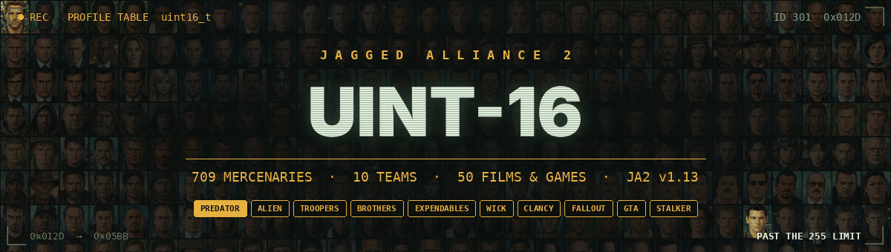
</p>

# Jagged Alliance 2 UINT-16 - ten teams, 709 mercenaries

<p align="center">
  <a href="https://github.com/OleksandrKhrashchevskyi/Jagged-Alliance-2-UINT-16/releases/latest"></a>
</p>

<p align="center">
  
  
  
  
  
  
  <a href="LICENSE"></a>
  <a href="https://discord.com/invite/Ku2H9Hf"></a>
  <a href="../../discussions"></a>
</p>

<p align="center">
  <a href="#about-the-mod">About</a> ·
  <a href="#getting-started">Getting started</a> ·
  <a href="#the-teams">Teams</a> ·
  <a href="#the-roster">Roster</a> ·
  <a href="#stats">Stats</a> ·
  <a href="#troubleshooting--faq">FAQ</a> ·
  <a href="#-community">Community</a>
</p>

**709 mercenaries in one game.** The Predator Team, The Alien Team, The Starship Troopers, Brothers in Arms, The Expendables, John Wick's Team, Tom Clancy's Team, The Fallout Shelter Team, The Grand Theft Auto Team and The S.T.A.L.K.E.R. Team — all ten squads on one laptop, all hireable in the same campaign. Stats are on the JA2 1.13 scale (0-100), the day rate is in dollars. Traits use the 1.13 new trait system.

**It's free.** No price, no ads, no sign-up. *Downloads are strictly for true fans only* — if you know who said "get to the chopper", what a marker is worth at the Continental, why the only good bug is a dead bug, what war never does and what Strelok had to kill, you qualify. 😏

> [!CAUTION]
> **Selling this mod is strictly forbidden!** The mod was created by a fan of **Jagged Alliance 2**, for the fans. It is free and must stay free: do not sell it, do not bundle it into paid packs and do not put it behind a paywall. If someone charged you for it, you were scammed. See [License](LICENSE).

> [!WARNING]
> **After downloading, check the files for viruses!** Before running any `.exe` you got from the internet — `ja2u16.exe` included — upload it to an online multi-engine scanner:
>
> - [MetaDefender](https://metadefender.com/) — scans the file with dozens of antivirus engines at once
> - [VirusTotal](https://www.virustotal.com/) — 70+ antivirus engines and URL/file reputation
> - [Hybrid Analysis](https://www.hybrid-analysis.com/) — scan plus sandbox run showing what the file does
> - [Jotti's malware scan](https://virusscan.jotti.org/) — free scan with a set of popular engines
>
> Get the mod only from the [Releases](../../releases) page of this repository. See [Security policy](SECURITY.md).

## 📑 Contents

<table align="center">
<tr>
<th>📖 About</th>
<th>🎖️ The teams</th>
<th>🆘 Help &amp; info</th>
</tr>
<tr valign="top">
<td>

[About the mod](#about-the-mod)<br>
[🔢 Why UINT-16](#-why-uint-16)<br>
[▶️ Getting started](#getting-started)<br>
[🔐 Verify the download](#verify-the-download-sha-256)<br>
[✅ Compatibility](#-compatibility)

</td>
<td>

[The teams](#the-teams)<br>
[🩸 Predator](#-the-predator-team) · [👾 Alien](#-the-alien-team)<br>
[🪲 Troopers](#-the-starship-troopers) · [🪖 Brothers](#-brothers-in-arms)<br>
[💥 Expendables](#-the-expendables-team) · [🪙 Wick](#-john-wicks-team)<br>
[🚨 Clancy](#-tom-clancys-team) · [☢️ Fallout](#-the-fallout-shelter-team)<br>
[🚗 GTA](#-the-grand-theft-auto-team) · [☣️ Stalker](#-the-stalker-team)<br>
[The roster](#the-roster) · [Stats](#stats) · [Screenshots](#screenshots)

</td>
<td>

[❓ Troubleshooting / FAQ](#troubleshooting--faq)<br>
[🐞 Reporting bugs](#reporting-bugs)<br>
[💬 Community](#-community)<br>
[📝 Changelog](#changelog)<br>
[🏅 Credits](#credits) · [License](#license) · [Disclaimer](#disclaimer)

</td>
</tr>
</table>

## About the mod

**Jagged Alliance 2 UINT-16** replaces A.I.M. and M.E.R.C. with ten mercenary outfits at once: **709 operators** from 49 films, games and a TV series plus the Rainbow units of Tom Clancy. All standard mercs are gone; the story of Arulco works as usual.

- 🎯 **709 operators** with stats, skill traits, day rates and starting kits based on their roles in the films and games. Leaders and veterans are at the top; recruits, civilians and the people who were just in the wrong place are where they belong.
- 🧑‍🤝‍🧑 **Ten teams** — The Predator Team (31), The Alien Team (58), The Starship Troopers (36), Brothers in Arms (46), The Expendables Team (56), John Wick's Team (59), Tom Clancy's Team (71), The Fallout Shelter Team (58), The Grand Theft Auto Team (227) and The S.T.A.L.K.E.R. Team (67).
- 🎒 **Five gear kits** for every operator — Standard plus four kits of their own, the last one Premium (the Premium kit costs 50% more).
- 🖼️ **A portrait for every merc** — 709 faces, see [the roster](#the-roster).
- 🧩 **Safe install**: the mod runs from its own `Data-UINT16` folder with its own `ja2u16.exe`; the stock `Data-1.13` is not touched.

### 🔢 Why UINT-16

The stock game keeps a merc's profile number in a single byte (`UINT8`), so it can never go past **255** profiles — and Arulco's own NPCs, rebels and story characters already take a good part of them. That is why every team so far came as its own separate mod.

This mod runs on **16-bit profile numbers (`UINT16`)**. The ceiling moves from 255 to 65,535, and all ten teams fit into one game side by side with the whole cast of Arulco. Every team has its own block of IDs:

<div align="center">

| 🩸 Predator | 👾 Alien | 🪲 Troopers | 🪖 Brothers | 💥 Expendables | 🪙 Wick | 🚨 Clancy | ☢️ Fallout | 🚗 GTA | ☣️ Stalker |
|:---:|:---:|:---:|:---:|:---:|:---:|:---:|:---:|:---:|:---:|
| `301-331` | `401-458` | `501-536` | `601-646` | `701-756` | `801-859` | `901-971` | `1001-1058` | `1101-1327` | `1401-1467` |

</div>

## Getting started

<p align="center">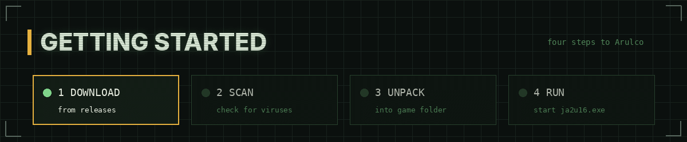</p>

You need **Jagged Alliance 2 v1.13**.

1. [Download](https://github.com/OleksandrKhrashchevskyi/Jagged-Alliance-2-UINT-16/releases/latest) `JA2-UINT16.zip` from the latest release.
2. **Scan the archive for viruses** (see the links above) and [verify the checksum](#verify-the-download-sha-256).
3. Unpack the archive into the game folder (the one that contains `ja2.exe`). No backup is needed: the mod runs from its own `Data-UINT16` folder and its own `ja2u16.exe`, and does not change the stock game files.
4. Start the game with **`ja2u16.exe`** and begin a **new game**. Saves from older versions of the mod are not compatible.

`README.txt` in the archive has the details.

### Verify the download (SHA-256)

Every release lists the SHA-256 checksum of its archive. Download the mod **only from this repository** and compare the checksum before unpacking it.
In PowerShell, in the folder with the downloaded file:

```powershell
Get-FileHash .\JA2-UINT16.zip -Algorithm SHA256
```

or in the Command Prompt:

```bat
certutil -hashfile JA2-UINT16.zip SHA256
```

If the value differs from the one in the release notes, **do not use the file** — it was changed by someone else.

## ✅ Compatibility

| Game | Status |
|---|---|
| **Jagged Alliance 2 v1.13** | ✅ Supported — the mod is made and tested for it. |
| **Jagged Alliance 2: Unfinished Business** | ⏳ Not yet — for now the mercenaries are only in JA2 v1.13; they have not been added to Unfinished Business yet. |
| Other mods — **Arulco Revisited**, **AIMNAS**, **SDO**, **Urban Chaos**, **Wildfire** and others | ❌ Not supported — the mod replaces A.I.M. and M.E.R.C. and does not work together with other mods. |
| [The Predator Team](https://github.com/OleksandrKhrashchevskyi/Jagged-Alliance-2-Mod-Predator-Squad), [The Alien Team](https://github.com/OleksandrKhrashchevskyi/Jagged-Alliance-2-Mod-Alien-Squad) | ℹ️ Already inside — no need to install them on top. |
| Original JA2 (without v1.13), JA2 Stracciatella | ❌ Not supported — the mod needs v1.13. |

Saves from older versions of the mod do not work in newer ones — start a new game after updating. The mod works only with a clean **Jagged Alliance 2 v1.13** — do not install it on top of other mods.

## The teams

<p align="center">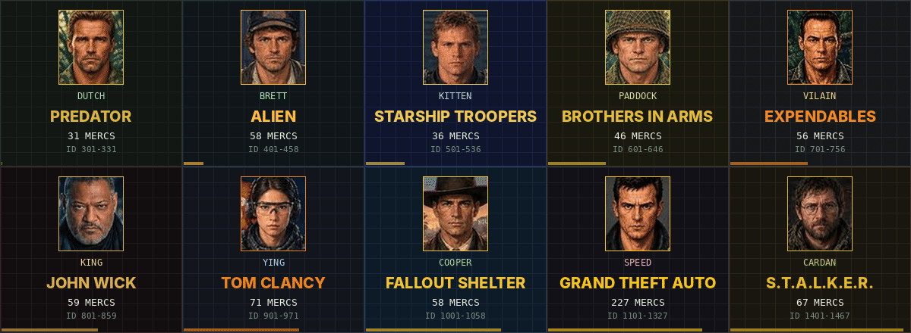</p>

<div align="center">

| | Team | From | Mercs | IDs | Avg level | Avg stats | Day rates | Dossiers |
|:---:|:---|:---|:---:|:---:|:---:|:---:|:---:|:---:|
| 🩸 | [**The Predator Team**](#-the-predator-team) | 4 films | **31** | 301-331 | 6.1 | 65.6 | $1,800 - $8,500 | [open](docs/characters/predator.md) |
| 👾 | [**The Alien Team**](#-the-alien-team) | 7 films | **58** | 401-458 | 4.0 | 60.2 | $350 - $5,000 | [open](docs/characters/alien.md) |
| 🪲 | [**The Starship Troopers**](#-the-starship-troopers) | 3 films | **36** | 501-536 | 4.5 | 60.1 | $400 - $6,000 | [open](docs/characters/troopers.md) |
| 🪖 | [**Brothers in Arms**](#-brothers-in-arms) | 3 games | **46** | 601-646 | 4.2 | 58.7 | $600 - $4,500 | [open](docs/characters/bia.md) |
| 💥 | [**The Expendables Team**](#-the-expendables-team) | 4 films | **56** | 701-756 | 7.1 | 65.9 | $2,200 - $7,500 | [open](docs/characters/expendables.md) |
| 🪙 | [**John Wick's Team**](#-john-wicks-team) | 4 films | **59** | 801-859 | 5.8 | 61.2 | $500 - $11,000 | [open](docs/characters/johnwick.md) |
| 🚨 | [**Tom Clancy's Team**](#-tom-clancys-team) | 8 roles | **71** | 901-971 | 6.4 | 68.7 | $3,600 - $7,850 | [open](docs/characters/clancy.md) |
| ☢️ | [**The Fallout Shelter Team**](#-the-fallout-shelter-team) | 5 games + TV | **58** | 1001-1058 | 4.8 | 61.9 | $300 - $5,500 | [open](docs/characters/fallout.md) |
| 🚗 | [**The Grand Theft Auto Team**](#-the-grand-theft-auto-team) | 15 games | **227** | 1101-1327 | 5.0 | 58.8 | $300 - $6,200 | [open](docs/characters/gta.md) |
| ☣️ | [**The S.T.A.L.K.E.R. Team**](#-the-stalker-team) | 3 games | **67** | 1401-1467 | 6.4 | 66.3 | $1,000 - $6,300 | [open](docs/characters/stalker.md) |
| | **All teams** | 50 films & games | **709** | 301-1467 | 5.4 | 62.0 | $300 - $11,000 | |

</div>

Every team has its own dossier page with a portrait, the full stats, traits, rates and all five kits of every merc — press **open** in the table, or the header of a team below.

### 🩸 The Predator Team

<a href="docs/characters/predator.md"></a>

Dutch's rescue team in the jungle, Harrigan's LAPD in the heat of 1997, the hunted of the game preserve planet and the Loonies of 2018. **31 mercs**, ID 301-331. 📂 [All dossiers with full stats and kits →](docs/characters/predator.md)

<details>
<summary><b>Predator 1987</b> · 7 mercs · Dutch, Mac, Blain, Billy, Poncho, Hawkins …</summary>

<div align="center">

| | ID | Name | Role | Lvl | Day rate | Traits |
|:---:|:---:|:---:|:---:|:---:|:---:|:---:|
|  | 301 | **Dutch**<br><sub>Alan "Dutch" Schaefer</sub> | Major. Team leader, rescue specialist. | 9 | $8,500 | Squadleader, Stealthy, Survival |
|  | 302 | **Mac**<br><sub>Mac Eliot</sub> | Sergeant. Machine gunner, Blain's best friend. | 7 | $5,000 | Auto Weapons, Melee, Night Ops |
|  | 303 | **Blain**<br><sub>Blain Cooper</sub> | Sergeant. Heavy weapons, minigun. | 7 | $4,800 | Heavy Weapons, Auto Weapons, Bodybuilding |
|  | 304 | **Billy**<br><sub>Billy Sole</sub> | Scout and tracker. | 8 | $5,800 | Ranger, Scouting, Melee |
|  | 305 | **Poncho**<br><sub>Jorge "Poncho" Ramirez</sub> | Grenadier, interpreter. | 7 | $4,600 | Heavy Weapons, Demolitions, Throwing |
|  | 306 | **Hawkins**<br><sub>Rick Hawkins</sub> | Radio operator, technician. | 6 | $3,500 | Technician, Radio Operator, Scouting |
|  | 307 | **Dillon**<br><sub>Al Dillon</sub> | CIA officer, old friend of Dutch. | 7 | $5,500 | Auto Weapons, Covert Ops, Athletics |

</div>

</details>

<details>
<summary><b>Predator 1990</b> · 7 mercs · Harrigan, Leona, Danny, Lambert, Keyes, Willie …</summary>

<div align="center">

| | ID | Name | Role | Lvl | Day rate | Traits |
|:---:|:---:|:---:|:---:|:---:|:---:|:---:|
|  | 308 | **Harrigan**<br><sub>Mike Harrigan</sub> | LAPD lieutenant. Stubborn, fearless leader. | 8 | $7,000 | Squadleader, Gunslinger, Athletics |
|  | 309 | **Leona**<br><sub>Leona Cantrell</sub> | LAPD detective. Tough, fast with a SMG. | 5 | $3,200 | Gunslinger, Athletics, Auto Weapons |
|  | 310 | **Danny**<br><sub>Danny Archuleta</sub> | LAPD detective. Harrigan's oldest friend. | 4 | $2,400 | Gunslinger, Scouting, Athletics |
|  | 311 | **Lambert**<br><sub>Jerry Lambert</sub> | LAPD detective. Cocky newcomer with a shiny pistol. | 5 | $2,800 | Gunslinger, Bodybuilding, Melee |
|  | 312 | **Keyes**<br><sub>Peter Keyes</sub> | Federal agent. Head of a special task force. | 6 | $5,000 | Squadleader, Technician, Night Ops |
|  | 313 | **Willie**<br><sub>King Willie</sub> | Gang boss and mystic. Sees what others miss. | 4 | $2,500 | Squadleader, Scouting, Covert Ops |
|  | 314 | **Heinemann**<br><sub>Phil Heinemann</sub> | LAPD deputy chief. Commander and organiser. | 4 | $2,600 | Squadleader, Radio Operator, Teaching |

</div>

</details>

<details>
<summary><b>Predators 2010</b> · 9 mercs · Royce, Isabelle, Edwin, Stans, Noland, Cuchillo …</summary>

<div align="center">

| | ID | Name | Role | Lvl | Day rate | Traits |
|:---:|:---:|:---:|:---:|:---:|:---:|:---:|
|  | 315 | **Royce** | Mercenary leader, ex-special forces. | 8 | $7,000 | Auto Weapons, Survival, Stealthy |
|  | 316 | **Isabelle** | IDF sniper. | 7 | $6,000 | Sniper, Sniper, Stealthy |
|  | 317 | **Edwin** | Doctor. | 3 | $2,500 | Doctor, Doctor |
|  | 318 | **Stans**<br><sub>Walter Stans</sub> | Death row convict. | 4 | $1,800 | Martial Arts, Melee, Bodybuilding |
|  | 319 | **Noland**<br><sub>Ronald Noland</sub> | Survivor of earlier hunts. | 7 | $4,500 | Ranger, Survival, Stealthy |
|  | 320 | **Cuchillo** | Cartel enforcer. | 5 | $2,800 | Auto Weapons, Ambidextrous, Melee |
|  | 321 | **Nikolai** | Spetsnaz soldier, heavy weapons. | 7 | $5,200 | Heavy Weapons, Auto Weapons, Bodybuilding |
|  | 322 | **Hanzo** | Yakuza enforcer, swordsman. | 7 | $4,800 | Martial Arts, Melee, Stealthy |
|  | 323 | **Mombasa** | Death squad officer. | 7 | $5,000 | Auto Weapons, Athletics, Night Ops |

</div>

</details>

<details>
<summary><b>The Predator 2018</b> · 8 mercs · Quinn, Nebraska, Baxley, Coyle, Lynch, Nettles …</summary>

<div align="center">

| | ID | Name | Role | Lvl | Day rate | Traits |
|:---:|:---:|:---:|:---:|:---:|:---:|:---:|
|  | 324 | **Quinn**<br><sub>Quinn McKenna</sub> | Army Ranger sniper. Leader of the "Loonies". | 8 | $7,500 | Sniper, Stealthy, Survival |
|  | 325 | **Nebraska**<br><sub>Nebraska Williams</sub> | Veteran soldier. Quinn's right hand. | 7 | $5,200 | Auto Weapons, Melee, Athletics |
|  | 326 | **Baxley** | Ex-soldier. Rifleman, nervous tic, foul mouth. | 6 | $3,800 | Auto Weapons, Throwing, Bodybuilding |
|  | 327 | **Coyle** | Ex-soldier. Squad joker, Baxley's best friend. | 6 | $3,600 | Auto Weapons, Throwing, Athletics |
|  | 328 | **Lynch** | Ex-soldier. Card sharp and demolitions man. | 6 | $3,800 | Technician, Demolitions, Ambidextrous |
|  | 329 | **Nettles** | Former military helicopter pilot. | 5 | $3,200 | Technician, Radio Operator, Scouting |
|  | 330 | **Casey**<br><sub>Casey Bracket</sub> | Evolutionary biologist. Science advisor. | 3 | $2,600 | Doctor, Teaching, Survival |
|  | 331 | **Traeger**<br><sub>Will Traeger</sub> | Government agent. Head of a secret program. | 6 | $5,500 | Squadleader, Covert Ops, Radio Operator |

</div>

</details>

### 👾 The Alien Team

<a href="docs/characters/alien.md"></a>

The Nostromo crew, the Colonial Marines, the inmates of Fiorina 161, the smugglers of the Betty and the crews of Prometheus, Covenant and Romulus. **58 mercs**, ID 401-458. 📂 [All dossiers with full stats and kits →](docs/characters/alien.md)

<details>
<summary><b>Alien 1979</b> · 6 mercs · Dallas, Ripley, Kane, Lambert, Parker, Brett</summary>

<div align="center">

| | ID | Name | Role | Lvl | Day rate | Traits |
|:---:|:---:|:---:|:---:|:---:|:---:|:---:|
|  | 401 | **Dallas**<br><sub>Arthur Dallas</sub> | Captain of the Nostromo. Calm, careful, decides for the crew. | 3 | $1,950 | Squadleader, Ranger, Scouting |
|  | 402 | **Ripley**<br><sub>Ellen Ripley</sub> | Warrant officer. By the book, stubborn, very hard to kill. | 5 | $3,200 | Survival, Squadleader, Technician |
|  | 403 | **Kane**<br><sub>Gilbert Kane</sub> | Executive officer. First through every door. | 3 | $1,700 | Scouting, Ranger, Athletics |
|  | 404 | **Lambert**<br><sub>Joan Lambert</sub> | Navigator. Knows the way home, wants to take it now. | 3 | $1,550 | Radio Operator, Technician, Scouting |
|  | 405 | **Parker**<br><sub>Dennis Parker</sub> | Chief engineer. Wants his full share - and earns it. | 4 | $2,600 | Technician, Heavy Weapons, Bodybuilding |
|  | 406 | **Brett**<br><sub>Samuel Brett</sub> | Engineering technician. Steady hands, few words. | 3 | $1,400 | Technician, Technician |

</div>

</details>

<details>
<summary><b>Aliens 1986</b> · 8 mercs · Ripley, Hicks, Burke, Hudson, Apone, Vasquez …</summary>

<div align="center">

| | ID | Name | Role | Lvl | Day rate | Traits |
|:---:|:---:|:---:|:---:|:---:|:---:|:---:|
|  | 407 | **Ripley**<br><sub>Ellen Ripley</sub> | Survivor of the Nostromo. Back for the colony - and the girl. | 6 | $4,200 | Auto Weapons, Squadleader, Survival |
|  | 408 | **Hicks**<br><sub>Dwayne Hicks</sub> | Corporal. Quiet, steady - takes command when it matters. | 7 | $4,800 | Auto Weapons, Squadleader, Night Ops |
|  | 409 | **Burke**<br><sub>Carter Burke</sub> | Company man. Smiles a lot. Never turn your back on him. | 3 | $1,800 | Covert Ops, Snitch, Radio Operator |
|  | 410 | **Hudson**<br><sub>William Hudson</sub> | Private. Big mouth, fast hands - game over, man. | 5 | $3,000 | Auto Weapons, Athletics, Radio Operator |
|  | 411 | **Apone**<br><sub>Al Apone</sub> | Master sergeant. Twenty years in the corps, chews cigars. | 7 | $5,000 | Squadleader, Auto Weapons, Bodybuilding |
|  | 412 | **Vasquez**<br><sub>Jenette Vasquez</sub> | Smartgunner. Tougher than anybody in the room. | 6 | $4,500 | Auto Weapons, Auto Weapons, Bodybuilding |
|  | 413 | **Gorman**<br><sub>William Gorman</sub> | Lieutenant. New in command, by the book. | 4 | $2,350 | Radio Operator, Scouting, Teaching |
|  | 414 | **Drake**<br><sub>Mark Drake</sub> | Smartgunner. Vasquez's partner, says little, shoots a lot. | 5 | $3,200 | Auto Weapons, Bodybuilding, Heavy Weapons |

</div>

</details>

<details>
<summary><b>Alien 1992</b> · 6 mercs · Ripley, Dillon, Clemens, Golic, Andrews, Aaron</summary>

<div align="center">

| | ID | Name | Role | Lvl | Day rate | Traits |
|:---:|:---:|:---:|:---:|:---:|:---:|:---:|
|  | 415 | **Ripley**<br><sub>Ellen Ripley</sub> | Sole survivor of the Sulaco. No illusions left. | 6 | $3,800 | Squadleader, Survival, Athletics |
|  | 416 | **Dillon** | Spiritual leader of the inmates. Feared, respected, unbreakable. | 4 | $2,700 | Squadleader, Melee, Bodybuilding |
|  | 417 | **Clemens**<br><sub>Jonathan Clemens</sub> | Prison doctor. Clever, tired, carries his own past. | 4 | $3,000 | Doctor, Doctor, Survival |
|  | 418 | **Golic** | Inmate. Damaged, unpredictable, sees the beast as a dragon. | 3 | $1,200 | Melee, Stealthy, Bodybuilding |
|  | 419 | **Andrews**<br><sub>Harold Andrews</sub> | Prison superintendent. Rules are rules - until they stop working. | 3 | $2,150 | Squadleader, Teaching, Radio Operator |
|  | 420 | **Aaron** | Assistant superintendent. IQ 85 - and more loyal than anybody. | 3 | $1,500 | Radio Operator, Technician, Scouting |

</div>

</details>

<details>
<summary><b>Resurrection 1997</b> · 10 mercs · Elgin, Johner, Kristie, Vriess, Hillard, Perez …</summary>

<div align="center">

| | ID | Name | Role | Lvl | Day rate | Traits |
|:---:|:---:|:---:|:---:|:---:|:---:|:---:|
|  | 421 | **Elgin**<br><sub>Frank Elgin</sub> | Captain of the Betty. Smuggler, mercenary, businessman. | 6 | $3,600 | Squadleader, Auto Weapons, Covert Ops |
|  | 422 | **Johner** | Muscle of the Betty. Loud, rude and very hard to kill. | 6 | $3,800 | Heavy Weapons, Auto Weapons, Bodybuilding |
|  | 423 | **Kristie** | Gunman of the Betty. Two pistols on his arms, never misses. | 7 | $4,400 | Ambidextrous, Gunslinger, Athletics |
|  | 424 | **Vriess**<br><sub>Gary Vriess</sub> | Mechanic of the Betty. Never lets the wheelchair stop him. | 5 | $2,600 | Technician, Demolitions, Radio Operator |
|  | 425 | **Hillard**<br><sub>Sabra Hillard</sub> | Pilot of the Betty. Elgin's partner. | 4 | $2,000 | Radio Operator, Technician, Athletics |
|  | 426 | **Perez**<br><sub>Martin Perez</sub> | General. Commander of the USM Auriga. | 6 | $3,800 | Squadleader, Teaching, Radio Operator |
|  | 427 | **Wren**<br><sub>Mason Wren</sub> | Chief scientist of the Auriga's project. | 3 | $2,150 | Doctor, Snitch, Covert Ops |
|  | 428 | **Gediman**<br><sub>Jonathan Gediman</sub> | Scientist of the Auriga. Loves his specimens. | 3 | $2,200 | Doctor, Doctor |
|  | 429 | **DiStefano**<br><sub>Vincent DiStefano</sub> | Soldier of the Auriga. The last one alive. | 5 | $3,000 | Auto Weapons, Athletics, Night Ops |
|  | 430 | **Purvis**<br><sub>Larry Purvis</sub> | Miner. Woke up with something inside him. | 3 | $1,400 | Bodybuilding, Melee, Survival |

</div>

</details>

<details>
<summary><b>Prometheus 2012</b> · 9 mercs · Shaw, Vickers, Weyland, Holloway, Janek, Fifield …</summary>

<div align="center">

| | ID | Name | Role | Lvl | Day rate | Traits |
|:---:|:---:|:---:|:---:|:---:|:---:|:---:|
|  | 431 | **Shaw**<br><sub>Elizabeth Shaw</sub> | Archaeologist. A believer who survives what kills everybody else. | 4 | $2,500 | Survival, Scouting, Doctor |
|  | 432 | **Vickers**<br><sub>Meredith Vickers</sub> | Company mission director. Cold, in charge, with her own way out. | 3 | $2,400 | Squadleader, Athletics, Radio Operator |
|  | 433 | **Weyland**<br><sub>Peter Weyland</sub> | Founder of the company. Came all this way to ask for more time. | 2 | $2,050 | Squadleader, Teaching, Radio Operator |
|  | 434 | **Holloway**<br><sub>Charlie Holloway</sub> | Archaeologist. Wants the answers now. | 3 | $1,950 | Scouting, Survival, Athletics |
|  | 435 | **Janek** | Captain of the Prometheus. Calm, practical, decides fast. | 5 | $3,350 | Squadleader, Radio Operator, Technician |
|  | 436 | **Fifield** | Geologist. Hates the job, loves his mapping drones. | 3 | $1,800 | Demolitions, Technician, Scouting |
|  | 437 | **Millburn** | Biologist. Too friendly with strange animals. | 3 | $1,550 | Doctor, Survival, Scouting |
|  | 438 | **Ravel** | Co-pilot. Jokes a lot, flies very well. | 4 | $2,000 | Technician, Radio Operator, Athletics |
|  | 439 | **Ford** | Medical officer. Quiet and steady. | 3 | $2,150 | Doctor, Doctor, Survival |

</div>

</details>

<details>
<summary><b>Covenant 2017</b> · 14 mercs · Daniels, Oram, Tennessee, Karin, Maggie, Ricks …</summary>

<div align="center">

| | ID | Name | Role | Lvl | Day rate | Traits |
|:---:|:---:|:---:|:---:|:---:|:---:|:---:|
|  | 440 | **Daniels**<br><sub>Daniels Branson</sub> | Terraforming expert. Lost her husband on the first day - and kept going. | 6 | $3,800 | Survival, Auto Weapons, Squadleader |
|  | 441 | **Oram**<br><sub>Christopher Oram</sub> | First mate, captain by accident. A man of faith with doubts. | 3 | $2,150 | Squadleader, Teaching, Radio Operator |
|  | 442 | **Tennessee**<br><sub>Tennessee Faris</sub> | Chief pilot. Steady hands, big heart. | 4 | $2,500 | Technician, Radio Operator, Athletics |
|  | 443 | **Karin**<br><sub>Karin Oram</sub> | Biologist. Married to the captain. | 3 | $1,800 | Doctor, Survival, Scouting |
|  | 444 | **Maggie**<br><sub>Maggie Faris</sub> | Lander pilot. Married to Tennessee. | 3 | $1,800 | Technician, Athletics, Radio Operator |
|  | 445 | **Ricks** | Navigator. Quick with a joke. | 3 | $1,700 | Radio Operator, Scouting, Technician |
|  | 446 | **Upworth** | Medic and radio man. A calm voice on the line. | 3 | $1,800 | Doctor, Radio Operator, Survival |
|  | 447 | **Branson**<br><sub>Jacob Branson</sub> | Captain of the Covenant. Died before the job began. | 3 | $2,350 | Squadleader, Radio Operator, Scouting |
|  | 448 | **Lope** | Sergeant. Leads the security team. | 6 | $4,200 | Squadleader, Auto Weapons, Bodybuilding |
|  | 449 | **Hallett** | Sergeant. Lope's partner. | 4 | $2,650 | Auto Weapons, Bodybuilding, Athletics |
|  | 450 | **Rosenthal** | Corporal. Sharp-eyed and quiet. | 4 | $2,600 | Auto Weapons, Stealthy, Scouting |
|  | 451 | **Ledward** | Private. The first to fall ill. | 3 | $2,050 | Auto Weapons, Athletics, Survival |
|  | 452 | **Cole** | Private. Big gun, few words. | 4 | $2,300 | Auto Weapons, Heavy Weapons, Bodybuilding |
|  | 453 | **Ankor** | Private. Fast and loud. | 3 | $2,200 | Auto Weapons, Demolitions, Athletics |

</div>

</details>

<details>
<summary><b>Romulus 2024</b> · 5 mercs · Rain, Tyler, Kay, Bjorn, Navarro</summary>

<div align="center">

| | ID | Name | Role | Lvl | Day rate | Traits |
|:---:|:---:|:---:|:---:|:---:|:---:|:---:|
|  | 454 | **Rain**<br><sub>Rain Carradine</sub> | Orphan miner. Wants out of the colony - and gets out. | 4 | $2,550 | Survival, Auto Weapons, Stealthy |
|  | 455 | **Tyler** | Miner. Rain's ex. The plan was his. | 3 | $2,000 | Squadleader, Athletics, Scouting |
|  | 456 | **Kay** | Tyler's younger sister. Pregnant, and scared. | 1 | $350 | Survival, Stealthy |
|  | 457 | **Bjorn** | Tyler's cousin. Hot-headed, hates synthetics. | 3 | $1,750 | Athletics, Melee, Bodybuilding |
|  | 458 | **Navarro** | Pilot and mechanic of the Corbelan. | 3 | $1,900 | Technician, Radio Operator, Athletics |

</div>

</details>

### 🪲 The Starship Troopers

<a href="docs/characters/troopers.md">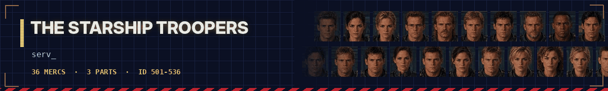</a>

The Roughnecks of 1997, Dax's squad on planet OM-1 and the Marauder pilots - the Mobile Infantry against the Bugs. **36 mercs**, ID 501-536. 📂 [All dossiers with full stats and kits →](docs/characters/troopers.md)

<details>
<summary><b>Starship Troopers 1997</b> · 13 mercs · Rico, Dizzy, Carmen, Jenkins, Rasczak, Ace …</summary>

<div align="center">

| | ID | Name | Role | Lvl | Day rate | Traits |
|:---:|:---:|:---:|:---:|:---:|:---:|:---:|
|  | 501 | **Rico**<br><sub>Johnny Rico</sub> | Mobile Infantry. Lieutenant of the Roughnecks. | 4 | $1,950 | Squadleader, Auto Weapons, Athletics |
| 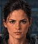 | 502 | **Dizzy**<br><sub>Dizzy Flores</sub> | Mobile Infantry. Football star, never quits. | 4 | $1,700 | Auto Weapons, Athletics, Melee |
| 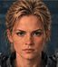 | 503 | **Carmen**<br><sub>Carmen Ibanez</sub> | Fleet pilot. Top of her class, steady hands. | 4 | $1,550 | Technician, Radio Operator, Scouting |
|  | 504 | **Jenkins**<br><sub>Carl Jenkins</sub> | Military Intelligence. Psychic, colonel, cold. | 5 | $2,450 | Covert Ops, Radio Operator, Snitch |
|  | 505 | **Rasczak**<br><sub>Jean Rasczak</sub> | Lieutenant of the Roughnecks. Teacher, veteran. | 7 | $4,200 | Squadleader, Squadleader, Teaching |
|  | 506 | **Ace**<br><sub>Ace Levy</sub> | Mobile Infantry. Loud, strong, plays the fiddle. | 3 | $1,200 | Auto Weapons, Bodybuilding, Melee |
| 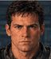 | 507 | **Zander**<br><sub>Zander Barcalow</sub> | Fleet pilot. Handsome, fearless, a bit too sure. | 4 | $1,650 | Technician, Night Ops, Athletics |
|  | 508 | **Zim**<br><sub>Career Sergeant Zim</sub> | Career Sergeant. Drill instructor, knife expert. | 7 | $3,800 | Martial Arts, Teaching, Throwing |
| 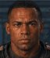 | 509 | **Sugar**<br><sub>Sugar Watkins</sub> | Roughneck. Big gun, big heart. | 4 | $1,700 | Auto Weapons, Heavy Weapons, Bodybuilding |
|  | 510 | **Shujumi** | Mobile Infantry. Quiet, fast with a blade. | 3 | $1,100 | Auto Weapons, Stealthy, Athletics |
|  | 511 | **Kitten**<br><sub>Kitten Smith</sub> | Mobile Infantry. Youngest of the squad. | 2 | $700 | Auto Weapons, Athletics, Scouting |
|  | 512 | **Breck**<br><sub>Breckinridge</sub> | Mobile Infantry. Tough recruit, no luck. | 2 | $750 | Auto Weapons, Melee, Bodybuilding |
| 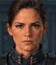 | 513 | **Deladier**<br><sub>Captain Deladier</sub> | Fleet. Captain of the corvette Rodger Young. | 5 | $2,550 | Squadleader, Technician, Radio Operator |

</div>

</details>

<details>
<summary><b>Hero of the Federation 2004</b> · 13 mercs · Dax, Sahara, Dill, Rake, Soda, Sandee …</summary>

<div align="center">

| | ID | Name | Role | Lvl | Day rate | Traits |
|:---:|:---:|:---:|:---:|:---:|:---:|:---:|
|  | 514 | **Dax**<br><sub>Captain V.J. Dax</sub> | Disgraced captain. Sniper. Works alone. | 7 | $4,800 | Sniper, Sniper, Squadleader |
|  | 515 | **Sahara**<br><sub>Lei Sahara</sub> | Medic and scout. Feels what is coming. | 4 | $1,800 | Doctor, Scouting, Night Ops |
|  | 516 | **Dill**<br><sub>Pavlov Dill</sub> | Lieutenant. Fast, aggressive, wants command. | 5 | $2,200 | Auto Weapons, Auto Weapons, Athletics |
| 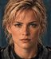 | 517 | **Rake**<br><sub>Dede Rake</sub> | Sergeant. Veteran gunner, holds the line. | 6 | $3,000 | Heavy Weapons, Auto Weapons, Bodybuilding |
| 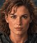 | 518 | **Soda**<br><sub>Charlie Soda</sub> | Private. A born instructor. | 5 | $2,400 | Squadleader, Teaching, Athletics |
|  | 519 | **Sandee**<br><sub>Jill Sandee</sub> | Private. Two guns, close quarters. | 4 | $1,850 | Gunslinger, Ambidextrous, Athletics |
| 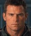 | 520 | **Griff**<br><sub>Joe Griff</sub> | Corporal. The squad's muscle and medic. | 5 | $2,250 | Martial Arts, Martial Arts, Bodybuilding |
|  | 521 | **Kobe**<br><sub>Thom Kobe</sub> | Corporal. Grenades and knives. | 4 | $1,650 | Heavy Weapons, Throwing, Athletics |
|  | 522 | **Peck**<br><sub>Ari Peck</sub> | Tech sergeant. Fixes anything, opens anything. | 5 | $2,800 | Technician, Technician, Radio Operator |
| 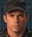 | 523 | **Horton**<br><sub>Duff Horton</sub> | Private. Scout, quiet killer. | 4 | $1,700 | Covert Ops, Stealthy, Melee |
| 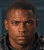 | 524 | **Brick**<br><sub>Ottis Brick</sub> | Private. Demolitions, mines, walls. | 4 | $1,800 | Heavy Weapons, Demolitions, Bodybuilding |
|  | 525 | **Otter**<br><sub>Billie Otter</sub> | Private. Steady rifleman. | 3 | $1,000 | Auto Weapons, Ranger, Survival |
|  | 526 | **Tor**<br><sub>Kipper Tor</sub> | Private. Machine gun on the high ground. | 3 | $1,150 | Auto Weapons, Auto Weapons, Scouting |

</div>

</details>

<details>
<summary><b>Marauder 2008</b> · 10 mercs · Rico, Hauser, Beck, Anoke, Holly, Brittles …</summary>

<div align="center">

| | ID | Name | Role | Lvl | Day rate | Traits |
|:---:|:---:|:---:|:---:|:---:|:---:|:---:|
| 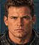 | 527 | **Rico**<br><sub>Johnny Rico</sub> | Colonel. Veteran of the Bug War, Marauder pilot. | 8 | $6,000 | Squadleader, Squadleader, Bodybuilding |
|  | 528 | **Hauser**<br><sub>General Dix Hauser</sub> | General. Hits first, thinks later. | 7 | $4,000 | Martial Arts, Auto Weapons, Athletics |
| 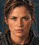 | 529 | **Beck**<br><sub>Captain Lola Beck</sub> | Fleet captain and pilot. Gets people home. | 6 | $3,000 | Squadleader, Technician, Survival |
| 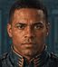 | 530 | **Anoke**<br><sub>Omar Anoke</sub> | Sky Marshal. Speaks well, fights badly. | 5 | $2,300 | Squadleader, Teaching, Radio Operator |
| 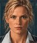 | 531 | **Holly**<br><sub>Holly Little</sub> | Civilian. Lucky, cheerful, a survivor. | 1 | $400 | Teaching, Athletics |
|  | 532 | **Brittles**<br><sub>Chief Bull Brittles</sub> | Chief engineer. Built like a tank. | 5 | $2,250 | Martial Arts, Heavy Weapons, Bodybuilding |
| 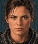 | 533 | **Manion**<br><sub>Link Manion</sub> | Lieutenant. Launchers and charges. | 5 | $2,400 | Heavy Weapons, Heavy Weapons, Demolitions |
| 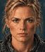 | 534 | **Sunday**<br><sub>Sergeant A. Sunday</sub> | Sergeant. Sniper, patient, precise. | 5 | $2,700 | Sniper, Sniper, Stealthy |
| 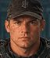 | 535 | **Skinner**<br><sub>Slug Skinner</sub> | Private. Mechanic and gunner. | 3 | $1,200 | Technician, Auto Weapons, Athletics |
| 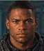 | 536 | **Hightower**<br><sub>Sergeant M. Hightower</sub> | Sergeant. Holds what we take. | 4 | $1,200 | Auto Weapons, Bodybuilding, Survival |

</div>

</details>

### 🪖 Brothers in Arms

<a href="docs/characters/bia.md"></a>

Baker's and Red's paratroopers of the 502nd PIR - from the hedgerows of Normandy to the road through Holland. **46 mercs**, ID 601-646. 📂 [All dossiers with full stats and kits →](docs/characters/bia.md)

<details>
<summary><b>Road to Hill 30</b> · 13 mercs · Baker, Mac, Red, Leggett, Corrion, Obi …</summary>

<div align="center">

| | ID | Name | Role | Lvl | Day rate | Traits |
|:---:|:---:|:---:|:---:|:---:|:---:|:---:|
|  | 601 | **Baker**<br><sub>Matthew Baker</sub> | Sergeant. Leader of the 3rd Squad. | 5 | $2,600 | Squadleader, Ranger, Athletics |
|  | 602 | **Mac**<br><sub>Greg Hassay</sub> | Staff Sergeant. Platoon sergeant, Baker's mentor. | 6 | $3,200 | Squadleader, Squadleader, Teaching |
|  | 603 | **Red**<br><sub>Joseph Hartsock</sub> | Corporal. Fire team leader with the BAR. | 5 | $2,300 | Auto Weapons, Squadleader, Survival |
|  | 604 | **Leggett**<br><sub>Kevin Leggett</sub> | Private first class. Radioman, the youngest. | 2 | $600 | Radio Operator, Scouting |
|  | 605 | **Corrion**<br><sub>Sam Corrion</sub> | Corporal. Assault team leader, calm head. | 4 | $1,750 | Auto Weapons, Teaching |
|  | 606 | **Obi**<br><sub>Stephan Obrieski</sub> | Private first class. Polish volunteer with the BAR. | 3 | $1,250 | Auto Weapons, Auto Weapons, Bodybuilding |
|  | 607 | **Desola**<br><sub>Michael Desola</sub> | Private. Philadelphia, cheerful and brave. | 3 | $1,000 | Auto Weapons, Athletics |
|  | 608 | **Garnett**<br><sub>Michael Garnett</sub> | Private. Kentucky rifleman, Allen's best friend. | 3 | $1,050 | Ranger, Survival |
|  | 609 | **Allen**<br><sub>Larry Allen</sub> | Private. Sharp tongue, sharp eyes. | 3 | $1,150 | Ranger, Scouting |
|  | 610 | **Zano**<br><sub>Thomas Zanovich</sub> | Private first class. Former Foreign Legionnaire. | 5 | $2,000 | Ranger, Melee, Survival |
|  | 611 | **Courtland**<br><sub>Jack Courtland</sub> | Private first class. The ballplayer. | 2 | $700 | Throwing, Athletics |
|  | 612 | **Rivas**<br><sub>Johnny Rivas</sub> | Private. The artist with a sketchbook. | 2 | $700 | Scouting, Stealthy |
|  | 613 | **Muzza**<br><sub>David Muzza</sub> | Private. The squad's joker. | 2 | $600 | Auto Weapons, Athletics |

</div>

</details>

<details>
<summary><b>Earned in Blood</b> · 20 mercs · Red, Marshall, Paddock, McConnel, Campbell, Paige …</summary>

<div align="center">

| | ID | Name | Role | Lvl | Day rate | Traits |
|:---:|:---:|:---:|:---:|:---:|:---:|:---:|
|  | 614 | **Red**<br><sub>Joseph Hartsock</sub> | Sergeant. Leader of the 2nd Squad. | 6 | $2,800 | Squadleader, Auto Weapons, Heavy Weapons |
|  | 615 | **Marshall**<br><sub>S.L.A. Marshall</sub> | Colonel. The Army's combat historian. | 4 | $1,600 | Teaching, Snitch |
|  | 616 | **Paddock**<br><sub>Franklin Paddock</sub> | Corporal. Assault team leader, "Mr. Deathwish". | 4 | $1,900 | Auto Weapons, Squadleader, Athletics |
|  | 617 | **McConnel**<br><sub>Derrick McConnel</sub> | Private. Assault team, Paige's friend. | 3 | $950 | Athletics, Stealthy |
|  | 618 | **Campbell**<br><sub>Jacob Campbell</sub> | Corporal. Fire team rifleman, the loud one. | 4 | $1,400 | Ranger, Athletics |
|  | 619 | **Paige**<br><sub>William Paige</sub> | Private first class. The hothead with a Thompson. | 2 | $750 | Auto Weapons, Melee |
|  | 620 | **Doyle**<br><sub>Seamus Doyle</sub> | Sergeant, 82nd Airborne. Red's friend from the other division. | 5 | $2,100 | Auto Weapons, Ranger, Squadleader |
|  | 621 | **Cassidy**<br><sub>Patrick Cassidy</sub> | Lieutenant Colonel. 1st Battalion, 502nd. | 7 | $4,200 | Squadleader, Squadleader, Teaching |
|  | 622 | **Cole**<br><sub>Robert Cole</sub> | Lieutenant Colonel. 3rd Battalion, 502nd. | 7 | $4,500 | Squadleader, Squadleader, Melee |
|  | 623 | **Mac**<br><sub>Greg Hassay</sub> | Staff Sergeant. Platoon sergeant of Baker and Red. | 6 | $3,200 | Squadleader, Squadleader, Teaching |
|  | 624 | **Baker**<br><sub>Matthew Baker</sub> | Sergeant. 3rd Squad, Red's best friend. | 6 | $2,900 | Squadleader, Ranger, Athletics |
|  | 625 | **Leggett**<br><sub>Kevin Leggett</sub> | Private first class. The platoon's radioman. | 3 | $700 | Radio Operator, Scouting |
|  | 626 | **Corrion**<br><sub>Sam Corrion</sub> | Corporal. Assault team leader of the 3rd Squad. | 5 | $1,900 | Auto Weapons, Teaching |
|  | 627 | **Obi**<br><sub>Stephan Obrieski</sub> | Private first class. Polish volunteer with the BAR. | 4 | $1,400 | Auto Weapons, Auto Weapons, Bodybuilding |
|  | 628 | **Desola**<br><sub>Michael Desola</sub> | Private. Philadelphia, cheerful and brave. | 4 | $1,150 | Auto Weapons, Athletics |
|  | 629 | **Garnett**<br><sub>Michael Garnett</sub> | Private. Kentucky rifleman, Allen's best friend. | 3 | $1,100 | Ranger, Survival |
|  | 630 | **Allen**<br><sub>Larry Allen</sub> | Private. Sharp tongue, sharp eyes. | 3 | $1,200 | Ranger, Scouting |
|  | 631 | **Zano**<br><sub>Thomas Zanovich</sub> | Corporal. Former Foreign Legionnaire. | 5 | $2,200 | Ranger, Melee, Survival |
|  | 632 | **Courtland**<br><sub>Jack Courtland</sub> | Private first class. The ballplayer. | 3 | $850 | Throwing, Athletics |
|  | 633 | **Rivas**<br><sub>Johnny Rivas</sub> | Private. The artist with a sketchbook. | 3 | $800 | Scouting, Stealthy |

</div>

</details>

<details>
<summary><b>Hell's Highway</b> · 13 mercs · Baker, Mac, Red, Corrion, Zano, Paddock …</summary>

<div align="center">

| | ID | Name | Role | Lvl | Day rate | Traits |
|:---:|:---:|:---:|:---:|:---:|:---:|:---:|
|  | 634 | **Baker**<br><sub>Matthew Baker</sub> | Staff Sergeant. Platoon sergeant, Holland 1944. | 7 | $3,600 | Squadleader, Squadleader, Ranger |
|  | 635 | **Mac**<br><sub>Greg Hassay</sub> | First Sergeant. Fox Company. | 7 | $3,800 | Squadleader, Squadleader, Teaching |
|  | 636 | **Red**<br><sub>Joseph Hartsock</sub> | Staff Sergeant. Leader of the 2nd Squad. | 7 | $3,300 | Squadleader, Auto Weapons, Heavy Weapons |
|  | 637 | **Corrion**<br><sub>Sam Corrion</sub> | Corporal. Assault team leader, passed over three times. | 6 | $2,400 | Auto Weapons, Teaching, Squadleader |
|  | 638 | **Zano**<br><sub>Thomas Zanovich</sub> | Corporal. Fire team leader with the BAR. | 6 | $2,600 | Ranger, Auto Weapons, Survival |
|  | 639 | **Paddock**<br><sub>Franklin Paddock</sub> | Sergeant. Took over the 2nd Squad. | 5 | $2,300 | Auto Weapons, Squadleader, Athletics |
|  | 640 | **Courtland**<br><sub>Jack Courtland</sub> | Private first class. The ballplayer, Holland. | 4 | $1,150 | Throwing, Athletics |
|  | 641 | **Dawson**<br><sub>Mike Dawson</sub> | Private first class. The Englishman of the squad. | 3 | $1,350 | Scouting, Ranger |
|  | 642 | **LaRoche**<br><sub>Franky LaRoche</sub> | Private. The youngest replacement. | 2 | $600 | Auto Weapons, Athletics |
|  | 643 | **Jasper**<br><sub>Gary Jasper</sub> | Private first class. The bazooka man. | 4 | $1,500 | Heavy Weapons, Bodybuilding |
|  | 644 | **McCreary**<br><sub>Dale McCreary</sub> | Private first class. Fire team rifleman. | 3 | $1,050 | Ranger, Survival |
|  | 645 | **Holden**<br><sub>Nathan Holden</sub> | Technician 5th Grade. The radioman. | 2 | $850 | Radio Operator, Scouting |
|  | 646 | **Marsh**<br><sub>James Marsh</sub> | Private first class. The rifleman from Oklahoma. | 4 | $1,300 | Ranger, Survival |

</div>

</details>

### 💥 The Expendables Team

<a href="docs/characters/expendables.md"></a>

Barney Ross's crew across all four films - old guns, loud jobs, no questions asked. **56 mercs**, ID 701-756. 📂 [All dossiers with full stats and kits →](docs/characters/expendables.md)

<details>
<summary><b>The Expendables 1</b> · 13 mercs · Barney, Christmas, Yin Yang, Gunnar, Caesar, Toll Road …</summary>

<div align="center">

| | ID | Name | Role | Lvl | Day rate | Traits |
|:---:|:---:|:---:|:---:|:---:|:---:|:---:|
|  | 701 | **Barney**<br><sub>Barney Ross</sub> | The boss. Leader, pilot, the man who says yes or no. | 8 | $6,500 | Squadleader, Squadleader, Gunslinger |
|  | 702 | **Christmas**<br><sub>Lee Christmas</sub> | Knives and close combat. Barney's best friend. | 7 | $5,200 | Throwing, Melee, Martial Arts |
|  | 703 | **Yin Yang** | Martial artist. Small, fast, wants a raise. | 7 | $4,500 | Martial Arts, Martial Arts, Athletics |
|  | 704 | **Gunnar**<br><sub>Gunnar Jensen</sub> | Chemist and demolitions. A loose cannon. | 7 | $4,800 | Demolitions, Heavy Weapons, Bodybuilding |
|  | 705 | **Caesar**<br><sub>Hale Caesar</sub> | Heavy weapons specialist. | 7 | $4,800 | Heavy Weapons, Auto Weapons, Bodybuilding |
|  | 706 | **Toll Road** | Demolitions and wrestling. The ear man. | 7 | $4,600 | Demolitions, Martial Arts, Bodybuilding |
|  | 707 | **Tool** | Former team member. Tattoo artist and go-between. | 6 | $3,000 | Snitch, Teaching |
|  | 708 | **Munroe**<br><sub>James Munroe</sub> | James Munroe. Former CIA. The real power on Vilena. | 7 | $4,500 | Squadleader, Gunslinger, Covert Ops |
|  | 709 | **Paine**<br><sub>Dan Paine</sub> | Dan Paine. Munroe's bodyguard. | 6 | $3,800 | Martial Arts, Melee, Bodybuilding |
|  | 710 | **Garza**<br><sub>General Garza</sub> | General Garza. Dictator of Vilena. | 6 | $3,000 | Squadleader, Gunslinger |
|  | 711 | **Brit**<br><sub>The Brit</sub> | The Brit. Munroe's hired fighter. | 6 | $3,600 | Martial Arts, Martial Arts, Melee |
|  | 712 | **Church** | Mr. Church. CIA. The man with the Vilena job. | 8 | $6,000 | Squadleader, Gunslinger, Covert Ops |
|  | 713 | **Trench**<br><sub>Trench Mauser</sub> | Trench. Barney's old rival. | 8 | $6,200 | Heavy Weapons, Auto Weapons, Bodybuilding |

</div>

</details>

<details>
<summary><b>The Expendables 2</b> · 14 mercs · Barney, Christmas, Yin Yang, Gunnar, Caesar, Toll Road …</summary>

<div align="center">

| | ID | Name | Role | Lvl | Day rate | Traits |
|:---:|:---:|:---:|:---:|:---:|:---:|:---:|
|  | 714 | **Barney**<br><sub>Barney Ross</sub> | The boss. Two years older, same rules. | 8 | $6,800 | Squadleader, Squadleader, Gunslinger |
|  | 715 | **Christmas**<br><sub>Lee Christmas</sub> | Knives and close combat. Still Barney's best friend. | 8 | $5,600 | Throwing, Melee, Martial Arts |
|  | 716 | **Yin Yang** | Martial artist. In and out of Nepal. | 7 | $4,600 | Martial Arts, Martial Arts, Athletics |
|  | 717 | **Gunnar**<br><sub>Gunnar Jensen</sub> | Chemist and demolitions. Back on the team. | 7 | $5,000 | Demolitions, Heavy Weapons, Bodybuilding |
|  | 718 | **Caesar**<br><sub>Hale Caesar</sub> | Heavy weapons specialist. | 8 | $5,200 | Heavy Weapons, Auto Weapons, Bodybuilding |
|  | 719 | **Toll Road** | Demolitions and wrestling. | 7 | $4,800 | Demolitions, Martial Arts, Bodybuilding |
|  | 720 | **Billy**<br><sub>Billy Timmons</sub> | Sniper. The youngest of the team. | 5 | $3,200 | Sniper, Sniper, Ranger |
|  | 721 | **Vilain**<br><sub>Jean Vilain</sub> | Leader of the Sangs. The man who wants respect. | 8 | $6,000 | Melee, Martial Arts, Squadleader |
|  | 722 | **Hector** | Vilain's right hand. | 7 | $4,200 | Martial Arts, Martial Arts, Melee |
|  | 723 | **Maggie**<br><sub>Maggie Chen</sub> | Church's agent. Safes, codes and a good kick. | 6 | $3,600 | Technician, Martial Arts, Covert Ops |
|  | 724 | **Booker** | The Lone Wolf. | 9 | $7,500 | Ranger, Ranger, Stealthy |
|  | 725 | **Church** | Mr. Church. The man who hires the hired. | 8 | $6,200 | Squadleader, Gunslinger, Covert Ops |
|  | 726 | **Trench**<br><sub>Trench Mauser</sub> | Trench. Barney's old rival. | 8 | $6,500 | Heavy Weapons, Auto Weapons, Bodybuilding |
|  | 727 | **Pilar** | Leader of the village militia. | 5 | $2,400 | Squadleader, Ranger, Survival |

</div>

</details>

<details>
<summary><b>The Expendables 3</b> · 17 mercs · Barney, Christmas, Gunnar, Toll Road, Caesar, Yin Yang …</summary>

<div align="center">

| | ID | Name | Role | Lvl | Day rate | Traits |
|:---:|:---:|:---:|:---:|:---:|:---:|:---:|
|  | 728 | **Barney**<br><sub>Barney Ross</sub> | The boss. The founder who stayed. | 9 | $7,200 | Squadleader, Squadleader, Gunslinger |
|  | 729 | **Christmas**<br><sub>Lee Christmas</sub> | Knives. Barney's right hand, not ready to retire. | 8 | $5,800 | Throwing, Melee, Martial Arts |
|  | 730 | **Gunnar**<br><sub>Gunnar Jensen</sub> | Heavy weapons and demolitions. Still a loose cannon. | 7 | $5,000 | Demolitions, Heavy Weapons, Bodybuilding |
|  | 731 | **Toll Road** | Demolitions and wrestling. | 7 | $4,900 | Demolitions, Martial Arts, Bodybuilding |
|  | 732 | **Caesar**<br><sub>Hale Caesar</sub> | Heavy weapons. Shot in Mogadishu. | 8 | $5,200 | Heavy Weapons, Auto Weapons, Bodybuilding |
|  | 733 | **Yin Yang** | Martial artist. Works for Trench now. | 7 | $4,600 | Martial Arts, Martial Arts, Athletics |
|  | 734 | **Doc** | Doc. Founder, medic and blade man. | 8 | $6,000 | Doctor, Melee, Throwing |
|  | 735 | **Galgo** | Galgo. Spanish Legion. Talks a lot. | 7 | $3,800 | Gunslinger, Martial Arts, Athletics |
|  | 736 | **Smiley**<br><sub>John Smiley</sub> | John Smiley. Ex-Marine, takes risks. | 5 | $2,800 | Auto Weapons, Ranger, Athletics |
|  | 737 | **Luna** | Luna. Close combat. Former bouncer. | 5 | $2,600 | Martial Arts, Martial Arts, Melee |
|  | 738 | **Thorn** | Thorn. Hacker, pilot and tech man. | 5 | $2,800 | Technician, Technician, Radio Operator |
|  | 739 | **Mars** | Mars. Sniper and weapons specialist. | 5 | $3,000 | Sniper, Auto Weapons, Scouting |
|  | 740 | **Drummer**<br><sub>Max Drummer</sub> | Max Drummer. CIA. The man with the jobs now. | 8 | $6,000 | Squadleader, Gunslinger, Covert Ops |
|  | 741 | **Trench**<br><sub>Trench Mauser</sub> | Trench. Barney's old rival. | 8 | $6,500 | Heavy Weapons, Auto Weapons, Bodybuilding |
|  | 742 | **Bonaparte** | Bonaparte. Retired, finds people. | 6 | $2,200 | Teaching, Snitch |
|  | 743 | **Conrad**<br><sub>Conrad Stonebanks</sub> | Conrad Stonebanks. Founder of the team. Arms dealer. | 9 | $7,500 | Squadleader, Gunslinger, Covert Ops |
|  | 744 | **Vata**<br><sub>Goran Vata</sub> | Goran Vata. The buyer. | 6 | $3,200 | Gunslinger, Squadleader, Snitch |

</div>

</details>

<details>
<summary><b>The Expendables 4</b> · 12 mercs · Christmas, Barney, Gunnar, Toll Road, Gina, Easy Day …</summary>

<div align="center">

| | ID | Name | Role | Lvl | Day rate | Traits |
|:---:|:---:|:---:|:---:|:---:|:---:|:---:|
|  | 745 | **Christmas**<br><sub>Lee Christmas</sub> | Lee Christmas. Knives. Leads the team now. | 9 | $6,200 | Throwing, Melee, Martial Arts |
|  | 746 | **Barney**<br><sub>Barney Ross</sub> | Barney Ross. The founder. Not as dead as they think. | 9 | $7,000 | Squadleader, Squadleader, Gunslinger |
|  | 747 | **Gunnar**<br><sub>Gunnar Jensen</sub> | Gunnar Jensen. Sober and short-sighted. | 7 | $5,000 | Demolitions, Heavy Weapons, Bodybuilding |
|  | 748 | **Toll Road** | Toll Road. Demolitions and wrestling. | 7 | $5,000 | Demolitions, Martial Arts, Bodybuilding |
|  | 749 | **Gina** | Gina. CIA. Leads the team on the ship. | 7 | $4,800 | Squadleader, Gunslinger, Covert Ops |
|  | 750 | **Easy Day** | Easy Day. Guns. | 7 | $4,500 | Auto Weapons, Auto Weapons, Gunslinger |
|  | 751 | **Galan** | Galan. Son of Galgo. Fast and talkative. | 6 | $3,600 | Gunslinger, Martial Arts, Athletics |
|  | 752 | **Lash** | Lash. CIA. A whip with blades. | 7 | $4,200 | Martial Arts, Melee, Covert Ops |
|  | 753 | **Decha** | Decha. A former Expendable. Sailor. | 8 | $5,000 | Martial Arts, Martial Arts, Melee |
|  | 754 | **Marsh** | Marsh. CIA. The handler who came along. | 8 | $6,000 | Squadleader, Gunslinger, Covert Ops |
|  | 755 | **Rahmat** | Rahmat. Mercenary with his own army. | 8 | $6,500 | Martial Arts, Martial Arts, Squadleader |
|  | 756 | **Ocelot** | Ocelot. The name nobody could put a face to. | 8 | $7,000 | Squadleader, Snitch, Covert Ops |

</div>

</details>

### 🪙 John Wick's Team

<a href="docs/characters/johnwick.md"></a>

Wick himself, the Continental, the High Table and everybody who ever tried to collect the bounty. **59 mercs**, ID 801-859. 📂 [All dossiers with full stats and kits →](docs/characters/johnwick.md)

<details>
<summary><b>John Wick 1</b> · 14 mercs · Wick, Viggo, Iosef, Perkins, Avi, Kirill …</summary>

<div align="center">

| | ID | Name | Role | Lvl | Day rate | Traits |
|:---:|:---:|:---:|:---:|:---:|:---:|:---:|
|  | 801 | **Wick**<br><sub>John Wick</sub> | John Wick. The one they call Baba Yaga. | 8 | $8,000 | Gunslinger, Martial Arts, Stealthy |
|  | 802 | **Viggo**<br><sub>Viggo Tarasov</sub> | Viggo Tarasov. Head of the Russian mob in New York. | 6 | $4,500 | Squadleader, Covert Ops |
|  | 803 | **Iosef**<br><sub>Iosef Tarasov</sub> | Iosef Tarasov. Viggo's son. | 2 | $700 | Ambidextrous |
|  | 804 | **Perkins**<br><sub>Ms. Perkins</sub> | Ms. Perkins. Hired killer. Breaks rules for money. | 7 | $5,000 | Gunslinger, Martial Arts, Covert Ops |
|  | 805 | **Avi** | Avi. Viggo's lawyer and right hand. | 1 | $500 | Snitch |
|  | 806 | **Kirill** | Kirill. Viggo's chief bodyguard. | 6 | $3,800 | Martial Arts, Melee |
|  | 807 | **Gregori** | Gregori. Iosef's man. | 3 | $1,300 | Auto Weapons |
|  | 808 | **Victor** | Victor. Iosef's man. | 3 | $1,200 | Melee |
|  | 809 | **Marcus** | Marcus. Sniper. John's old friend and mentor. | 9 | $7,000 | Sniper, Sniper, Stealthy |
|  | 810 | **Aurelio** | Aurelio. Owner of a garage for stolen cars. | 3 | $1,500 | Technician, Technician |
|  | 811 | **Winston** | Winston. Manager of the Continental, New York. | 7 | $6,000 | Squadleader, Snitch |
|  | 812 | **Charon** | Charon. Concierge of the Continental. | 5 | $3,000 | Covert Ops |
|  | 813 | **Charlie** | Charlie. Head of the cleaners. | 4 | $2,000 | Covert Ops, Doctor |
|  | 814 | **Jimmy** | Jimmy. Police officer. | 3 | $1,200 | Gunslinger |

</div>

</details>

<details>
<summary><b>John Wick 2</b> · 16 mercs · Wick, Santino, Cassian, Ares, Gianna, Winston …</summary>

<div align="center">

| | ID | Name | Role | Lvl | Day rate | Traits |
|:---:|:---:|:---:|:---:|:---:|:---:|:---:|
|  | 815 | **Wick**<br><sub>John Wick</sub> | John Wick, 2017. A marker comes due. | 9 | $9,000 | Gunslinger, Martial Arts, Stealthy |
|  | 816 | **Santino**<br><sub>Santino D'Antonio</sub> | Santino D'Antonio. A prince of the Camorra. | 5 | $4,000 | Squadleader, Covert Ops |
|  | 817 | **Cassian** | Cassian. Gianna D'Antonio's bodyguard. | 8 | $6,500 | Gunslinger, Martial Arts |
|  | 818 | **Ares** | Ares. Santino's bodyguard and chief killer. | 7 | $5,500 | Gunslinger, Martial Arts, Stealthy |
|  | 819 | **Gianna**<br><sub>Gianna D'Antonio</sub> | Gianna D'Antonio. Head of the D'Antonio family. | 3 | $1,800 | Squadleader |
|  | 820 | **Winston** | Winston, 2017. Manager of the Continental, New York. | 7 | $6,500 | Squadleader, Snitch |
|  | 821 | **Charon** | Charon, 2017. Concierge of the Continental. | 5 | $3,200 | Covert Ops |
|  | 822 | **Julius** | Julius. Manager of the Continental, Rome. | 6 | $5,000 | Squadleader, Snitch |
|  | 823 | **Sommelier**<br><sub>The Sommelier</sub> | The Sommelier. The Continental Rome's weapons expert. | 4 | $3,000 | Technician, Auto Weapons |
|  | 824 | **Tailor**<br><sub>The Tailor</sub> | The Tailor. Suits for the profession. | 2 | $1,200 | Technician |
|  | 825 | **Akuma** | Akuma. Dispatcher. | 3 | $1,500 | Radio Operator, Snitch |
|  | 826 | **King**<br><sub>The Bowery King</sub> | The Bowery King. King of the underground of New York. | 7 | $5,500 | Squadleader, Snitch |
|  | 827 | **Earl** | Earl. One of the Bowery King's people. | 3 | $1,100 | Melee, Scouting |
|  | 828 | **Abram**<br><sub>Abram Tarasov</sub> | Abram Tarasov. Viggo's brother. | 6 | $4,000 | Squadleader, Covert Ops |
|  | 829 | **Aurelio** | Aurelio, 2017. Owner of a garage. | 3 | $1,600 | Technician, Technician |
|  | 830 | **Jimmy** | Jimmy, 2017. Police officer. | 3 | $1,300 | Gunslinger |

</div>

</details>

<details>
<summary><b>John Wick 3</b> · 15 mercs · Wick, Judge, Zero, Elder, Shinobi 2, Shinobi 1 …</summary>

<div align="center">

| | ID | Name | Role | Lvl | Day rate | Traits |
|:---:|:---:|:---:|:---:|:---:|:---:|:---:|
|  | 831 | **Wick**<br><sub>John Wick</sub> | John Wick, 2019. Excommunicado. | 10 | $10,000 | Gunslinger, Martial Arts, Stealthy |
|  | 832 | **Judge**<br><sub>The Adjudicator</sub> | The Adjudicator. Voice of the High Table. | 3 | $2,000 | Squadleader, Snitch |
|  | 833 | **Zero** | Zero. Killer of the High Table - and John's greatest fan. | 9 | $8,000 | Martial Arts, Melee, Stealthy |
|  | 834 | **Elder**<br><sub>The Elder</sub> | The Elder. The one who sits above the High Table. | 6 | $4,000 | Squadleader, Snitch |
|  | 835 | **Shinobi 2**<br><sub>Shinobi #2</sub> | Shinobi #2. Zero's student. | 7 | $4,500 | Martial Arts, Melee |
|  | 836 | **Shinobi 1**<br><sub>Shinobi #1</sub> | Shinobi #1. Zero's student. | 7 | $4,400 | Martial Arts, Melee |
|  | 837 | **Ernest** | Ernest. Hired killer. | 5 | $2,500 | Melee, Bodybuilding |
|  | 838 | **Sofia**<br><sub>Sofia Al-Azwar</sub> | Sofia Al-Azwar. Manager of the Continental, Casablanca. | 9 | $7,500 | Gunslinger, Squadleader |
|  | 839 | **Director**<br><sub>The Director</sub> | The Director. Head of the Ruska Roma. | 7 | $5,500 | Squadleader, Teaching |
|  | 840 | **Berrada** | Berrada. Sofia's old boss in Casablanca. | 5 | $4,000 | Squadleader, Snitch |
|  | 841 | **Winston** | Winston, 2019. Manager of the Continental, New York. | 7 | $7,000 | Squadleader, Snitch |
|  | 842 | **Charon** | Charon, 2019. Concierge of the Continental. | 6 | $4,000 | Auto Weapons, Covert Ops |
|  | 843 | **King**<br><sub>The Bowery King</sub> | The Bowery King, 2019. | 7 | $5,000 | Squadleader, Snitch |
|  | 844 | **Tick Tock** | Tick Tock. One of the Bowery King's people. | 4 | $1,800 | Gunslinger, Scouting |
|  | 845 | **Admin**<br><sub>The Administrator</sub> | The Administrator. Keeper of the board. | 2 | $1,000 | Radio Operator, Snitch |

</div>

</details>

<details>
<summary><b>John Wick 4</b> · 14 mercs · Wick, Marquis, Chidi, New Elder, Harbinger, Caine …</summary>

<div align="center">

| | ID | Name | Role | Lvl | Day rate | Traits |
|:---:|:---:|:---:|:---:|:---:|:---:|:---:|
|  | 846 | **Wick**<br><sub>John Wick</sub> | John Wick, 2023. The last fight. | 10 | $11,000 | Gunslinger, Martial Arts, Stealthy |
|  | 847 | **Marquis**<br><sub>Marquis Vincent de Gramont</sub> | The Marquis Vincent de Gramont. | 5 | $3,500 | Squadleader, Covert Ops |
|  | 848 | **Chidi** | Chidi. The Marquis' right hand. | 8 | $6,000 | Martial Arts, Melee |
|  | 849 | **New Elder**<br><sub>The New Elder</sub> | The New Elder. The head of the High Table since 2023. | 6 | $4,000 | Squadleader, Snitch |
|  | 850 | **Harbinger**<br><sub>The Harbinger</sub> | The Harbinger. Keeper of the old rules. | 6 | $3,500 | Squadleader, Snitch |
|  | 851 | **Caine** | Caine. Blind, and still one of the best. | 10 | $10,000 | Martial Arts, Gunslinger, Night Ops |
|  | 852 | **Tracker**<br><sub>Mr. Nobody</sub> | Mr. Nobody. The Tracker. | 8 | $6,500 | Gunslinger, Scouting |
|  | 853 | **Killa**<br><sub>Killa Harkan</sub> | Killa Harkan. Head of the Berlin family. | 7 | $5,500 | Martial Arts, Melee |
|  | 854 | **Winston** | Winston, 2023. Manager of the Continental, New York - for a while. | 7 | $7,500 | Squadleader, Snitch |
|  | 855 | **Charon** | Charon, 2023. Concierge of the Continental. | 6 | $4,500 | Auto Weapons, Covert Ops |
|  | 856 | **Koji**<br><sub>Shimazu Koji</sub> | Shimazu Koji. Manager of the Continental, Osaka. | 9 | $8,000 | Martial Arts, Squadleader, Melee |
|  | 857 | **Akira** | Akira. Koji's daughter, concierge of the Osaka Continental. | 7 | $5,500 | Martial Arts, Throwing |
|  | 858 | **King**<br><sub>The Bowery King</sub> | The Bowery King, 2023. | 7 | $5,500 | Squadleader, Snitch |
|  | 859 | **Katia** | Katia. Head of the Ruska Roma in Berlin. | 7 | $5,000 | Gunslinger, Squadleader |

</div>

</details>

### 🚨 Tom Clancy's Team

<a href="docs/characters/clancy.md"></a>

Rainbow operators from the world's special units - SAS, FBI SWAT, GIGN, Spetsnaz, GSG 9 and more - sorted by role. **71 mercs**, ID 901-971. 📂 [All dossiers with full stats and kits →](docs/characters/clancy.md)

<details>
<summary><b>Heavy</b> · 11 mercs · Sledge, Montagne, Fuze, Tachanka, Beard, Maestro …</summary>

<div align="center">

| | ID | Name | Unit | Lvl | Day rate | Traits |
|:---:|:---:|:---:|:---:|:---:|:---:|:---:|
|  | 901 | **Sledge**<br><sub>Seamus Cowden</sub> | SAS (United Kingdom) | 6 | $3,850 | Auto Weapons, Melee, Bodybuilding |
|  | 910 | **Montagne**<br><sub>Gilles Toure</sub> | GIGN (France) | 7 | $4,850 | Gunslinger, Squadleader, Bodybuilding |
|  | 914 | **Fuze**<br><sub>Shuhrat Kessikbayev</sub> | Spetsnaz (Russia) | 6 | $4,850 | Auto Weapons, Technician, Demolitions |
|  | 916 | **Tachanka**<br><sub>Alexsandr Senaviev</sub> | Spetsnaz (Russia) | 7 | $5,000 | Auto Weapons, Auto Weapons, Bodybuilding |
|  | 923 | **Beard**<br><sub>Craig Jenson</sub> | Navy SEAL (USA) | 6 | $4,200 | Auto Weapons, Sniper, Bodybuilding |
|  | 939 | **Maestro**<br><sub>Adriano Martello</sub> | GIS (Italy) | 7 | $5,200 | Auto Weapons, Technician, Bodybuilding |
|  | 942 | **Clash**<br><sub>Morowa Evans</sub> | Scotland Yard (United Kingdom) | 6 | $4,000 | Auto Weapons, Bodybuilding, Melee |
|  | 945 | **Gridlock**<br><sub>Tori Tallyo Fairous</sub> | SASR (Australia) | 6 | $4,500 | Auto Weapons, Technician, Bodybuilding |
|  | 954 | **Oryx**<br><sub>Saif Al Hadid</sub> | Jordan (Jordan) | 7 | $4,850 | Martial Arts, Auto Weapons, Bodybuilding |
|  | 958 | **Aruni**<br><sub>Apha Tawanroong</sub> | Nighthaven (Thailand) | 7 | $5,450 | Martial Arts, Technician, Bodybuilding |
|  | 969 | **Ram**<br><sub>Bo Ram Choi</sub> | Redhammer (South Korea) | 6 | $5,000 | Auto Weapons, Technician, Demolitions |

</div>

</details>

<details>
<summary><b>Tech</b> · 26 mercs · Thatcher, Mute, Thermite, Castle, Twitch, IQ …</summary>

<div align="center">

| | ID | Name | Unit | Lvl | Day rate | Traits |
|:---:|:---:|:---:|:---:|:---:|:---:|:---:|
|  | 902 | **Thatcher**<br><sub>Mike Baker</sub> | SAS (United Kingdom) | 8 | $6,350 | Squadleader, Demolitions, Teaching |
|  | 904 | **Mute**<br><sub>Mark R. Chandar</sub> | SAS (United Kingdom) | 5 | $3,600 | Technician, Technician, Radio Operator |
|  | 906 | **Thermite**<br><sub>Jordan Trace</sub> | FBI SWAT (USA) | 6 | $5,050 | Auto Weapons, Technician, Demolitions |
|  | 907 | **Castle**<br><sub>Miles Campbell</sub> | FBI SWAT (USA) | 6 | $4,600 | Technician, Auto Weapons, Bodybuilding |
|  | 909 | **Twitch**<br><sub>Emmanuelle Pichon</sub> | GIGN (France) | 6 | $4,500 | Technician, Auto Weapons, Scouting |
|  | 918 | **IQ**<br><sub>Monika Weiss</sub> | GSG 9 (Germany) | 7 | $5,250 | Technician, Auto Weapons, Scouting |
|  | 919 | **Jager**<br><sub>Marius Streicher</sub> | GSG 9 (Germany) | 6 | $4,650 | Technician, Auto Weapons, Radio Operator |
|  | 920 | **Bandit**<br><sub>Dominic Brunsmeier</sub> | GSG 9 (Germany) | 7 | $5,200 | Technician, Covert Ops, Night Ops |
|  | 924 | **Valkyrie**<br><sub>Meghan J. Castellano</sub> | Navy SEAL (USA) | 6 | $4,600 | Auto Weapons, Scouting, Athletics |
|  | 927 | **Hibana**<br><sub>Yumiko Imagawa</sub> | SAT (Japan) | 6 | $4,900 | Auto Weapons, Heavy Weapons, Demolitions |
|  | 928 | **Echo**<br><sub>Masaru Enatsu</sub> | SAT (Japan) | 6 | $3,950 | Technician, Technician, Radio Operator |
|  | 930 | **Mira**<br><sub>Elena Maria Alvarez</sub> | GEO (Spain) | 7 | $5,200 | Technician, Technician, Teaching |
|  | 935 | **Dokkaebi**<br><sub>Grace Nam</sub> | 707th SMB (South Korea) | 6 | $4,400 | Technician, Sniper, Radio Operator |
|  | 937 | **Lion**<br><sub>Olivier Flament</sub> | CBRN (France) | 6 | $4,950 | Auto Weapons, Doctor, Scouting |
|  | 946 | **Mozzie**<br><sub>Max Goose</sub> | SASR (Australia) | 6 | $4,350 | Technician, Auto Weapons, Survival |
|  | 948 | **Warden**<br><sub>Collinn McKinley</sub> | Secret Service (USA) | 7 | $5,150 | Auto Weapons, Squadleader, Night Ops |
|  | 952 | **Wamai**<br><sub>Ngugi Muchoki Furaha</sub> | Nighthaven (Kenya) | 6 | $4,650 | Technician, Auto Weapons, Athletics |
|  | 953 | **Iana**<br><sub>Nienke Meijer</sub> | REU (Netherlands) | 6 | $4,500 | Technician, Technician, Scouting |
|  | 956 | **Ace**<br><sub>Havard Haugland</sub> | Nighthaven (Norway) | 6 | $5,000 | Auto Weapons, Demolitions, Athletics |
|  | 959 | **Flores**<br><sub>Santiago Lucero</sub> | Argentina (Argentina) | 6 | $4,900 | Technician, Covert Ops, Demolitions |
|  | 961 | **Osa**<br><sub>Anja Katarina Jankovic</sub> | Nighthaven (Croatia) | 6 | $4,700 | Technician, Technician, Teaching |
|  | 963 | **Azami**<br><sub>Kana Fujiwara</sub> | Keisatsu (Japan) | 6 | $4,450 | Martial Arts, Technician, Throwing |
|  | 964 | **Sens**<br><sub>Neon Ngoma Mutombo</sub> | Wolfguard (Belgium) | 5 | $3,900 | Auto Weapons, Technician, Scouting |
|  | 966 | **Solis**<br><sub>Ana Valentina Diaz</sub> | Ghosteyes (Colombia) | 6 | $4,400 | Auto Weapons, Scouting, Radio Operator |
|  | 967 | **Brava**<br><sub>Nayara Cardoso</sub> | Viperstrike (Brazil) | 6 | $4,450 | Technician, Auto Weapons, Radio Operator |
|  | 970 | **Tubarao**<br><sub>Isaac Nunes Oliveira</sub> | Wolfguard (Portugal) | 6 | $4,650 | Auto Weapons, Throwing, Survival |

</div>

</details>

<details>
<summary><b>Trapper</b> · 9 mercs · Smoke, Kapkan, Frost, Lesion, Nomad, Goyo …</summary>

<div align="center">

| | ID | Name | Unit | Lvl | Day rate | Traits |
|:---:|:---:|:---:|:---:|:---:|:---:|:---:|
|  | 903 | **Smoke**<br><sub>James Porter</sub> | SAS (United Kingdom) | 6 | $4,450 | Auto Weapons, Demolitions, Throwing |
|  | 915 | **Kapkan**<br><sub>Maxim Basuda</sub> | Spetsnaz (Russia) | 7 | $5,550 | Ranger, Auto Weapons, Demolitions |
|  | 922 | **Frost**<br><sub>Tina Lin Tsang</sub> | JTF2 (Canada) | 6 | $4,750 | Ranger, Auto Weapons, Survival |
|  | 932 | **Lesion**<br><sub>Liu Tze Long</sub> | SDU (Hong Kong) | 7 | $5,800 | Auto Weapons, Technician, Demolitions |
|  | 943 | **Nomad**<br><sub>Sanaa El Maktoub</sub> | GIGR (Morocco) | 7 | $5,150 | Heavy Weapons, Ranger, Survival |
|  | 950 | **Goyo**<br><sub>Cesar Ruiz Hernandez</sub> | FES (Mexico) | 6 | $4,700 | Auto Weapons, Demolitions, Throwing |
|  | 955 | **Melusi**<br><sub>Thandiwe Ndlovu</sub> | ITF (South Africa) | 6 | $4,800 | Ranger, Auto Weapons, Scouting |
|  | 962 | **Thorn**<br><sub>Brianna Skehan</sub> | Garda (Ireland) | 6 | $4,700 | Auto Weapons, Demolitions, Survival |
|  | 968 | **Fenrir**<br><sub>Emil Svensson</sub> | Redhammer (Sweden) | 6 | $5,150 | Auto Weapons, Demolitions, Night Ops |

</div>

</details>

<details>
<summary><b>Assault</b> · 8 mercs · Ash, Blitz, Buck, Jackal, Ying, Zofia …</summary>

<div align="center">

| | ID | Name | Unit | Lvl | Day rate | Traits |
|:---:|:---:|:---:|:---:|:---:|:---:|:---:|
|  | 905 | **Ash**<br><sub>Eliza Cohen</sub> | FBI SWAT (USA) | 7 | $5,600 | Auto Weapons, Heavy Weapons, Athletics |
|  | 917 | **Blitz**<br><sub>Elias Kotz</sub> | GSG 9 (Germany) | 6 | $4,200 | Gunslinger, Athletics, Throwing |
|  | 921 | **Buck**<br><sub>Sebastien Cote</sub> | JTF2 (Canada) | 6 | $4,350 | Auto Weapons, Ranger, Athletics |
|  | 929 | **Jackal**<br><sub>Ryad Ramirez Al-Hassar</sub> | GEO (Spain) | 7 | $5,000 | Auto Weapons, Ranger, Scouting |
|  | 931 | **Ying**<br><sub>Siu Mei Lin</sub> | SDU (Hong Kong) | 6 | $4,350 | Auto Weapons, Throwing, Athletics |
|  | 933 | **Zofia**<br><sub>Zofia Bosak</sub> | GROM (Poland) | 6 | $4,550 | Auto Weapons, Heavy Weapons, Bodybuilding |
|  | 949 | **Amaru**<br><sub>Azucena Rocio Quispe</sub> | APCA (Peru) | 7 | $5,150 | Auto Weapons, Ranger, Athletics |
|  | 965 | **Grim**<br><sub>Charlie Tho Keng Boon</sub> | Nighthaven (Singapore) | 6 | $4,250 | Auto Weapons, Heavy Weapons, Night Ops |

</div>

</details>

<details>
<summary><b>Stealth</b> · 8 mercs · Pulse, Caveira, Ela, Vigil, Alibi, Maverick …</summary>

<div align="center">

| | ID | Name | Unit | Lvl | Day rate | Traits |
|:---:|:---:|:---:|:---:|:---:|:---:|:---:|
|  | 908 | **Pulse**<br><sub>Jack Estrada</sub> | FBI SWAT (USA) | 6 | $4,450 | Auto Weapons, Scouting, Stealthy |
|  | 926 | **Caveira**<br><sub>Taina Pereira</sub> | BOPE (Brazil) | 7 | $4,350 | Gunslinger, Martial Arts, Stealthy |
|  | 934 | **Ela**<br><sub>Elzbieta Bosak</sub> | GROM (Poland) | 6 | $4,100 | Auto Weapons, Stealthy, Demolitions |
|  | 936 | **Vigil**<br><sub>Chul Kyung Hwa</sub> | 707th SMB (South Korea) | 6 | $3,850 | Covert Ops, Auto Weapons, Stealthy |
|  | 940 | **Alibi**<br><sub>Aria de Luca</sub> | GIS (Italy) | 6 | $4,050 | Covert Ops, Auto Weapons, Throwing |
|  | 941 | **Maverick**<br><sub>Erik Thorn</sub> | Delta Force (USA) | 7 | $5,450 | Covert Ops, Technician, Stealthy |
|  | 947 | **Nokk**<br><sub>Nokk (name classified)</sub> | Jaeger Corps (Denmark) | 6 | $3,800 | Covert Ops, Stealthy, Night Ops |
|  | 971 | **Deimos**<br><sub>Gerald Morris</sub> | Keres (USA) | 8 | $6,550 | Gunslinger, Covert Ops, Stealthy |

</div>

</details>

<details>
<summary><b>Medic</b> · 3 mercs · Doc, Finka, Thunder</summary>

<div align="center">

| | ID | Name | Unit | Lvl | Day rate | Traits |
|:---:|:---:|:---:|:---:|:---:|:---:|:---:|
|  | 911 | **Doc**<br><sub>Gustave Kateb</sub> | GIGN (France) | 7 | $5,400 | Doctor, Doctor, Teaching |
|  | 938 | **Finka**<br><sub>Lera Melnikova</sub> | CBRN (Russia) | 6 | $5,050 | Doctor, Auto Weapons, Athletics |
|  | 960 | **Thunder**<br><sub>Mina Sky</sub> | Nakoda (Canada) | 6 | $4,900 | Doctor, Auto Weapons, Survival |

</div>

</details>

<details>
<summary><b>Leader</b> · 4 mercs · Rook, Capitao, Kaid, Zero</summary>

<div align="center">

| | ID | Name | Unit | Lvl | Day rate | Traits |
|:---:|:---:|:---:|:---:|:---:|:---:|:---:|
|  | 912 | **Rook**<br><sub>Julien Nizan</sub> | GIGN (France) | 6 | $4,400 | Squadleader, Auto Weapons, Teaching |
|  | 925 | **Capitao**<br><sub>Vicente Souza</sub> | BOPE (Brazil) | 8 | $6,200 | Squadleader, Auto Weapons, Survival |
|  | 944 | **Kaid**<br><sub>Jalal El Fassi</sub> | GIGR (Morocco) | 8 | $6,150 | Squadleader, Squadleader, Teaching |
|  | 957 | **Zero**<br><sub>Samuel Fisher</sub> | ROS (USA) | 9 | $7,850 | Squadleader, Covert Ops, Night Ops |

</div>

</details>

<details>
<summary><b>Sniper</b> · 2 mercs · Glaz, Kali</summary>

<div align="center">

| | ID | Name | Unit | Lvl | Day rate | Traits |
|:---:|:---:|:---:|:---:|:---:|:---:|:---:|
|  | 913 | **Glaz**<br><sub>Timur Glazkov</sub> | Spetsnaz (Russia) | 7 | $4,250 | Sniper, Sniper, Night Ops |
|  | 951 | **Kali**<br><sub>Jaimini Kalimohan Shah</sub> | Nighthaven (India) | 8 | $5,950 | Sniper, Squadleader, Scouting |

</div>

</details>

### ☢️ The Fallout Shelter Team

<a href="docs/characters/fallout.md"></a>

Vault dwellers, Wastelanders and companions from the Capital Wasteland, the Mojave, the Commonwealth, Appalachia and the TV series - everybody who ever stepped out of a Vault door. **58 mercs**, ID 1001-1058. 📂 [All dossiers with full stats and kits →](docs/characters/fallout.md)

<details>
<summary><b>Fallout 3</b> · 20 mercs · Abraham, Tenpenny, Amata, Bittercup, Butch, Autumn …</summary>

<div align="center">

| | ID | Name | Place | Lvl | Day rate | Traits |
|:---:|:---:|:---:|:---:|:---:|:---:|:---:|
|  | 1001 | **Abraham**<br><sub>Abraham Washington</sub> | Rivet City, Capital Wasteland | 3 | $700 | Ranger, Teaching |
|  | 1002 | **Tenpenny**<br><sub>Allistair Tenpenny</sub> | Tenpenny Tower, Capital Wasteland | 4 | $900 | Sniper |
|  | 1003 | **Amata**<br><sub>Amata Almodovar</sub> | Vault 101 | 4 | $2,000 | Squadleader, Athletics |
|  | 1004 | **Bittercup** | Big Town, Capital Wasteland | 2 | $300 | Stealthy, Scouting |
|  | 1005 | **Butch**<br><sub>Butch DeLoria</sub> | Vault 101 | 3 | $500 | Martial Arts, Melee |
|  | 1006 | **Autumn**<br><sub>Colonel Autumn</sub> | The Enclave, Raven Rock | 8 | $5,200 | Squadleader, Gunslinger |
|  | 1007 | **Cromwell**<br><sub>Confessor Cromwell</sub> | Megaton, Capital Wasteland | 2 | $300 | Teaching |
|  | 1008 | **Li**<br><sub>Madison Li</sub> | Rivet City, Capital Wasteland | 4 | $2,450 | Technician, Technician |
|  | 1009 | **Lyons**<br><sub>Elder Lyons</sub> | The Citadel, Capital Wasteland | 8 | $4,800 | Squadleader, Squadleader, Teaching |
|  | 1010 | **Eulogy**<br><sub>Eulogy Jones</sub> | Paradise Falls, Capital Wasteland | 6 | $3,250 | Gunslinger, Squadleader |
|  | 1011 | **Harkness** | Rivet City, Capital Wasteland | 7 | $4,600 | Auto Weapons, Squadleader |
|  | 1012 | **James** | Vault 101 | 5 | $3,500 | Doctor, Doctor, Teaching |
|  | 1013 | **Jericho** | Megaton, Capital Wasteland | 6 | $2,950 | Auto Weapons, Melee |
|  | 1014 | **Simms**<br><sub>Lucas Simms</sub> | Megaton, Capital Wasteland | 6 | $3,200 | Ranger, Squadleader |
|  | 1015 | **Burke**<br><sub>Mister Burke</sub> | Tenpenny Tower, Capital Wasteland | 6 | $3,300 | Gunslinger, Covert Ops |
|  | 1016 | **Moira**<br><sub>Moira Brown</sub> | Megaton, Capital Wasteland | 3 | $2,050 | Technician, Demolitions |
|  | 1017 | **Sarah**<br><sub>Sarah Lyons</sub> | The Citadel, Capital Wasteland | 8 | $5,100 | Auto Weapons, Squadleader |
|  | 1018 | **Rothchild**<br><sub>Scribe Rothchild</sub> | The Citadel, Capital Wasteland | 4 | $2,000 | Technician, Teaching |
|  | 1019 | **Cross**<br><sub>Star Paladin Cross</sub> | The Citadel, Capital Wasteland | 7 | $4,450 | Auto Weapons, Heavy Weapons |
|  | 1020 | **Three Dog** | Galaxy News Radio | 4 | $1,950 | Radio Operator, Teaching |

</div>

</details>

<details>
<summary><b>New Vegas</b> · 10 mercs · Steph, Xander, House, Legate, King, Lucy …</summary>

<div align="center">

| | ID | Name | Place | Lvl | Day rate | Traits |
|:---:|:---:|:---:|:---:|:---:|:---:|:---:|
|  | 1040 | **Steph**<br><sub>Stephanie Harper</sub> | Vault 32 | 5 | $2,700 | Covert Ops, Squadleader |
|  | 1041 | **Xander**<br><sub>Paladin Harkness</sub> | The Commonwealth Brotherhood | 7 | $3,900 | Auto Weapons, Bodybuilding |
|  | 1042 | **House**<br><sub>Robert House</sub> | Las Vegas, before the war | 6 | $3,750 | Technician, Technician |
|  | 1043 | **Legate**<br><sub>Lacerta Legate</sub> | Caesar's Legion, the Mojave | 7 | $4,200 | Martial Arts, Squadleader, Melee |
|  | 1044 | **King**<br><sub>Ghoul King</sub> | Freeside, New Vegas | 6 | $3,250 | Squadleader, Bodybuilding, Survival |
|  | 1051 | **Lucy**<br><sub>Lucy MacLean</sub> | New Vegas | 4 | $2,400 | Gunslinger, Athletics |
|  | 1052 | **Hank**<br><sub>Hank MacLean</sub> | New Vegas | 5 | $2,950 | Squadleader, Technician |
|  | 1053 | **Ghoul**<br><sub>The Ghoul</sub> | New Vegas | 9 | $5,500 | Gunslinger, Gunslinger, Survival |
|  | 1054 | **Henry**<br><sub>Dr. Henry</sub> | New Vegas | 3 | $1,550 | Doctor |
|  | 1055 | **Reg**<br><sub>Reg McPhee</sub> | Vault 33 | 2 | $300 | Snitch |

</div>

</details>

<details>
<summary><b>Fallout 4</b> · 10 mercs · Preston, Piper, Old Long, Cait, Zeke, Danse …</summary>

<div align="center">

| | ID | Name | Place | Lvl | Day rate | Traits |
|:---:|:---:|:---:|:---:|:---:|:---:|:---:|
|  | 1021 | **Preston**<br><sub>Preston Garvey</sub> | Sanctuary Hills, Commonwealth | 6 | $3,600 | Squadleader, Ranger |
|  | 1022 | **Piper**<br><sub>Piper Wright</sub> | Diamond City, Commonwealth | 4 | $1,800 | Covert Ops, Scouting |
|  | 1023 | **Old Long**<br><sub>Old Longfellow</sub> | Far Harbor | 6 | $3,150 | Sniper, Ranger, Survival |
|  | 1046 | **Cait** | The Combat Zone, Commonwealth | 5 | $2,000 | Martial Arts, Athletics |
|  | 1047 | **Zeke** | The Atom Cats, Commonwealth | 5 | $3,350 | Technician, Squadleader |
|  | 1049 | **Danse**<br><sub>Paladin Danse</sub> | The Prydwen, Commonwealth | 7 | $4,650 | Auto Weapons, Squadleader, Bodybuilding |
|  | 1050 | **Valentine**<br><sub>Nick Valentine</sub> | Diamond City, Commonwealth | 6 | $3,500 | Gunslinger, Technician, Scouting |
|  | 1056 | **Desdemona** | The Railroad, Boston | 6 | $3,850 | Covert Ops, Squadleader |
|  | 1057 | **Liam**<br><sub>Liam Binet</sub> | The Institute | 3 | $1,650 | Technician |
|  | 1058 | **Curie** | Vault 81 | 5 | $3,050 | Doctor, Doctor |

</div>

</details>

<details>
<summary><b>Fallout Shelter</b> · 2 mercs · Luc, Ed</summary>

<div align="center">

| | ID | Name | Place | Lvl | Day rate | Traits |
|:---:|:---:|:---:|:---:|:---:|:---:|:---:|
|  | 1026 | **Luc**<br><sub>Luc the Human</sub> | The Shelter | 3 | $1,050 | Auto Weapons, Athletics |
|  | 1027 | **Ed**<br><sub>Ed the Ghoul</sub> | The Shelter | 4 | $1,450 | Ranger, Survival |

</div>

</details>

<details>
<summary><b>Fallout 76</b> · 4 mercs · Overseer, Valdez, Claff, Moreno</summary>

<div align="center">

| | ID | Name | Place | Lvl | Day rate | Traits |
|:---:|:---:|:---:|:---:|:---:|:---:|:---:|
|  | 1024 | **Overseer**<br><sub>Vault 76 Overseer</sub> | Vault 76, Appalachia | 5 | $2,850 | Squadleader, Teaching |
|  | 1025 | **Valdez**<br><sub>Scribe Valdez</sub> | Appalachia | 3 | $1,450 | Technician, Teaching |
|  | 1045 | **Claff**<br><sub>Overseer Claff</sub> | Vault 76 | 4 | $2,150 | Squadleader, Teaching |
|  | 1048 | **Moreno**<br><sub>Orion Moreno</sub> | The Enclave remnants | 8 | $4,800 | Heavy Weapons, Bodybuilding |

</div>

</details>

<details>
<summary><b>TV series</b> · 12 mercs · Lucy, Ghoul, Maximus, Ma June, Snake Oil, Betty …</summary>

<div align="center">

| | ID | Name | Place | Lvl | Day rate | Traits |
|:---:|:---:|:---:|:---:|:---:|:---:|:---:|
|  | 1028 | **Lucy**<br><sub>Lucy MacLean</sub> | Vault 33 | 3 | $1,650 | Gunslinger, Athletics |
|  | 1029 | **Ghoul**<br><sub>The Ghoul</sub> | The Wasteland (the series) | 9 | $5,450 | Gunslinger, Gunslinger, Survival |
|  | 1030 | **Maximus** | The Brotherhood of Steel | 4 | $1,900 | Auto Weapons, Bodybuilding |
|  | 1031 | **Ma June** | Filly, California | 2 | $300 | Survival |
|  | 1032 | **Snake Oil**<br><sub>Snake Oil Salesman</sub> | The Wasteland (the series) | 3 | $1,400 | Covert Ops, Snitch |
|  | 1033 | **Betty**<br><sub>Betty Pearson</sub> | Vault 33 | 2 | $300 | Squadleader, Teaching |
|  | 1034 | **Hank**<br><sub>Hank MacLean</sub> | Vault 33 | 4 | $1,900 | Squadleader, Covert Ops |
|  | 1035 | **Wilzig**<br><sub>Siggi Wilzig</sub> | The Wasteland (the series) | 4 | $2,300 | Doctor, Technician |
|  | 1036 | **Cooper**<br><sub>Cooper Howard</sub> | Hollywood, before the war | 6 | $3,400 | Gunslinger, Ambidextrous |
|  | 1037 | **Chet** | Vault 33 | 1 | $300 | Athletics |
|  | 1038 | **Norm**<br><sub>Norm MacLean</sub> | Vault 33 | 2 | $400 | Technician |
|  | 1039 | **Moldaver**<br><sub>Lee Moldaver</sub> | Shady Sands | 7 | $4,350 | Squadleader, Technician |

</div>

</details>

### 🚗 The Grand Theft Auto Team

<a href="docs/characters/gta.md"></a>

Gangsters, hustlers, crooked cops and getaway drivers from Liberty City, Vice City, San Andreas and London - every Grand Theft Auto from 1997 to GTA V. **227 mercs**, ID 1101-1327. 📂 [All dossiers with full stats and kits →](docs/characters/gta.md)

<details>
<summary><b>GTA 1997</b> · 17 mercs · Travis, Troy, Big Bubba, Kivlov, Ulrika, Mikki …</summary>

<div align="center">

| | ID | Name | Place | Lvl | Day rate | Traits |
|:---:|:---:|:---:|:---:|:---:|:---:|:---:|
|  | 1101 | **Travis** | Liberty City | 6 | $3,600 | Auto Weapons, Athletics |
|  | 1102 | **Troy** | Liberty City | 6 | $3,450 | Gunslinger |
|  | 1103 | **Big Bubba**<br><sub>Bubba</sub> | San Andreas | 5 | $2,550 | Heavy Weapons, Bodybuilding |
|  | 1104 | **Kivlov** | Liberty City | 6 | $3,650 | Auto Weapons, Demolitions |
|  | 1105 | **Ulrika** | Vice City | 6 | $3,200 | Gunslinger, Athletics |
|  | 1106 | **Mikki** | Liberty City | 6 | $3,100 | Gunslinger, Stealthy |
|  | 1107 | **Divine** | Vice City | 6 | $3,200 | Auto Weapons, Melee |
|  | 1108 | **Katie** | San Andreas | 6 | $3,250 | Auto Weapons, Athletics |
|  | 1109 | **Bubby**<br><sub>Robert Seragliano</sub> | Liberty City | 6 | $2,400 | Squadleader |
|  | 1110 | **Sonetti** | Liberty City | 6 | $2,450 | Squadleader |
|  | 1111 | **Cabot** | Liberty City | 5 | $2,350 | Gunslinger, Snitch |
|  | 1112 | **Dixon**<br><sub>Seymour Dixon</sub> | Liberty City | 5 | $2,300 | Gunslinger |
|  | 1113 | **Uncle Fu** | Chinatown, San Andreas | 6 | $2,400 | Squadleader, Teaching |
|  | 1114 | **Burro**<br><sub>El Burro</sub> | San Andreas | 5 | $2,100 | Squadleader |
|  | 1115 | **Marcus SA**<br><sub>Marcus of San Andreas</sub> | San Andreas | 5 | $2,600 | Auto Weapons, Squadleader |
|  | 1116 | **Brother**<br><sub>Brother Marcus</sub> | Vice City | 5 | $2,400 | Squadleader |
|  | 1117 | **Deever**<br><sub>Samuel Deever</sub> | Vice City | 5 | $2,150 | Gunslinger, Snitch |

</div>

</details>

<details>
<summary><b>London 1969</b> · 12 mercs · Maurice, Mick, Hawthorn, W. Henry, Charles, Rodney …</summary>

<div align="center">

| | ID | Name | Place | Lvl | Day rate | Traits |
|:---:|:---:|:---:|:---:|:---:|:---:|:---:|
|  | 1118 | **Maurice**<br><sub>Maurice Caine</sub> | Soho, London | 5 | $2,850 | Auto Weapons, Athletics |
|  | 1119 | **Mick**<br><sub>Mick Casey</sub> | Battersea, London | 5 | $2,750 | Auto Weapons, Melee |
|  | 1120 | **Hawthorn**<br><sub>Johnny Hawthorn</sub> | Kensington, London | 5 | $2,850 | Gunslinger |
|  | 1121 | **W. Henry**<br><sub>Winston Henry</sub> | Brixton, London | 5 | $2,900 | Auto Weapons, Night Ops |
|  | 1122 | **Charles**<br><sub>Charles Jones</sub> | Mayfair, London | 5 | $2,850 | Gunslinger |
|  | 1123 | **Rodney**<br><sub>Rodney Morash</sub> | Camden, London | 5 | $2,750 | Auto Weapons, Athletics |
|  | 1124 | **Sid**<br><sub>Sid Vacant</sub> | Chelsea, London | 5 | $2,350 | Auto Weapons, Melee |
|  | 1125 | **Wolfie**<br><sub>Wolfie Vilans</sub> | The East End, London | 5 | $2,750 | Auto Weapons, Bodybuilding |
|  | 1126 | **Harold**<br><sub>Harold Cartwright</sub> | London | 5 | $2,150 | Squadleader |
|  | 1127 | **Parkinson**<br><sub>Jack Parkinson</sub> | London | 6 | $2,950 | Squadleader, Covert Ops |
|  | 1128 | **Albert**<br><sub>Albert Crisp</sub> | The East End, London | 7 | $3,450 | Squadleader |
|  | 1129 | **Archie**<br><sub>Archie Crisp</sub> | The East End, London | 7 | $3,600 | Squadleader, Melee |

</div>

</details>

<details>
<summary><b>London 1961</b> · 11 mercs · Maurice, Mick, Hawthorn, W. Henry, Charles, Rodney …</summary>

<div align="center">

| | ID | Name | Place | Lvl | Day rate | Traits |
|:---:|:---:|:---:|:---:|:---:|:---:|:---:|
|  | 1130 | **Maurice**<br><sub>Maurice Caine</sub> | Soho, London | 4 | $2,300 | Auto Weapons, Athletics |
|  | 1131 | **Mick**<br><sub>Mick Casey</sub> | Battersea, London | 4 | $2,200 | Auto Weapons, Melee |
|  | 1132 | **Hawthorn**<br><sub>Johnny Hawthorn</sub> | Kensington, London | 4 | $2,350 | Gunslinger |
|  | 1133 | **W. Henry**<br><sub>Winston Henry</sub> | Brixton, London | 4 | $2,350 | Auto Weapons, Night Ops |
|  | 1134 | **Charles**<br><sub>Charles Jones</sub> | Mayfair, London | 4 | $2,300 | Gunslinger |
|  | 1135 | **Rodney**<br><sub>Rodney Morash</sub> | Camden, London | 4 | $2,250 | Auto Weapons, Athletics |
|  | 1136 | **Sid**<br><sub>Sid Vacant</sub> | Chelsea, London | 4 | $1,800 | Auto Weapons, Melee |
|  | 1137 | **Wolfie**<br><sub>Wolfie Vilans</sub> | The East End, London | 4 | $2,250 | Auto Weapons, Bodybuilding |
|  | 1138 | **Harold**<br><sub>Harold Cartwright</sub> | London | 4 | $1,600 | Squadleader |
|  | 1139 | **Albert**<br><sub>Albert Crisp</sub> | The East End, London | 6 | $3,000 | Squadleader |
|  | 1140 | **Archie**<br><sub>Archie Crisp</sub> | The East End, London | 6 | $3,050 | Squadleader, Melee |

</div>

</details>

<details>
<summary><b>GTA 2</b> · 10 mercs · Speed, Trey, Zoo, Elmo, R. Valdez, LaBrat …</summary>

<div align="center">

| | ID | Name | Place | Lvl | Day rate | Traits |
|:---:|:---:|:---:|:---:|:---:|:---:|:---:|
|  | 1141 | **Speed**<br><sub>Claude Speed</sub> | Anywhere City | 7 | $4,300 | Auto Weapons, Covert Ops |
|  | 1142 | **Trey**<br><sub>Trey Welsh</sub> | Downtown, Anywhere City | 6 | $2,850 | Squadleader, Covert Ops |
|  | 1143 | **Zoo**<br><sub>Johnny Zoo</sub> | Downtown, Anywhere City | 6 | $3,300 | Squadleader, Martial Arts |
|  | 1144 | **Elmo** | Downtown, Anywhere City | 5 | $1,900 | Demolitions, Melee |
|  | 1145 | **R. Valdez**<br><sub>Red Valdez</sub> | Residential, Anywhere City | 6 | $2,900 | Squadleader |
|  | 1146 | **LaBrat**<br><sub>Dr. LaBrat</sub> | Residential, Anywhere City | 5 | $3,200 | Technician, Doctor |
|  | 1147 | **Billy Bob**<br><sub>Billy Bob Bean</sub> | Residential, Anywhere City | 5 | $2,800 | Demolitions, Heavy Weapons |
|  | 1148 | **Uno Carb** | Industrial, Anywhere City | 7 | $3,700 | Squadleader, Covert Ops |
|  | 1149 | **Jerkov** | Industrial, Anywhere City | 7 | $4,050 | Auto Weapons, Squadleader |
|  | 1150 | **Sunbeam** | Industrial, Anywhere City | 5 | $2,850 | Squadleader, Demolitions |

</div>

</details>

<details>
<summary><b>GTA III</b> · 18 mercs · Claude, Catalina, Miguel, Salvatore, Maria, 8-Ball …</summary>

<div align="center">

| | ID | Name | Place | Lvl | Day rate | Traits |
|:---:|:---:|:---:|:---:|:---:|:---:|:---:|
|  | 1151 | **Claude** | Liberty City | 8 | $5,050 | Gunslinger, Auto Weapons |
|  | 1152 | **Catalina** | Cochrane Dam, Shoreside Vale | 7 | $4,050 | Gunslinger, Covert Ops |
|  | 1153 | **Miguel** | Staunton Island | 5 | $2,350 | Auto Weapons |
|  | 1154 | **Salvatore**<br><sub>Salvatore Leone</sub> | Saint Mark's, Portland | 6 | $2,300 | Squadleader |
|  | 1155 | **Maria**<br><sub>Maria Latore</sub> | Saint Mark's, Portland | 1 | $300 | Snitch |
|  | 1156 | **8-Ball** | Harwood, Portland | 6 | $3,700 | Demolitions, Technician |
|  | 1157 | **Toni**<br><sub>Toni Cipriani</sub> | Saint Mark's, Portland | 6 | $3,350 | Auto Weapons, Squadleader |
|  | 1158 | **Joey**<br><sub>Joey Leone</sub> | Portland | 4 | $2,250 | Technician |
|  | 1159 | **Luigi**<br><sub>Luigi Goterelli</sub> | Red Light District, Portland | 4 | $1,300 | Gunslinger |
|  | 1160 | **Asuka**<br><sub>Asuka Kasen</sub> | Newport, Staunton Island | 7 | $4,150 | Martial Arts, Squadleader |
|  | 1161 | **Kenji**<br><sub>Kenji Kasen</sub> | Torrington, Staunton Island | 5 | $2,550 | Martial Arts, Teaching |
|  | 1162 | **Love**<br><sub>Donald Love</sub> | Staunton Island | 4 | $1,200 | Teaching |
|  | 1163 | **Ray**<br><sub>Ray Machowski</sub> | Belleville Park, Staunton Island | 5 | $2,200 | Gunslinger, Snitch |
|  | 1164 | **Phil**<br><sub>Phil Cassidy</sub> | Rockford, Staunton Island | 6 | $3,200 | Heavy Weapons |
|  | 1165 | **El Burro** | Hepburn Heights, Portland | 5 | $2,100 | Squadleader |
|  | 1166 | **Courtney**<br><sub>King Courtney</sub> | Staunton Island | 6 | $3,050 | Auto Weapons, Squadleader |
|  | 1167 | **D-Ice** | Wichita Gardens, Shoreside Vale | 5 | $2,400 | Auto Weapons |
|  | 1168 | **Marty**<br><sub>Marty Chonks</sub> | Trenton, Portland | 3 | $300 | Melee |

</div>

</details>

<details>
<summary><b>Vice City</b> · 18 mercs · Tommy, Sonny, Lance, Ken, Cortez, Diaz …</summary>

<div align="center">

| | ID | Name | Place | Lvl | Day rate | Traits |
|:---:|:---:|:---:|:---:|:---:|:---:|:---:|
|  | 1169 | **Tommy**<br><sub>Tommy Vercetti</sub> | Starfish Island, Vice City | 9 | $6,000 | Gunslinger, Squadleader |
|  | 1170 | **Sonny**<br><sub>Sonny Forelli</sub> | Liberty City | 7 | $3,200 | Squadleader |
|  | 1171 | **Lance**<br><sub>Lance Vance</sub> | Vice City | 6 | $3,350 | Auto Weapons, Athletics |
|  | 1172 | **Ken**<br><sub>Ken Rosenberg</sub> | Washington Beach, Vice City | 1 | $300 | Snitch |
|  | 1173 | **Cortez**<br><sub>Juan Garcia Cortez</sub> | his yacht, Vice City | 7 | $4,050 | Squadleader, Teaching |
|  | 1174 | **Diaz**<br><sub>Ricardo Diaz</sub> | Starfish Island, Vice City | 6 | $2,350 | Auto Weapons |
|  | 1175 | **Avery**<br><sub>Avery Carrington</sub> | Vice City | 5 | $2,300 | Teaching |
|  | 1176 | **Umberto**<br><sub>Umberto Robina</sub> | Little Havana, Vice City | 6 | $3,050 | Auto Weapons, Bodybuilding |
|  | 1177 | **Poulet**<br><sub>Auntie Poulet</sub> | Little Haiti, Vice City | 4 | $1,000 | Doctor |
|  | 1178 | **Mitch**<br><sub>Mitch Baker</sub> | The Greasy Chopper, Downtown | 7 | $4,150 | Auto Weapons, Squadleader |
|  | 1179 | **Kent Paul** | Malibu Club, Vice Point | 1 | $300 | Snitch |
|  | 1180 | **Phil**<br><sub>Phil Cassidy</sub> | Little Haiti, Vice City | 6 | $3,550 | Heavy Weapons, Demolitions |
|  | 1181 | **Steve**<br><sub>Steve Scott</sub> | Prawn Island, Vice City | 1 | $300 | Scouting |
|  | 1182 | **Candy**<br><sub>Candy Suxxx</sub> | Downtown, Vice City | 1 | $300 | Covert Ops |
|  | 1183 | **Jezz**<br><sub>Jezz Torrent</sub> | Vice City | 2 | $300 | Melee |
|  | 1184 | **Earnest**<br><sub>Earnest Kelly</sub> | Print Works, Little Haiti | 2 | $300 | Technician |
|  | 1185 | **BJ**<br><sub>BJ Smith</sub> | Sunshine Autos, Little Havana | 4 | $1,900 | Bodybuilding, Athletics |
|  | 1186 | **Love**<br><sub>Donald Love</sub> | Vice City | 2 | $300 | Teaching |

</div>

</details>

<details>
<summary><b>GTA Advance</b> · 9 mercs · Mike, Vinnie, Jonnie, Cisco, Courtney, Asuka …</summary>

<div align="center">

| | ID | Name | Place | Lvl | Day rate | Traits |
|:---:|:---:|:---:|:---:|:---:|:---:|:---:|
|  | 1187 | **Mike** | Liberty City | 7 | $4,250 | Gunslinger, Athletics |
|  | 1188 | **Vinnie** | Liberty City | 6 | $2,900 | Auto Weapons, Snitch |
|  | 1189 | **Jonnie** | Red Light District, Portland | 3 | $650 | Snitch |
|  | 1190 | **Cisco** | Liberty City | 6 | $3,200 | Squadleader, Auto Weapons |
|  | 1191 | **Courtney**<br><sub>King Courtney</sub> | Staunton Island | 6 | $3,050 | Auto Weapons, Squadleader |
|  | 1192 | **Asuka**<br><sub>Asuka Kasen</sub> | Staunton Island | 6 | $3,500 | Martial Arts, Squadleader |
|  | 1193 | **8-Ball** | Portland | 5 | $3,150 | Demolitions, Technician |
|  | 1194 | **Yuka** | Staunton Island | 1 | $300 | Athletics |
|  | 1195 | **Misty** | Portland | 1 | $300 | Covert Ops |

</div>

</details>

<details>
<summary><b>San Andreas</b> · 24 mercs · CJ, Sweet, Kendl, Big Smoke, Ryder, Tenpenny …</summary>

<div align="center">

| | ID | Name | Place | Lvl | Day rate | Traits |
|:---:|:---:|:---:|:---:|:---:|:---:|:---:|
|  | 1196 | **CJ**<br><sub>Carl Johnson</sub> | Grove Street, Los Santos | 8 | $5,400 | Gunslinger, Bodybuilding |
|  | 1197 | **Sweet**<br><sub>Sean Johnson</sub> | Grove Street, Los Santos | 6 | $3,400 | Squadleader |
|  | 1198 | **Kendl**<br><sub>Kendl Johnson</sub> | Grove Street, Los Santos | 1 | $300 | Teaching |
|  | 1199 | **Big Smoke**<br><sub>Melvin Harris</sub> | Los Santos | 7 | $3,550 | Auto Weapons, Snitch |
|  | 1200 | **Ryder**<br><sub>Lance Wilson</sub> | Grove Street, Los Santos | 5 | $2,100 | Auto Weapons |
|  | 1201 | **Tenpenny**<br><sub>Frank Tenpenny</sub> | Los Santos | 8 | $4,500 | Squadleader, Gunslinger |
|  | 1202 | **Pulaski**<br><sub>Eddie Pulaski</sub> | Los Santos | 6 | $2,800 | Gunslinger, Melee |
|  | 1203 | **Hernandez**<br><sub>Jimmy Hernandez</sub> | Los Santos | 4 | $1,750 | Gunslinger |
|  | 1204 | **Cesar**<br><sub>Cesar Vialpando</sub> | El Corona, Los Santos | 6 | $3,850 | Gunslinger, Technician |
|  | 1205 | **Woozie**<br><sub>Wu Zi Mu</sub> | Chinatown, San Fierro | 7 | $3,600 | Squadleader, Night Ops |
|  | 1206 | **The Truth** | Flint County | 4 | $2,350 | Technician, Survival |
|  | 1207 | **Madd Dogg** | Mulholland, Los Santos | 3 | $700 | Radio Operator |
|  | 1208 | **Toreno**<br><sub>Mike Toreno</sub> | San Andreas | 8 | $5,350 | Covert Ops, Sniper |
|  | 1209 | **OG Loc**<br><sub>Jeffrey Cross</sub> | Los Santos | 1 | $300 | Snitch |
|  | 1210 | **B Dup**<br><sub>Mark Wayne</sub> | Los Santos | 3 | $400 | Melee |
|  | 1211 | **Big Bear**<br><sub>Barry Thorne</sub> | Los Santos | 2 | $300 | Bodybuilding |
|  | 1212 | **Jizzy B.** | Battery Point, San Fierro | 4 | $1,250 | Snitch |
|  | 1213 | **T-Bone**<br><sub>T-Bone Mendez</sub> | San Fierro | 6 | $3,050 | Auto Weapons, Melee |
|  | 1214 | **Catalina** | Fern Ridge, Red County | 6 | $3,450 | Gunslinger, Covert Ops |
|  | 1215 | **Claude** | San Fierro | 7 | $4,400 | Gunslinger, Auto Weapons |
|  | 1216 | **Ken**<br><sub>Ken Rosenberg</sub> | Caligula's Palace, Las Venturas | 2 | $300 | Snitch |
|  | 1217 | **Salvatore**<br><sub>Salvatore Leone</sub> | Caligula's Palace, Las Venturas | 6 | $2,450 | Squadleader |
|  | 1218 | **Kent Paul** | Las Venturas | 1 | $300 | Snitch |
|  | 1219 | **Maccer** | Las Venturas | 1 | $300 | Night Ops |

</div>

</details>

<details>
<summary><b>Liberty City Stories</b> · 19 mercs · Toni, Salvatore, Ma, Vincenzo, Maria, Torini …</summary>

<div align="center">

| | ID | Name | Place | Lvl | Day rate | Traits |
|:---:|:---:|:---:|:---:|:---:|:---:|:---:|
|  | 1220 | **Toni**<br><sub>Toni Cipriani</sub> | Saint Mark's, Portland | 7 | $4,050 | Auto Weapons, Squadleader |
|  | 1221 | **Salvatore**<br><sub>Salvatore Leone</sub> | Saint Mark's, Portland | 6 | $2,400 | Squadleader |
|  | 1222 | **Ma**<br><sub>Ma Cipriani</sub> | Saint Mark's, Portland | 4 | $750 | Squadleader |
|  | 1223 | **Vincenzo**<br><sub>Vincenzo Cilli</sub> | Portland | 5 | $2,000 | Gunslinger |
|  | 1224 | **Maria**<br><sub>Maria Latore</sub> | Saint Mark's, Portland | 1 | $300 | Snitch |
|  | 1225 | **Torini**<br><sub>Massimo Torini</sub> | Liberty City | 8 | $4,450 | Squadleader, Covert Ops |
|  | 1226 | **Paulie**<br><sub>Paulie Sindacco</sub> | Staunton Island | 6 | $2,350 | Squadleader |
|  | 1227 | **Franco**<br><sub>Franco Forelli</sub> | Liberty City | 7 | $3,200 | Squadleader |
|  | 1228 | **Love**<br><sub>Donald Love</sub> | Staunton Island | 4 | $1,250 | Teaching |
|  | 1229 | **McAffrey**<br><sub>Leon McAffrey</sub> | Staunton Island | 5 | $2,350 | Gunslinger, Snitch |
|  | 1230 | **JD**<br><sub>JD O'Toole</sub> | Red Light District, Portland | 1 | $300 | Snitch |
|  | 1231 | **Ned**<br><sub>Ned Burner</sub> | Portland | 2 | $300 | Covert Ops, Scouting |
|  | 1232 | **Toshiko**<br><sub>Toshiko Kasen</sub> | Staunton Island | 3 | $600 | Covert Ops |
|  | 1233 | **Kazuki**<br><sub>Kazuki Kasen</sub> | The Big Shot Casino, Staunton Island | 7 | $3,950 | Martial Arts, Squadleader |
|  | 1234 | **Avery**<br><sub>Avery Carrington</sub> | Staunton Island | 5 | $2,250 | Teaching |
|  | 1235 | **8-Ball** | Harwood, Portland | 5 | $3,150 | Demolitions, Technician |
|  | 1236 | **Ray**<br><sub>Ray Machowski</sub> | Staunton Island | 5 | $2,250 | Gunslinger, Scouting |
|  | 1237 | **Mickey**<br><sub>Mickey Hamfists</sub> | Saint Mark's, Portland | 6 | $2,850 | Gunslinger, Melee |
|  | 1238 | **Phil**<br><sub>Phil Cassidy</sub> | Rockford, Staunton Island | 6 | $3,050 | Heavy Weapons |

</div>

</details>

<details>
<summary><b>Vice City Stories</b> · 14 mercs · Vic, Lance, Janet, Martinez, Armando, Diego …</summary>

<div align="center">

| | ID | Name | Place | Lvl | Day rate | Traits |
|:---:|:---:|:---:|:---:|:---:|:---:|:---:|
|  | 1239 | **Vic**<br><sub>Victor Vance</sub> | Fort Baxter, Vice City | 8 | $5,400 | Auto Weapons, Athletics |
|  | 1240 | **Lance**<br><sub>Lance Vance</sub> | Vice City | 5 | $2,650 | Auto Weapons, Athletics |
|  | 1241 | **Janet**<br><sub>Janet Vance</sub> | Vice City | 1 | $300 | Snitch |
|  | 1242 | **Martinez**<br><sub>Jerry Martinez</sub> | Fort Baxter, Vice City | 6 | $3,400 | Auto Weapons, Squadleader |
|  | 1243 | **Armando**<br><sub>Armando Mendez</sub> | Vice City | 7 | $3,400 | Squadleader, Covert Ops |
|  | 1244 | **Diego**<br><sub>Diego Mendez</sub> | Vice City | 7 | $3,600 | Auto Weapons, Melee |
|  | 1245 | **Marty J.**<br><sub>Marty Jay Williams</sub> | The trailer park, Vice City | 5 | $2,050 | Auto Weapons |
|  | 1246 | **Louise**<br><sub>Louise Cassidy-Williams</sub> | Vice City | 1 | $300 | Athletics |
|  | 1247 | **Phil**<br><sub>Phil Cassidy</sub> | Viceport, Vice City | 6 | $3,550 | Heavy Weapons, Demolitions |
|  | 1248 | **Diaz**<br><sub>Ricardo Diaz</sub> | Vice City | 5 | $1,850 | Auto Weapons |
|  | 1249 | **Forbes**<br><sub>Bryan Forbes</sub> | Vice City | 6 | $3,350 | Gunslinger, Covert Ops |
|  | 1250 | **Umberto**<br><sub>Umberto Robina</sub> | Little Havana, Vice City | 6 | $3,050 | Auto Weapons, Bodybuilding |
|  | 1251 | **Gonzalez** | Vice City | 2 | $300 | Snitch |
|  | 1252 | **Reni**<br><sub>Reni Wassulmaier</sub> | Vice City | 2 | $300 | Scouting |

</div>

</details>

<details>
<summary><b>GTA IV</b> · 23 mercs · Niko, Roman, Jacob, Brucie, Vlad, Faustin …</summary>

<div align="center">

| | ID | Name | Place | Lvl | Day rate | Traits |
|:---:|:---:|:---:|:---:|:---:|:---:|:---:|
|  | 1253 | **Niko**<br><sub>Niko Bellic</sub> | Broker, Liberty City | 9 | $6,200 | Gunslinger, Night Ops |
|  | 1254 | **Roman**<br><sub>Roman Bellic</sub> | Broker, Liberty City | 1 | $300 | Snitch |
|  | 1255 | **Jacob**<br><sub>Little Jacob</sub> | Schottler, Liberty City | 6 | $3,200 | Auto Weapons |
|  | 1256 | **Brucie**<br><sub>Brucie Kibbutz</sub> | Liberty City | 4 | $1,950 | Bodybuilding, Athletics |
|  | 1257 | **Vlad**<br><sub>Vlad Glebov</sub> | Hove Beach, Liberty City | 3 | $300 | Snitch |
|  | 1258 | **Faustin**<br><sub>Mikhail Faustin</sub> | Hove Beach, Liberty City | 7 | $3,250 | Squadleader |
|  | 1259 | **Dimitri**<br><sub>Dimitri Rascalov</sub> | Liberty City | 8 | $4,500 | Squadleader, Covert Ops |
|  | 1260 | **Packie**<br><sub>Patrick McReary</sub> | Dukes, Liberty City | 7 | $4,400 | Auto Weapons, Demolitions |
|  | 1261 | **Kate**<br><sub>Kate McReary</sub> | Dukes, Liberty City | 1 | $300 | Teaching |
|  | 1262 | **Gerry**<br><sub>Gerald McReary</sub> | Liberty City | 7 | $3,900 | Squadleader, Bodybuilding |
|  | 1263 | **Derrick**<br><sub>Derrick McReary</sub> | Dukes, Liberty City | 5 | $2,250 | Demolitions |
|  | 1264 | **Francis**<br><sub>Francis McReary</sub> | Liberty City | 6 | $3,200 | Gunslinger, Snitch |
|  | 1265 | **Elizabeta**<br><sub>Elizabeta Torres</sub> | South Bohan, Liberty City | 5 | $1,500 | Squadleader |
|  | 1266 | **Playboy X** | North Holland, Liberty City | 5 | $2,250 | Squadleader, Gunslinger |
|  | 1267 | **Dwayne**<br><sub>Dwayne Forge</sub> | North Holland, Liberty City | 6 | $3,000 | Squadleader |
|  | 1268 | **Manny**<br><sub>Manny Escuela</sub> | South Bohan, Liberty City | 3 | $300 | Snitch |
|  | 1269 | **Pegorino**<br><sub>Jimmy Pegorino</sub> | Alderney | 6 | $2,400 | Squadleader |
|  | 1270 | **Boccino**<br><sub>Ray Boccino</sub> | Alderney | 6 | $3,050 | Squadleader, Covert Ops |
|  | 1271 | **Bell**<br><sub>Phil Bell</sub> | Alderney | 7 | $3,850 | Squadleader, Gunslinger |
|  | 1272 | **Bernie**<br><sub>Bernie Crane</sub> | Liberty City | 3 | $650 | Athletics |
|  | 1273 | **Darko**<br><sub>Darko Brevic</sub> | Liberty City | 2 | $300 | Survival |
|  | 1274 | **Karen**<br><sub>Karen Daniels</sub> | Liberty City | 6 | $3,350 | Covert Ops, Gunslinger |
|  | 1275 | **U.L.P.**<br><sub>The U.L.P. contact</sub> | Liberty City | 7 | $4,100 | Covert Ops, Radio Operator |

</div>

</details>

<details>
<summary><b>The Lost and Damned</b> · 15 mercs · Johnny, Billy, Jim, Brian, Terry, Clay …</summary>

<div align="center">

| | ID | Name | Place | Lvl | Day rate | Traits |
|:---:|:---:|:---:|:---:|:---:|:---:|:---:|
|  | 1276 | **Johnny**<br><sub>Johnny Klebitz</sub> | Acter, Alderney | 8 | $5,200 | Auto Weapons, Squadleader |
|  | 1277 | **Billy**<br><sub>Billy Grey</sub> | Acter, Alderney | 6 | $2,750 | Auto Weapons |
|  | 1278 | **Jim**<br><sub>Jim Fitzgerald</sub> | Acter, Alderney | 6 | $3,250 | Auto Weapons, Technician |
|  | 1279 | **Brian**<br><sub>Brian Jeremy</sub> | Acter, Alderney | 5 | $1,950 | Auto Weapons |
|  | 1280 | **Terry**<br><sub>Terry Thorpe</sub> | Acter, Alderney | 6 | $3,200 | Heavy Weapons |
|  | 1281 | **Clay**<br><sub>Clay Simons</sub> | Acter, Alderney | 6 | $3,350 | Auto Weapons, Athletics |
|  | 1282 | **Angus**<br><sub>Angus Martin</sub> | Acter, Alderney | 4 | $1,450 | Technician, Radio Operator |
|  | 1283 | **Jason**<br><sub>Jason Michaels</sub> | Acter, Alderney | 5 | $2,150 | Auto Weapons, Athletics |
|  | 1284 | **Stubbs**<br><sub>Thomas Stubbs III</sub> | Liberty City | 3 | $300 | Teaching |
|  | 1285 | **Ashley**<br><sub>Ashley Butler</sub> | Hove Beach, Liberty City | 1 | $300 | Snitch |
|  | 1286 | **Malc** | Liberty City | 6 | $3,400 | Auto Weapons, Athletics |
|  | 1287 | **DeSean** | Liberty City | 5 | $2,350 | Auto Weapons |
|  | 1288 | **Boccino**<br><sub>Ray Boccino</sub> | Alderney | 6 | $3,050 | Squadleader, Covert Ops |
|  | 1289 | **Niko**<br><sub>Niko Bellic</sub> | Liberty City | 9 | $6,200 | Gunslinger, Night Ops |
|  | 1290 | **Elizabeta**<br><sub>Elizabeta Torres</sub> | South Bohan, Liberty City | 5 | $1,500 | Squadleader |

</div>

</details>

<details>
<summary><b>Chinatown Wars</b> · 10 mercs · Huang, Kenny, Hsin, Chan, Zhou, Heston …</summary>

<div align="center">

| | ID | Name | Place | Lvl | Day rate | Traits |
|:---:|:---:|:---:|:---:|:---:|:---:|:---:|
|  | 1291 | **Huang**<br><sub>Huang Lee</sub> | Liberty City | 8 | $5,000 | Gunslinger, Martial Arts |
|  | 1292 | **Kenny**<br><sub>Wu Lee</sub> | Chinatown, Liberty City | 6 | $2,600 | Squadleader, Covert Ops |
|  | 1293 | **Hsin**<br><sub>Hsin Jaoming</sub> | Liberty City | 6 | $2,300 | Squadleader, Teaching |
|  | 1294 | **Chan**<br><sub>Chan Jaoming</sub> | Liberty City | 2 | $300 | Snitch |
|  | 1295 | **Zhou**<br><sub>Zhou Ming</sub> | Liberty City | 7 | $3,600 | Squadleader, Melee |
|  | 1296 | **Heston**<br><sub>Wade Heston</sub> | Liberty City | 5 | $2,250 | Gunslinger, Snitch |
|  | 1297 | **Ling**<br><sub>Ling Shan</sub> | Chinatown, Liberty City | 6 | $3,350 | Martial Arts, Gunslinger |
|  | 1298 | **Lester**<br><sub>Lester Leroc</sub> | Liberty City | 2 | $300 | Covert Ops |
|  | 1299 | **Melanie**<br><sub>Melanie Mallard</sub> | Liberty City | 1 | $300 | Scouting |
|  | 1300 | **Xin**<br><sub>Xin Shan</sub> | Liberty City | 6 | $3,250 | Heavy Weapons |

</div>

</details>

<details>
<summary><b>The Ballad of Gay Tony</b> · 10 mercs · Luis, Gay Tony, Bulgarin, Timur, Rocco, Yusuf …</summary>

<div align="center">

| | ID | Name | Place | Lvl | Day rate | Traits |
|:---:|:---:|:---:|:---:|:---:|:---:|:---:|
|  | 1301 | **Luis**<br><sub>Luis Fernando Lopez</sub> | Northwood, Liberty City | 8 | $5,400 | Gunslinger, Martial Arts |
|  | 1302 | **Gay Tony**<br><sub>Anthony Prince</sub> | Algonquin, Liberty City | 3 | $300 | Snitch |
|  | 1303 | **Bulgarin**<br><sub>Ray Bulgarin</sub> | Liberty City | 8 | $4,400 | Squadleader, Covert Ops |
|  | 1304 | **Timur** | Liberty City | 7 | $4,000 | Auto Weapons, Melee |
|  | 1305 | **Rocco**<br><sub>Rocco Pelosi</sub> | Liberty City | 5 | $1,750 | Snitch |
|  | 1306 | **Yusuf**<br><sub>Yusuf Amir</sub> | Liberty City | 4 | $1,400 | Teaching |
|  | 1307 | **Torres**<br><sub>Armando Torres</sub> | Northwood, Liberty City | 5 | $2,100 | Auto Weapons |
|  | 1308 | **Henrique**<br><sub>Henrique Bardas</sub> | Northwood, Liberty City | 5 | $2,400 | Auto Weapons |
|  | 1309 | **Mori**<br><sub>Mori Kibbutz</sub> | Liberty City | 3 | $1,100 | Bodybuilding |
|  | 1310 | **Gracie**<br><sub>Gracie Ancelotti</sub> | Liberty City | 1 | $300 | Athletics |

</div>

</details>

<details>
<summary><b>GTA V</b> · 17 mercs · Michael, Franklin, Philips, Crest, Lamar, Norton …</summary>

<div align="center">

| | ID | Name | Place | Lvl | Day rate | Traits |
|:---:|:---:|:---:|:---:|:---:|:---:|:---:|
|  | 1311 | **Michael**<br><sub>Michael De Santa</sub> | Rockford Hills, Los Santos | 9 | $5,850 | Gunslinger, Squadleader |
|  | 1312 | **Franklin**<br><sub>Franklin Clinton</sub> | Strawberry, Los Santos | 8 | $5,050 | Auto Weapons, Athletics |
|  | 1313 | **Philips**<br><sub>Trevor Philips</sub> | Sandy Shores, Blaine County | 9 | $5,900 | Heavy Weapons, Demolitions |
|  | 1314 | **Crest**<br><sub>Lester Crest</sub> | Murrieta Heights, Los Santos | 6 | $3,050 | Technician, Radio Operator |
|  | 1315 | **Lamar**<br><sub>Lamar Davis</sub> | Forum Drive, Chamberlain Hills | 5 | $2,150 | Auto Weapons |
|  | 1316 | **Norton**<br><sub>Dave Norton</sub> | Los Santos | 7 | $3,850 | Gunslinger, Night Ops |
|  | 1317 | **Amanda**<br><sub>Amanda De Santa</sub> | Rockford Hills, Los Santos | 1 | $300 | Athletics |
|  | 1318 | **Jimmy D.**<br><sub>Jimmy De Santa</sub> | Rockford Hills, Los Santos | 1 | $300 | Night Ops |
|  | 1319 | **Tracey**<br><sub>Tracey De Santa</sub> | Rockford Hills, Los Santos | 1 | $300 | Athletics |
|  | 1320 | **Weston**<br><sub>Devin Weston</sub> | Pacific Bluffs, Los Santos | 6 | $2,550 | Squadleader |
|  | 1321 | **Haines**<br><sub>Steve Haines</sub> | Los Santos | 6 | $3,100 | Gunslinger, Squadleader |
|  | 1322 | **Stretch** | Davis, Los Santos | 5 | $2,300 | Auto Weapons, Bodybuilding |
|  | 1323 | **Wei Cheng** | Pacific Bluffs, Los Santos | 6 | $2,450 | Squadleader |
|  | 1324 | **Madrazo**<br><sub>Martin Madrazo</sub> | Vinewood Hills, Los Santos | 6 | $2,950 | Squadleader |
|  | 1325 | **Ron**<br><sub>Ron Jakowski</sub> | Sandy Shores, Blaine County | 4 | $1,550 | Technician, Radio Operator |
|  | 1326 | **Wade**<br><sub>Wade Hebert</sub> | Sandy Shores, Blaine County | 3 | $300 | Melee |
|  | 1327 | **Solomon**<br><sub>Solomon Richards</sub> | Vinewood, Los Santos | 2 | $300 | Teaching |

</div>

</details>

### ☣️ The S.T.A.L.K.E.R. Team

<a href="docs/characters/stalker.md"></a>

Stalkers, traders, Duty and Freedom fighters from the Cordon to Pripyat - Shadow of Chernobyl, Clear Sky and Call of Pripyat. **67 mercs**, ID 1401-1467. 📂 [All dossiers with full stats and kits →](docs/characters/stalker.md)

<details>
<summary><b>Shadow of Chernobyl</b> · 15 mercs · Strelok, Ghost, Fang, Doctor, Sidor, Barman …</summary>

<div align="center">

| | ID | Name | Place | Lvl | Day rate | Traits |
|:---:|:---:|:---:|:---:|:---:|:---:|:---:|
|  | 1401 | **Strelok**<br><sub>The Marked One</sub> | The Cordon, the Zone | 9 | $5,900 | Auto Weapons, Ranger |
|  | 1402 | **Ghost** | Lake Yantar, the Zone | 8 | $5,000 | Sniper, Stealthy |
|  | 1403 | **Fang** | Pripyat, the Zone | 7 | $4,450 | Auto Weapons, Scouting |
|  | 1404 | **Doctor** | The marshes, the Zone | 8 | $4,900 | Doctor, Ranger |
|  | 1405 | **Sidor**<br><sub>Sidorovich</sub> | The Cordon, the Zone | 4 | $1,600 | Snitch |
|  | 1406 | **Barman** | Rostok, the Zone | 6 | $3,650 | Gunslinger, Snitch |
|  | 1407 | **Sakharov**<br><sub>Professor Sakharov</sub> | Lake Yantar, the Zone | 5 | $2,900 | Technician, Doctor |
|  | 1408 | **Voronin**<br><sub>General Voronin</sub> | Rostok, the Zone | 9 | $5,200 | Squadleader |
|  | 1409 | **Lukash** | The Army Warehouses, the Zone | 8 | $5,000 | Auto Weapons, Squadleader |
|  | 1410 | **Volk**<br><sub>Wolf</sub> | The Cordon, the Zone | 7 | $4,400 | Gunslinger, Teaching |
|  | 1411 | **Lis**<br><sub>Fox</sub> | The Cordon, the Zone | 5 | $2,450 | Athletics, Scouting |
|  | 1412 | **Seriy** | The Garbage, the Zone | 6 | $3,500 | Auto Weapons, Survival |
|  | 1413 | **Mole** | Agroprom, the Zone | 6 | $3,350 | Stealthy, Scouting |
|  | 1414 | **Kruglov** | Lake Yantar, the Zone | 3 | $1,450 | Technician, Radio Operator |
|  | 1415 | **Guide**<br><sub>The Guide</sub> | The Cordon, the Zone | 9 | $5,650 | Ranger, Scouting |

</div>

</details>

<details>
<summary><b>Clear Sky</b> · 26 mercs · Scar, Lebedev, Kalancha, Suslov, Cold, Novikov …</summary>

<div align="center">

| | ID | Name | Place | Lvl | Day rate | Traits |
|:---:|:---:|:---:|:---:|:---:|:---:|:---:|
|  | 1416 | **Scar** | The swamps, the Zone | 9 | $5,900 | Auto Weapons, Scouting |
|  | 1417 | **Lebedev** | The swamps, the Zone | 7 | $4,400 | Squadleader, Radio Operator |
|  | 1418 | **Kalancha**<br><sub>Professor Kalancha</sub> | The swamps, the Zone | 4 | $2,200 | Technician, Doctor |
|  | 1419 | **Suslov** | The swamps, the Zone | 4 | $1,750 | Snitch |
|  | 1420 | **Cold** | The swamps, the Zone | 5 | $2,450 | Teaching, Snitch |
|  | 1421 | **Novikov** | The swamps, the Zone | 5 | $3,300 | Technician, Demolitions |
|  | 1422 | **Strelok** | The Cordon, the Zone | 9 | $6,100 | Auto Weapons, Ranger |
|  | 1423 | **Fang** | The Garbage, the Zone | 7 | $4,500 | Auto Weapons, Scouting |
|  | 1424 | **Sidor**<br><sub>Sidorovich</sub> | The Cordon, the Zone | 4 | $1,600 | Snitch |
|  | 1425 | **Valerian**<br><sub>Father Valerian</sub> | The Cordon, the Zone | 8 | $5,000 | Auto Weapons, Squadleader |
|  | 1426 | **Khaletsky**<br><sub>Major Khaletsky</sub> | The Cordon, the Zone | 7 | $4,000 | Squadleader, Gunslinger |
|  | 1427 | **Volk**<br><sub>Wolf</sub> | The Cordon, the Zone | 7 | $4,400 | Gunslinger, Teaching |
|  | 1428 | **Krylov**<br><sub>General Krylov</sub> | Agroprom, the Zone | 9 | $5,350 | Squadleader, Auto Weapons |
|  | 1429 | **Sakharov**<br><sub>Professor Sakharov</sub> | Lake Yantar, the Zone | 5 | $2,900 | Technician, Doctor |
|  | 1430 | **Lefty** | Lake Yantar, the Zone | 8 | $5,100 | Auto Weapons, Squadleader |
|  | 1431 | **Forester** | The Red Forest, the Zone | 9 | $5,650 | Sniper, Scouting |
|  | 1432 | **Hog** | The Army Warehouses, the Zone | 8 | $5,100 | Auto Weapons, Squadleader |
|  | 1433 | **Yoga** | The Garbage, the Zone | 7 | $4,050 | Squadleader, Melee |
|  | 1434 | **Borov** | The Garbage, the Zone | 6 | $3,150 | Heavy Weapons, Bodybuilding |
|  | 1435 | **Tooth** | The Garbage, the Zone | 4 | $1,650 | Snitch, Stealthy |
|  | 1436 | **Vasyan** | The Garbage, the Zone | 3 | $1,000 | Athletics |
|  | 1437 | **Chekhov** | The Dark Valley, the Zone | 8 | $5,100 | Auto Weapons, Squadleader |
|  | 1438 | **Lingov**<br><sub>Commandant Lingov</sub> | The Dark Valley, the Zone | 7 | $4,100 | Gunslinger, Stealthy |
|  | 1439 | **Yar**<br><sub>Uncle Yar</sub> | The Dark Valley, the Zone | 7 | $4,550 | Sniper, Technician |
|  | 1440 | **Ashot** | The Dark Valley, the Zone | 4 | $1,600 | Snitch |
|  | 1441 | **Ganja** | The Dark Valley, the Zone | 4 | $1,400 | Teaching, Snitch |

</div>

</details>

<details>
<summary><b>Call of Pripyat</b> · 26 mercs · Degtyarev, Beard, Sultan, Owl, Cardan, Grouse …</summary>

<div align="center">

| | ID | Name | Place | Lvl | Day rate | Traits |
|:---:|:---:|:---:|:---:|:---:|:---:|:---:|
|  | 1442 | **Degtyarev**<br><sub>Major Degtyarev</sub> | Zaton, the Zone | 9 | $6,300 | Covert Ops, Ranger |
|  | 1443 | **Beard** | Zaton, the Zone | 6 | $3,650 | Squadleader, Snitch |
|  | 1444 | **Sultan** | Zaton, the Zone | 7 | $4,100 | Squadleader, Gunslinger |
|  | 1445 | **Owl** | Zaton, the Zone | 6 | $3,600 | Snitch, Gunslinger |
|  | 1446 | **Cardan** | Zaton, the Zone | 4 | $2,450 | Technician, Demolitions |
|  | 1447 | **Grouse** | Zaton, the Zone | 7 | $4,450 | Auto Weapons, Scouting |
|  | 1448 | **Tremor** | Zaton, the Zone | 5 | $2,750 | Doctor, Stealthy |
|  | 1449 | **Gonta** | Zaton, the Zone | 8 | $5,100 | Ranger, Survival |
|  | 1450 | **Noah** | Zaton, the Zone | 5 | $2,550 | Survival, Athletics |
|  | 1451 | **Loki** | Yanov station, the Zone | 8 | $5,000 | Auto Weapons, Squadleader |
|  | 1452 | **Shulga**<br><sub>Lieutenant Colonel Shulga</sub> | Yanov station, the Zone | 8 | $4,900 | Squadleader, Auto Weapons |
|  | 1453 | **Hawaiian** | Yanov station, the Zone | 4 | $1,700 | Snitch |
|  | 1454 | **Nitro** | Yanov station, the Zone | 5 | $3,050 | Technician, Radio Operator |
|  | 1455 | **Flint** | Yanov station, the Zone | 5 | $2,350 | Athletics, Stealthy |
|  | 1456 | **Yar**<br><sub>Uncle Yar</sub> | Yanov station, the Zone | 7 | $4,750 | Sniper, Doctor |
|  | 1457 | **Hermann**<br><sub>Professor Hermann</sub> | The scientists' bunker, the Zone | 4 | $2,400 | Technician, Doctor |
|  | 1458 | **Ozersky**<br><sub>Professor Ozersky</sub> | The scientists' bunker, the Zone | 4 | $2,400 | Doctor, Technician |
|  | 1459 | **Novikov** | The scientists' bunker, the Zone | 5 | $3,300 | Technician, Demolitions |
|  | 1460 | **Topol** | The scientists' bunker, the Zone | 8 | $5,200 | Auto Weapons, Squadleader |
|  | 1461 | **Zulu** | Yanov station, the Zone | 8 | $4,850 | Heavy Weapons, Bodybuilding |
|  | 1462 | **Vano** | Yanov station, the Zone | 4 | $1,900 | Athletics |
|  | 1463 | **Sokolov**<br><sub>Lieutenant Sokolov</sub> | The scientists' bunker, the Zone | 4 | $2,400 | Technician, Radio Operator |
|  | 1464 | **Strider** | Jupiter, the Zone | 8 | $5,100 | Auto Weapons, Stealthy |
|  | 1465 | **Kovalsky**<br><sub>Colonel Kovalsky</sub> | Pripyat, the Zone | 9 | $5,600 | Squadleader, Auto Weapons |
|  | 1466 | **Tarasov**<br><sub>Captain Tarasov</sub> | Pripyat, the Zone | 8 | $5,400 | Auto Weapons, Night Ops |
|  | 1467 | **Strelok** | Pripyat, the Zone | 9 | $6,100 | Auto Weapons, Ranger |

</div>

</details>


## The roster

<p align="center">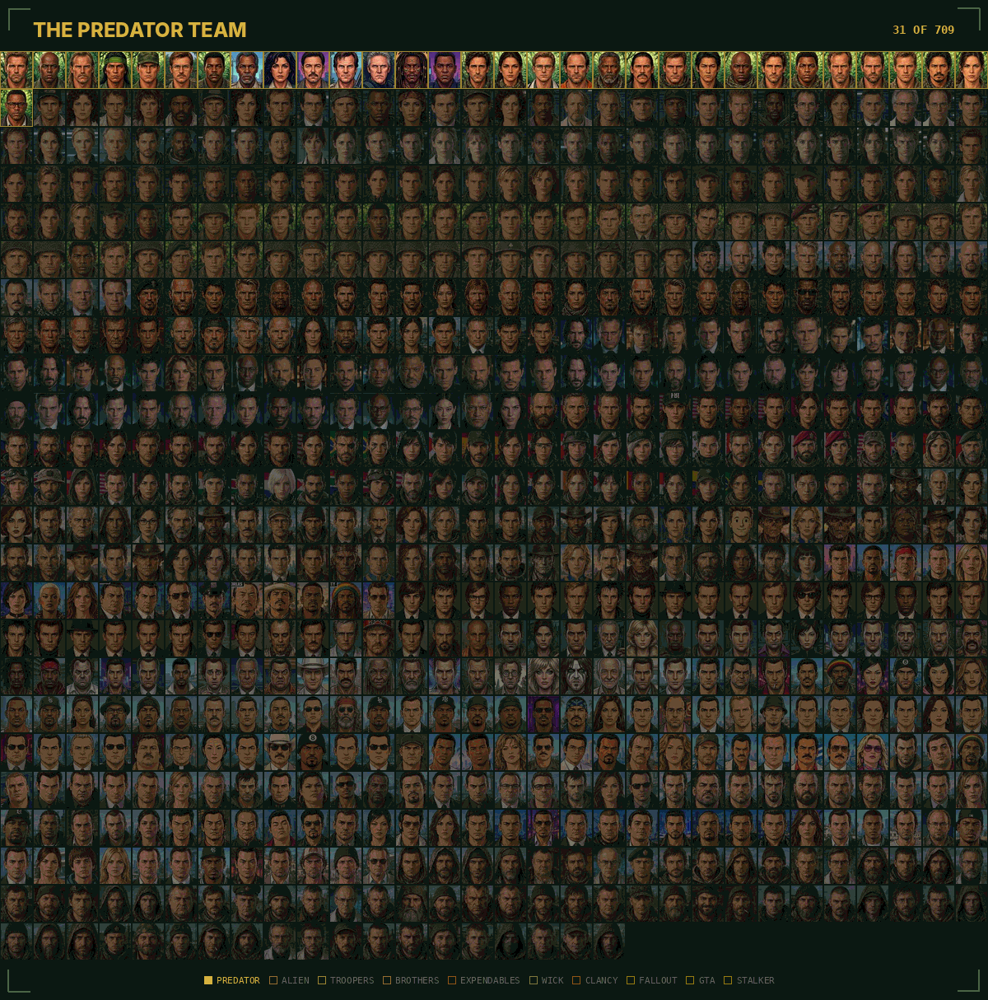</p>

All 709 faces, team by team. Portraits of every merc are in [`docs/img/faces`](docs/img/faces), named by profile ID.

## Stats

<div align="center">

| Stat | Top 5 across all teams |
|:---|:---|
| ❤️ Health | **Griff** 98, **Ernest** 98, **Brittles** 97, **Blain** 96, **Nikolai** 96 |
| 🏃 Agility | **Yin Yang** 96, **Yin Yang** 96, **Yin Yang** 96, **Decha** 96, **Rahmat** 96 |
| ✋ Dexterity | **Wick** 97, **Caine** 97, **Wick** 95, **Zero** 94, **Wick** 93 |
| 💪 Strength | **Ernest** 99, **Blain** 98, **Griff** 97, **Nikolai** 96, **Brittles** 96 |
| 🧠 Wisdom | **Elder** 99, **New Elder** 99, **House** 99, **Winston** 98, **Winston** 97 |
| 🎖️ Leadership | **Elder** 98, **New Elder** 98, **Winston** 96, **King** 96, **Dutch** 95 |
| 🎯 Marksmanship | **Marcus** 99, **Wick** 99, **Kali** 98, **Quinn** 97, **Wick** 97 |
| 🔧 Mechanical | **Peck** 96, **Cardan** 96, **Novikov** 96, **Vriess** 95, **Aurelio** 95 |
| 💣 Explosives | **8-Ball** 95, **Brick** 94, **Fuze** 92, **Kapkan** 92, **8-Ball** 92 |
| 🩹 Medical | **Doc** 96, **James** 95, **Edwin** 92, **Finka** 92, **Curie** 92 |

</div>

Full stats of every merc are in the dossiers: [🩸 Predator](docs/characters/predator.md) · [👾 Alien](docs/characters/alien.md) · [🪲 Troopers](docs/characters/troopers.md) · [🪖 Brothers](docs/characters/bia.md) · [💥 Expendables](docs/characters/expendables.md) · [🪙 Wick](docs/characters/johnwick.md) · [🚨 Clancy](docs/characters/clancy.md) · [☢️ Fallout](docs/characters/fallout.md) · [🚗 GTA](docs/characters/gta.md) · [☣️ Stalker](docs/characters/stalker.md)

Lvl experience level, HLT health, AGI agility, DEX dexterity, STR strength, WIS wisdom, LDR leadership, MRK marksmanship, MEC mechanical, EXP explosives, MED medical.

## Screenshots

Screenshots of the mod will be added here with the first release.

## Troubleshooting / FAQ

**Windows SmartScreen says "Windows protected your PC" when I start `ja2u16.exe`.**
Windows shows this for new programs downloaded from the internet that it does not know yet. Check the archive with the scanners and the SHA-256 checksum above, then press *More info* → *Run anyway*.

**I see the standard A.I.M. and M.E.R.C. mercs, not the ten teams.**
Start the game with **`ja2u16.exe`**, not the stock `ja2.exe`, and begin a **new game**. The mod runs from its own `Data-UINT16` folder; `ja2.exe` still starts the stock 1.13 game.

**Can I use `ja2at.exe` or `ja2pt.exe` from the Alien or Predator mods?**
No. Use only `ja2u16.exe` from this mod — the exes of the single-team mods are built for the usual 255 profiles.

**My save does not load after updating the mod.**
Saves from older versions of the mod are not compatible with newer ones. Start a new game, or go back to the version the save was made with.

**How do I go back to the stock game?**
Start the game with `ja2.exe` — the stock `Data-1.13` is not touched by the mod. To remove the mod completely, delete `ja2u16.exe` and the `Data-UINT16` folder.

## Reporting bugs

Found a bug or have an idea? Open an [issue](../../issues) and include:

- the mod version (the name of the release archive) and your game version (the 1.13 build from `JA2_113-Version.txt`, and any other mods you use);
- whether you started the game with `ja2u16.exe` or with the stock `ja2.exe`;
- the team and the merc, with the profile ID, if the problem is with one;
- what you did, what you expected and what happened instead;
- a screenshot, and the save game if the problem is with one (zip it if it is large).

Please check the [open issues](../../issues) first — maybe it is already reported. More in [Contributing](CONTRIBUTING.md).

## 💬 Community

<p align="center">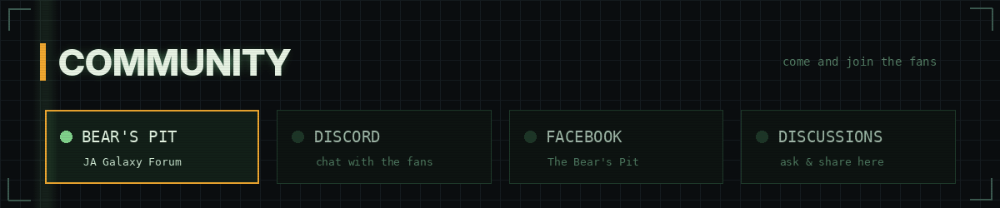</p>

Questions, ideas, mods and talk about Jagged Alliance 2 — come and join the fans:

<p align="center">
  <a href="https://thepit.ja-galaxy-forum.com/"></a>
  <a href="https://discord.com/invite/Ku2H9Hf"></a>
  <a href="https://www.facebook.com/bearspit"></a>
  <a href="../../discussions"></a>
</p>

- **[The Bear's Pit — JA Galaxy Forum](https://thepit.ja-galaxy-forum.com/)** — the home of Jagged Alliance 2 and 1.13 modding: mods, maps, tools and help.
- **[Discord](https://discord.com/invite/Ku2H9Hf)** — chat with other players and modders.
- **[Facebook — The Bear's Pit](https://www.facebook.com/bearspit)** — news and posts from The Bear's Pit community on Facebook.
- **[GitHub Discussions](../../discussions)** — ask a question, share an idea or show your squad right here in the repository: press **New discussion**.
  - Mod creator: [`oleksandr1024`](https://discord.com/users/660456590364901387)
  - Server admins: [`kitty624`](https://discord.com/users/485597085496901633), [`papa_bear2842`](https://discord.com/users/348550304557563905), [`h_world_37628`](https://discord.com/users/1407768046956839042), [`tais0001`](https://discord.com/users/118450058780868613), [`marco6326`](https://discord.com/users/201429346240430080), [`asdow5338`](https://discord.com/users/484390622040686592)

Before you post, read the [Code of Conduct](CODE_OF_CONDUCT.md). Want to help? See [Contributing](CONTRIBUTING.md). Found a security problem? See the [Security policy](SECURITY.md).

## Changelog

What's new in each version is listed on the [Releases](../../releases) page.

## Credits

<p align="center">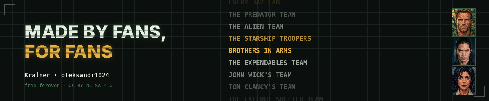</p>

Thanks to the whole **Jagged Alliance 2** fan community — the modders, map makers and players who have kept this game alive for decades, and the **1.13** team whose work makes mods like this possible. This mod is made by fans, for fans.

Created by **Krainer (Oleksandr Khrashchevskyi)** — [`oleksandr1024`](https://discord.com/users/660456590364901387) on Discord. Thanks to the admins of the Discord server — [`kitty624`](https://discord.com/users/485597085496901633), [`papa_bear2842`](https://discord.com/users/348550304557563905), [`h_world_37628`](https://discord.com/users/1407768046956839042), [`tais0001`](https://discord.com/users/118450058780868613), [`marco6326`](https://discord.com/users/201429346240430080) and [`asdow5338`](https://discord.com/users/484390622040686592).

More squads from the same author: [The Predator Team](https://github.com/OleksandrKhrashchevskyi/Jagged-Alliance-2-Mod-Predator-Squad) · [The Alien Team](https://github.com/OleksandrKhrashchevskyi/Jagged-Alliance-2-Mod-Alien-Squad) · [Jagged Alliance 2 Game Editor](https://github.com/OleksandrKhrashchevskyi/Jagged-Alliance-2-Game-Editor)

## License

Made by **Krainer**. The mod is free and released under [CC BY-NC-SA 4.0](LICENSE). Jagged Alliance 2, and the films and games the teams come from, belong to their respective owners; this is a non-commercial fan work.

Copyright (c) 2026 Krainer (Oleksandr Khrashchevskyi)

## Disclaimer

This is a fan-made mod and is not affiliated with the owners of Jagged Alliance 2 or of any of the films and games the teams come from. The mod does not include the game; you need your own copy of Jagged Alliance 2 with v1.13. The mod runs from its own files and does not change the stock game. You use it at your own risk.
