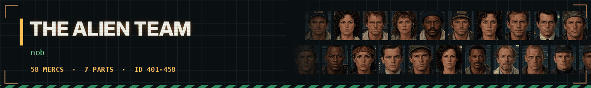

# 👾 The Alien Team - dossiers

<a href="../../README.md">⬅ Back to README</a> · <a href="predator.md">🩸 Predator Team</a> · <a href="troopers.md">🪲 Starship Troopers</a> · <a href="bia.md">🪖 Brothers in Arms</a> · <a href="expendables.md">💥 Expendables Team</a> · <a href="johnwick.md">🪙 John Wick's Team</a> · <a href="clancy.md">🚨 Tom Clancy's Team</a> · <a href="fallout.md">☢️ Fallout Shelter Team</a> · <a href="gta.md">🚗 Grand Theft Auto Team</a> · <a href="stalker.md">☣️ S.T.A.L.K.E.R. Team</a>

The Nostromo crew, the Colonial Marines, the inmates of Fiorina 161, the smugglers of the Betty and the crews of Prometheus, Covenant and Romulus.

| Mercs | IDs | Films | Avg level | Best all-rounder | Most expensive |
|:---:|:---:|:---:|:---:|:---:|:---:|
| **58** | 401-458 | 7 | 4.0 | **Hicks** (73.5) | **Apone** ($5,000/day) |

**Films:** [Alien 1979](#alien-1979) · [Aliens 1986](#aliens-1986) · [Alien 1992](#alien-1992) · [Resurrection 1997](#resurrection-1997) · [Prometheus 2012](#prometheus-2012) · [Covenant 2017](#covenant-2017) · [Romulus 2024](#romulus-2024)

Stats are on the JA2 1.13 scale (0-100), one ━ is 10 points. Day rates are in dollars; the Premium kit costs 50% more.

## Alien 1979

6 mercs

<table>
<tr>
<td width="120" align="center" valign="top">
 
<b>ID 401</b> 
Lvl <b>3</b>
</td>
<td valign="top">

### Dallas · Arthur Dallas

Captain of the Nostromo. Calm, careful, decides for the crew. 
Played by: <b>Tom Skerritt</b>

<code>Squadleader</code> <code>Ranger</code> <code>Scouting</code>

<pre>
HLT ━━━━━━━━──  75    AGI ━━━━━━────  65
DEX ━━━━━━━───  70    STR ━━━━━━────  60
WIS ━━━━━━━━──  80    LDR ━━━━━━━━──  80
MRK ━━━━━━────  55    MEC ━━━━━━────  55
EXP ━━────────  20    MED ━━────────  25
AVG 58.5
</pre>

💵 **$1,950** a day · **$12,000** a week · **$22,500** for two weeks 
🎒 Standard · Air Ducts · Prod · Survival · Premium +50%

</td>
</tr>
</table>

<table>
<tr>
<td width="120" align="center" valign="top">
 
<b>ID 402</b> 
Lvl <b>5</b>
</td>
<td valign="top">

### Ripley · Ellen Ripley

Warrant officer. By the book, stubborn, very hard to kill. 
Played by: <b>Sigourney Weaver</b>

<code>Survival</code> <code>Squadleader</code> <code>Technician</code>

<pre>
HLT ━━━━━━━━──  82    AGI ━━━━━━━━──  80
DEX ━━━━━━━━──  76    STR ━━━━━━────  62
WIS ━━━━━━━━──  85    LDR ━━━━━━━───  70
MRK ━━━━━━────  55    MEC ━━━━━━────  65
EXP ━━━━──────  35    MED ━━━━──────  40
AVG 65.0
</pre>

💵 **$3,200** a day · **$20,000** a week · **$37,000** for two weeks 
🎒 Standard · Tracker · Narcissus · Survival · Premium +50%

</td>
</tr>
</table>

<table>
<tr>
<td width="120" align="center" valign="top">
 
<b>ID 403</b> 
Lvl <b>3</b>
</td>
<td valign="top">

### Kane · Gilbert Kane

Executive officer. First through every door. 
Played by: <b>John Hurt</b>

<code>Scouting</code> <code>Ranger</code> <code>Athletics</code>

<pre>
HLT ━━━━━━━───  72    AGI ━━━━━━━───  70
DEX ━━━━━━━───  72    STR ━━━━━━────  60
WIS ━━━━━━━━──  82    LDR ━━━━━━────  60
MRK ━━━━━─────  50    MEC ━━━━──────  45
EXP ━━────────  25    MED ━━────────  25
AVG 56.1
</pre>

💵 **$1,700** a day · **$10,500** a week · **$19,500** for two weeks 
🎒 Standard · Derelict · Prod · Flamer · Premium +50%

</td>
</tr>
</table>

<table>
<tr>
<td width="120" align="center" valign="top">
 
<b>ID 404</b> 
Lvl <b>3</b>
</td>
<td valign="top">

### Lambert · Joan Lambert

Navigator. Knows the way home, wants to take it now. 
Played by: <b>Veronica Cartwright</b>

<code>Radio Operator</code> <code>Technician</code> <code>Scouting</code>

<pre>
HLT ━━━━━━────  62    AGI ━━━━━━━───  70
DEX ━━━━━━━───  74    STR ━━━━──────  45
WIS ━━━━━━━━──  84    LDR ━━━━──────  35
MRK ━━━━──────  45    MEC ━━━━━━────  62
EXP ━━────────  15    MED ━━━───────  30
AVG 52.2
</pre>

💵 **$1,550** a day · **$9,500** a week · **$18,000** for two weeks 
🎒 Standard · Tracker · Flamer · Survival · Premium +50%

</td>
</tr>
</table>

<table>
<tr>
<td width="120" align="center" valign="top">
 
<b>ID 405</b> 
Lvl <b>4</b>
</td>
<td valign="top">

### Parker · Dennis Parker

Chief engineer. Wants his full share - and earns it. 
Played by: <b>Yaphet Kotto</b>

<code>Technician</code> <code>Heavy Weapons</code> <code>Bodybuilding</code>

<pre>
HLT ━━━━━━━━━─  88    AGI ━━━━━━────  64
DEX ━━━━━━━───  70    STR ━━━━━━━━──  85
WIS ━━━━━━━───  66    LDR ━━━━──────  45
MRK ━━━━━━────  62    MEC ━━━━━━━━━─  90
EXP ━━━━━━━───  70    MED ━━────────  20
AVG 66.0
</pre>

💵 **$2,600** a day · **$16,000** a week · **$30,000** for two weeks 
🎒 Standard · Engineer · Prod · Bludgeon · Premium +50%

</td>
</tr>
</table>

<table>
<tr>
<td width="120" align="center" valign="top">
 
<b>ID 406</b> 
Lvl <b>3</b>
</td>
<td valign="top">

### Brett · Samuel Brett

Engineering technician. Steady hands, few words. 
Played by: <b>Harry Dean Stanton</b>

<code>Technician</code> <code>Technician</code>

<pre>
HLT ━━━━━━━━──  76    AGI ━━━━━━────  60
DEX ━━━━━━━───  72    STR ━━━━━━━───  70
WIS ━━━━━━────  60    LDR ━━────────  25
MRK ━━━━━─────  48    MEC ━━━━━━━━──  82
EXP ━━━━━━────  55    MED ━━────────  15
AVG 56.3
</pre>

💵 **$1,400** a day · **$8,500** a week · **$16,000** for two weeks 
🎒 Standard · Engineer · Flamer · Jonesy · Premium +50%

</td>
</tr>
</table>

## Aliens 1986

8 mercs

<table>
<tr>
<td width="120" align="center" valign="top">
 
<b>ID 407</b> 
Lvl <b>6</b>
</td>
<td valign="top">

### Ripley · Ellen Ripley

Survivor of the Nostromo. Back for the colony - and the girl. 
Played by: <b>Sigourney Weaver</b>

<code>Auto Weapons</code> <code>Squadleader</code> <code>Survival</code>

<pre>
HLT ━━━━━━━━──  85    AGI ━━━━━━━━──  82
DEX ━━━━━━━━──  80    STR ━━━━━━────  65
WIS ━━━━━━━━━─  88    LDR ━━━━━━━━──  75
MRK ━━━━━━━━──  78    MEC ━━━━━━────  65
EXP ━━━━──────  45    MED ━━━━──────  40
AVG 70.3
</pre>

💵 **$4,200** a day · **$26,000** a week · **$48,500** for two weeks 
🎒 Standard · Flamer · Tracker · Advisor · Premium +50%

</td>
</tr>
</table>

<table>
<tr>
<td width="120" align="center" valign="top">
 
<b>ID 408</b> 
Lvl <b>7</b>
</td>
<td valign="top">

### Hicks · Dwayne Hicks

Corporal. Quiet, steady - takes command when it matters. 
Played by: <b>Michael Biehn</b>

<code>Auto Weapons</code> <code>Squadleader</code> <code>Night Ops</code>

<pre>
HLT ━━━━━━━━━─  90    AGI ━━━━━━━━──  78
DEX ━━━━━━━━──  82    STR ━━━━━━━━──  78
WIS ━━━━━━━━──  85    LDR ━━━━━━━━──  82
MRK ━━━━━━━━──  85    MEC ━━━━━━────  55
EXP ━━━━━━────  60    MED ━━━━──────  40
AVG 73.5
</pre>

💵 **$4,800** a day · **$30,000** a week · **$55,500** for two weeks 
🎒 Standard · Pulse Rifle · Welder · Night Ops · Premium +50%

</td>
</tr>
</table>

<table>
<tr>
<td width="120" align="center" valign="top">
 
<b>ID 409</b> 
Lvl <b>3</b>
</td>
<td valign="top">

### Burke · Carter Burke

Company man. Smiles a lot. Never turn your back on him. 
Played by: <b>Paul Reiser</b>

<code>Covert Ops</code> <code>Snitch</code> <code>Radio Operator</code>

<pre>
HLT ━━━━━━────  60    AGI ━━━━━━────  55
DEX ━━━━━━────  65    STR ━━━━──────  45
WIS ━━━━━━━━──  82    LDR ━━━━━━────  60
MRK ━━━━──────  35    MEC ━━━━──────  40
EXP ━━────────  15    MED ━━────────  20
AVG 47.7
</pre>

💵 **$1,800** a day · **$11,000** a week · **$21,000** for two weeks 
🎒 Standard · Company · Specimen · Borrowed · Premium +50%

</td>
</tr>
</table>

<table>
<tr>
<td width="120" align="center" valign="top">
 
<b>ID 410</b> 
Lvl <b>5</b>
</td>
<td valign="top">

### Hudson · William Hudson

Private. Big mouth, fast hands - game over, man. 
Played by: <b>Bill Paxton</b>

<code>Auto Weapons</code> <code>Athletics</code> <code>Radio Operator</code>

<pre>
HLT ━━━━━━━━──  80    AGI ━━━━━━━━──  80
DEX ━━━━━━━━──  76    STR ━━━━━━━━──  75
WIS ━━━━━━────  58    LDR ━━━───────  30
MRK ━━━━━━━───  74    MEC ━━━━━━────  60
EXP ━━━━──────  45    MED ━━────────  25
AVG 60.3
</pre>

💵 **$3,000** a day · **$18,500** a week · **$35,000** for two weeks 
🎒 Standard · Tracker · Comtech · Last Stand · Premium +50%

</td>
</tr>
</table>

<table>
<tr>
<td width="120" align="center" valign="top">
 
<b>ID 411</b> 
Lvl <b>7</b>
</td>
<td valign="top">

### Apone · Al Apone

Master sergeant. Twenty years in the corps, chews cigars. 
Played by: <b>Al Matthews</b>

<code>Squadleader</code> <code>Auto Weapons</code> <code>Bodybuilding</code>

<pre>
HLT ━━━━━━━━━─  92    AGI ━━━━━━━───  72
DEX ━━━━━━━━──  78    STR ━━━━━━━━──  85
WIS ━━━━━━━━──  80    LDR ━━━━━━━━━─  88
MRK ━━━━━━━━──  84    MEC ━━━━──────  45
EXP ━━━━━━────  55    MED ━━━━──────  35
AVG 71.4
</pre>

💵 **$5,000** a day · **$31,000** a week · **$58,000** for two weeks 
🎒 Standard · Pulse Rifle · Command · Sidearm · Premium +50%

</td>
</tr>
</table>

<table>
<tr>
<td width="120" align="center" valign="top">
 
<b>ID 412</b> 
Lvl <b>6</b>
</td>
<td valign="top">

### Vasquez · Jenette Vasquez

Smartgunner. Tougher than anybody in the room. 
Played by: <b>Jenette Goldstein</b>

<code>Auto Weapons</code> <code>Auto Weapons</code> <code>Bodybuilding</code>

<pre>
HLT ━━━━━━━━━─  88    AGI ━━━━━━━━──  80
DEX ━━━━━━━━──  80    STR ━━━━━━━━──  82
WIS ━━━━━━────  62    LDR ━━━━──────  40
MRK ━━━━━━━━━─  86    MEC ━━━━──────  40
EXP ━━━━━━────  60    MED ━━────────  20
AVG 63.8
</pre>

💵 **$4,500** a day · **$28,000** a week · **$52,000** for two weeks 
🎒 Standard · Pulse Rifle · Last Stand · Ammo Load · Premium +50%

</td>
</tr>
</table>

<table>
<tr>
<td width="120" align="center" valign="top">
 
<b>ID 413</b> 
Lvl <b>4</b>
</td>
<td valign="top">

### Gorman · William Gorman

Lieutenant. New in command, by the book. 
Played by: <b>William Hope</b>

<code>Radio Operator</code> <code>Scouting</code> <code>Teaching</code>

<pre>
HLT ━━━━━━━───  68    AGI ━━━━━━────  62
DEX ━━━━━━━───  70    STR ━━━━━━────  55
WIS ━━━━━━━━──  75    LDR ━━━━━━────  65
MRK ━━━━━━────  60    MEC ━━━━──────  45
EXP ━━━───────  30    MED ━━━───────  30
AVG 56.0
</pre>

💵 **$2,350** a day · **$14,500** a week · **$27,500** for two weeks 
🎒 Standard · Command · Pulse Rifle · Grenades · Premium +50%

</td>
</tr>
</table>

<table>
<tr>
<td width="120" align="center" valign="top">
 
<b>ID 414</b> 
Lvl <b>5</b>
</td>
<td valign="top">

### Drake · Mark Drake

Smartgunner. Vasquez's partner, says little, shoots a lot. 
Played by: <b>Mark Rolston</b>

<code>Auto Weapons</code> <code>Bodybuilding</code> <code>Heavy Weapons</code>

<pre>
HLT ━━━━━━━━━─  86    AGI ━━━━━━━───  70
DEX ━━━━━━━───  74    STR ━━━━━━━━──  85
WIS ━━━━━━────  58    LDR ━━━───────  30
MRK ━━━━━━━━──  80    MEC ━━━━──────  45
EXP ━━━━━━────  55    MED ━━────────  15
AVG 59.8
</pre>

💵 **$3,200** a day · **$20,000** a week · **$37,000** for two weeks 
🎒 Standard · Flamer · Pulse Rifle · Ammo Load · Premium +50%

</td>
</tr>
</table>

## Alien 1992

6 mercs

<table>
<tr>
<td width="120" align="center" valign="top">
 
<b>ID 415</b> 
Lvl <b>6</b>
</td>
<td valign="top">

### Ripley · Ellen Ripley

Sole survivor of the Sulaco. No illusions left. 
Played by: <b>Sigourney Weaver</b>

<code>Squadleader</code> <code>Survival</code> <code>Athletics</code>

<pre>
HLT ━━━━━━━━──  80    AGI ━━━━━━━━──  80
DEX ━━━━━━━━──  78    STR ━━━━━━────  64
WIS ━━━━━━━━━─  88    LDR ━━━━━━━━──  78
MRK ━━━━━━────  60    MEC ━━━━━━━───  72
EXP ━━━━──────  45    MED ━━━━──────  45
AVG 69.0
</pre>

💵 **$3,800** a day · **$23,500** a week · **$44,000** for two weeks 
🎒 Standard · Bait · Lead Works · Survival · Premium +50%

</td>
</tr>
</table>

<table>
<tr>
<td width="120" align="center" valign="top">
 
<b>ID 416</b> 
Lvl <b>4</b>
</td>
<td valign="top">

### Dillon

Spiritual leader of the inmates. Feared, respected, unbreakable. 
Played by: <b>Charles S. Dutton</b>

<code>Squadleader</code> <code>Melee</code> <code>Bodybuilding</code>

<pre>
HLT ━━━━━━━━━─  90    AGI ━━━━━━━───  70
DEX ━━━━━━━───  72    STR ━━━━━━━━━─  88
WIS ━━━━━━━━──  75    LDR ━━━━━━━━──  85
MRK ━━━━━━────  60    MEC ━━━━━─────  50
EXP ━━━━──────  40    MED ━━━───────  30
AVG 66.0
</pre>

💵 **$2,700** a day · **$16,500** a week · **$31,500** for two weeks 
🎒 Standard · Fire · Tunnels · Preacher · Premium +50%

</td>
</tr>
</table>

<table>
<tr>
<td width="120" align="center" valign="top">
 
<b>ID 417</b> 
Lvl <b>4</b>
</td>
<td valign="top">

### Clemens · Jonathan Clemens

Prison doctor. Clever, tired, carries his own past. 
Played by: <b>Charles Dance</b>

<code>Doctor</code> <code>Doctor</code> <code>Survival</code>

<pre>
HLT ━━━━━━━───  70    AGI ━━━━━━────  62
DEX ━━━━━━━━──  78    STR ━━━━━━────  55
WIS ━━━━━━━━━─  90    LDR ━━━━──────  45
MRK ━━━━──────  40    MEC ━━━━━━────  55
EXP ━━────────  25    MED ━━━━━━━━━─  90
AVG 61.0
</pre>

💵 **$3,000** a day · **$18,500** a week · **$35,000** for two weeks 
🎒 Standard · Infirmary · Survival · Fire · Premium +50%

</td>
</tr>
</table>

<table>
<tr>
<td width="120" align="center" valign="top">
 
<b>ID 418</b> 
Lvl <b>3</b>
</td>
<td valign="top">

### Golic

Inmate. Damaged, unpredictable, sees the beast as a dragon. 
Played by: <b>Paul McGann</b>

<code>Melee</code> <code>Stealthy</code> <code>Bodybuilding</code>

<pre>
HLT ━━━━━━━━──  80    AGI ━━━━━━━───  72
DEX ━━━━━━━───  66    STR ━━━━━━━━──  78
WIS ━━━━──────  35    LDR ━━────────  15
MRK ━━━━──────  45    MEC ━━━━──────  40
EXP ━━━━━─────  50    MED ━─────────  10
AVG 49.1
</pre>

💵 **$1,200** a day · **$7,500** a week · **$14,000** for two weeks 
🎒 Standard · Fire · Tunnels · Scrap · Premium +50%

</td>
</tr>
</table>

<table>
<tr>
<td width="120" align="center" valign="top">
 
<b>ID 419</b> 
Lvl <b>3</b>
</td>
<td valign="top">

### Andrews · Harold Andrews

Prison superintendent. Rules are rules - until they stop working. 
Played by: <b>Brian Glover</b>

<code>Squadleader</code> <code>Teaching</code> <code>Radio Operator</code>

<pre>
HLT ━━━━━━━━──  75    AGI ━━━━━━────  55
DEX ━━━━━━────  65    STR ━━━━━━────  65
WIS ━━━━━━━───  70    LDR ━━━━━━━───  72
MRK ━━━━━━────  55    MEC ━━━━──────  35
EXP ━━━───────  30    MED ━━━───────  30
AVG 55.2
</pre>

💵 **$2,150** a day · **$13,500** a week · **$25,000** for two weeks 
🎒 Standard · Warden · Fire · Infirmary · Premium +50%

</td>
</tr>
</table>

<table>
<tr>
<td width="120" align="center" valign="top">
 
<b>ID 420</b> 
Lvl <b>3</b>
</td>
<td valign="top">

### Aaron

Assistant superintendent. IQ 85 - and more loyal than anybody. 
Played by: <b>Ralph Brown</b>

<code>Radio Operator</code> <code>Technician</code> <code>Scouting</code>

<pre>
HLT ━━━━━━━───  70    AGI ━━━━━━────  58
DEX ━━━━━━━───  66    STR ━━━━━━────  55
WIS ━━━━━━────  62    LDR ━━━━──────  35
MRK ━━━━━─────  50    MEC ━━━━━━────  60
EXP ━━────────  25    MED ━━━━──────  35
AVG 51.6
</pre>

💵 **$1,500** a day · **$9,500** a week · **$17,500** for two weeks 
🎒 Standard · Radio · Tech · Fire · Premium +50%

</td>
</tr>
</table>

## Resurrection 1997

10 mercs

<table>
<tr>
<td width="120" align="center" valign="top">
 
<b>ID 421</b> 
Lvl <b>6</b>
</td>
<td valign="top">

### Elgin · Frank Elgin

Captain of the Betty. Smuggler, mercenary, businessman. 
Played by: <b>Michael Wincott</b>

<code>Squadleader</code> <code>Auto Weapons</code> <code>Covert Ops</code>

<pre>
HLT ━━━━━━━━──  82    AGI ━━━━━━━───  70
DEX ━━━━━━━───  74    STR ━━━━━━━───  70
WIS ━━━━━━━━──  78    LDR ━━━━━━━━──  80
MRK ━━━━━━━───  74    MEC ━━━━━─────  50
EXP ━━━━──────  40    MED ━━────────  25
AVG 64.3
</pre>

💵 **$3,600** a day · **$22,500** a week · **$42,000** for two weeks 
🎒 Standard · Shockrifle · Captain · Smuggler · Premium +50%

</td>
</tr>
</table>

<table>
<tr>
<td width="120" align="center" valign="top">
 
<b>ID 422</b> 
Lvl <b>6</b>
</td>
<td valign="top">

### Johner

Muscle of the Betty. Loud, rude and very hard to kill. 
Played by: <b>Ron Perlman</b>

<code>Heavy Weapons</code> <code>Auto Weapons</code> <code>Bodybuilding</code>

<pre>
HLT ━━━━━━━━━━  95    AGI ━━━━━━━───  68
DEX ━━━━━━━───  72    STR ━━━━━━━━━━  95
WIS ━━━━──────  45    LDR ━━━───────  30
MRK ━━━━━━━━──  84    MEC ━━━━──────  35
EXP ━━━━━━────  60    MED ━─────────  10
AVG 59.4
</pre>

💵 **$3,800** a day · **$23,500** a week · **$44,000** for two weeks 
🎒 Standard · Draco · Flask Gun · Muscle · Premium +50%

</td>
</tr>
</table>

<table>
<tr>
<td width="120" align="center" valign="top">
 
<b>ID 423</b> 
Lvl <b>7</b>
</td>
<td valign="top">

### Kristie

Gunman of the Betty. Two pistols on his arms, never misses. 
Played by: <b>Gary Dourdan</b>

<code>Ambidextrous</code> <code>Gunslinger</code> <code>Athletics</code>

<pre>
HLT ━━━━━━━━━─  88    AGI ━━━━━━━━━─  88
DEX ━━━━━━━━━─  90    STR ━━━━━━━━──  78
WIS ━━━━━━━───  70    LDR ━━━━──────  40
MRK ━━━━━━━━━─  90    MEC ━━━━──────  40
EXP ━━━━━━────  55    MED ━━────────  20
AVG 65.9
</pre>

💵 **$4,400** a day · **$27,500** a week · **$51,000** for two weeks 
🎒 Standard · Grenadier · Draco · Climber · Premium +50%

</td>
</tr>
</table>

<table>
<tr>
<td width="120" align="center" valign="top">
 
<b>ID 424</b> 
Lvl <b>5</b>
</td>
<td valign="top">

### Vriess · Gary Vriess

Mechanic of the Betty. Never lets the wheelchair stop him. 
Played by: <b>Dominique Pinon</b>

<code>Technician</code> <code>Demolitions</code> <code>Radio Operator</code>

<pre>
HLT ━━━━━━━───  70    AGI ━━────────  25
DEX ━━━━━━━━──  85    STR ━━━━━━────  60
WIS ━━━━━━━━──  75    LDR ━━━───────  30
MRK ━━━━━━━───  74    MEC ━━━━━━━━━━  95
EXP ━━━━━━━───  70    MED ━━━───────  30
AVG 61.4
</pre>

💵 **$2,600** a day · **$16,000** a week · **$30,000** for two weeks 
🎒 Standard · Grenadier · Mechanic · Demolition · Premium +50%

</td>
</tr>
</table>

<table>
<tr>
<td width="120" align="center" valign="top">
 
<b>ID 425</b> 
Lvl <b>4</b>
</td>
<td valign="top">

### Hillard · Sabra Hillard

Pilot of the Betty. Elgin's partner. 
Played by: <b>Kim Flowers</b>

<code>Radio Operator</code> <code>Technician</code> <code>Athletics</code>

<pre>
HLT ━━━━━━━───  70    AGI ━━━━━━━━──  76
DEX ━━━━━━━━──  76    STR ━━━━━─────  50
WIS ━━━━━━━───  74    LDR ━━━━──────  45
MRK ━━━━━━────  58    MEC ━━━━━━━───  70
EXP ━━────────  25    MED ━━━━──────  35
AVG 57.9
</pre>

💵 **$2,000** a day · **$12,500** a week · **$23,000** for two weeks 
🎒 Standard · Pilot · Lookout · Mechanic · Premium +50%

</td>
</tr>
</table>

<table>
<tr>
<td width="120" align="center" valign="top">
 
<b>ID 426</b> 
Lvl <b>6</b>
</td>
<td valign="top">

### Perez · Martin Perez

General. Commander of the USM Auriga. 
Played by: <b>Dan Hedaya</b>

<code>Squadleader</code> <code>Teaching</code> <code>Radio Operator</code>

<pre>
HLT ━━━━━━━━──  75    AGI ━━━━━━────  55
DEX ━━━━━━────  62    STR ━━━━━━────  62
WIS ━━━━━━━━──  82    LDR ━━━━━━━━━─  90
MRK ━━━━━━━───  70    MEC ━━━━──────  35
EXP ━━━━──────  40    MED ━━────────  25
AVG 59.6
</pre>

💵 **$3,800** a day · **$23,500** a week · **$44,000** for two weeks 
🎒 Standard · General · Field · Escort · Premium +50%

</td>
</tr>
</table>

<table>
<tr>
<td width="120" align="center" valign="top">
 
<b>ID 427</b> 
Lvl <b>3</b>
</td>
<td valign="top">

### Wren · Mason Wren

Chief scientist of the Auriga's project. 
Played by: <b>J. E. Freeman</b>

<code>Doctor</code> <code>Snitch</code> <code>Covert Ops</code>

<pre>
HLT ━━━━━━────  62    AGI ━━━━━━────  60
DEX ━━━━━━━━──  78    STR ━━━━━─────  48
WIS ━━━━━━━━━─  90    LDR ━━━━━━────  55
MRK ━━━━──────  45    MEC ━━━━━━────  55
EXP ━━────────  20    MED ━━━━━━━━──  80
AVG 59.3
</pre>

💵 **$2,150** a day · **$13,500** a week · **$25,000** for two weeks 
🎒 Standard · Scientist · Lab · Escape · Premium +50%

</td>
</tr>
</table>

<table>
<tr>
<td width="120" align="center" valign="top">
 
<b>ID 428</b> 
Lvl <b>3</b>
</td>
<td valign="top">

### Gediman · Jonathan Gediman

Scientist of the Auriga. Loves his specimens. 
Played by: <b>Brad Dourif</b>

<code>Doctor</code> <code>Doctor</code>

<pre>
HLT ━━━━━━────  60    AGI ━━━━━━────  58
DEX ━━━━━━━━──  78    STR ━━━━──────  45
WIS ━━━━━━━━━─  92    LDR ━━━━──────  35
MRK ━━━━──────  35    MEC ━━━━━━────  60
EXP ━━────────  15    MED ━━━━━━━━──  85
AVG 56.3
</pre>

💵 **$2,200** a day · **$13,500** a week · **$25,500** for two weeks 
🎒 Standard · Scientist · Lab · Survivor · Premium +50%

</td>
</tr>
</table>

<table>
<tr>
<td width="120" align="center" valign="top">
 
<b>ID 429</b> 
Lvl <b>5</b>
</td>
<td valign="top">

### DiStefano · Vincent DiStefano

Soldier of the Auriga. The last one alive. 
Played by: <b>Raymond Cruz</b>

<code>Auto Weapons</code> <code>Athletics</code> <code>Night Ops</code>

<pre>
HLT ━━━━━━━━──  85    AGI ━━━━━━━━──  78
DEX ━━━━━━━━──  78    STR ━━━━━━━━──  76
WIS ━━━━━━━───  70    LDR ━━━━──────  45
MRK ━━━━━━━━──  82    MEC ━━━━──────  45
EXP ━━━━──────  45    MED ━━━───────  30
AVG 63.4
</pre>

💵 **$3,000** a day · **$18,500** a week · **$35,000** for two weeks 
🎒 Standard · Taser · Sidearm · Escort · Premium +50%

</td>
</tr>
</table>

<table>
<tr>
<td width="120" align="center" valign="top">
 
<b>ID 430</b> 
Lvl <b>3</b>
</td>
<td valign="top">

### Purvis · Larry Purvis

Miner. Woke up with something inside him. 
Played by: <b>Leland Orser</b>

<code>Bodybuilding</code> <code>Melee</code> <code>Survival</code>

<pre>
HLT ━━━━━━━━━─  86    AGI ━━━━━━────  64
DEX ━━━━━━────  62    STR ━━━━━━━━──  84
WIS ━━━━━━────  55    LDR ━━────────  25
MRK ━━━━──────  45    MEC ━━━━━━────  55
EXP ━━────────  20    MED ━━────────  15
AVG 51.1
</pre>

💵 **$1,400** a day · **$8,500** a week · **$16,000** for two weeks 
🎒 Standard · Brawler · Miner · Survivor · Premium +50%

</td>
</tr>
</table>

## Prometheus 2012

9 mercs

<table>
<tr>
<td width="120" align="center" valign="top">
 
<b>ID 431</b> 
Lvl <b>4</b>
</td>
<td valign="top">

### Shaw · Elizabeth Shaw

Archaeologist. A believer who survives what kills everybody else. 
Played by: <b>Noomi Rapace</b>

<code>Survival</code> <code>Scouting</code> <code>Doctor</code>

<pre>
HLT ━━━━━━━━──  80    AGI ━━━━━━━───  74
DEX ━━━━━━━━──  76    STR ━━━━━━────  55
WIS ━━━━━━━━━─  90    LDR ━━━━━━────  62
MRK ━━━━━─────  50    MEC ━━━━━━────  55
EXP ━━━───────  30    MED ━━━━━━━───  70
AVG 64.2
</pre>

💵 **$2,500** a day · **$15,500** a week · **$29,000** for two weeks 
🎒 Standard · Archaeology · Med Pod · Survivor · Premium +50%

</td>
</tr>
</table>

<table>
<tr>
<td width="120" align="center" valign="top">
 
<b>ID 432</b> 
Lvl <b>3</b>
</td>
<td valign="top">

### Vickers · Meredith Vickers

Company mission director. Cold, in charge, with her own way out. 
Played by: <b>Charlize Theron</b>

<code>Squadleader</code> <code>Athletics</code> <code>Radio Operator</code>

<pre>
HLT ━━━━━━━───  72    AGI ━━━━━━━━──  76
DEX ━━━━━━━───  74    STR ━━━━━━────  58
WIS ━━━━━━━━──  85    LDR ━━━━━━━━──  82
MRK ━━━━━━────  55    MEC ━━━━──────  40
EXP ━━━───────  30    MED ━━────────  25
AVG 59.7
</pre>

💵 **$2,400** a day · **$15,000** a week · **$28,000** for two weeks 
🎒 Standard · Corporate · Lifeboat · Security · Premium +50%

</td>
</tr>
</table>

<table>
<tr>
<td width="120" align="center" valign="top">
 
<b>ID 433</b> 
Lvl <b>2</b>
</td>
<td valign="top">

### Weyland · Peter Weyland

Founder of the company. Came all this way to ask for more time. 
Played by: <b>Guy Pearce</b>

<code>Squadleader</code> <code>Teaching</code> <code>Radio Operator</code>

<pre>
HLT ━━━━━━────  55    AGI ━━━━──────  40
DEX ━━━━━━────  62    STR ━━━━──────  42
WIS ━━━━━━━━━━  95    LDR ━━━━━━━━━─  90
MRK ━━━━──────  42    MEC ━━━━━━────  60
EXP ━━────────  20    MED ━━━━──────  40
AVG 54.6
</pre>

💵 **$2,050** a day · **$12,500** a week · **$24,000** for two weeks 
🎒 Standard · Corporate · Bodyguard · Engineer · Premium +50%

</td>
</tr>
</table>

<table>
<tr>
<td width="120" align="center" valign="top">
 
<b>ID 434</b> 
Lvl <b>3</b>
</td>
<td valign="top">

### Holloway · Charlie Holloway

Archaeologist. Wants the answers now. 
Played by: <b>Logan Marshall-Green</b>

<code>Scouting</code> <code>Survival</code> <code>Athletics</code>

<pre>
HLT ━━━━━━━━──  80    AGI ━━━━━━━───  72
DEX ━━━━━━━───  70    STR ━━━━━━━───  72
WIS ━━━━━━━━──  85    LDR ━━━━━━────  55
MRK ━━━━━━────  55    MEC ━━━━━━────  60
EXP ━━━━──────  35    MED ━━━━──────  35
AVG 61.9
</pre>

💵 **$1,950** a day · **$12,000** a week · **$22,500** for two weeks 
🎒 Standard · Archaeology · Flamer · Security · Premium +50%

</td>
</tr>
</table>

<table>
<tr>
<td width="120" align="center" valign="top">
 
<b>ID 435</b> 
Lvl <b>5</b>
</td>
<td valign="top">

### Janek

Captain of the Prometheus. Calm, practical, decides fast. 
Played by: <b>Idris Elba</b>

<code>Squadleader</code> <code>Radio Operator</code> <code>Technician</code>

<pre>
HLT ━━━━━━━━━─  88    AGI ━━━━━━━───  70
DEX ━━━━━━━━──  76    STR ━━━━━━━━──  80
WIS ━━━━━━━━──  78    LDR ━━━━━━━━──  85
MRK ━━━━━━────  65    MEC ━━━━━━━━──  80
EXP ━━━━━─────  50    MED ━━━───────  30
AVG 70.2
</pre>

💵 **$3,350** a day · **$21,000** a week · **$39,000** for two weeks 
🎒 Standard · Captain · Security · Engineer · Premium +50%

</td>
</tr>
</table>

<table>
<tr>
<td width="120" align="center" valign="top">
 
<b>ID 436</b> 
Lvl <b>3</b>
</td>
<td valign="top">

### Fifield

Geologist. Hates the job, loves his mapping drones. 
Played by: <b>Sean Harris</b>

<code>Demolitions</code> <code>Technician</code> <code>Scouting</code>

<pre>
HLT ━━━━━━━━──  75    AGI ━━━━━━━───  70
DEX ━━━━━━━───  72    STR ━━━━━━────  65
WIS ━━━━━━━───  70    LDR ━━────────  25
MRK ━━━━━━────  55    MEC ━━━━━━━───  70
EXP ━━━━━━━━──  75    MED ━━────────  15
AVG 59.2
</pre>

💵 **$1,800** a day · **$11,000** a week · **$21,000** for two weeks 
🎒 Standard · Pups · Geologist · Security · Premium +50%

</td>
</tr>
</table>

<table>
<tr>
<td width="120" align="center" valign="top">
 
<b>ID 437</b> 
Lvl <b>3</b>
</td>
<td valign="top">

### Millburn

Biologist. Too friendly with strange animals. 
Played by: <b>Rafe Spall</b>

<code>Doctor</code> <code>Survival</code> <code>Scouting</code>

<pre>
HLT ━━━━━━━───  70    AGI ━━━━━━━───  68
DEX ━━━━━━━───  70    STR ━━━━━━────  58
WIS ━━━━━━━━──  80    LDR ━━━───────  30
MRK ━━━━──────  45    MEC ━━━━━─────  50
EXP ━━────────  25    MED ━━━━━━────  62
AVG 55.8
</pre>

💵 **$1,550** a day · **$9,500** a week · **$18,000** for two weeks 
🎒 Standard · Biologist · Survivor · Security · Premium +50%

</td>
</tr>
</table>

<table>
<tr>
<td width="120" align="center" valign="top">
 
<b>ID 438</b> 
Lvl <b>4</b>
</td>
<td valign="top">

### Ravel

Co-pilot. Jokes a lot, flies very well. 
Played by: <b>Benedict Wong</b>

<code>Technician</code> <code>Radio Operator</code> <code>Athletics</code>

<pre>
HLT ━━━━━━━━──  80    AGI ━━━━━━━───  70
DEX ━━━━━━━───  74    STR ━━━━━━━───  72
WIS ━━━━━━━───  72    LDR ━━━━──────  40
MRK ━━━━━━────  62    MEC ━━━━━━━━──  82
EXP ━━━━──────  45    MED ━━────────  25
AVG 62.2
</pre>

💵 **$2,000** a day · **$12,500** a week · **$23,000** for two weeks 
🎒 Standard · Pilot · Security · Engineer · Premium +50%

</td>
</tr>
</table>

<table>
<tr>
<td width="120" align="center" valign="top">
 
<b>ID 439</b> 
Lvl <b>3</b>
</td>
<td valign="top">

### Ford

Medical officer. Quiet and steady. 
Played by: <b>Kate Dickie</b>

<code>Doctor</code> <code>Doctor</code> <code>Survival</code>

<pre>
HLT ━━━━━━━───  68    AGI ━━━━━━━───  66
DEX ━━━━━━━━──  76    STR ━━━━━─────  50
WIS ━━━━━━━━━─  88    LDR ━━━━──────  40
MRK ━━━━──────  40    MEC ━━━━━─────  50
EXP ━━────────  20    MED ━━━━━━━━━─  90
AVG 58.8
</pre>

💵 **$2,150** a day · **$13,500** a week · **$25,000** for two weeks 
🎒 Standard · Medic · Autopsy · Security · Premium +50%

</td>
</tr>
</table>

## Covenant 2017

14 mercs

<table>
<tr>
<td width="120" align="center" valign="top">
 
<b>ID 440</b> 
Lvl <b>6</b>
</td>
<td valign="top">

### Daniels · Daniels Branson

Terraforming expert. Lost her husband on the first day - and kept going. 
Played by: <b>Katherine Waterston</b>

<code>Survival</code> <code>Auto Weapons</code> <code>Squadleader</code>

<pre>
HLT ━━━━━━━━──  85    AGI ━━━━━━━━──  82
DEX ━━━━━━━━──  80    STR ━━━━━━────  62
WIS ━━━━━━━━━─  88    LDR ━━━━━━━───  74
MRK ━━━━━━━━──  76    MEC ━━━━━━━───  70
EXP ━━━━──────  45    MED ━━━━──────  40
AVG 70.2
</pre>

💵 **$3,800** a day · **$23,500** a week · **$44,000** for two weeks 
🎒 Standard · Carbine · Terraform · Crane · Premium +50%

</td>
</tr>
</table>

<table>
<tr>
<td width="120" align="center" valign="top">
 
<b>ID 441</b> 
Lvl <b>3</b>
</td>
<td valign="top">

### Oram · Christopher Oram

First mate, captain by accident. A man of faith with doubts. 
Played by: <b>Billy Crudup</b>

<code>Squadleader</code> <code>Teaching</code> <code>Radio Operator</code>

<pre>
HLT ━━━━━━━───  72    AGI ━━━━━━────  64
DEX ━━━━━━━───  70    STR ━━━━━━────  62
WIS ━━━━━━━━──  82    LDR ━━━━━━━───  66
MRK ━━━━━─────  52    MEC ━━━━━━────  55
EXP ━━━───────  30    MED ━━━───────  30
AVG 58.3
</pre>

💵 **$2,150** a day · **$13,500** a week · **$25,000** for two weeks 
🎒 Standard · Command · Faith · Engineer · Premium +50%

</td>
</tr>
</table>

<table>
<tr>
<td width="120" align="center" valign="top">
 
<b>ID 442</b> 
Lvl <b>4</b>
</td>
<td valign="top">

### Tennessee · Tennessee Faris

Chief pilot. Steady hands, big heart. 
Played by: <b>Danny McBride</b>

<code>Technician</code> <code>Radio Operator</code> <code>Athletics</code>

<pre>
HLT ━━━━━━━━──  80    AGI ━━━━━━━───  72
DEX ━━━━━━━━──  76    STR ━━━━━━━───  70
WIS ━━━━━━━───  74    LDR ━━━━━━────  55
MRK ━━━━━━────  65    MEC ━━━━━━━━──  85
EXP ━━━━──────  45    MED ━━────────  25
AVG 64.7
</pre>

💵 **$2,500** a day · **$15,500** a week · **$29,000** for two weeks 
🎒 Standard · Pilot · Engineer · Lander · Premium +50%

</td>
</tr>
</table>

<table>
<tr>
<td width="120" align="center" valign="top">
 
<b>ID 443</b> 
Lvl <b>3</b>
</td>
<td valign="top">

### Karin · Karin Oram

Biologist. Married to the captain. 
Played by: <b>Carmen Ejogo</b>

<code>Doctor</code> <code>Survival</code> <code>Scouting</code>

<pre>
HLT ━━━━━━━───  68    AGI ━━━━━━━───  66
DEX ━━━━━━━───  74    STR ━━━━━─────  48
WIS ━━━━━━━━━─  88    LDR ━━━━──────  40
MRK ━━━━──────  40    MEC ━━━━━─────  50
EXP ━━────────  20    MED ━━━━━━━━──  75
AVG 56.9
</pre>

💵 **$1,800** a day · **$11,000** a week · **$21,000** for two weeks 
🎒 Standard · Medic · Lander · Survey · Premium +50%

</td>
</tr>
</table>

<table>
<tr>
<td width="120" align="center" valign="top">
 
<b>ID 444</b> 
Lvl <b>3</b>
</td>
<td valign="top">

### Maggie · Maggie Faris

Lander pilot. Married to Tennessee. 
Played by: <b>Amy Seimetz</b>

<code>Technician</code> <code>Athletics</code> <code>Radio Operator</code>

<pre>
HLT ━━━━━━━───  72    AGI ━━━━━━━───  74
DEX ━━━━━━━━──  76    STR ━━━━━─────  52
WIS ━━━━━━━━──  78    LDR ━━━━──────  45
MRK ━━━━━─────  50    MEC ━━━━━━━━──  80
EXP ━━━───────  30    MED ━━━━──────  35
AVG 59.2
</pre>

💵 **$1,800** a day · **$11,000** a week · **$21,000** for two weeks 
🎒 Standard · Pilot · Engineer · Shotgun · Premium +50%

</td>
</tr>
</table>

<table>
<tr>
<td width="120" align="center" valign="top">
 
<b>ID 445</b> 
Lvl <b>3</b>
</td>
<td valign="top">

### Ricks

Navigator. Quick with a joke. 
Played by: <b>Jussie Smollett</b>

<code>Radio Operator</code> <code>Scouting</code> <code>Technician</code>

<pre>
HLT ━━━━━━━━──  75    AGI ━━━━━━━───  68
DEX ━━━━━━━───  70    STR ━━━━━━────  64
WIS ━━━━━━━━──  76    LDR ━━━━──────  35
MRK ━━━━━━────  55    MEC ━━━━━━────  60
EXP ━━━───────  30    MED ━━━───────  30
AVG 56.3
</pre>

💵 **$1,700** a day · **$10,500** a week · **$19,500** for two weeks 
🎒 Standard · Navigator · Survey · Armory · Premium +50%

</td>
</tr>
</table>

<table>
<tr>
<td width="120" align="center" valign="top">
 
<b>ID 446</b> 
Lvl <b>3</b>
</td>
<td valign="top">

### Upworth

Medic and radio man. A calm voice on the line. 
Played by: <b>Callie Hernandez</b>

<code>Doctor</code> <code>Radio Operator</code> <code>Survival</code>

<pre>
HLT ━━━━━━━───  70    AGI ━━━━━━━───  66
DEX ━━━━━━━───  72    STR ━━━━━━────  58
WIS ━━━━━━━━──  80    LDR ━━━━──────  38
MRK ━━━━━─────  48    MEC ━━━━━━────  55
EXP ━━────────  25    MED ━━━━━━━───  70
AVG 58.2
</pre>

💵 **$1,800** a day · **$11,000** a week · **$21,000** for two weeks 
🎒 Standard · Medic · Comms · Armory · Premium +50%

</td>
</tr>
</table>

<table>
<tr>
<td width="120" align="center" valign="top">
 
<b>ID 447</b> 
Lvl <b>3</b>
</td>
<td valign="top">

### Branson · Jacob Branson

Captain of the Covenant. Died before the job began. 
Played by: <b>James Franco</b>

<code>Squadleader</code> <code>Radio Operator</code> <code>Scouting</code>

<pre>
HLT ━━━━━━━━──  78    AGI ━━━━━━━───  70
DEX ━━━━━━━───  72    STR ━━━━━━━───  72
WIS ━━━━━━━━──  84    LDR ━━━━━━━━──  82
MRK ━━━━━━────  55    MEC ━━━━━━────  62
EXP ━━━━──────  35    MED ━━━━──────  35
AVG 64.5
</pre>

💵 **$2,350** a day · **$14,500** a week · **$27,500** for two weeks 
🎒 Standard · Captain · Engineer · Armory · Premium +50%

</td>
</tr>
</table>

<table>
<tr>
<td width="120" align="center" valign="top">
 
<b>ID 448</b> 
Lvl <b>6</b>
</td>
<td valign="top">

### Lope

Sergeant. Leads the security team. 
Played by: <b>Demián Bichir</b>

<code>Squadleader</code> <code>Auto Weapons</code> <code>Bodybuilding</code>

<pre>
HLT ━━━━━━━━━─  88    AGI ━━━━━━━───  72
DEX ━━━━━━━━──  78    STR ━━━━━━━━──  82
WIS ━━━━━━━━──  76    LDR ━━━━━━━━━─  86
MRK ━━━━━━━━──  82    MEC ━━━━━─────  50
EXP ━━━━━━────  55    MED ━━━━──────  35
AVG 70.4
</pre>

💵 **$4,200** a day · **$26,000** a week · **$48,500** for two weeks 
🎒 Standard · Sergeant · Sidearm · Assault · Premium +50%

</td>
</tr>
</table>

<table>
<tr>
<td width="120" align="center" valign="top">
 
<b>ID 449</b> 
Lvl <b>4</b>
</td>
<td valign="top">

### Hallett

Sergeant. Lope's partner. 
Played by: <b>Nathaniel Dean</b>

<code>Auto Weapons</code> <code>Bodybuilding</code> <code>Athletics</code>

<pre>
HLT ━━━━━━━━──  82    AGI ━━━━━━━───  70
DEX ━━━━━━━───  74    STR ━━━━━━━━──  80
WIS ━━━━━━────  62    LDR ━━━━──────  45
MRK ━━━━━━━━──  76    MEC ━━━━──────  45
EXP ━━━━──────  45    MED ━━────────  25
AVG 60.4
</pre>

💵 **$2,650** a day · **$16,500** a week · **$30,500** for two weeks 
🎒 Standard · Heavy · Grenades · Close · Premium +50%

</td>
</tr>
</table>

<table>
<tr>
<td width="120" align="center" valign="top">
 
<b>ID 450</b> 
Lvl <b>4</b>
</td>
<td valign="top">

### Rosenthal

Corporal. Sharp-eyed and quiet. 
Played by: <b>Tess Haubrich</b>

<code>Auto Weapons</code> <code>Stealthy</code> <code>Scouting</code>

<pre>
HLT ━━━━━━━━──  80    AGI ━━━━━━━───  74
DEX ━━━━━━━━──  76    STR ━━━━━━━───  72
WIS ━━━━━━────  64    LDR ━━━━──────  45
MRK ━━━━━━━━──  76    MEC ━━━━──────  45
EXP ━━━━──────  40    MED ━━────────  25
AVG 59.7
</pre>

💵 **$2,600** a day · **$16,000** a week · **$30,000** for two weeks 
🎒 Standard · Sidearm · Stealth · Grenades · Premium +50%

</td>
</tr>
</table>

<table>
<tr>
<td width="120" align="center" valign="top">
 
<b>ID 451</b> 
Lvl <b>3</b>
</td>
<td valign="top">

### Ledward

Private. The first to fall ill. 
Played by: <b>Benjamin Rigby</b>

<code>Auto Weapons</code> <code>Athletics</code> <code>Survival</code>

<pre>
HLT ━━━━━━━━──  78    AGI ━━━━━━━───  72
DEX ━━━━━━━───  72    STR ━━━━━━━───  72
WIS ━━━━━━────  60    LDR ━━━───────  30
MRK ━━━━━━━───  74    MEC ━━━━──────  40
EXP ━━━━──────  35    MED ━━━───────  30
AVG 56.3
</pre>

💵 **$2,050** a day · **$12,500** a week · **$24,000** for two weeks 
🎒 Standard · Scout · Grenades · Medic · Premium +50%

</td>
</tr>
</table>

<table>
<tr>
<td width="120" align="center" valign="top">
 
<b>ID 452</b> 
Lvl <b>4</b>
</td>
<td valign="top">

### Cole

Private. Big gun, few words. 
Played by: <b>Uli Latukefu</b>

<code>Auto Weapons</code> <code>Heavy Weapons</code> <code>Bodybuilding</code>

<pre>
HLT ━━━━━━━━──  82    AGI ━━━━━━━───  70
DEX ━━━━━━━───  74    STR ━━━━━━━━──  78
WIS ━━━━━━────  60    LDR ━━━━──────  35
MRK ━━━━━━━───  74    MEC ━━━━──────  45
EXP ━━━━━─────  50    MED ━━────────  20
AVG 58.8
</pre>

💵 **$2,300** a day · **$14,500** a week · **$26,500** for two weeks 
🎒 Standard · Grenadier · Rifleman · Grenades · Premium +50%

</td>
</tr>
</table>

<table>
<tr>
<td width="120" align="center" valign="top">
 
<b>ID 453</b> 
Lvl <b>3</b>
</td>
<td valign="top">

### Ankor

Private. Fast and loud. 
Played by: <b>Alexander England</b>

<code>Auto Weapons</code> <code>Demolitions</code> <code>Athletics</code>

<pre>
HLT ━━━━━━━━──  80    AGI ━━━━━━━───  72
DEX ━━━━━━━───  72    STR ━━━━━━━━──  76
WIS ━━━━━━────  58    LDR ━━━───────  30
MRK ━━━━━━━───  74    MEC ━━━━──────  40
EXP ━━━━━━────  62    MED ━━────────  20
AVG 58.4
</pre>

💵 **$2,200** a day · **$13,500** a week · **$25,500** for two weeks 
🎒 Standard · Demolition · Grenades · Close · Premium +50%

</td>
</tr>
</table>

## Romulus 2024

5 mercs

<table>
<tr>
<td width="120" align="center" valign="top">
 
<b>ID 454</b> 
Lvl <b>4</b>
</td>
<td valign="top">

### Rain · Rain Carradine

Orphan miner. Wants out of the colony - and gets out. 
Played by: <b>Cailee Spaeny</b>

<code>Survival</code> <code>Auto Weapons</code> <code>Stealthy</code>

<pre>
HLT ━━━━━━━━──  80    AGI ━━━━━━━━──  82
DEX ━━━━━━━━──  80    STR ━━━━━━────  58
WIS ━━━━━━━━──  82    LDR ━━━━━━────  60
MRK ━━━━━━────  64    MEC ━━━━━━────  62
EXP ━━━───────  30    MED ━━━━──────  40
AVG 63.8
</pre>

💵 **$2,550** a day · **$16,000** a week · **$29,500** for two weeks 
🎒 Standard · Cryo · Miner · Escape · Premium +50%

</td>
</tr>
</table>

<table>
<tr>
<td width="120" align="center" valign="top">
 
<b>ID 455</b> 
Lvl <b>3</b>
</td>
<td valign="top">

### Tyler

Miner. Rain's ex. The plan was his. 
Played by: <b>Archie Renaux</b>

<code>Squadleader</code> <code>Athletics</code> <code>Scouting</code>

<pre>
HLT ━━━━━━━━──  80    AGI ━━━━━━━───  74
DEX ━━━━━━━───  72    STR ━━━━━━━───  72
WIS ━━━━━━━───  70    LDR ━━━━━━────  62
MRK ━━━━━━────  55    MEC ━━━━━━────  58
EXP ━━━━──────  35    MED ━━────────  25
AVG 60.3
</pre>

💵 **$2,000** a day · **$12,500** a week · **$23,000** for two weeks 
🎒 Standard · Scavenger · Leader · Miner · Premium +50%

</td>
</tr>
</table>

<table>
<tr>
<td width="120" align="center" valign="top">
 
<b>ID 456</b> 
Lvl <b>1</b>
</td>
<td valign="top">

### Kay

Tyler's younger sister. Pregnant, and scared. 
Played by: <b>Isabela Merced</b>

<code>Survival</code> <code>Stealthy</code>

<pre>
HLT ━━━━━━────  60    AGI ━━━━━━────  62
DEX ━━━━━━━───  68    STR ━━━━──────  42
WIS ━━━━━━━───  70    LDR ━━────────  20
MRK ━━━━──────  35    MEC ━━━━──────  40
EXP ━─────────  10    MED ━━━───────  30
AVG 43.7
</pre>

💵 **$350** a day · **$2,000** a week · **$4,000** for two weeks 
🎒 Standard · Medic · Survivor · Stealth · Premium +50%

</td>
</tr>
</table>

<table>
<tr>
<td width="120" align="center" valign="top">
 
<b>ID 457</b> 
Lvl <b>3</b>
</td>
<td valign="top">

### Bjorn

Tyler's cousin. Hot-headed, hates synthetics. 
Played by: <b>Spike Fearn</b>

<code>Athletics</code> <code>Melee</code> <code>Bodybuilding</code>

<pre>
HLT ━━━━━━━━──  84    AGI ━━━━━━━───  74
DEX ━━━━━━━───  70    STR ━━━━━━━━──  80
WIS ━━━━━━────  55    LDR ━━━───────  30
MRK ━━━━━━────  55    MEC ━━━━━─────  50
EXP ━━━━━─────  50    MED ━━────────  20
AVG 56.8
</pre>

💵 **$1,750** a day · **$11,000** a week · **$20,500** for two weeks 
🎒 Standard · Pulse Rifle · Mechanic · Brawler · Premium +50%

</td>
</tr>
</table>

<table>
<tr>
<td width="120" align="center" valign="top">
 
<b>ID 458</b> 
Lvl <b>3</b>
</td>
<td valign="top">

### Navarro

Pilot and mechanic of the Corbelan. 
Played by: <b>Aileen Wu</b>

<code>Technician</code> <code>Radio Operator</code> <code>Athletics</code>

<pre>
HLT ━━━━━━━───  72    AGI ━━━━━━━───  74
DEX ━━━━━━━━──  78    STR ━━━━━─────  54
WIS ━━━━━━━━──  76    LDR ━━━━──────  40
MRK ━━━━━─────  52    MEC ━━━━━━━━──  80
EXP ━━━───────  30    MED ━━────────  25
AVG 58.1
</pre>

💵 **$1,900** a day · **$12,000** a week · **$22,000** for two weeks 
🎒 Standard · Pilot · Mechanic · Pulse Rifle · Premium +50%

</td>
</tr>
</table>

<a href="#">⬆ Back to top</a> · <a href="../../README.md">README</a>

