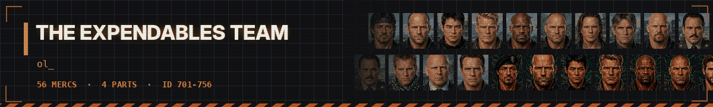

# 💥 The Expendables Team - dossiers

<a href="../../README.md">⬅ Back to README</a> · <a href="predator.md">🩸 Predator Team</a> · <a href="alien.md">👾 Alien Team</a> · <a href="troopers.md">🪲 Starship Troopers</a> · <a href="bia.md">🪖 Brothers in Arms</a> · <a href="johnwick.md">🪙 John Wick's Team</a> · <a href="clancy.md">🚨 Tom Clancy's Team</a> · <a href="fallout.md">☢️ Fallout Shelter Team</a> · <a href="gta.md">🚗 Grand Theft Auto Team</a> · <a href="stalker.md">☣️ S.T.A.L.K.E.R. Team</a>

Barney Ross's crew across all four films - old guns, loud jobs, no questions asked.

| Mercs | IDs | Films | Avg level | Best all-rounder | Most expensive |
|:---:|:---:|:---:|:---:|:---:|:---:|
| **56** | 701-756 | 4 | 7.1 | **Conrad** (76.6) | **Booker** ($7,500/day) |

**Films:** [The Expendables 1](#the-expendables-1) · [The Expendables 2](#the-expendables-2) · [The Expendables 3](#the-expendables-3) · [The Expendables 4](#the-expendables-4)

Stats are on the JA2 1.13 scale (0-100), one ━ is 10 points. Day rates are in dollars; the Premium kit costs 50% more.

## The Expendables 1

13 mercs

<table>
<tr>
<td width="120" align="center" valign="top">
 
<b>ID 701</b> 
Lvl <b>8</b>
</td>
<td valign="top">

### Barney · Barney Ross

The boss. Leader, pilot, the man who says yes or no. 
Played by: <b>Sylvester Stallone</b>

<code>Squadleader</code> <code>Squadleader</code> <code>Gunslinger</code>

<pre>
HLT ━━━━━━━━━─  90    AGI ━━━━━━━━──  82
DEX ━━━━━━━━──  84    STR ━━━━━━━━──  82
WIS ━━━━━━━━──  82    LDR ━━━━━━━━━─  92
MRK ━━━━━━━━━─  90    MEC ━━━━──────  45
EXP ━━━━──────  40    MED ━━━───────  30
AVG 71.7
</pre>

💵 **$6,500** a day · **$40,500** a week · **$75,500** for two weeks 
🎒 Standard · Rifle · Revolver · Tanker · Premium +50%

</td>
</tr>
</table>

<table>
<tr>
<td width="120" align="center" valign="top">
 
<b>ID 702</b> 
Lvl <b>7</b>
</td>
<td valign="top">

### Christmas · Lee Christmas

Knives and close combat. Barney's best friend. 
Played by: <b>Jason Statham</b>

<code>Throwing</code> <code>Melee</code> <code>Martial Arts</code>

<pre>
HLT ━━━━━━━━━─  88    AGI ━━━━━━━━━─  90
DEX ━━━━━━━━━─  90    STR ━━━━━━━━──  78
WIS ━━━━━━━━──  80    LDR ━━━━━━────  55
MRK ━━━━━━━━━─  88    MEC ━━━───────  30
EXP ━━━━──────  35    MED ━━────────  20
AVG 65.4
</pre>

💵 **$5,200** a day · **$32,000** a week · **$60,500** for two weeks 
🎒 Standard · Knives · Pistol · Flares · Premium +50%

</td>
</tr>
</table>

<table>
<tr>
<td width="120" align="center" valign="top">
 
<b>ID 703</b> 
Lvl <b>7</b>
</td>
<td valign="top">

### Yin Yang

Martial artist. Small, fast, wants a raise. 
Played by: <b>Jet Li</b>

<code>Martial Arts</code> <code>Martial Arts</code> <code>Athletics</code>

<pre>
HLT ━━━━━━━━──  82    AGI ━━━━━━━━━━  96
DEX ━━━━━━━━━─  90    STR ━━━━━━────  62
WIS ━━━━━━━━──  82    LDR ━━━───────  30
MRK ━━━━━━━━──  82    MEC ━━────────  20
EXP ━━────────  20    MED ━━━───────  30
AVG 59.4
</pre>

💵 **$4,500** a day · **$28,000** a week · **$52,000** for two weeks 
🎒 Standard · Rifle · Hands · Quiet · Premium +50%

</td>
</tr>
</table>

<table>
<tr>
<td width="120" align="center" valign="top">
 
<b>ID 704</b> 
Lvl <b>7</b>
</td>
<td valign="top">

### Gunnar · Gunnar Jensen

Chemist and demolitions. A loose cannon. 
Played by: <b>Dolph Lundgren</b>

<code>Demolitions</code> <code>Heavy Weapons</code> <code>Bodybuilding</code>

<pre>
HLT ━━━━━━━━━─  92    AGI ━━━━━━━━──  76
DEX ━━━━━━━━──  78    STR ━━━━━━━━━─  92
WIS ━━━━━━────  62    LDR ━━────────  25
MRK ━━━━━━━━──  84    MEC ━━━━━━────  55
EXP ━━━━━━━━━─  88    MED ━━────────  25
AVG 67.7
</pre>

💵 **$4,800** a day · **$30,000** a week · **$55,500** for two weeks 
🎒 Standard · Grenadier · Chemist · Pistol · Premium +50%

</td>
</tr>
</table>

<table>
<tr>
<td width="120" align="center" valign="top">
 
<b>ID 705</b> 
Lvl <b>7</b>
</td>
<td valign="top">

### Caesar · Hale Caesar

Heavy weapons specialist. 
Played by: <b>Terry Crews</b>

<code>Heavy Weapons</code> <code>Auto Weapons</code> <code>Bodybuilding</code>

<pre>
HLT ━━━━━━━━━─  90    AGI ━━━━━━━───  74
DEX ━━━━━━━━──  78    STR ━━━━━━━━━─  90
WIS ━━━━━━━───  72    LDR ━━━━──────  35
MRK ━━━━━━━━──  82    MEC ━━━━──────  40
EXP ━━━━━─────  50    MED ━━────────  20
AVG 63.1
</pre>

💵 **$4,800** a day · **$30,000** a week · **$55,500** for two weeks 
🎒 Standard · Heavy · Pistol · Frag · Premium +50%

</td>
</tr>
</table>

<table>
<tr>
<td width="120" align="center" valign="top">
 
<b>ID 706</b> 
Lvl <b>7</b>
</td>
<td valign="top">

### Toll Road

Demolitions and wrestling. The ear man. 
Played by: <b>Randy Couture</b>

<code>Demolitions</code> <code>Martial Arts</code> <code>Bodybuilding</code>

<pre>
HLT ━━━━━━━━━─  90    AGI ━━━━━━━━──  80
DEX ━━━━━━━━──  80    STR ━━━━━━━━━─  88
WIS ━━━━━━━───  74    LDR ━━━━──────  40
MRK ━━━━━━━━──  82    MEC ━━━━──────  40
EXP ━━━━━━━━──  82    MED ━━────────  25
AVG 68.1
</pre>

💵 **$4,600** a day · **$28,500** a week · **$53,500** for two weeks 
🎒 Standard · Rifle · Demolition · Wrestler · Premium +50%

</td>
</tr>
</table>

<table>
<tr>
<td width="120" align="center" valign="top">
 
<b>ID 707</b> 
Lvl <b>6</b>
</td>
<td valign="top">

### Tool

Former team member. Tattoo artist and go-between. 
Played by: <b>Mickey Rourke</b>

<code>Snitch</code> <code>Teaching</code>

<pre>
HLT ━━━━━━━───  72    AGI ━━━━━━━───  66
DEX ━━━━━━━━──  80    STR ━━━━━━━───  70
WIS ━━━━━━━━━─  90    LDR ━━━━━━────  60
MRK ━━━━━━━━──  78    MEC ━━━━──────  40
EXP ━━━───────  30    MED ━━━━──────  40
AVG 62.6
</pre>

💵 **$3,000** a day · **$18,500** a week · **$35,000** for two weeks 
🎒 Standard · Shop · Old Days · Go-between · Premium +50%

</td>
</tr>
</table>

<table>
<tr>
<td width="120" align="center" valign="top">
 
<b>ID 708</b> 
Lvl <b>7</b>
</td>
<td valign="top">

### Munroe · James Munroe

James Munroe. Former CIA. The real power on Vilena. 
Played by: <b>Eric Roberts</b>

<code>Squadleader</code> <code>Gunslinger</code> <code>Covert Ops</code>

<pre>
HLT ━━━━━━━━──  80    AGI ━━━━━━━───  72
DEX ━━━━━━━━──  78    STR ━━━━━━━───  70
WIS ━━━━━━━━━─  90    LDR ━━━━━━━━──  80
MRK ━━━━━━━━──  82    MEC ━━━━──────  40
EXP ━━━━──────  40    MED ━━────────  25
AVG 65.7
</pre>

💵 **$4,500** a day · **$28,000** a week · **$52,000** for two weeks 
🎒 Standard · Guards · Agent · Rifle · Premium +50%

</td>
</tr>
</table>

<table>
<tr>
<td width="120" align="center" valign="top">
 
<b>ID 709</b> 
Lvl <b>6</b>
</td>
<td valign="top">

### Paine · Dan Paine

Dan Paine. Munroe's bodyguard. 
Played by: <b>Steve Austin</b>

<code>Martial Arts</code> <code>Melee</code> <code>Bodybuilding</code>

<pre>
HLT ━━━━━━━━━━  95    AGI ━━━━━━━───  74
DEX ━━━━━━━───  72    STR ━━━━━━━━━━  96
WIS ━━━━━━────  55    LDR ━━━━──────  40
MRK ━━━━━━━───  74    MEC ━━━───────  30
EXP ━━━───────  30    MED ━━────────  15
AVG 58.1
</pre>

💵 **$3,800** a day · **$23,500** a week · **$44,000** for two weeks 
🎒 Standard · Brawler · Guard · Rifle · Premium +50%

</td>
</tr>
</table>

<table>
<tr>
<td width="120" align="center" valign="top">
 
<b>ID 710</b> 
Lvl <b>6</b>
</td>
<td valign="top">

### Garza · General Garza

General Garza. Dictator of Vilena. 
Played by: <b>David Zayas</b>

<code>Squadleader</code> <code>Gunslinger</code>

<pre>
HLT ━━━━━━━───  70    AGI ━━━━━━────  60
DEX ━━━━━━━───  66    STR ━━━━━━────  64
WIS ━━━━━━━───  70    LDR ━━━━━━━━──  78
MRK ━━━━━━━━──  75    MEC ━━━───────  30
EXP ━━━───────  30    MED ━━────────  20
AVG 56.3
</pre>

💵 **$3,000** a day · **$18,500** a week · **$35,000** for two weeks 
🎒 Standard · Palace · Gunner · General · Premium +50%

</td>
</tr>
</table>

<table>
<tr>
<td width="120" align="center" valign="top">
 
<b>ID 711</b> 
Lvl <b>6</b>
</td>
<td valign="top">

### Brit · The Brit

The Brit. Munroe's hired fighter. 
Played by: <b>Gary Daniels</b>

<code>Martial Arts</code> <code>Martial Arts</code> <code>Melee</code>

<pre>
HLT ━━━━━━━━──  84    AGI ━━━━━━━━━─  90
DEX ━━━━━━━━━─  88    STR ━━━━━━━━──  76
WIS ━━━━━━━───  66    LDR ━━━───────  30
MRK ━━━━━━━━──  82    MEC ━━━───────  30
EXP ━━━───────  30    MED ━━────────  15
AVG 59.1
</pre>

💵 **$3,600** a day · **$22,500** a week · **$42,000** for two weeks 
🎒 Standard · Pistol · Fighter · Rifle · Premium +50%

</td>
</tr>
</table>

<table>
<tr>
<td width="120" align="center" valign="top">
 
<b>ID 712</b> 
Lvl <b>8</b>
</td>
<td valign="top">

### Church

Mr. Church. CIA. The man with the Vilena job. 
Played by: <b>Bruce Willis</b>

<code>Squadleader</code> <code>Gunslinger</code> <code>Covert Ops</code>

<pre>
HLT ━━━━━━━━──  80    AGI ━━━━━━━───  72
DEX ━━━━━━━━──  80    STR ━━━━━━━───  72
WIS ━━━━━━━━━─  90    LDR ━━━━━━━━──  80
MRK ━━━━━━━━━─  86    MEC ━━━━──────  45
EXP ━━━━──────  40    MED ━━━───────  30
AVG 67.5
</pre>

💵 **$6,000** a day · **$37,000** a week · **$69,500** for two weeks 
🎒 Standard · SMG · Agent · Pistol · Premium +50%

</td>
</tr>
</table>

<table>
<tr>
<td width="120" align="center" valign="top">
 
<b>ID 713</b> 
Lvl <b>8</b>
</td>
<td valign="top">

### Trench · Trench Mauser

Trench. Barney's old rival. 
Played by: <b>Arnold Schwarzenegger</b>

<code>Heavy Weapons</code> <code>Auto Weapons</code> <code>Bodybuilding</code>

<pre>
HLT ━━━━━━━━━─  92    AGI ━━━━━━━───  70
DEX ━━━━━━━━──  76    STR ━━━━━━━━━─  94
WIS ━━━━━━━━──  76    LDR ━━━━━━━───  72
MRK ━━━━━━━━──  84    MEC ━━━━──────  40
EXP ━━━━━─────  48    MED ━━────────  20
AVG 67.2
</pre>

💵 **$6,200** a day · **$38,500** a week · **$72,000** for two weeks 
🎒 Standard · Rifle · Shotgun · Pistol · Premium +50%

</td>
</tr>
</table>

## The Expendables 2

14 mercs

<table>
<tr>
<td width="120" align="center" valign="top">
 
<b>ID 714</b> 
Lvl <b>8</b>
</td>
<td valign="top">

### Barney · Barney Ross

The boss. Two years older, same rules. 
Played by: <b>Sylvester Stallone</b>

<code>Squadleader</code> <code>Squadleader</code> <code>Gunslinger</code>

<pre>
HLT ━━━━━━━━━─  90    AGI ━━━━━━━━──  82
DEX ━━━━━━━━━─  86    STR ━━━━━━━━──  82
WIS ━━━━━━━━──  84    LDR ━━━━━━━━━─  94
MRK ━━━━━━━━━─  92    MEC ━━━━━─────  48
EXP ━━━━──────  42    MED ━━━───────  32
AVG 73.2
</pre>

💵 **$6,800** a day · **$42,000** a week · **$79,000** for two weeks 
🎒 Standard · Pistols · SMG · Sidearm · Premium +50%

</td>
</tr>
</table>

<table>
<tr>
<td width="120" align="center" valign="top">
 
<b>ID 715</b> 
Lvl <b>8</b>
</td>
<td valign="top">

### Christmas · Lee Christmas

Knives and close combat. Still Barney's best friend. 
Played by: <b>Jason Statham</b>

<code>Throwing</code> <code>Melee</code> <code>Martial Arts</code>

<pre>
HLT ━━━━━━━━━─  88    AGI ━━━━━━━━━─  90
DEX ━━━━━━━━━─  92    STR ━━━━━━━━──  78
WIS ━━━━━━━━──  82    LDR ━━━━━━────  58
MRK ━━━━━━━━━─  90    MEC ━━━───────  32
EXP ━━━━──────  38    MED ━━────────  22
AVG 67.0
</pre>

💵 **$5,600** a day · **$34,500** a week · **$65,000** for two weeks 
🎒 Standard · Knives · Gunner · Carbine · Premium +50%

</td>
</tr>
</table>

<table>
<tr>
<td width="120" align="center" valign="top">
 
<b>ID 716</b> 
Lvl <b>7</b>
</td>
<td valign="top">

### Yin Yang

Martial artist. In and out of Nepal. 
Played by: <b>Jet Li</b>

<code>Martial Arts</code> <code>Martial Arts</code> <code>Athletics</code>

<pre>
HLT ━━━━━━━━──  82    AGI ━━━━━━━━━━  96
DEX ━━━━━━━━━─  90    STR ━━━━━━────  62
WIS ━━━━━━━━──  84    LDR ━━━───────  30
MRK ━━━━━━━━──  84    MEC ━━────────  20
EXP ━━────────  20    MED ━━━───────  30
AVG 59.8
</pre>

💵 **$4,600** a day · **$28,500** a week · **$53,500** for two weeks 
🎒 Standard · Hands · Quiet · Rifle · Premium +50%

</td>
</tr>
</table>

<table>
<tr>
<td width="120" align="center" valign="top">
 
<b>ID 717</b> 
Lvl <b>7</b>
</td>
<td valign="top">

### Gunnar · Gunnar Jensen

Chemist and demolitions. Back on the team. 
Played by: <b>Dolph Lundgren</b>

<code>Demolitions</code> <code>Heavy Weapons</code> <code>Bodybuilding</code>

<pre>
HLT ━━━━━━━━━─  92    AGI ━━━━━━━━──  76
DEX ━━━━━━━━──  80    STR ━━━━━━━━━─  92
WIS ━━━━━━━───  70    LDR ━━────────  25
MRK ━━━━━━━━━─  86    MEC ━━━━━━────  58
EXP ━━━━━━━━━─  90    MED ━━────────  25
AVG 69.4
</pre>

💵 **$5,000** a day · **$31,000** a week · **$58,000** for two weeks 
🎒 Standard · Grenadier · SMG · Chemist · Premium +50%

</td>
</tr>
</table>

<table>
<tr>
<td width="120" align="center" valign="top">
 
<b>ID 718</b> 
Lvl <b>8</b>
</td>
<td valign="top">

### Caesar · Hale Caesar

Heavy weapons specialist. 
Played by: <b>Terry Crews</b>

<code>Heavy Weapons</code> <code>Auto Weapons</code> <code>Bodybuilding</code>

<pre>
HLT ━━━━━━━━━─  90    AGI ━━━━━━━───  74
DEX ━━━━━━━━──  78    STR ━━━━━━━━━─  92
WIS ━━━━━━━───  74    LDR ━━━━──────  38
MRK ━━━━━━━━──  84    MEC ━━━━──────  40
EXP ━━━━━─────  52    MED ━━────────  20
AVG 64.2
</pre>

💵 **$5,200** a day · **$32,000** a week · **$60,500** for two weeks 
🎒 Standard · Benelli · Rocket · Grenadier · Premium +50%

</td>
</tr>
</table>

<table>
<tr>
<td width="120" align="center" valign="top">
 
<b>ID 719</b> 
Lvl <b>7</b>
</td>
<td valign="top">

### Toll Road

Demolitions and wrestling. 
Played by: <b>Randy Couture</b>

<code>Demolitions</code> <code>Martial Arts</code> <code>Bodybuilding</code>

<pre>
HLT ━━━━━━━━━─  92    AGI ━━━━━━━━──  80
DEX ━━━━━━━━──  80    STR ━━━━━━━━━─  90
WIS ━━━━━━━━──  78    LDR ━━━━──────  42
MRK ━━━━━━━━──  84    MEC ━━━━──────  42
EXP ━━━━━━━━──  84    MED ━━────────  25
AVG 69.7
</pre>

💵 **$4,800** a day · **$30,000** a week · **$55,500** for two weeks 
🎒 Standard · SMG · Demolition · Wrestler · Premium +50%

</td>
</tr>
</table>

<table>
<tr>
<td width="120" align="center" valign="top">
 
<b>ID 720</b> 
Lvl <b>5</b>
</td>
<td valign="top">

### Billy · Billy Timmons

Sniper. The youngest of the team. 
Played by: <b>Liam Hemsworth</b>

<code>Sniper</code> <code>Sniper</code> <code>Ranger</code>

<pre>
HLT ━━━━━━━━──  84    AGI ━━━━━━━━━─  86
DEX ━━━━━━━━━─  88    STR ━━━━━━━───  74
WIS ━━━━━━━───  70    LDR ━━━───────  30
MRK ━━━━━━━━━━  96    MEC ━━━───────  30
EXP ━━────────  25    MED ━━━───────  30
AVG 61.3
</pre>

💵 **$3,200** a day · **$20,000** a week · **$37,000** for two weeks 
🎒 Standard · Barrett · Ranger · Pistol · Premium +50%

</td>
</tr>
</table>

<table>
<tr>
<td width="120" align="center" valign="top">
 
<b>ID 721</b> 
Lvl <b>8</b>
</td>
<td valign="top">

### Vilain · Jean Vilain

Leader of the Sangs. The man who wants respect. 
Played by: <b>Jean-Claude Van Damme</b>

<code>Melee</code> <code>Martial Arts</code> <code>Squadleader</code>

<pre>
HLT ━━━━━━━━━─  88    AGI ━━━━━━━━━─  92
DEX ━━━━━━━━━─  90    STR ━━━━━━━━──  82
WIS ━━━━━━━━──  80    LDR ━━━━━━━━──  85
MRK ━━━━━━━━━─  88    MEC ━━━━──────  40
EXP ━━━━━━────  55    MED ━━────────  20
AVG 72.0
</pre>

💵 **$6,000** a day · **$37,000** a week · **$69,500** for two weeks 
🎒 Standard · Knife · Rifle · Pistol · Premium +50%

</td>
</tr>
</table>

<table>
<tr>
<td width="120" align="center" valign="top">
 
<b>ID 722</b> 
Lvl <b>7</b>
</td>
<td valign="top">

### Hector

Vilain's right hand. 
Played by: <b>Scott Adkins</b>

<code>Martial Arts</code> <code>Martial Arts</code> <code>Melee</code>

<pre>
HLT ━━━━━━━━━─  86    AGI ━━━━━━━━━─  86
DEX ━━━━━━━━━─  86    STR ━━━━━━━━──  80
WIS ━━━━━━────  64    LDR ━━━━──────  45
MRK ━━━━━━━━──  84    MEC ━━━───────  30
EXP ━━━━──────  40    MED ━━────────  15
AVG 61.6
</pre>

💵 **$4,200** a day · **$26,000** a week · **$48,500** for two weeks 
🎒 Standard · Pistol · Close · Guard · Premium +50%

</td>
</tr>
</table>

<table>
<tr>
<td width="120" align="center" valign="top">
 
<b>ID 723</b> 
Lvl <b>6</b>
</td>
<td valign="top">

### Maggie · Maggie Chen

Church's agent. Safes, codes and a good kick. 
Played by: <b>Yu Nan</b>

<code>Technician</code> <code>Martial Arts</code> <code>Covert Ops</code>

<pre>
HLT ━━━━━━━━──  76    AGI ━━━━━━━━━─  88
DEX ━━━━━━━━━─  86    STR ━━━━━━────  60
WIS ━━━━━━━━━─  86    LDR ━━━━──────  40
MRK ━━━━━━━━──  80    MEC ━━━━━━━───  72
EXP ━━━━──────  40    MED ━━━━──────  40
AVG 66.8
</pre>

💵 **$3,600** a day · **$22,500** a week · **$42,000** for two weeks 
🎒 Standard · SMG · Tech · Martial · Premium +50%

</td>
</tr>
</table>

<table>
<tr>
<td width="120" align="center" valign="top">
 
<b>ID 724</b> 
Lvl <b>9</b>
</td>
<td valign="top">

### Booker

The Lone Wolf. 
Played by: <b>Chuck Norris</b>

<code>Ranger</code> <code>Ranger</code> <code>Stealthy</code>

<pre>
HLT ━━━━━━━━━━  95    AGI ━━━━━━━━──  84
DEX ━━━━━━━━━─  90    STR ━━━━━━━━━─  86
WIS ━━━━━━━━━─  90    LDR ━━━━──────  40
MRK ━━━━━━━━━━  96    MEC ━━━━──────  40
EXP ━━━━──────  45    MED ━━━───────  30
AVG 69.6
</pre>

💵 **$7,500** a day · **$46,500** a week · **$87,000** for two weeks 
🎒 Standard · Lone Wolf · Carbine · Hunter · Premium +50%

</td>
</tr>
</table>

<table>
<tr>
<td width="120" align="center" valign="top">
 
<b>ID 725</b> 
Lvl <b>8</b>
</td>
<td valign="top">

### Church

Mr. Church. The man who hires the hired. 
Played by: <b>Bruce Willis</b>

<code>Squadleader</code> <code>Gunslinger</code> <code>Covert Ops</code>

<pre>
HLT ━━━━━━━━──  82    AGI ━━━━━━━───  74
DEX ━━━━━━━━──  80    STR ━━━━━━━───  74
WIS ━━━━━━━━━─  92    LDR ━━━━━━━━──  82
MRK ━━━━━━━━━─  88    MEC ━━━━──────  45
EXP ━━━━──────  40    MED ━━━───────  30
AVG 68.7
</pre>

💵 **$6,200** a day · **$38,500** a week · **$72,000** for two weeks 
🎒 Standard · SMG · Agent · Pistol · Premium +50%

</td>
</tr>
</table>

<table>
<tr>
<td width="120" align="center" valign="top">
 
<b>ID 726</b> 
Lvl <b>8</b>
</td>
<td valign="top">

### Trench · Trench Mauser

Trench. Barney's old rival. 
Played by: <b>Arnold Schwarzenegger</b>

<code>Heavy Weapons</code> <code>Auto Weapons</code> <code>Bodybuilding</code>

<pre>
HLT ━━━━━━━━━─  94    AGI ━━━━━━━───  72
DEX ━━━━━━━━──  78    STR ━━━━━━━━━━  95
WIS ━━━━━━━━──  78    LDR ━━━━━━━━──  75
MRK ━━━━━━━━━─  86    MEC ━━━━──────  40
EXP ━━━━━─────  50    MED ━━────────  20
AVG 68.8
</pre>

💵 **$6,500** a day · **$40,500** a week · **$75,500** for two weeks 
🎒 Standard · Rifle · Shotgun · Heavy · Premium +50%

</td>
</tr>
</table>

<table>
<tr>
<td width="120" align="center" valign="top">
 
<b>ID 727</b> 
Lvl <b>5</b>
</td>
<td valign="top">

### Pilar

Leader of the village militia. 
Played by: <b>Amanda Ooms</b>

<code>Squadleader</code> <code>Ranger</code> <code>Survival</code>

<pre>
HLT ━━━━━━━━──  78    AGI ━━━━━━━━──  80
DEX ━━━━━━━━──  80    STR ━━━━━━━───  66
WIS ━━━━━━━━──  80    LDR ━━━━━━━━──  78
MRK ━━━━━━━━──  80    MEC ━━━━──────  40
EXP ━━━━──────  45    MED ━━━━──────  40
AVG 66.7
</pre>

💵 **$2,400** a day · **$15,000** a week · **$28,000** for two weeks 
🎒 Standard · Village · Rifle · Pistol · Premium +50%

</td>
</tr>
</table>

## The Expendables 3

17 mercs

<table>
<tr>
<td width="120" align="center" valign="top">
 
<b>ID 728</b> 
Lvl <b>9</b>
</td>
<td valign="top">

### Barney · Barney Ross

The boss. The founder who stayed. 
Played by: <b>Sylvester Stallone</b>

<code>Squadleader</code> <code>Squadleader</code> <code>Gunslinger</code>

<pre>
HLT ━━━━━━━━━─  90    AGI ━━━━━━━━──  80
DEX ━━━━━━━━━─  86    STR ━━━━━━━━──  82
WIS ━━━━━━━━━─  86    LDR ━━━━━━━━━━  95
MRK ━━━━━━━━━─  92    MEC ━━━━━─────  48
EXP ━━━━──────  42    MED ━━━───────  32
AVG 73.3
</pre>

💵 **$7,200** a day · **$44,500** a week · **$83,500** for two weeks 
🎒 Standard · Revolver · Carbine · Assault · Premium +50%

</td>
</tr>
</table>

<table>
<tr>
<td width="120" align="center" valign="top">
 
<b>ID 729</b> 
Lvl <b>8</b>
</td>
<td valign="top">

### Christmas · Lee Christmas

Knives. Barney's right hand, not ready to retire. 
Played by: <b>Jason Statham</b>

<code>Throwing</code> <code>Melee</code> <code>Martial Arts</code>

<pre>
HLT ━━━━━━━━━─  88    AGI ━━━━━━━━━─  90
DEX ━━━━━━━━━─  92    STR ━━━━━━━━──  78
WIS ━━━━━━━━──  82    LDR ━━━━━━────  60
MRK ━━━━━━━━━─  90    MEC ━━━───────  32
EXP ━━━━──────  38    MED ━━────────  22
AVG 67.2
</pre>

💵 **$5,800** a day · **$36,000** a week · **$67,500** for two weeks 
🎒 Standard · Knives · Grenadier · Carbine · Premium +50%

</td>
</tr>
</table>

<table>
<tr>
<td width="120" align="center" valign="top">
 
<b>ID 730</b> 
Lvl <b>7</b>
</td>
<td valign="top">

### Gunnar · Gunnar Jensen

Heavy weapons and demolitions. Still a loose cannon. 
Played by: <b>Dolph Lundgren</b>

<code>Demolitions</code> <code>Heavy Weapons</code> <code>Bodybuilding</code>

<pre>
HLT ━━━━━━━━━─  92    AGI ━━━━━━━━──  76
DEX ━━━━━━━━──  80    STR ━━━━━━━━━─  92
WIS ━━━━━━━───  68    LDR ━━────────  25
MRK ━━━━━━━━━─  86    MEC ━━━━━━────  58
EXP ━━━━━━━━━─  90    MED ━━────────  25
AVG 69.2
</pre>

💵 **$5,000** a day · **$31,000** a week · **$58,000** for two weeks 
🎒 Standard · Grenadier · Swiss · Chemist · Premium +50%

</td>
</tr>
</table>

<table>
<tr>
<td width="120" align="center" valign="top">
 
<b>ID 731</b> 
Lvl <b>7</b>
</td>
<td valign="top">

### Toll Road

Demolitions and wrestling. 
Played by: <b>Randy Couture</b>

<code>Demolitions</code> <code>Martial Arts</code> <code>Bodybuilding</code>

<pre>
HLT ━━━━━━━━━─  92    AGI ━━━━━━━━──  80
DEX ━━━━━━━━──  80    STR ━━━━━━━━━─  90
WIS ━━━━━━━━──  78    LDR ━━━━──────  42
MRK ━━━━━━━━──  84    MEC ━━━━──────  42
EXP ━━━━━━━━━─  86    MED ━━────────  25
AVG 69.9
</pre>

💵 **$4,900** a day · **$30,500** a week · **$57,000** for two weeks 
🎒 Standard · Para · PKM · Demolition · Premium +50%

</td>
</tr>
</table>

<table>
<tr>
<td width="120" align="center" valign="top">
 
<b>ID 732</b> 
Lvl <b>8</b>
</td>
<td valign="top">

### Caesar · Hale Caesar

Heavy weapons. Shot in Mogadishu. 
Played by: <b>Terry Crews</b>

<code>Heavy Weapons</code> <code>Auto Weapons</code> <code>Bodybuilding</code>

<pre>
HLT ━━━━━━━━━─  88    AGI ━━━━━━━───  72
DEX ━━━━━━━━──  78    STR ━━━━━━━━━─  92
WIS ━━━━━━━───  74    LDR ━━━━──────  38
MRK ━━━━━━━━──  84    MEC ━━━━──────  40
EXP ━━━━━─────  52    MED ━━────────  20
AVG 63.8
</pre>

💵 **$5,200** a day · **$32,000** a week · **$60,500** for two weeks 
🎒 Standard · Rifle · Ammo Load · Pistol · Premium +50%

</td>
</tr>
</table>

<table>
<tr>
<td width="120" align="center" valign="top">
 
<b>ID 733</b> 
Lvl <b>7</b>
</td>
<td valign="top">

### Yin Yang

Martial artist. Works for Trench now. 
Played by: <b>Jet Li</b>

<code>Martial Arts</code> <code>Martial Arts</code> <code>Athletics</code>

<pre>
HLT ━━━━━━━━──  82    AGI ━━━━━━━━━━  96
DEX ━━━━━━━━━─  90    STR ━━━━━━────  62
WIS ━━━━━━━━──  84    LDR ━━━───────  30
MRK ━━━━━━━━──  84    MEC ━━────────  20
EXP ━━────────  20    MED ━━━───────  30
AVG 59.8
</pre>

💵 **$4,600** a day · **$28,500** a week · **$53,500** for two weeks 
🎒 Standard · Two Guns · Gunner · Hands · Premium +50%

</td>
</tr>
</table>

<table>
<tr>
<td width="120" align="center" valign="top">
 
<b>ID 734</b> 
Lvl <b>8</b>
</td>
<td valign="top">

### Doc

Doc. Founder, medic and blade man. 
Played by: <b>Wesley Snipes</b>

<code>Doctor</code> <code>Melee</code> <code>Throwing</code>

<pre>
HLT ━━━━━━━━━─  88    AGI ━━━━━━━━━─  90
DEX ━━━━━━━━━─  92    STR ━━━━━━━━──  80
WIS ━━━━━━━━──  80    LDR ━━━━━━────  55
MRK ━━━━━━━━━─  86    MEC ━━━───────  30
EXP ━━━━──────  35    MED ━━━━━━━───  70
AVG 70.6
</pre>

💵 **$6,000** a day · **$37,000** a week · **$69,500** for two weeks 
🎒 Standard · Blades · Rifle · Medic · Premium +50%

</td>
</tr>
</table>

<table>
<tr>
<td width="120" align="center" valign="top">
 
<b>ID 735</b> 
Lvl <b>7</b>
</td>
<td valign="top">

### Galgo

Galgo. Spanish Legion. Talks a lot. 
Played by: <b>Antonio Banderas</b>

<code>Gunslinger</code> <code>Martial Arts</code> <code>Athletics</code>

<pre>
HLT ━━━━━━━━──  84    AGI ━━━━━━━━━─  94
DEX ━━━━━━━━━─  90    STR ━━━━━━━───  74
WIS ━━━━━━━───  72    LDR ━━━━──────  40
MRK ━━━━━━━━━─  86    MEC ━━━───────  30
EXP ━━━━──────  40    MED ━━────────  25
AVG 63.5
</pre>

💵 **$3,800** a day · **$23,500** a week · **$44,000** for two weeks 
🎒 Standard · Two Guns · Legion · Fast · Premium +50%

</td>
</tr>
</table>

<table>
<tr>
<td width="120" align="center" valign="top">
 
<b>ID 736</b> 
Lvl <b>5</b>
</td>
<td valign="top">

### Smiley · John Smiley

John Smiley. Ex-Marine, takes risks. 
Played by: <b>Kellan Lutz</b>

<code>Auto Weapons</code> <code>Ranger</code> <code>Athletics</code>

<pre>
HLT ━━━━━━━━━─  86    AGI ━━━━━━━━━─  86
DEX ━━━━━━━━──  84    STR ━━━━━━━━──  80
WIS ━━━━━━────  60    LDR ━━━───────  30
MRK ━━━━━━━━──  84    MEC ━━━───────  30
EXP ━━━━──────  40    MED ━━────────  20
AVG 60.0
</pre>

💵 **$2,800** a day · **$17,500** a week · **$32,500** for two weeks 
🎒 Standard · Rifle · SMG · Pistol · Premium +50%

</td>
</tr>
</table>

<table>
<tr>
<td width="120" align="center" valign="top">
 
<b>ID 737</b> 
Lvl <b>5</b>
</td>
<td valign="top">

### Luna

Luna. Close combat. Former bouncer. 
Played by: <b>Ronda Rousey</b>

<code>Martial Arts</code> <code>Martial Arts</code> <code>Melee</code>

<pre>
HLT ━━━━━━━━──  84    AGI ━━━━━━━━━─  90
DEX ━━━━━━━━━─  86    STR ━━━━━━━───  72
WIS ━━━━━━━───  66    LDR ━━━───────  30
MRK ━━━━━━━━──  78    MEC ━━────────  20
EXP ━━────────  25    MED ━━────────  20
AVG 57.1
</pre>

💵 **$2,600** a day · **$16,000** a week · **$30,000** for two weeks 
🎒 Standard · Bouncer · SMG · Rifle · Premium +50%

</td>
</tr>
</table>

<table>
<tr>
<td width="120" align="center" valign="top">
 
<b>ID 738</b> 
Lvl <b>5</b>
</td>
<td valign="top">

### Thorn

Thorn. Hacker, pilot and tech man. 
Played by: <b>Glen Powell</b>

<code>Technician</code> <code>Technician</code> <code>Radio Operator</code>

<pre>
HLT ━━━━━━━━──  78    AGI ━━━━━━━━──  84
DEX ━━━━━━━━──  84    STR ━━━━━━━───  66
WIS ━━━━━━━━━─  88    LDR ━━━───────  30
MRK ━━━━━━━━──  80    MEC ━━━━━━━━──  80
EXP ━━━───────  30    MED ━━────────  25
AVG 64.5
</pre>

💵 **$2,800** a day · **$17,500** a week · **$32,500** for two weeks 
🎒 Standard · Hacker · Pilot · Tech · Premium +50%

</td>
</tr>
</table>

<table>
<tr>
<td width="120" align="center" valign="top">
 
<b>ID 739</b> 
Lvl <b>5</b>
</td>
<td valign="top">

### Mars

Mars. Sniper and weapons specialist. 
Played by: <b>Victor Ortiz</b>

<code>Sniper</code> <code>Auto Weapons</code> <code>Scouting</code>

<pre>
HLT ━━━━━━━━──  80    AGI ━━━━━━━━──  82
DEX ━━━━━━━━━─  90    STR ━━━━━━━───  68
WIS ━━━━━━━───  72    LDR ━━━───────  30
MRK ━━━━━━━━━─  94    MEC ━━━━──────  40
EXP ━━━━──────  40    MED ━━────────  20
AVG 61.6
</pre>

💵 **$3,000** a day · **$18,500** a week · **$35,000** for two weeks 
🎒 Standard · Shotgun · Sniper · Corner · Premium +50%

</td>
</tr>
</table>

<table>
<tr>
<td width="120" align="center" valign="top">
 
<b>ID 740</b> 
Lvl <b>8</b>
</td>
<td valign="top">

### Drummer · Max Drummer

Max Drummer. CIA. The man with the jobs now. 
Played by: <b>Harrison Ford</b>

<code>Squadleader</code> <code>Gunslinger</code> <code>Covert Ops</code>

<pre>
HLT ━━━━━━━━──  78    AGI ━━━━━━━───  70
DEX ━━━━━━━━──  78    STR ━━━━━━━───  70
WIS ━━━━━━━━━─  94    LDR ━━━━━━━━──  85
MRK ━━━━━━━━──  84    MEC ━━━━━━────  60
EXP ━━━━──────  40    MED ━━━───────  30
AVG 68.9
</pre>

💵 **$6,000** a day · **$37,000** a week · **$69,500** for two weeks 
🎒 Standard · Gunship · Agent · Pilot · Premium +50%

</td>
</tr>
</table>

<table>
<tr>
<td width="120" align="center" valign="top">
 
<b>ID 741</b> 
Lvl <b>8</b>
</td>
<td valign="top">

### Trench · Trench Mauser

Trench. Barney's old rival. 
Played by: <b>Arnold Schwarzenegger</b>

<code>Heavy Weapons</code> <code>Auto Weapons</code> <code>Bodybuilding</code>

<pre>
HLT ━━━━━━━━━─  94    AGI ━━━━━━━───  72
DEX ━━━━━━━━──  78    STR ━━━━━━━━━━  95
WIS ━━━━━━━━──  78    LDR ━━━━━━━━──  75
MRK ━━━━━━━━━─  86    MEC ━━━━──────  40
EXP ━━━━━─────  50    MED ━━────────  20
AVG 68.8
</pre>

💵 **$6,500** a day · **$40,500** a week · **$75,500** for two weeks 
🎒 Standard · Gunner · Shotgun · Pistol · Premium +50%

</td>
</tr>
</table>

<table>
<tr>
<td width="120" align="center" valign="top">
 
<b>ID 742</b> 
Lvl <b>6</b>
</td>
<td valign="top">

### Bonaparte

Bonaparte. Retired, finds people. 
Played by: <b>Kelsey Grammer</b>

<code>Teaching</code> <code>Snitch</code>

<pre>
HLT ━━━━━━━───  70    AGI ━━━━━━────  60
DEX ━━━━━━━───  70    STR ━━━━━━────  60
WIS ━━━━━━━━━─  92    LDR ━━━━━━━───  70
MRK ━━━━━━━━──  76    MEC ━━━───────  30
EXP ━━━───────  30    MED ━━━━──────  40
AVG 59.8
</pre>

💵 **$2,200** a day · **$13,500** a week · **$25,500** for two weeks 
🎒 Standard · Recruiter · Old Days · Shotgun · Premium +50%

</td>
</tr>
</table>

<table>
<tr>
<td width="120" align="center" valign="top">
 
<b>ID 743</b> 
Lvl <b>9</b>
</td>
<td valign="top">

### Conrad · Conrad Stonebanks

Conrad Stonebanks. Founder of the team. Arms dealer. 
Played by: <b>Mel Gibson</b>

<code>Squadleader</code> <code>Gunslinger</code> <code>Covert Ops</code>

<pre>
HLT ━━━━━━━━━─  90    AGI ━━━━━━━━──  84
DEX ━━━━━━━━━─  88    STR ━━━━━━━━──  84
WIS ━━━━━━━━━─  90    LDR ━━━━━━━━━─  88
MRK ━━━━━━━━━─  92    MEC ━━━━━─────  50
EXP ━━━━━━━───  70    MED ━━━───────  30
AVG 76.6
</pre>

💵 **$7,500** a day · **$46,500** a week · **$87,000** for two weeks 
🎒 Standard · Revolver · Dealer · Pistol · Premium +50%

</td>
</tr>
</table>

<table>
<tr>
<td width="120" align="center" valign="top">
 
<b>ID 744</b> 
Lvl <b>6</b>
</td>
<td valign="top">

### Vata · Goran Vata

Goran Vata. The buyer. 
Played by: <b>Robert Davi</b>

<code>Gunslinger</code> <code>Squadleader</code> <code>Snitch</code>

<pre>
HLT ━━━━━━━━──  78    AGI ━━━━━━━───  70
DEX ━━━━━━━━──  76    STR ━━━━━━━───  74
WIS ━━━━━━━━──  76    LDR ━━━━━━━───  70
MRK ━━━━━━━━──  76    MEC ━━━───────  30
EXP ━━━━──────  40    MED ━━────────  20
AVG 61.0
</pre>

💵 **$3,200** a day · **$20,000** a week · **$37,000** for two weeks 
🎒 Standard · Guards · Shotgun · Boss · Premium +50%

</td>
</tr>
</table>

## The Expendables 4

12 mercs

<table>
<tr>
<td width="120" align="center" valign="top">
 
<b>ID 745</b> 
Lvl <b>9</b>
</td>
<td valign="top">

### Christmas · Lee Christmas

Lee Christmas. Knives. Leads the team now. 
Played by: <b>Jason Statham</b>

<code>Throwing</code> <code>Melee</code> <code>Martial Arts</code>

<pre>
HLT ━━━━━━━━━─  88    AGI ━━━━━━━━━─  90
DEX ━━━━━━━━━─  92    STR ━━━━━━━━──  78
WIS ━━━━━━━━──  84    LDR ━━━━━━━───  70
MRK ━━━━━━━━━─  90    MEC ━━━───────  32
EXP ━━━━──────  38    MED ━━────────  22
AVG 68.4
</pre>

💵 **$6,200** a day · **$38,500** a week · **$72,000** for two weeks 
🎒 Standard · Knives · Rocket · Rifle · Premium +50%

</td>
</tr>
</table>

<table>
<tr>
<td width="120" align="center" valign="top">
 
<b>ID 746</b> 
Lvl <b>9</b>
</td>
<td valign="top">

### Barney · Barney Ross

Barney Ross. The founder. Not as dead as they think. 
Played by: <b>Sylvester Stallone</b>

<code>Squadleader</code> <code>Squadleader</code> <code>Gunslinger</code>

<pre>
HLT ━━━━━━━━━─  86    AGI ━━━━━━━━──  76
DEX ━━━━━━━━──  84    STR ━━━━━━━━──  80
WIS ━━━━━━━━━─  88    LDR ━━━━━━━━━━  95
MRK ━━━━━━━━━─  92    MEC ━━━━━─────  48
EXP ━━━━──────  42    MED ━━━───────  32
AVG 72.3
</pre>

💵 **$7,000** a day · **$43,500** a week · **$81,000** for two weeks 
🎒 Standard · Rifle · Revolver · Pilot · Premium +50%

</td>
</tr>
</table>

<table>
<tr>
<td width="120" align="center" valign="top">
 
<b>ID 747</b> 
Lvl <b>7</b>
</td>
<td valign="top">

### Gunnar · Gunnar Jensen

Gunnar Jensen. Sober and short-sighted. 
Played by: <b>Dolph Lundgren</b>

<code>Demolitions</code> <code>Heavy Weapons</code> <code>Bodybuilding</code>

<pre>
HLT ━━━━━━━━━─  90    AGI ━━━━━━━───  74
DEX ━━━━━━━━──  80    STR ━━━━━━━━━─  90
WIS ━━━━━━━───  74    LDR ━━────────  25
MRK ━━━━━━━━──  80    MEC ━━━━━━────  58
EXP ━━━━━━━━━─  90    MED ━━────────  25
AVG 68.6
</pre>

💵 **$5,000** a day · **$31,000** a week · **$58,000** for two weeks 
🎒 Standard · Rifle · Chemist · Grenades · Premium +50%

</td>
</tr>
</table>

<table>
<tr>
<td width="120" align="center" valign="top">
 
<b>ID 748</b> 
Lvl <b>7</b>
</td>
<td valign="top">

### Toll Road

Toll Road. Demolitions and wrestling. 
Played by: <b>Randy Couture</b>

<code>Demolitions</code> <code>Martial Arts</code> <code>Bodybuilding</code>

<pre>
HLT ━━━━━━━━━─  92    AGI ━━━━━━━━──  78
DEX ━━━━━━━━──  80    STR ━━━━━━━━━─  90
WIS ━━━━━━━━──  80    LDR ━━━━──────  42
MRK ━━━━━━━━──  84    MEC ━━━━──────  42
EXP ━━━━━━━━━─  88    MED ━━────────  25
AVG 70.1
</pre>

💵 **$5,000** a day · **$31,000** a week · **$58,000** for two weeks 
🎒 Standard · Grenadier · Demolition · AK · Premium +50%

</td>
</tr>
</table>

<table>
<tr>
<td width="120" align="center" valign="top">
 
<b>ID 749</b> 
Lvl <b>7</b>
</td>
<td valign="top">

### Gina

Gina. CIA. Leads the team on the ship. 
Played by: <b>Megan Fox</b>

<code>Squadleader</code> <code>Gunslinger</code> <code>Covert Ops</code>

<pre>
HLT ━━━━━━━━──  80    AGI ━━━━━━━━━─  88
DEX ━━━━━━━━━─  86    STR ━━━━━━────  64
WIS ━━━━━━━━━─  86    LDR ━━━━━━━━──  75
MRK ━━━━━━━━━─  86    MEC ━━━━──────  40
EXP ━━━━──────  40    MED ━━━───────  30
AVG 67.5
</pre>

💵 **$4,800** a day · **$30,000** a week · **$55,500** for two weeks 
🎒 Standard · Tavor · Agent · Pistol · Premium +50%

</td>
</tr>
</table>

<table>
<tr>
<td width="120" align="center" valign="top">
 
<b>ID 750</b> 
Lvl <b>7</b>
</td>
<td valign="top">

### Easy Day

Easy Day. Guns. 
Played by: <b>Curtis "50 Cent" Jackson</b>

<code>Auto Weapons</code> <code>Auto Weapons</code> <code>Gunslinger</code>

<pre>
HLT ━━━━━━━━━─  88    AGI ━━━━━━━━──  78
DEX ━━━━━━━━──  84    STR ━━━━━━━━──  84
WIS ━━━━━━━───  66    LDR ━━━━──────  40
MRK ━━━━━━━━━─  92    MEC ━━━━──────  40
EXP ━━━━──────  40    MED ━━────────  20
AVG 63.2
</pre>

💵 **$4,500** a day · **$28,000** a week · **$52,000** for two weeks 
🎒 Standard · Pistol · Rifle · Gunner · Premium +50%

</td>
</tr>
</table>

<table>
<tr>
<td width="120" align="center" valign="top">
 
<b>ID 751</b> 
Lvl <b>6</b>
</td>
<td valign="top">

### Galan

Galan. Son of Galgo. Fast and talkative. 
Played by: <b>Jacob Scipio</b>

<code>Gunslinger</code> <code>Martial Arts</code> <code>Athletics</code>

<pre>
HLT ━━━━━━━━──  84    AGI ━━━━━━━━━━  95
DEX ━━━━━━━━━─  90    STR ━━━━━━━───  72
WIS ━━━━━━────  64    LDR ━━━───────  30
MRK ━━━━━━━━━─  86    MEC ━━━───────  30
EXP ━━━━──────  35    MED ━━────────  20
AVG 60.6
</pre>

💵 **$3,600** a day · **$22,500** a week · **$42,000** for two weeks 
🎒 Standard · Shotgun · Two Guns · Fast · Premium +50%

</td>
</tr>
</table>

<table>
<tr>
<td width="120" align="center" valign="top">
 
<b>ID 752</b> 
Lvl <b>7</b>
</td>
<td valign="top">

### Lash

Lash. CIA. A whip with blades. 
Played by: <b>Levy Tran</b>

<code>Martial Arts</code> <code>Melee</code> <code>Covert Ops</code>

<pre>
HLT ━━━━━━━━──  78    AGI ━━━━━━━━━─  92
DEX ━━━━━━━━━─  90    STR ━━━━━━━───  66
WIS ━━━━━━━━──  78    LDR ━━━━──────  40
MRK ━━━━━━━━──  80    MEC ━━━───────  30
EXP ━━━───────  30    MED ━━────────  25
AVG 60.9
</pre>

💵 **$4,200** a day · **$26,000** a week · **$48,500** for two weeks 
🎒 Standard · Rifle · Blades · Agent · Premium +50%

</td>
</tr>
</table>

<table>
<tr>
<td width="120" align="center" valign="top">
 
<b>ID 753</b> 
Lvl <b>8</b>
</td>
<td valign="top">

### Decha

Decha. A former Expendable. Sailor. 
Played by: <b>Tony Jaa</b>

<code>Martial Arts</code> <code>Martial Arts</code> <code>Melee</code>

<pre>
HLT ━━━━━━━━━─  88    AGI ━━━━━━━━━━  96
DEX ━━━━━━━━━─  92    STR ━━━━━━━━──  80
WIS ━━━━━━━━──  78    LDR ━━━━──────  40
MRK ━━━━━━━━──  80    MEC ━━━━──────  40
EXP ━━━───────  30    MED ━━────────  25
AVG 64.9
</pre>

💵 **$5,000** a day · **$31,000** a week · **$58,000** for two weeks 
🎒 Standard · Sailor · Muay Thai · Rifle · Premium +50%

</td>
</tr>
</table>

<table>
<tr>
<td width="120" align="center" valign="top">
 
<b>ID 754</b> 
Lvl <b>8</b>
</td>
<td valign="top">

### Marsh

Marsh. CIA. The handler who came along. 
Played by: <b>Andy García</b>

<code>Squadleader</code> <code>Gunslinger</code> <code>Covert Ops</code>

<pre>
HLT ━━━━━━━━──  78    AGI ━━━━━━━───  70
DEX ━━━━━━━━──  78    STR ━━━━━━━───  70
WIS ━━━━━━━━━─  94    LDR ━━━━━━━━──  82
MRK ━━━━━━━━──  84    MEC ━━━━━─────  50
EXP ━━━━──────  45    MED ━━━───────  30
AVG 68.1
</pre>

💵 **$6,000** a day · **$37,000** a week · **$69,500** for two weeks 
🎒 Standard · Agent · Field · Pistol · Premium +50%

</td>
</tr>
</table>

<table>
<tr>
<td width="120" align="center" valign="top">
 
<b>ID 755</b> 
Lvl <b>8</b>
</td>
<td valign="top">

### Rahmat

Rahmat. Mercenary with his own army. 
Played by: <b>Iko Uwais</b>

<code>Martial Arts</code> <code>Martial Arts</code> <code>Squadleader</code>

<pre>
HLT ━━━━━━━━━─  90    AGI ━━━━━━━━━━  96
DEX ━━━━━━━━━─  92    STR ━━━━━━━━──  82
WIS ━━━━━━━━──  76    LDR ━━━━━━━━──  78
MRK ━━━━━━━━━─  88    MEC ━━━━──────  40
EXP ━━━━━─────  50    MED ━━────────  20
AVG 71.2
</pre>

💵 **$6,500** a day · **$40,500** a week · **$75,500** for two weeks 
🎒 Standard · Sniper · Gunner · Fighter · Premium +50%

</td>
</tr>
</table>

<table>
<tr>
<td width="120" align="center" valign="top">
 
<b>ID 756</b> 
Lvl <b>8</b>
</td>
<td valign="top">

### Ocelot

Ocelot. The name nobody could put a face to. 
From: <b>The Expendables 4</b>

<code>Squadleader</code> <code>Snitch</code> <code>Covert Ops</code>

<pre>
HLT ━━━━━━━━──  75    AGI ━━━━━━━───  66
DEX ━━━━━━━───  74    STR ━━━━━━━───  68
WIS ━━━━━━━━━━  95    LDR ━━━━━━━━──  85
MRK ━━━━━━━━──  82    MEC ━━━━━━────  60
EXP ━━━━━━━───  70    MED ━━━───────  30
AVG 70.5
</pre>

💵 **$7,000** a day · **$43,500** a week · **$81,000** for two weeks 
🎒 Standard · Dealer · Agent · Pistol · Premium +50%

</td>
</tr>
</table>

<a href="#">⬆ Back to top</a> · <a href="../../README.md">README</a>

