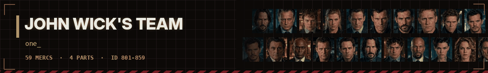

# 🪙 John Wick's Team - dossiers

<a href="../../README.md">⬅ Back to README</a> · <a href="predator.md">🩸 Predator Team</a> · <a href="alien.md">👾 Alien Team</a> · <a href="troopers.md">🪲 Starship Troopers</a> · <a href="bia.md">🪖 Brothers in Arms</a> · <a href="expendables.md">💥 Expendables Team</a> · <a href="clancy.md">🚨 Tom Clancy's Team</a> · <a href="fallout.md">☢️ Fallout Shelter Team</a> · <a href="gta.md">🚗 Grand Theft Auto Team</a> · <a href="stalker.md">☣️ S.T.A.L.K.E.R. Team</a>

Wick himself, the Continental, the High Table and everybody who ever tried to collect the bounty.

| Mercs | IDs | Films | Avg level | Best all-rounder | Most expensive |
|:---:|:---:|:---:|:---:|:---:|:---:|
| **59** | 801-859 | 4 | 5.8 | **Wick** (75.6) | **Wick** ($11,000/day) |

**Films:** [John Wick 1](#john-wick-1) · [John Wick 2](#john-wick-2) · [John Wick 3](#john-wick-3) · [John Wick 4](#john-wick-4)

Stats are on the JA2 1.13 scale (0-100), one ━ is 10 points. Day rates are in dollars; the Premium kit costs 50% more.

## John Wick 1

14 mercs

<table>
<tr>
<td width="120" align="center" valign="top">
 
<b>ID 801</b> 
Lvl <b>8</b>
</td>
<td valign="top">

### Wick · John Wick

John Wick. The one they call Baba Yaga. 
Played by: <b>Keanu Reeves</b>

<code>Gunslinger</code> <code>Martial Arts</code> <code>Stealthy</code>

<pre>
HLT ━━━━━━━━━─  88    AGI ━━━━━━━━━─  90
DEX ━━━━━━━━━─  91    STR ━━━━━━━━──  78
WIS ━━━━━━━━──  84    LDR ━━━━──────  40
MRK ━━━━━━━━━─  93    MEC ━━━━──────  40
EXP ━━━━──────  40    MED ━━━───────  30
AVG 67.4
</pre>

💵 **$8,000** a day · **$49,500** a week · **$93,000** for two weeks 
🎒 Standard · Carbine · Shotgun · Rifle · Premium +50%

</td>
</tr>
</table>

<table>
<tr>
<td width="120" align="center" valign="top">
 
<b>ID 802</b> 
Lvl <b>6</b>
</td>
<td valign="top">

### Viggo · Viggo Tarasov

Viggo Tarasov. Head of the Russian mob in New York. 
Played by: <b>Mikael Nyqvist</b>

<code>Squadleader</code> <code>Covert Ops</code>

<pre>
HLT ━━━━━━━───  72    AGI ━━━━━━────  62
DEX ━━━━━━━───  70    STR ━━━━━━────  64
WIS ━━━━━━━━━─  88    LDR ━━━━━━━━━─  90
MRK ━━━━━━━───  72    MEC ━━━───────  30
EXP ━━━━──────  35    MED ━━────────  20
AVG 60.3
</pre>

💵 **$4,500** a day · **$28,000** a week · **$52,000** for two weeks 
🎒 Standard · Guards · Shotgun · Boss · Premium +50%

</td>
</tr>
</table>

<table>
<tr>
<td width="120" align="center" valign="top">
 
<b>ID 803</b> 
Lvl <b>2</b>
</td>
<td valign="top">

### Iosef · Iosef Tarasov

Iosef Tarasov. Viggo's son. 
Played by: <b>Alfie Allen</b>

<code>Ambidextrous</code>

<pre>
HLT ━━━━━━━───  66    AGI ━━━━━━━───  70
DEX ━━━━━━━───  66    STR ━━━━━━────  58
WIS ━━━━━─────  50    LDR ━━━───────  30
MRK ━━━━━━────  58    MEC ━━━━──────  40
EXP ━━────────  15    MED ━─────────  10
AVG 46.3
</pre>

💵 **$700** a day · **$4,500** a week · **$8,000** for two weeks 
🎒 Standard · Car Thief · SMG · Shotgun · Premium +50%

</td>
</tr>
</table>

<table>
<tr>
<td width="120" align="center" valign="top">
 
<b>ID 804</b> 
Lvl <b>7</b>
</td>
<td valign="top">

### Perkins · Ms. Perkins

Ms. Perkins. Hired killer. Breaks rules for money. 
Played by: <b>Adrianne Palicki</b>

<code>Gunslinger</code> <code>Martial Arts</code> <code>Covert Ops</code>

<pre>
HLT ━━━━━━━━──  80    AGI ━━━━━━━━━─  90
DEX ━━━━━━━━━─  90    STR ━━━━━━━───  66
WIS ━━━━━━━───  74    LDR ━━━───────  30
MRK ━━━━━━━━━─  90    MEC ━━━━──────  35
EXP ━━━━──────  40    MED ━━────────  25
AVG 62.0
</pre>

💵 **$5,000** a day · **$31,000** a week · **$58,000** for two weeks 
🎒 Standard · Revolver · SMG · Close · Premium +50%

</td>
</tr>
</table>

<table>
<tr>
<td width="120" align="center" valign="top">
 
<b>ID 805</b> 
Lvl <b>1</b>
</td>
<td valign="top">

### Avi

Avi. Viggo's lawyer and right hand. 
Played by: <b>Dean Winters</b>

<code>Snitch</code>

<pre>
HLT ━━━━━━────  60    AGI ━━━━━━────  55
DEX ━━━━━━────  62    STR ━━━━━─────  50
WIS ━━━━━━━━━─  86    LDR ━━━━━─────  50
MRK ━━━━──────  40    MEC ━━━───────  30
EXP ━─────────  10    MED ━━────────  20
AVG 46.3
</pre>

💵 **$500** a day · **$3,000** a week · **$6,000** for two weeks 
🎒 Standard · Lawyer · Office · Driver · Premium +50%

</td>
</tr>
</table>

<table>
<tr>
<td width="120" align="center" valign="top">
 
<b>ID 806</b> 
Lvl <b>6</b>
</td>
<td valign="top">

### Kirill

Kirill. Viggo's chief bodyguard. 
Played by: <b>Daniel Bernhardt</b>

<code>Martial Arts</code> <code>Melee</code>

<pre>
HLT ━━━━━━━━━─  92    AGI ━━━━━━━━━─  86
DEX ━━━━━━━━──  84    STR ━━━━━━━━━─  88
WIS ━━━━━━━───  66    LDR ━━━━──────  45
MRK ━━━━━━━━──  82    MEC ━━━───────  30
EXP ━━━━──────  35    MED ━━────────  20
AVG 62.8
</pre>

💵 **$3,800** a day · **$23,500** a week · **$44,000** for two weeks 
🎒 Standard · Guard · Shotgun · Brawler · Premium +50%

</td>
</tr>
</table>

<table>
<tr>
<td width="120" align="center" valign="top">
 
<b>ID 807</b> 
Lvl <b>3</b>
</td>
<td valign="top">

### Gregori

Gregori. Iosef's man. 
Played by: <b>Omer Barnea</b>

<code>Auto Weapons</code>

<pre>
HLT ━━━━━━━━──  82    AGI ━━━━━━━───  72
DEX ━━━━━━━───  72    STR ━━━━━━━━──  76
WIS ━━━━━━────  55    LDR ━━────────  25
MRK ━━━━━━━───  74    MEC ━━━━──────  40
EXP ━━━───────  30    MED ━━────────  15
AVG 54.1
</pre>

💵 **$1,300** a day · **$8,000** a week · **$15,000** for two weeks 
🎒 Standard · SMG · Shotgun · Thug · Premium +50%

</td>
</tr>
</table>

<table>
<tr>
<td width="120" align="center" valign="top">
 
<b>ID 808</b> 
Lvl <b>3</b>
</td>
<td valign="top">

### Victor

Victor. Iosef's man. 
Played by: <b>Toby Leonard Moore</b>

<code>Melee</code>

<pre>
HLT ━━━━━━━━──  80    AGI ━━━━━━━───  74
DEX ━━━━━━━───  74    STR ━━━━━━━───  74
WIS ━━━━━━────  56    LDR ━━────────  20
MRK ━━━━━━━───  74    MEC ━━━───────  30
EXP ━━━───────  30    MED ━━────────  15
AVG 52.7
</pre>

💵 **$1,200** a day · **$7,500** a week · **$14,000** for two weeks 
🎒 Standard · SMG · Shotgun · Thug · Premium +50%

</td>
</tr>
</table>

<table>
<tr>
<td width="120" align="center" valign="top">
 
<b>ID 809</b> 
Lvl <b>9</b>
</td>
<td valign="top">

### Marcus

Marcus. Sniper. John's old friend and mentor. 
Played by: <b>Willem Dafoe</b>

<code>Sniper</code> <code>Sniper</code> <code>Stealthy</code>

<pre>
HLT ━━━━━━━━──  78    AGI ━━━━━━━━──  76
DEX ━━━━━━━━━─  88    STR ━━━━━━━───  66
WIS ━━━━━━━━━─  90    LDR ━━━━━─────  50
MRK ━━━━━━━━━━  99    MEC ━━━━━─────  50
EXP ━━━━──────  40    MED ━━━━──────  35
AVG 67.2
</pre>

💵 **$7,000** a day · **$43,500** a week · **$81,000** for two weeks 
🎒 Standard · Pistol · Closet · Watcher · Premium +50%

</td>
</tr>
</table>

<table>
<tr>
<td width="120" align="center" valign="top">
 
<b>ID 810</b> 
Lvl <b>3</b>
</td>
<td valign="top">

### Aurelio

Aurelio. Owner of a garage for stolen cars. 
Played by: <b>John Leguizamo</b>

<code>Technician</code> <code>Technician</code>

<pre>
HLT ━━━━━━━───  72    AGI ━━━━━━━───  66
DEX ━━━━━━━━──  80    STR ━━━━━━────  64
WIS ━━━━━━━━──  76    LDR ━━━━━─────  50
MRK ━━━━━━────  55    MEC ━━━━━━━━━━  95
EXP ━━━━──────  35    MED ━━────────  20
AVG 61.3
</pre>

💵 **$1,500** a day · **$9,500** a week · **$17,500** for two weeks 
🎒 Standard · Garage · Shotgun · Driver · Premium +50%

</td>
</tr>
</table>

<table>
<tr>
<td width="120" align="center" valign="top">
 
<b>ID 811</b> 
Lvl <b>7</b>
</td>
<td valign="top">

### Winston

Winston. Manager of the Continental, New York. 
Played by: <b>Ian McShane</b>

<code>Squadleader</code> <code>Snitch</code>

<pre>
HLT ━━━━━━━───  66    AGI ━━━━━━────  55
DEX ━━━━━━━───  70    STR ━━━━━━────  55
WIS ━━━━━━━━━━  96    LDR ━━━━━━━━━─  92
MRK ━━━━━━━━──  76    MEC ━━━───────  30
EXP ━━────────  25    MED ━━━───────  30
AVG 59.5
</pre>

💵 **$6,000** a day · **$37,000** a week · **$69,500** for two weeks 
🎒 Standard · Manager · Old Days · Shotgun · Premium +50%

</td>
</tr>
</table>

<table>
<tr>
<td width="120" align="center" valign="top">
 
<b>ID 812</b> 
Lvl <b>5</b>
</td>
<td valign="top">

### Charon

Charon. Concierge of the Continental. 
Played by: <b>Lance Reddick</b>

<code>Covert Ops</code>

<pre>
HLT ━━━━━━━━──  78    AGI ━━━━━━━───  74
DEX ━━━━━━━━──  82    STR ━━━━━━━───  66
WIS ━━━━━━━━━─  90    LDR ━━━━━━────  60
MRK ━━━━━━━━──  82    MEC ━━━━──────  40
EXP ━━━───────  30    MED ━━━━──────  40
AVG 64.2
</pre>

💵 **$3,000** a day · **$18,500** a week · **$35,000** for two weeks 
🎒 Standard · Concierge · Pistol · Defence · Premium +50%

</td>
</tr>
</table>

<table>
<tr>
<td width="120" align="center" valign="top">
 
<b>ID 813</b> 
Lvl <b>4</b>
</td>
<td valign="top">

### Charlie

Charlie. Head of the cleaners. 
Played by: <b>David Patrick Kelly</b>

<code>Covert Ops</code> <code>Doctor</code>

<pre>
HLT ━━━━━━━───  70    AGI ━━━━━━────  60
DEX ━━━━━━━━──  80    STR ━━━━━━────  62
WIS ━━━━━━━━──  82    LDR ━━━━━━────  55
MRK ━━━━━━────  60    MEC ━━━━━━────  60
EXP ━━━━──────  40    MED ━━━━━━━───  70
AVG 63.9
</pre>

💵 **$2,000** a day · **$12,500** a week · **$23,000** for two weeks 
🎒 Standard · Cleaner · Crew · Van · Premium +50%

</td>
</tr>
</table>

<table>
<tr>
<td width="120" align="center" valign="top">
 
<b>ID 814</b> 
Lvl <b>3</b>
</td>
<td valign="top">

### Jimmy

Jimmy. Police officer. 
Played by: <b>Thomas Sadoski</b>

<code>Gunslinger</code>

<pre>
HLT ━━━━━━━━──  76    AGI ━━━━━━━───  70
DEX ━━━━━━━───  74    STR ━━━━━━━───  66
WIS ━━━━━━━───  70    LDR ━━━━──────  35
MRK ━━━━━━━━──  76    MEC ━━━───────  30
EXP ━━────────  15    MED ━━────────  25
AVG 53.7
</pre>

💵 **$1,200** a day · **$7,500** a week · **$14,000** for two weeks 
🎒 Standard · Patrol · Night Shift · Off Duty · Premium +50%

</td>
</tr>
</table>

## John Wick 2

16 mercs

<table>
<tr>
<td width="120" align="center" valign="top">
 
<b>ID 815</b> 
Lvl <b>9</b>
</td>
<td valign="top">

### Wick · John Wick

John Wick, 2017. A marker comes due. 
Played by: <b>Keanu Reeves</b>

<code>Gunslinger</code> <code>Martial Arts</code> <code>Stealthy</code>

<pre>
HLT ━━━━━━━━━─  90    AGI ━━━━━━━━━─  92
DEX ━━━━━━━━━─  93    STR ━━━━━━━━──  80
WIS ━━━━━━━━━─  87    LDR ━━━━──────  42
MRK ━━━━━━━━━━  95    MEC ━━━━──────  45
EXP ━━━━──────  42    MED ━━━━──────  35
AVG 70.1
</pre>

💵 **$9,000** a day · **$56,000** a week · **$104,500** for two weeks 
🎒 Standard · Carbine · Shotgun · Seven · Premium +50%

</td>
</tr>
</table>

<table>
<tr>
<td width="120" align="center" valign="top">
 
<b>ID 816</b> 
Lvl <b>5</b>
</td>
<td valign="top">

### Santino · Santino D'Antonio

Santino D'Antonio. A prince of the Camorra. 
Played by: <b>Riccardo Scamarcio</b>

<code>Squadleader</code> <code>Covert Ops</code>

<pre>
HLT ━━━━━━━───  68    AGI ━━━━━━────  64
DEX ━━━━━━━───  66    STR ━━━━━━────  60
WIS ━━━━━━━━──  84    LDR ━━━━━━━━──  80
MRK ━━━━━━━───  70    MEC ━━────────  25
EXP ━━━───────  30    MED ━━────────  20
AVG 56.7
</pre>

💵 **$4,000** a day · **$25,000** a week · **$46,500** for two weeks 
🎒 Standard · Boss · Guards · Party · Premium +50%

</td>
</tr>
</table>

<table>
<tr>
<td width="120" align="center" valign="top">
 
<b>ID 817</b> 
Lvl <b>8</b>
</td>
<td valign="top">

### Cassian

Cassian. Gianna D'Antonio's bodyguard. 
Played by: <b>Common</b>

<code>Gunslinger</code> <code>Martial Arts</code>

<pre>
HLT ━━━━━━━━━─  90    AGI ━━━━━━━━━─  86
DEX ━━━━━━━━━─  88    STR ━━━━━━━━──  84
WIS ━━━━━━━━──  78    LDR ━━━━──────  45
MRK ━━━━━━━━━─  92    MEC ━━━━──────  40
EXP ━━━━──────  40    MED ━━━───────  30
AVG 67.3
</pre>

💵 **$6,500** a day · **$40,500** a week · **$75,500** for two weeks 
🎒 Standard · Close · SMG · Shotgun · Premium +50%

</td>
</tr>
</table>

<table>
<tr>
<td width="120" align="center" valign="top">
 
<b>ID 818</b> 
Lvl <b>7</b>
</td>
<td valign="top">

### Ares

Ares. Santino's bodyguard and chief killer. 
Played by: <b>Ruby Rose</b>

<code>Gunslinger</code> <code>Martial Arts</code> <code>Stealthy</code>

<pre>
HLT ━━━━━━━━──  82    AGI ━━━━━━━━━─  92
DEX ━━━━━━━━━─  90    STR ━━━━━━────  64
WIS ━━━━━━━━──  76    LDR ━━━━──────  40
MRK ━━━━━━━━━─  88    MEC ━━━━──────  40
EXP ━━━━──────  35    MED ━━────────  25
AVG 63.2
</pre>

💵 **$5,500** a day · **$34,000** a week · **$64,000** for two weeks 
🎒 Standard · Close · SMG · Shotgun · Premium +50%

</td>
</tr>
</table>

<table>
<tr>
<td width="120" align="center" valign="top">
 
<b>ID 819</b> 
Lvl <b>3</b>
</td>
<td valign="top">

### Gianna · Gianna D'Antonio

Gianna D'Antonio. Head of the D'Antonio family. 
Played by: <b>Claudia Gerini</b>

<code>Squadleader</code>

<pre>
HLT ━━━━━━────  62    AGI ━━━━━━────  58
DEX ━━━━━━────  64    STR ━━━━━─────  48
WIS ━━━━━━━━━─  90    LDR ━━━━━━━━━─  88
MRK ━━━━━─────  52    MEC ━━────────  25
EXP ━━────────  15    MED ━━━───────  30
AVG 53.2
</pre>

💵 **$1,800** a day · **$11,000** a week · **$21,000** for two weeks 
🎒 Standard · Table · Guarded · Escort · Premium +50%

</td>
</tr>
</table>

<table>
<tr>
<td width="120" align="center" valign="top">
 
<b>ID 820</b> 
Lvl <b>7</b>
</td>
<td valign="top">

### Winston

Winston, 2017. Manager of the Continental, New York. 
Played by: <b>Ian McShane</b>

<code>Squadleader</code> <code>Snitch</code>

<pre>
HLT ━━━━━━━───  66    AGI ━━━━━━────  55
DEX ━━━━━━━───  70    STR ━━━━━━────  55
WIS ━━━━━━━━━━  96    LDR ━━━━━━━━━─  94
MRK ━━━━━━━━──  76    MEC ━━━───────  30
EXP ━━────────  25    MED ━━━───────  30
AVG 59.7
</pre>

💵 **$6,500** a day · **$40,500** a week · **$75,500** for two weeks 
🎒 Standard · Manager · Old Days · Shotgun · Premium +50%

</td>
</tr>
</table>

<table>
<tr>
<td width="120" align="center" valign="top">
 
<b>ID 821</b> 
Lvl <b>5</b>
</td>
<td valign="top">

### Charon

Charon, 2017. Concierge of the Continental. 
Played by: <b>Lance Reddick</b>

<code>Covert Ops</code>

<pre>
HLT ━━━━━━━━──  78    AGI ━━━━━━━───  74
DEX ━━━━━━━━──  82    STR ━━━━━━━───  66
WIS ━━━━━━━━━─  90    LDR ━━━━━━────  60
MRK ━━━━━━━━──  82    MEC ━━━━──────  40
EXP ━━━───────  30    MED ━━━━──────  40
AVG 64.2
</pre>

💵 **$3,200** a day · **$20,000** a week · **$37,000** for two weeks 
🎒 Standard · Concierge · Pistol · Defence · Premium +50%

</td>
</tr>
</table>

<table>
<tr>
<td width="120" align="center" valign="top">
 
<b>ID 822</b> 
Lvl <b>6</b>
</td>
<td valign="top">

### Julius

Julius. Manager of the Continental, Rome. 
Played by: <b>Franco Nero</b>

<code>Squadleader</code> <code>Snitch</code>

<pre>
HLT ━━━━━━────  64    AGI ━━━━━─────  52
DEX ━━━━━━━───  66    STR ━━━━━━────  58
WIS ━━━━━━━━━─  92    LDR ━━━━━━━━━─  90
MRK ━━━━━━━───  72    MEC ━━━───────  30
EXP ━━────────  25    MED ━━━───────  30
AVG 57.9
</pre>

💵 **$5,000** a day · **$31,000** a week · **$58,000** for two weeks 
🎒 Standard · Manager · Old Days · Shotgun · Premium +50%

</td>
</tr>
</table>

<table>
<tr>
<td width="120" align="center" valign="top">
 
<b>ID 823</b> 
Lvl <b>4</b>
</td>
<td valign="top">

### Sommelier · The Sommelier

The Sommelier. The Continental Rome's weapons expert. 
Played by: <b>Peter Serafinowicz</b>

<code>Technician</code> <code>Auto Weapons</code>

<pre>
HLT ━━━━━━━───  66    AGI ━━━━━━────  60
DEX ━━━━━━━━──  82    STR ━━━━━━────  58
WIS ━━━━━━━━━─  86    LDR ━━━━──────  40
MRK ━━━━━━━━──  80    MEC ━━━━━━━━━─  90
EXP ━━━━━─────  50    MED ━━────────  20
AVG 63.2
</pre>

💵 **$3,000** a day · **$18,500** a week · **$35,000** for two weeks 
🎒 Standard · Tasting · Shotgun · Pistols · Premium +50%

</td>
</tr>
</table>

<table>
<tr>
<td width="120" align="center" valign="top">
 
<b>ID 824</b> 
Lvl <b>2</b>
</td>
<td valign="top">

### Tailor · The Tailor

The Tailor. Suits for the profession. 
Played by: <b>Luca Mosca</b>

<code>Technician</code>

<pre>
HLT ━━━━━━────  60    AGI ━━━━━━────  58
DEX ━━━━━━━━━─  90    STR ━━━━━─────  48
WIS ━━━━━━━━──  82    LDR ━━━───────  30
MRK ━━━━──────  40    MEC ━━━━━━━━──  85
EXP ━━────────  15    MED ━━━━──────  40
AVG 54.8
</pre>

💵 **$1,200** a day · **$7,500** a week · **$14,000** for two weeks 
🎒 Standard · Fitting · Shop · Delivery · Premium +50%

</td>
</tr>
</table>

<table>
<tr>
<td width="120" align="center" valign="top">
 
<b>ID 825</b> 
Lvl <b>3</b>
</td>
<td valign="top">

### Akuma

Akuma. Dispatcher. 
Played by: <b>Chukwudi Iwuji</b>

<code>Radio Operator</code> <code>Snitch</code>

<pre>
HLT ━━━━━━────  62    AGI ━━━━━━────  60
DEX ━━━━━━━───  70    STR ━━━━━─────  52
WIS ━━━━━━━━──  84    LDR ━━━━──────  45
MRK ━━━━━━────  55    MEC ━━━━━─────  50
EXP ━━────────  20    MED ━━────────  25
AVG 52.3
</pre>

💵 **$1,500** a day · **$9,500** a week · **$17,500** for two weeks 
🎒 Standard · Desk · Dispatch · SMG · Premium +50%

</td>
</tr>
</table>

<table>
<tr>
<td width="120" align="center" valign="top">
 
<b>ID 826</b> 
Lvl <b>7</b>
</td>
<td valign="top">

### King · The Bowery King

The Bowery King. King of the underground of New York. 
Played by: <b>Laurence Fishburne</b>

<code>Squadleader</code> <code>Snitch</code>

<pre>
HLT ━━━━━━━━──  80    AGI ━━━━━━────  62
DEX ━━━━━━━───  72    STR ━━━━━━━───  72
WIS ━━━━━━━━━─  90    LDR ━━━━━━━━━━  95
MRK ━━━━━━━━──  78    MEC ━━━━──────  45
EXP ━━━━──────  40    MED ━━━━──────  45
AVG 67.9
</pre>

💵 **$5,500** a day · **$34,000** a week · **$64,000** for two weeks 
🎒 Standard · Pigeons · Street · Shotgun · Premium +50%

</td>
</tr>
</table>

<table>
<tr>
<td width="120" align="center" valign="top">
 
<b>ID 827</b> 
Lvl <b>3</b>
</td>
<td valign="top">

### Earl

Earl. One of the Bowery King's people. 
Played by: <b>Tobias Segal</b>

<code>Melee</code> <code>Scouting</code>

<pre>
HLT ━━━━━━━━──  78    AGI ━━━━━━━───  72
DEX ━━━━━━━───  74    STR ━━━━━━━───  72
WIS ━━━━━━━───  66    LDR ━━━───────  30
MRK ━━━━━━━───  68    MEC ━━━━──────  35
EXP ━━────────  20    MED ━━────────  25
AVG 54.0
</pre>

💵 **$1,100** a day · **$7,000** a week · **$13,000** for two weeks 
🎒 Standard · Street · Shotgun · SMG · Premium +50%

</td>
</tr>
</table>

<table>
<tr>
<td width="120" align="center" valign="top">
 
<b>ID 828</b> 
Lvl <b>6</b>
</td>
<td valign="top">

### Abram · Abram Tarasov

Abram Tarasov. Viggo's brother. 
Played by: <b>Peter Stormare</b>

<code>Squadleader</code> <code>Covert Ops</code>

<pre>
HLT ━━━━━━━───  70    AGI ━━━━━━────  58
DEX ━━━━━━━───  66    STR ━━━━━━━───  66
WIS ━━━━━━━━──  84    LDR ━━━━━━━━──  85
MRK ━━━━━━━───  70    MEC ━━━───────  30
EXP ━━━━──────  35    MED ━━────────  20
AVG 58.4
</pre>

💵 **$4,000** a day · **$25,000** a week · **$46,500** for two weeks 
🎒 Standard · Guards · Boss · Shotgun · Premium +50%

</td>
</tr>
</table>

<table>
<tr>
<td width="120" align="center" valign="top">
 
<b>ID 829</b> 
Lvl <b>3</b>
</td>
<td valign="top">

### Aurelio

Aurelio, 2017. Owner of a garage. 
Played by: <b>John Leguizamo</b>

<code>Technician</code> <code>Technician</code>

<pre>
HLT ━━━━━━━───  72    AGI ━━━━━━━───  66
DEX ━━━━━━━━──  80    STR ━━━━━━────  64
WIS ━━━━━━━━──  76    LDR ━━━━━─────  50
MRK ━━━━━━────  55    MEC ━━━━━━━━━━  95
EXP ━━━━──────  35    MED ━━────────  20
AVG 61.3
</pre>

💵 **$1,600** a day · **$10,000** a week · **$18,500** for two weeks 
🎒 Standard · Garage · Shotgun · Driver · Premium +50%

</td>
</tr>
</table>

<table>
<tr>
<td width="120" align="center" valign="top">
 
<b>ID 830</b> 
Lvl <b>3</b>
</td>
<td valign="top">

### Jimmy

Jimmy, 2017. Police officer. 
Played by: <b>Thomas Sadoski</b>

<code>Gunslinger</code>

<pre>
HLT ━━━━━━━━──  76    AGI ━━━━━━━───  70
DEX ━━━━━━━───  74    STR ━━━━━━━───  66
WIS ━━━━━━━───  70    LDR ━━━━──────  35
MRK ━━━━━━━━──  76    MEC ━━━───────  30
EXP ━━────────  15    MED ━━────────  25
AVG 53.7
</pre>

💵 **$1,300** a day · **$8,000** a week · **$15,000** for two weeks 
🎒 Standard · Patrol · Night Shift · Off Duty · Premium +50%

</td>
</tr>
</table>

## John Wick 3

15 mercs

<table>
<tr>
<td width="120" align="center" valign="top">
 
<b>ID 831</b> 
Lvl <b>10</b>
</td>
<td valign="top">

### Wick · John Wick

John Wick, 2019. Excommunicado. 
Played by: <b>Keanu Reeves</b>

<code>Gunslinger</code> <code>Martial Arts</code> <code>Stealthy</code>

<pre>
HLT ━━━━━━━━━─  92    AGI ━━━━━━━━━─  94
DEX ━━━━━━━━━━  95    STR ━━━━━━━━──  82
WIS ━━━━━━━━━─  90    LDR ━━━━──────  44
MRK ━━━━━━━━━━  97    MEC ━━━━━─────  48
EXP ━━━━──────  45    MED ━━━━──────  40
AVG 72.7
</pre>

💵 **$10,000** a day · **$62,000** a week · **$116,000** for two weeks 
🎒 Standard · Carbine · Shotgun · Knives · Premium +50%

</td>
</tr>
</table>

<table>
<tr>
<td width="120" align="center" valign="top">
 
<b>ID 832</b> 
Lvl <b>3</b>
</td>
<td valign="top">

### Judge · The Adjudicator

The Adjudicator. Voice of the High Table. 
Played by: <b>Asia Kate Dillon</b>

<code>Squadleader</code> <code>Snitch</code>

<pre>
HLT ━━━━━━────  62    AGI ━━━━━━────  58
DEX ━━━━━━━───  66    STR ━━━━━─────  48
WIS ━━━━━━━━━─  92    LDR ━━━━━━━━━─  90
MRK ━━━━━━────  55    MEC ━━────────  25
EXP ━━────────  20    MED ━━────────  25
AVG 54.1
</pre>

💵 **$2,000** a day · **$12,500** a week · **$23,000** for two weeks 
🎒 Standard · Table · Escort · Office · Premium +50%

</td>
</tr>
</table>

<table>
<tr>
<td width="120" align="center" valign="top">
 
<b>ID 833</b> 
Lvl <b>9</b>
</td>
<td valign="top">

### Zero

Zero. Killer of the High Table - and John's greatest fan. 
Played by: <b>Mark Dacascos</b>

<code>Martial Arts</code> <code>Melee</code> <code>Stealthy</code>

<pre>
HLT ━━━━━━━━━─  88    AGI ━━━━━━━━━─  92
DEX ━━━━━━━━━─  94    STR ━━━━━━━━──  80
WIS ━━━━━━━━──  84    LDR ━━━━━━━───  70
MRK ━━━━━━━━━─  90    MEC ━━━━──────  40
EXP ━━━━──────  35    MED ━━━───────  30
AVG 70.3
</pre>

💵 **$8,000** a day · **$49,500** a week · **$93,000** for two weeks 
🎒 Standard · Blades · SMG · Sushi Bar · Premium +50%

</td>
</tr>
</table>

<table>
<tr>
<td width="120" align="center" valign="top">
 
<b>ID 834</b> 
Lvl <b>6</b>
</td>
<td valign="top">

### Elder · The Elder

The Elder. The one who sits above the High Table. 
Played by: <b>Saïd Taghmaoui</b>

<code>Squadleader</code> <code>Snitch</code>

<pre>
HLT ━━━━━━────  60    AGI ━━━━━─────  48
DEX ━━━━━━────  60    STR ━━━━━─────  50
WIS ━━━━━━━━━━  99    LDR ━━━━━━━━━━  98
MRK ━━━━━━────  60    MEC ━━━───────  30
EXP ━━────────  25    MED ━━━━──────  40
AVG 57.0
</pre>

💵 **$4,000** a day · **$25,000** a week · **$46,500** for two weeks 
🎒 Standard · Desert · Escort · Tent · Premium +50%

</td>
</tr>
</table>

<table>
<tr>
<td width="120" align="center" valign="top">
 
<b>ID 835</b> 
Lvl <b>7</b>
</td>
<td valign="top">

### Shinobi 2 · Shinobi #2

Shinobi #2. Zero's student. 
Played by: <b>Yayan Ruhian</b>

<code>Martial Arts</code> <code>Melee</code>

<pre>
HLT ━━━━━━━━━─  86    AGI ━━━━━━━━━━  95
DEX ━━━━━━━━━─  92    STR ━━━━━━━━──  78
WIS ━━━━━━━───  74    LDR ━━━━──────  40
MRK ━━━━━━━━──  78    MEC ━━━───────  30
EXP ━━━───────  30    MED ━━────────  20
AVG 62.3
</pre>

💵 **$4,500** a day · **$28,000** a week · **$52,000** for two weeks 
🎒 Standard · Blades · SMG · Close · Premium +50%

</td>
</tr>
</table>

<table>
<tr>
<td width="120" align="center" valign="top">
 
<b>ID 836</b> 
Lvl <b>7</b>
</td>
<td valign="top">

### Shinobi 1 · Shinobi #1

Shinobi #1. Zero's student. 
Played by: <b>Cecep Arif Rahman</b>

<code>Martial Arts</code> <code>Melee</code>

<pre>
HLT ━━━━━━━━──  84    AGI ━━━━━━━━━─  94
DEX ━━━━━━━━━─  93    STR ━━━━━━━━──  76
WIS ━━━━━━━───  72    LDR ━━━━──────  40
MRK ━━━━━━━━──  76    MEC ━━━───────  30
EXP ━━━───────  30    MED ━━────────  20
AVG 61.5
</pre>

💵 **$4,400** a day · **$27,500** a week · **$51,000** for two weeks 
🎒 Standard · Blades · SMG · Close · Premium +50%

</td>
</tr>
</table>

<table>
<tr>
<td width="120" align="center" valign="top">
 
<b>ID 837</b> 
Lvl <b>5</b>
</td>
<td valign="top">

### Ernest

Ernest. Hired killer. 
Played by: <b>Boban Marjanović</b>

<code>Melee</code> <code>Bodybuilding</code>

<pre>
HLT ━━━━━━━━━━  98    AGI ━━━━━━────  58
DEX ━━━━━━────  62    STR ━━━━━━━━━━  99
WIS ━━━━━━────  55    LDR ━━━───────  30
MRK ━━━━━━━───  68    MEC ━━────────  25
EXP ━━────────  20    MED ━━────────  15
AVG 53.0
</pre>

💵 **$2,500** a day · **$15,500** a week · **$29,000** for two weeks 
🎒 Standard · Brawler · Shotgun · SMG · Premium +50%

</td>
</tr>
</table>

<table>
<tr>
<td width="120" align="center" valign="top">
 
<b>ID 838</b> 
Lvl <b>9</b>
</td>
<td valign="top">

### Sofia · Sofia Al-Azwar

Sofia Al-Azwar. Manager of the Continental, Casablanca. 
Played by: <b>Halle Berry</b>

<code>Gunslinger</code> <code>Squadleader</code>

<pre>
HLT ━━━━━━━━━─  86    AGI ━━━━━━━━━─  88
DEX ━━━━━━━━━─  90    STR ━━━━━━━───  70
WIS ━━━━━━━━━─  86    LDR ━━━━━━━━──  75
MRK ━━━━━━━━━─  94    MEC ━━━━──────  40
EXP ━━━━──────  45    MED ━━━━──────  40
AVG 71.4
</pre>

💵 **$7,500** a day · **$46,500** a week · **$87,000** for two weeks 
🎒 Standard · Dogs · Carbine · Shotgun · Premium +50%

</td>
</tr>
</table>

<table>
<tr>
<td width="120" align="center" valign="top">
 
<b>ID 839</b> 
Lvl <b>7</b>
</td>
<td valign="top">

### Director · The Director

The Director. Head of the Ruska Roma. 
Played by: <b>Anjelica Huston</b>

<code>Squadleader</code> <code>Teaching</code>

<pre>
HLT ━━━━━━────  60    AGI ━━━━━━────  62
DEX ━━━━━━━───  70    STR ━━━━━─────  46
WIS ━━━━━━━━━─  94    LDR ━━━━━━━━━─  92
MRK ━━━━━━━───  70    MEC ━━━───────  30
EXP ━━────────  25    MED ━━━━──────  35
AVG 58.4
</pre>

💵 **$5,500** a day · **$34,000** a week · **$64,000** for two weeks 
🎒 Standard · Theatre · Ruska Roma · Escort · Premium +50%

</td>
</tr>
</table>

<table>
<tr>
<td width="120" align="center" valign="top">
 
<b>ID 840</b> 
Lvl <b>5</b>
</td>
<td valign="top">

### Berrada

Berrada. Sofia's old boss in Casablanca. 
Played by: <b>Jerome Flynn</b>

<code>Squadleader</code> <code>Snitch</code>

<pre>
HLT ━━━━━━────  64    AGI ━━━━━─────  52
DEX ━━━━━━────  62    STR ━━━━━━────  58
WIS ━━━━━━━━━─  90    LDR ━━━━━━━━──  80
MRK ━━━━━━━───  66    MEC ━━━───────  30
EXP ━━────────  25    MED ━━────────  25
AVG 55.2
</pre>

💵 **$4,000** a day · **$25,000** a week · **$46,500** for two weeks 
🎒 Standard · Mint · Guards · Shotgun · Premium +50%

</td>
</tr>
</table>

<table>
<tr>
<td width="120" align="center" valign="top">
 
<b>ID 841</b> 
Lvl <b>7</b>
</td>
<td valign="top">

### Winston

Winston, 2019. Manager of the Continental, New York. 
Played by: <b>Ian McShane</b>

<code>Squadleader</code> <code>Snitch</code>

<pre>
HLT ━━━━━━────  64    AGI ━━━━━━────  55
DEX ━━━━━━━───  70    STR ━━━━━━────  55
WIS ━━━━━━━━━━  97    LDR ━━━━━━━━━━  95
MRK ━━━━━━━━──  80    MEC ━━━───────  30
EXP ━━────────  25    MED ━━━───────  30
AVG 60.1
</pre>

💵 **$7,000** a day · **$43,500** a week · **$81,000** for two weeks 
🎒 Standard · Manager · Defence · Shotgun · Premium +50%

</td>
</tr>
</table>

<table>
<tr>
<td width="120" align="center" valign="top">
 
<b>ID 842</b> 
Lvl <b>6</b>
</td>
<td valign="top">

### Charon

Charon, 2019. Concierge of the Continental. 
Played by: <b>Lance Reddick</b>

<code>Auto Weapons</code> <code>Covert Ops</code>

<pre>
HLT ━━━━━━━━──  80    AGI ━━━━━━━━──  76
DEX ━━━━━━━━──  84    STR ━━━━━━━───  68
WIS ━━━━━━━━━─  90    LDR ━━━━━━────  62
MRK ━━━━━━━━━─  88    MEC ━━━━──────  40
EXP ━━━━──────  35    MED ━━━━──────  40
AVG 66.3
</pre>

💵 **$4,000** a day · **$25,000** a week · **$46,500** for two weeks 
🎒 Standard · Concierge · Shotgun · Defence · Premium +50%

</td>
</tr>
</table>

<table>
<tr>
<td width="120" align="center" valign="top">
 
<b>ID 843</b> 
Lvl <b>7</b>
</td>
<td valign="top">

### King · The Bowery King

The Bowery King, 2019. 
Played by: <b>Laurence Fishburne</b>

<code>Squadleader</code> <code>Snitch</code>

<pre>
HLT ━━━━━━━───  72    AGI ━━━━━━────  58
DEX ━━━━━━━───  70    STR ━━━━━━━───  70
WIS ━━━━━━━━━─  90    LDR ━━━━━━━━━━  95
MRK ━━━━━━━━──  78    MEC ━━━━──────  45
EXP ━━━━──────  40    MED ━━━━──────  45
AVG 66.3
</pre>

💵 **$5,000** a day · **$31,000** a week · **$58,000** for two weeks 
🎒 Standard · Pigeons · Street · Shotgun · Premium +50%

</td>
</tr>
</table>

<table>
<tr>
<td width="120" align="center" valign="top">
 
<b>ID 844</b> 
Lvl <b>4</b>
</td>
<td valign="top">

### Tick Tock

Tick Tock. One of the Bowery King's people. 
Played by: <b>Jason Mantzoukas</b>

<code>Gunslinger</code> <code>Scouting</code>

<pre>
HLT ━━━━━━━───  72    AGI ━━━━━━━───  74
DEX ━━━━━━━━──  78    STR ━━━━━━────  64
WIS ━━━━━━━───  70    LDR ━━━───────  30
MRK ━━━━━━━━──  76    MEC ━━━━──────  35
EXP ━━━───────  30    MED ━━────────  25
AVG 55.4
</pre>

💵 **$1,800** a day · **$11,000** a week · **$21,000** for two weeks 
🎒 Standard · Street · Shotgun · SMG · Premium +50%

</td>
</tr>
</table>

<table>
<tr>
<td width="120" align="center" valign="top">
 
<b>ID 845</b> 
Lvl <b>2</b>
</td>
<td valign="top">

### Admin · The Administrator

The Administrator. Keeper of the board. 
Played by: <b>Robin Lord Taylor</b>

<code>Radio Operator</code> <code>Snitch</code>

<pre>
HLT ━━━━━━────  58    AGI ━━━━━━────  55
DEX ━━━━━━━───  72    STR ━━━━━─────  46
WIS ━━━━━━━━━─  88    LDR ━━━━──────  40
MRK ━━━━──────  40    MEC ━━━━━━────  60
EXP ━─────────  10    MED ━━────────  20
AVG 48.9
</pre>

💵 **$1,000** a day · **$6,000** a week · **$11,500** for two weeks 
🎒 Standard · Desk · Board · Escort · Premium +50%

</td>
</tr>
</table>

## John Wick 4

14 mercs

<table>
<tr>
<td width="120" align="center" valign="top">
 
<b>ID 846</b> 
Lvl <b>10</b>
</td>
<td valign="top">

### Wick · John Wick

John Wick, 2023. The last fight. 
Played by: <b>Keanu Reeves</b>

<code>Gunslinger</code> <code>Martial Arts</code> <code>Stealthy</code>

<pre>
HLT ━━━━━━━━━━  95    AGI ━━━━━━━━━━  96
DEX ━━━━━━━━━━  97    STR ━━━━━━━━──  85
WIS ━━━━━━━━━─  93    LDR ━━━━━─────  48
MRK ━━━━━━━━━━  99    MEC ━━━━━─────  50
EXP ━━━━━─────  48    MED ━━━━──────  45
AVG 75.6
</pre>

💵 **$11,000** a day · **$68,000** a week · **$127,500** for two weeks 
🎒 Standard · Carbine · Shotgun · Osaka · Premium +50%

</td>
</tr>
</table>

<table>
<tr>
<td width="120" align="center" valign="top">
 
<b>ID 847</b> 
Lvl <b>5</b>
</td>
<td valign="top">

### Marquis · Marquis Vincent de Gramont

The Marquis Vincent de Gramont. 
Played by: <b>Bill Skarsgård</b>

<code>Squadleader</code> <code>Covert Ops</code>

<pre>
HLT ━━━━━━━───  66    AGI ━━━━━━────  62
DEX ━━━━━━━───  68    STR ━━━━━─────  52
WIS ━━━━━━━━━─  90    LDR ━━━━━━━━━─  92
MRK ━━━━━━━───  72    MEC ━━━───────  30
EXP ━━────────  25    MED ━━────────  25
AVG 58.2
</pre>

💵 **$3,500** a day · **$21,500** a week · **$40,500** for two weeks 
🎒 Standard · Duel · Guards · Office · Premium +50%

</td>
</tr>
</table>

<table>
<tr>
<td width="120" align="center" valign="top">
 
<b>ID 848</b> 
Lvl <b>8</b>
</td>
<td valign="top">

### Chidi

Chidi. The Marquis' right hand. 
Played by: <b>Marko Zaror</b>

<code>Martial Arts</code> <code>Melee</code>

<pre>
HLT ━━━━━━━━━─  92    AGI ━━━━━━━━━─  90
DEX ━━━━━━━━━─  90    STR ━━━━━━━━━─  88
WIS ━━━━━━━───  72    LDR ━━━━━━────  60
MRK ━━━━━━━━━─  86    MEC ━━━━──────  35
EXP ━━━───────  30    MED ━━────────  25
AVG 66.8
</pre>

💵 **$6,000** a day · **$37,000** a week · **$69,500** for two weeks 
🎒 Standard · Close · SMG · Shotgun · Premium +50%

</td>
</tr>
</table>

<table>
<tr>
<td width="120" align="center" valign="top">
 
<b>ID 849</b> 
Lvl <b>6</b>
</td>
<td valign="top">

### New Elder · The New Elder

The New Elder. The head of the High Table since 2023. 
Played by: <b>George Georgiou</b>

<code>Squadleader</code> <code>Snitch</code>

<pre>
HLT ━━━━━━────  62    AGI ━━━━━─────  50
DEX ━━━━━━────  62    STR ━━━━━─────  52
WIS ━━━━━━━━━━  99    LDR ━━━━━━━━━━  98
MRK ━━━━━━────  60    MEC ━━━───────  30
EXP ━━────────  25    MED ━━━━──────  40
AVG 57.8
</pre>

💵 **$4,000** a day · **$25,000** a week · **$46,500** for two weeks 
🎒 Standard · Desert · Escort · Tent · Premium +50%

</td>
</tr>
</table>

<table>
<tr>
<td width="120" align="center" valign="top">
 
<b>ID 850</b> 
Lvl <b>6</b>
</td>
<td valign="top">

### Harbinger · The Harbinger

The Harbinger. Keeper of the old rules. 
Played by: <b>Clancy Brown</b>

<code>Squadleader</code> <code>Snitch</code>

<pre>
HLT ━━━━━━━───  68    AGI ━━━━━─────  52
DEX ━━━━━━━───  66    STR ━━━━━━────  60
WIS ━━━━━━━━━━  95    LDR ━━━━━━━━━─  92
MRK ━━━━━━━───  74    MEC ━━━───────  30
EXP ━━────────  25    MED ━━━───────  30
AVG 59.2
</pre>

💵 **$3,500** a day · **$21,500** a week · **$40,500** for two weeks 
🎒 Standard · Table · Old Rules · Escort · Premium +50%

</td>
</tr>
</table>

<table>
<tr>
<td width="120" align="center" valign="top">
 
<b>ID 851</b> 
Lvl <b>10</b>
</td>
<td valign="top">

### Caine

Caine. Blind, and still one of the best. 
Played by: <b>Donnie Yen</b>

<code>Martial Arts</code> <code>Gunslinger</code> <code>Night Ops</code>

<pre>
HLT ━━━━━━━━━─  90    AGI ━━━━━━━━━━  96
DEX ━━━━━━━━━━  97    STR ━━━━━━━━──  78
WIS ━━━━━━━━━─  92    LDR ━━━━━━────  55
MRK ━━━━━━━━━─  92    MEC ━━━━──────  40
EXP ━━━━──────  35    MED ━━━───────  30
AVG 70.5
</pre>

💵 **$10,000** a day · **$62,000** a week · **$116,000** for two weeks 
🎒 Standard · Blades · Close · SMG · Premium +50%

</td>
</tr>
</table>

<table>
<tr>
<td width="120" align="center" valign="top">
 
<b>ID 852</b> 
Lvl <b>8</b>
</td>
<td valign="top">

### Tracker · Mr. Nobody

Mr. Nobody. The Tracker. 
Played by: <b>Shamier Anderson</b>

<code>Gunslinger</code> <code>Scouting</code>

<pre>
HLT ━━━━━━━━━─  88    AGI ━━━━━━━━━─  86
DEX ━━━━━━━━━─  86    STR ━━━━━━━───  74
WIS ━━━━━━━━──  82    LDR ━━━━──────  40
MRK ━━━━━━━━━─  94    MEC ━━━━──────  40
EXP ━━━━──────  40    MED ━━━───────  30
AVG 66.0
</pre>

💵 **$6,500** a day · **$40,500** a week · **$75,500** for two weeks 
🎒 Standard · Rifle · Hunter · Scout · Premium +50%

</td>
</tr>
</table>

<table>
<tr>
<td width="120" align="center" valign="top">
 
<b>ID 853</b> 
Lvl <b>7</b>
</td>
<td valign="top">

### Killa · Killa Harkan

Killa Harkan. Head of the Berlin family. 
Played by: <b>Scott Adkins</b>

<code>Martial Arts</code> <code>Melee</code>

<pre>
HLT ━━━━━━━━──  84    AGI ━━━━━━━───  74
DEX ━━━━━━━━──  80    STR ━━━━━━━━──  82
WIS ━━━━━━━━──  80    LDR ━━━━━━━───  70
MRK ━━━━━━━━──  84    MEC ━━━───────  30
EXP ━━━━──────  35    MED ━━────────  20
AVG 63.9
</pre>

💵 **$5,500** a day · **$34,000** a week · **$64,000** for two weeks 
🎒 Standard · Club · Cards · Shotgun · Premium +50%

</td>
</tr>
</table>

<table>
<tr>
<td width="120" align="center" valign="top">
 
<b>ID 854</b> 
Lvl <b>7</b>
</td>
<td valign="top">

### Winston

Winston, 2023. Manager of the Continental, New York - for a while. 
Played by: <b>Ian McShane</b>

<code>Squadleader</code> <code>Snitch</code>

<pre>
HLT ━━━━━━────  64    AGI ━━━━━━────  55
DEX ━━━━━━━───  70    STR ━━━━━━────  55
WIS ━━━━━━━━━━  98    LDR ━━━━━━━━━━  96
MRK ━━━━━━━━──  80    MEC ━━━───────  30
EXP ━━────────  25    MED ━━━───────  30
AVG 60.3
</pre>

💵 **$7,500** a day · **$46,500** a week · **$87,000** for two weeks 
🎒 Standard · Manager · Defence · Shotgun · Premium +50%

</td>
</tr>
</table>

<table>
<tr>
<td width="120" align="center" valign="top">
 
<b>ID 855</b> 
Lvl <b>6</b>
</td>
<td valign="top">

### Charon

Charon, 2023. Concierge of the Continental. 
Played by: <b>Lance Reddick</b>

<code>Auto Weapons</code> <code>Covert Ops</code>

<pre>
HLT ━━━━━━━━──  80    AGI ━━━━━━━━──  76
DEX ━━━━━━━━──  84    STR ━━━━━━━───  68
WIS ━━━━━━━━━─  92    LDR ━━━━━━────  62
MRK ━━━━━━━━━─  88    MEC ━━━━──────  40
EXP ━━━━──────  35    MED ━━━━──────  40
AVG 66.5
</pre>

💵 **$4,500** a day · **$28,000** a week · **$52,000** for two weeks 
🎒 Standard · Concierge · Shotgun · Defence · Premium +50%

</td>
</tr>
</table>

<table>
<tr>
<td width="120" align="center" valign="top">
 
<b>ID 856</b> 
Lvl <b>9</b>
</td>
<td valign="top">

### Koji · Shimazu Koji

Shimazu Koji. Manager of the Continental, Osaka. 
Played by: <b>Hiroyuki Sanada</b>

<code>Martial Arts</code> <code>Squadleader</code> <code>Melee</code>

<pre>
HLT ━━━━━━━━──  84    AGI ━━━━━━━━━─  88
DEX ━━━━━━━━━─  92    STR ━━━━━━━───  74
WIS ━━━━━━━━━─  94    LDR ━━━━━━━━──  85
MRK ━━━━━━━━━─  86    MEC ━━━━──────  40
EXP ━━━━──────  35    MED ━━━━──────  35
AVG 71.3
</pre>

💵 **$8,000** a day · **$49,500** a week · **$93,000** for two weeks 
🎒 Standard · Blades · Shotgun · Hotel · Premium +50%

</td>
</tr>
</table>

<table>
<tr>
<td width="120" align="center" valign="top">
 
<b>ID 857</b> 
Lvl <b>7</b>
</td>
<td valign="top">

### Akira

Akira. Koji's daughter, concierge of the Osaka Continental. 
Played by: <b>Rina Sawayama</b>

<code>Martial Arts</code> <code>Throwing</code>

<pre>
HLT ━━━━━━━━──  84    AGI ━━━━━━━━━─  92
DEX ━━━━━━━━━─  90    STR ━━━━━━────  64
WIS ━━━━━━━━━─  86    LDR ━━━━━━────  60
MRK ━━━━━━━━━─  86    MEC ━━━━──────  35
EXP ━━━───────  30    MED ━━━───────  30
AVG 65.7
</pre>

💵 **$5,500** a day · **$34,000** a week · **$64,000** for two weeks 
🎒 Standard · Blades · SMG · Close · Premium +50%

</td>
</tr>
</table>

<table>
<tr>
<td width="120" align="center" valign="top">
 
<b>ID 858</b> 
Lvl <b>7</b>
</td>
<td valign="top">

### King · The Bowery King

The Bowery King, 2023. 
Played by: <b>Laurence Fishburne</b>

<code>Squadleader</code> <code>Snitch</code>

<pre>
HLT ━━━━━━━━──  76    AGI ━━━━━━────  60
DEX ━━━━━━━───  72    STR ━━━━━━━───  72
WIS ━━━━━━━━━─  92    LDR ━━━━━━━━━━  96
MRK ━━━━━━━━──  80    MEC ━━━━──────  45
EXP ━━━━──────  40    MED ━━━━──────  45
AVG 67.8
</pre>

💵 **$5,500** a day · **$34,000** a week · **$64,000** for two weeks 
🎒 Standard · Pigeons · Street · Shotgun · Premium +50%

</td>
</tr>
</table>

<table>
<tr>
<td width="120" align="center" valign="top">
 
<b>ID 859</b> 
Lvl <b>7</b>
</td>
<td valign="top">

### Katia

Katia. Head of the Ruska Roma in Berlin. 
Played by: <b>Natalia Tena</b>

<code>Gunslinger</code> <code>Squadleader</code>

<pre>
HLT ━━━━━━━━──  78    AGI ━━━━━━━━──  80
DEX ━━━━━━━━──  82    STR ━━━━━━━───  66
WIS ━━━━━━━━──  84    LDR ━━━━━━━━──  85
MRK ━━━━━━━━──  84    MEC ━━━━──────  35
EXP ━━━━──────  35    MED ━━━───────  30
AVG 65.9
</pre>

💵 **$5,000** a day · **$31,000** a week · **$58,000** for two weeks 
🎒 Standard · Ruska Roma · Carbine · Shotgun · Premium +50%

</td>
</tr>
</table>

<a href="#">⬆ Back to top</a> · <a href="../../README.md">README</a>

