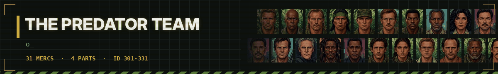
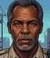

# 🩸 The Predator Team - dossiers

<a href="../../README.md">⬅ Back to README</a> · <a href="alien.md">👾 Alien Team</a> · <a href="troopers.md">🪲 Starship Troopers</a> · <a href="bia.md">🪖 Brothers in Arms</a> · <a href="expendables.md">💥 Expendables Team</a> · <a href="johnwick.md">🪙 John Wick's Team</a> · <a href="clancy.md">🚨 Tom Clancy's Team</a> · <a href="fallout.md">☢️ Fallout Shelter Team</a> · <a href="gta.md">🚗 Grand Theft Auto Team</a> · <a href="stalker.md">☣️ S.T.A.L.K.E.R. Team</a>

Dutch's rescue team in the jungle, Harrigan's LAPD in the heat of 1997, the hunted of the game preserve planet and the Loonies of 2018.

| Mercs | IDs | Films | Avg level | Best all-rounder | Most expensive |
|:---:|:---:|:---:|:---:|:---:|:---:|
| **31** | 301-331 | 4 | 6.1 | **Dutch** (80.8) | **Dutch** ($8,500/day) |

**Films:** [Predator 1987](#predator-1987) · [Predator 1990](#predator-1990) · [Predators 2010](#predators-2010) · [The Predator 2018](#the-predator-2018)

Stats are on the JA2 1.13 scale (0-100), one ━ is 10 points. Day rates are in dollars; the Premium kit costs 50% more.

## Predator 1987

7 mercs

<table>
<tr>
<td width="120" align="center" valign="top">
 
<b>ID 301</b> 
Lvl <b>9</b>
</td>
<td valign="top">

### Dutch · Alan "Dutch" Schaefer

Major. Team leader, rescue specialist. 
Played by: <b>Arnold Schwarzenegger</b>

<code>Squadleader</code> <code>Stealthy</code> <code>Survival</code>

<pre>
HLT ━━━━━━━━━━  95    AGI ━━━━━━━━──  85
DEX ━━━━━━━━──  85    STR ━━━━━━━━━━  95
WIS ━━━━━━━━━─  88    LDR ━━━━━━━━━━  95
MRK ━━━━━━━━━─  90    MEC ━━━━━━────  55
EXP ━━━━━━━━──  75    MED ━━━━──────  45
AVG 80.8
</pre>

💵 **$8,500** a day · **$52,500** a week · **$98,500** for two weeks 
🎒 Standard · Satchel · Primitive · Recon · Premium +50%

</td>
</tr>
</table>

<table>
<tr>
<td width="120" align="center" valign="top">
 
<b>ID 302</b> 
Lvl <b>7</b>
</td>
<td valign="top">

### Mac · Mac Eliot

Sergeant. Machine gunner, Blain's best friend. 
Played by: <b>Bill Duke</b>

<code>Auto Weapons</code> <code>Melee</code> <code>Night Ops</code>

<pre>
HLT ━━━━━━━━━─  90    AGI ━━━━━━━━──  75
DEX ━━━━━━━━──  80    STR ━━━━━━━━━─  90
WIS ━━━━━━━───  70    LDR ━━━━━━────  55
MRK ━━━━━━━━━─  90    MEC ━━━━──────  40
EXP ━━━━━─────  50    MED ━━━───────  30
AVG 67.0
</pre>

💵 **$5,000** a day · **$31,000** a week · **$58,000** for two weeks 
🎒 Standard · Claymores · Night Watch · Ammo Load · Premium +50%

</td>
</tr>
</table>

<table>
<tr>
<td width="120" align="center" valign="top">
 
<b>ID 303</b> 
Lvl <b>7</b>
</td>
<td valign="top">

### Blain · Blain Cooper

Sergeant. Heavy weapons, minigun. 
Played by: <b>Jesse Ventura</b>

<code>Heavy Weapons</code> <code>Auto Weapons</code> <code>Bodybuilding</code>

<pre>
HLT ━━━━━━━━━━  96    AGI ━━━━━━━───  70
DEX ━━━━━━━───  70    STR ━━━━━━━━━━  98
WIS ━━━━━━────  60    LDR ━━━━──────  45
MRK ━━━━━━━━──  85    MEC ━━━━──────  40
EXP ━━━━━─────  50    MED ━━────────  20
AVG 63.4
</pre>

💵 **$4,800** a day · **$30,000** a week · **$55,500** for two weeks 
🎒 Standard · Ammo Load · Carbine · Bush · Premium +50%

</td>
</tr>
</table>

<table>
<tr>
<td width="120" align="center" valign="top">
 
<b>ID 304</b> 
Lvl <b>8</b>
</td>
<td valign="top">

### Billy · Billy Sole

Scout and tracker. 
Played by: <b>Sonny Landham</b>

<code>Ranger</code> <code>Scouting</code> <code>Melee</code>

<pre>
HLT ━━━━━━━━━─  90    AGI ━━━━━━━━━─  92
DEX ━━━━━━━━──  85    STR ━━━━━━━━──  85
WIS ━━━━━━━━━─  90    LDR ━━━━──────  45
MRK ━━━━━━━━──  85    MEC ━━━━──────  35
EXP ━━━━──────  40    MED ━━━━──────  45
AVG 69.2
</pre>

💵 **$5,800** a day · **$36,000** a week · **$67,500** for two weeks 
🎒 Standard · Tracker · Bridge · Pointman · Premium +50%

</td>
</tr>
</table>

<table>
<tr>
<td width="120" align="center" valign="top">
 
<b>ID 305</b> 
Lvl <b>7</b>
</td>
<td valign="top">

### Poncho · Jorge "Poncho" Ramirez

Grenadier, interpreter. 
Played by: <b>Richard Chaves</b>

<code>Heavy Weapons</code> <code>Demolitions</code> <code>Throwing</code>

<pre>
HLT ━━━━━━━━━─  88    AGI ━━━━━━━━──  78
DEX ━━━━━━━━──  80    STR ━━━━━━━━──  82
WIS ━━━━━━━───  72    LDR ━━━━━─────  50
MRK ━━━━━━━━──  82    MEC ━━━━━─────  50
EXP ━━━━━━━━──  85    MED ━━━━──────  35
AVG 70.2
</pre>

💵 **$4,600** a day · **$28,500** a week · **$53,500** for two weeks 
🎒 Standard · HK94 · Demolition · Grenadier · Premium +50%

</td>
</tr>
</table>

<table>
<tr>
<td width="120" align="center" valign="top">
 
<b>ID 306</b> 
Lvl <b>6</b>
</td>
<td valign="top">

### Hawkins · Rick Hawkins

Radio operator, technician. 
Played by: <b>Shane Black</b>

<code>Technician</code> <code>Radio Operator</code> <code>Scouting</code>

<pre>
HLT ━━━━━━━━──  78    AGI ━━━━━━━━──  75
DEX ━━━━━━━━──  82    STR ━━━━━━━───  68
WIS ━━━━━━━━──  80    LDR ━━━━──────  40
MRK ━━━━━━━━──  78    MEC ━━━━━━━━──  75
EXP ━━━━──────  45    MED ━━━━──────  45
AVG 66.6
</pre>

💵 **$3,500** a day · **$21,500** a week · **$40,500** for two weeks 
🎒 Standard · Radio · Scout · Tech · Premium +50%

</td>
</tr>
</table>

<table>
<tr>
<td width="120" align="center" valign="top">
 
<b>ID 307</b> 
Lvl <b>7</b>
</td>
<td valign="top">

### Dillon · Al Dillon

CIA officer, old friend of Dutch. 
Played by: <b>Carl Weathers</b>

<code>Auto Weapons</code> <code>Covert Ops</code> <code>Athletics</code>

<pre>
HLT ━━━━━━━━━─  88    AGI ━━━━━━━━──  78
DEX ━━━━━━━━──  80    STR ━━━━━━━━──  85
WIS ━━━━━━━━──  85    LDR ━━━━━━━━──  80
MRK ━━━━━━━━──  85    MEC ━━━━──────  45
EXP ━━━━━━────  55    MED ━━━───────  30
AVG 71.1
</pre>

💵 **$5,500** a day · **$34,000** a week · **$64,000** for two weeks 
🎒 Standard · Akimbo · Covert · Field Op · Premium +50%

</td>
</tr>
</table>

## Predator 1990

7 mercs

<table>
<tr>
<td width="120" align="center" valign="top">
 
<b>ID 308</b> 
Lvl <b>8</b>
</td>
<td valign="top">

### Harrigan · Mike Harrigan

LAPD lieutenant. Stubborn, fearless leader. 
Played by: <b>Danny Glover</b>

<code>Squadleader</code> <code>Gunslinger</code> <code>Athletics</code>

<pre>
HLT ━━━━━━━━━─  92    AGI ━━━━━━━━──  82
DEX ━━━━━━━━──  84    STR ━━━━━━━━──  82
WIS ━━━━━━━━──  85    LDR ━━━━━━━━──  85
MRK ━━━━━━━━━─  88    MEC ━━━━━─────  50
EXP ━━━━━━────  55    MED ━━━━──────  40
AVG 74.3
</pre>

💵 **$7,000** a day · **$43,500** a week · **$81,000** for two weeks 
🎒 Standard · Assault · Detective · SWAT · Premium +50%

</td>
</tr>
</table>

<table>
<tr>
<td width="120" align="center" valign="top">
 
<b>ID 309</b> 
Lvl <b>5</b>
</td>
<td valign="top">

### Leona · Leona Cantrell

LAPD detective. Tough, fast with a SMG. 
Played by: <b>María Conchita Alonso</b>

<code>Gunslinger</code> <code>Athletics</code> <code>Auto Weapons</code>

<pre>
HLT ━━━━━━━━──  78    AGI ━━━━━━━━──  80
DEX ━━━━━━━━──  78    STR ━━━━━━────  60
WIS ━━━━━━━━──  75    LDR ━━━━━━────  55
MRK ━━━━━━━━──  75    MEC ━━━━──────  35
EXP ━━━───────  30    MED ━━━━──────  40
AVG 60.6
</pre>

💵 **$3,200** a day · **$20,000** a week · **$37,000** for two weeks 
🎒 Standard · Shotgun · Undercover · SWAT · Premium +50%

</td>
</tr>
</table>

<table>
<tr>
<td width="120" align="center" valign="top">
 
<b>ID 310</b> 
Lvl <b>4</b>
</td>
<td valign="top">

### Danny · Danny Archuleta

LAPD detective. Harrigan's oldest friend. 
Played by: <b>Rubén Blades</b>

<code>Gunslinger</code> <code>Scouting</code> <code>Athletics</code>

<pre>
HLT ━━━━━━━───  72    AGI ━━━━━━━━──  80
DEX ━━━━━━━━──  80    STR ━━━━━━────  62
WIS ━━━━━━━───  70    LDR ━━━━──────  45
MRK ━━━━━━━━──  76    MEC ━━━━──────  40
EXP ━━━───────  30    MED ━━━━──────  35
AVG 59.0
</pre>

💵 **$2,400** a day · **$15,000** a week · **$28,000** for two weeks 
🎒 Standard · Shotgun · Street · SWAT · Premium +50%

</td>
</tr>
</table>

<table>
<tr>
<td width="120" align="center" valign="top">
 
<b>ID 311</b> 
Lvl <b>5</b>
</td>
<td valign="top">

### Lambert · Jerry Lambert

LAPD detective. Cocky newcomer with a shiny pistol. 
Played by: <b>Bill Paxton</b>

<code>Gunslinger</code> <code>Bodybuilding</code> <code>Melee</code>

<pre>
HLT ━━━━━━━━──  82    AGI ━━━━━━━───  72
DEX ━━━━━━━───  70    STR ━━━━━━━━──  80
WIS ━━━━━━────  55    LDR ━━━━──────  40
MRK ━━━━━━━━──  76    MEC ━━━━──────  35
EXP ━━━───────  30    MED ━━────────  25
AVG 56.5
</pre>

💵 **$2,800** a day · **$17,500** a week · **$32,500** for two weeks 
🎒 Standard · Shotgun · Back-up · SWAT · Premium +50%

</td>
</tr>
</table>

<table>
<tr>
<td width="120" align="center" valign="top">
 
<b>ID 312</b> 
Lvl <b>6</b>
</td>
<td valign="top">

### Keyes · Peter Keyes

Federal agent. Head of a special task force. 
Played by: <b>Gary Busey</b>

<code>Squadleader</code> <code>Technician</code> <code>Night Ops</code>

<pre>
HLT ━━━━━━━━──  76    AGI ━━━━━━━───  70
DEX ━━━━━━━━──  76    STR ━━━━━━━───  68
WIS ━━━━━━━━━─  92    LDR ━━━━━━━━──  80
MRK ━━━━━━━━──  76    MEC ━━━━━━━━──  75
EXP ━━━━━─────  50    MED ━━━━━─────  50
AVG 71.3
</pre>

💵 **$5,000** a day · **$31,000** a week · **$58,000** for two weeks 
🎒 Standard · Thermal · Field Lab · Heavy · Premium +50%

</td>
</tr>
</table>

<table>
<tr>
<td width="120" align="center" valign="top">
 
<b>ID 313</b> 
Lvl <b>4</b>
</td>
<td valign="top">

### Willie · King Willie

Gang boss and mystic. Sees what others miss. 
Played by: <b>Calvin Lockhart</b>

<code>Squadleader</code> <code>Scouting</code> <code>Covert Ops</code>

<pre>
HLT ━━━━━━────  65    AGI ━━━━━━────  55
DEX ━━━━━━────  65    STR ━━━━━━────  55
WIS ━━━━━━━━━─  90    LDR ━━━━━━━━──  80
MRK ━━━━━━────  55    MEC ━━━───────  30
EXP ━━━━──────  35    MED ━━━━━─────  50
AVG 58.0
</pre>

💵 **$2,500** a day · **$15,500** a week · **$29,000** for two weeks 
🎒 Standard · Posse · Voodoo · Bodyguard · Premium +50%

</td>
</tr>
</table>

<table>
<tr>
<td width="120" align="center" valign="top">
 
<b>ID 314</b> 
Lvl <b>4</b>
</td>
<td valign="top">

### Heinemann · Phil Heinemann

LAPD deputy chief. Commander and organiser. 
Played by: <b>Robert Davi</b>

<code>Squadleader</code> <code>Radio Operator</code> <code>Teaching</code>

<pre>
HLT ━━━━━━━───  72    AGI ━━━━━━────  58
DEX ━━━━━━━───  68    STR ━━━━━━━───  66
WIS ━━━━━━━━──  76    LDR ━━━━━━━━──  78
MRK ━━━━━━━───  70    MEC ━━━───────  30
EXP ━━━───────  30    MED ━━━───────  30
AVG 57.8
</pre>

💵 **$2,600** a day · **$16,000** a week · **$30,000** for two weeks 
🎒 Standard · Command · Riot · SWAT · Premium +50%

</td>
</tr>
</table>

## Predators 2010

9 mercs

<table>
<tr>
<td width="120" align="center" valign="top">
 
<b>ID 315</b> 
Lvl <b>8</b>
</td>
<td valign="top">

### Royce

Mercenary leader, ex-special forces. 
Played by: <b>Adrien Brody</b>

<code>Auto Weapons</code> <code>Survival</code> <code>Stealthy</code>

<pre>
HLT ━━━━━━━━━─  90    AGI ━━━━━━━━━─  86
DEX ━━━━━━━━──  84    STR ━━━━━━━━──  82
WIS ━━━━━━━━━─  92    LDR ━━━━━━━━──  82
MRK ━━━━━━━━━─  88    MEC ━━━━━─────  50
EXP ━━━━━━────  60    MED ━━━━──────  45
AVG 75.9
</pre>

💵 **$7,000** a day · **$43,500** a week · **$81,000** for two weeks 
🎒 Standard · Booby Trap · Flares · Recon · Premium +50%

</td>
</tr>
</table>

<table>
<tr>
<td width="120" align="center" valign="top">
 
<b>ID 316</b> 
Lvl <b>7</b>
</td>
<td valign="top">

### Isabelle

IDF sniper. 
Played by: <b>Alice Braga</b>

<code>Sniper</code> <code>Sniper</code> <code>Stealthy</code>

<pre>
HLT ━━━━━━━━──  82    AGI ━━━━━━━━──  85
DEX ━━━━━━━━━─  88    STR ━━━━━━────  62
WIS ━━━━━━━━━─  86    LDR ━━━━━━────  60
MRK ━━━━━━━━━━  96    MEC ━━━━──────  40
EXP ━━━━──────  40    MED ━━━━──────  45
AVG 68.4
</pre>

💵 **$6,000** a day · **$37,000** a week · **$69,500** for two weeks 
🎒 Standard · Spotter · Ghillie · Close · Premium +50%

</td>
</tr>
</table>

<table>
<tr>
<td width="120" align="center" valign="top">
 
<b>ID 317</b> 
Lvl <b>3</b>
</td>
<td valign="top">

### Edwin

Doctor. 
Played by: <b>Topher Grace</b>

<code>Doctor</code> <code>Doctor</code>

<pre>
HLT ━━━━━━────  60    AGI ━━━━━━────  65
DEX ━━━━━━━━──  85    STR ━━━━━─────  50
WIS ━━━━━━━━━─  90    LDR ━━━───────  30
MRK ━━━━──────  45    MEC ━━━━──────  40
EXP ━━────────  25    MED ━━━━━━━━━─  92
AVG 58.2
</pre>

💵 **$2,500** a day · **$15,500** a week · **$29,000** for two weeks 
🎒 Standard · Toxin · Field Med · Survivor · Premium +50%

</td>
</tr>
</table>

<table>
<tr>
<td width="120" align="center" valign="top">
 
<b>ID 318</b> 
Lvl <b>4</b>
</td>
<td valign="top">

### Stans · Walter Stans

Death row convict. 
Played by: <b>Walton Goggins</b>

<code>Martial Arts</code> <code>Melee</code> <code>Bodybuilding</code>

<pre>
HLT ━━━━━━━━──  85    AGI ━━━━━━━━──  75
DEX ━━━━━━━───  70    STR ━━━━━━━━──  85
WIS ━━━━──────  40    LDR ━━────────  20
MRK ━━━━━━────  65    MEC ━━━───────  30
EXP ━━━───────  30    MED ━─────────  10
AVG 51.0
</pre>

💵 **$1,800** a day · **$11,000** a week · **$21,000** for two weeks 
🎒 Standard · Brawler · Scrapper · Survivor · Premium +50%

</td>
</tr>
</table>

<table>
<tr>
<td width="120" align="center" valign="top">
 
<b>ID 319</b> 
Lvl <b>7</b>
</td>
<td valign="top">

### Noland · Ronald Noland

Survivor of earlier hunts. 
Played by: <b>Laurence Fishburne</b>

<code>Ranger</code> <code>Survival</code> <code>Stealthy</code>

<pre>
HLT ━━━━━━━━──  75    AGI ━━━━━━━───  70
DEX ━━━━━━━━──  78    STR ━━━━━━━───  70
WIS ━━━━━━━━━─  92    LDR ━━━━──────  45
MRK ━━━━━━━━──  82    MEC ━━━━━━━───  70
EXP ━━━━━━────  65    MED ━━━━━─────  50
AVG 69.7
</pre>

💵 **$4,500** a day · **$28,000** a week · **$52,000** for two weeks 
🎒 Standard · Traps · Survivor · Cache · Premium +50%

</td>
</tr>
</table>

<table>
<tr>
<td width="120" align="center" valign="top">
 
<b>ID 320</b> 
Lvl <b>5</b>
</td>
<td valign="top">

### Cuchillo

Cartel enforcer. 
Played by: <b>Danny Trejo</b>

<code>Auto Weapons</code> <code>Ambidextrous</code> <code>Melee</code>

<pre>
HLT ━━━━━━━━──  82    AGI ━━━━━━━━──  82
DEX ━━━━━━━━──  84    STR ━━━━━━━━──  76
WIS ━━━━━━────  60    LDR ━━━───────  30
MRK ━━━━━━━━──  78    MEC ━━━───────  30
EXP ━━━━──────  35    MED ━━────────  15
AVG 57.2
</pre>

💵 **$2,800** a day · **$17,500** a week · **$32,500** for two weeks 
🎒 Standard · Akimbo · Cuchillo · Sicario · Premium +50%

</td>
</tr>
</table>

<table>
<tr>
<td width="120" align="center" valign="top">
 
<b>ID 321</b> 
Lvl <b>7</b>
</td>
<td valign="top">

### Nikolai

Spetsnaz soldier, heavy weapons. 
Played by: <b>Oleg Taktarov</b>

<code>Heavy Weapons</code> <code>Auto Weapons</code> <code>Bodybuilding</code>

<pre>
HLT ━━━━━━━━━━  96    AGI ━━━━━━━───  66
DEX ━━━━━━━───  72    STR ━━━━━━━━━━  96
WIS ━━━━━━────  65    LDR ━━━━━━────  55
MRK ━━━━━━━━━─  86    MEC ━━━━━─────  50
EXP ━━━━━━━───  70    MED ━━────────  25
AVG 68.1
</pre>

💵 **$5,200** a day · **$32,000** a week · **$60,500** for two weeks 
🎒 Standard · Claymores · Recon · Ammo Load · Premium +50%

</td>
</tr>
</table>

<table>
<tr>
<td width="120" align="center" valign="top">
 
<b>ID 322</b> 
Lvl <b>7</b>
</td>
<td valign="top">

### Hanzo

Yakuza enforcer, swordsman. 
Played by: <b>Louis Ozawa Changchien</b>

<code>Martial Arts</code> <code>Melee</code> <code>Stealthy</code>

<pre>
HLT ━━━━━━━━━─  86    AGI ━━━━━━━━━━  95
DEX ━━━━━━━━━─  92    STR ━━━━━━━━──  76
WIS ━━━━━━━━──  85    LDR ━━━━──────  40
MRK ━━━━━━━───  70    MEC ━━━───────  30
EXP ━━────────  25    MED ━━━───────  30
AVG 62.9
</pre>

💵 **$4,800** a day · **$30,000** a week · **$55,500** for two weeks 
🎒 Standard · Pistol · Ronin · Yakuza · Premium +50%

</td>
</tr>
</table>

<table>
<tr>
<td width="120" align="center" valign="top">
 
<b>ID 323</b> 
Lvl <b>7</b>
</td>
<td valign="top">

### Mombasa

Death squad officer. 
Played by: <b>Mahershala Ali</b>

<code>Auto Weapons</code> <code>Athletics</code> <code>Night Ops</code>

<pre>
HLT ━━━━━━━━━─  90    AGI ━━━━━━━━──  78
DEX ━━━━━━━━──  80    STR ━━━━━━━━━─  88
WIS ━━━━━━━───  72    LDR ━━━━━━━───  70
MRK ━━━━━━━━━─  86    MEC ━━━━──────  40
EXP ━━━━━━────  55    MED ━━────────  25
AVG 68.4
</pre>

💵 **$5,000** a day · **$31,000** a week · **$58,000** for two weeks 
🎒 Standard · Rebel · Sidearm · Ambush · Premium +50%

</td>
</tr>
</table>

## The Predator 2018

8 mercs

<table>
<tr>
<td width="120" align="center" valign="top">
 
<b>ID 324</b> 
Lvl <b>8</b>
</td>
<td valign="top">

### Quinn · Quinn McKenna

Army Ranger sniper. Leader of the "Loonies". 
Played by: <b>Boyd Holbrook</b>

<code>Sniper</code> <code>Stealthy</code> <code>Survival</code>

<pre>
HLT ━━━━━━━━━─  90    AGI ━━━━━━━━━─  86
DEX ━━━━━━━━━─  88    STR ━━━━━━━━──  82
WIS ━━━━━━━━━─  90    LDR ━━━━━━━━──  80
MRK ━━━━━━━━━━  97    MEC ━━━━──────  40
EXP ━━━━━━────  55    MED ━━━━──────  45
AVG 75.3
</pre>

💵 **$7,500** a day · **$46,500** a week · **$87,000** for two weeks 
🎒 Standard · Marksman · Assault · Grenadier · Premium +50%

</td>
</tr>
</table>

<table>
<tr>
<td width="120" align="center" valign="top">
 
<b>ID 325</b> 
Lvl <b>7</b>
</td>
<td valign="top">

### Nebraska · Nebraska Williams

Veteran soldier. Quinn's right hand. 
Played by: <b>Trevante Rhodes</b>

<code>Auto Weapons</code> <code>Melee</code> <code>Athletics</code>

<pre>
HLT ━━━━━━━━━─  92    AGI ━━━━━━━━──  82
DEX ━━━━━━━━──  80    STR ━━━━━━━━━─  86
WIS ━━━━━━━━──  75    LDR ━━━━━━────  55
MRK ━━━━━━━━━─  86    MEC ━━━━──────  40
EXP ━━━━──────  45    MED ━━━━──────  35
AVG 67.6
</pre>

💵 **$5,200** a day · **$32,000** a week · **$60,500** for two weeks 
🎒 Standard · Shotgun · Grenadier · Brawler · Premium +50%

</td>
</tr>
</table>

<table>
<tr>
<td width="120" align="center" valign="top">
 
<b>ID 326</b> 
Lvl <b>6</b>
</td>
<td valign="top">

### Baxley

Ex-soldier. Rifleman, nervous tic, foul mouth. 
Played by: <b>Thomas Jane</b>

<code>Auto Weapons</code> <code>Throwing</code> <code>Bodybuilding</code>

<pre>
HLT ━━━━━━━━━─  88    AGI ━━━━━━━───  72
DEX ━━━━━━━━──  76    STR ━━━━━━━━──  84
WIS ━━━━━━────  62    LDR ━━━━──────  35
MRK ━━━━━━━━──  84    MEC ━━━━──────  40
EXP ━━━━━─────  50    MED ━━────────  20
AVG 61.1
</pre>

💵 **$3,800** a day · **$23,500** a week · **$44,000** for two weeks 
🎒 Standard · Grenades · Sidearm · Assault · Premium +50%

</td>
</tr>
</table>

<table>
<tr>
<td width="120" align="center" valign="top">
 
<b>ID 327</b> 
Lvl <b>6</b>
</td>
<td valign="top">

### Coyle

Ex-soldier. Squad joker, Baxley's best friend. 
Played by: <b>Keegan-Michael Key</b>

<code>Auto Weapons</code> <code>Throwing</code> <code>Athletics</code>

<pre>
HLT ━━━━━━━━──  82    AGI ━━━━━━━━──  80
DEX ━━━━━━━━──  82    STR ━━━━━━━───  72
WIS ━━━━━━━───  70    LDR ━━━━──────  40
MRK ━━━━━━━━──  80    MEC ━━━━──────  40
EXP ━━━━──────  40    MED ━━━───────  30
AVG 61.6
</pre>

💵 **$3,600** a day · **$22,500** a week · **$42,000** for two weeks 
🎒 Standard · Grenadier · Grenades · Sidearm · Premium +50%

</td>
</tr>
</table>

<table>
<tr>
<td width="120" align="center" valign="top">
 
<b>ID 328</b> 
Lvl <b>6</b>
</td>
<td valign="top">

### Lynch

Ex-soldier. Card sharp and demolitions man. 
Played by: <b>Alfie Allen</b>

<code>Technician</code> <code>Demolitions</code> <code>Ambidextrous</code>

<pre>
HLT ━━━━━━━━──  78    AGI ━━━━━━━━──  82
DEX ━━━━━━━━━─  88    STR ━━━━━━━───  66
WIS ━━━━━━━━──  78    LDR ━━━━──────  40
MRK ━━━━━━━━──  76    MEC ━━━━━━━━──  75
EXP ━━━━━━━━──  80    MED ━━━━──────  35
AVG 69.8
</pre>

💵 **$3,800** a day · **$23,500** a week · **$44,000** for two weeks 
🎒 Standard · Marksman · Revolver · Demolition · Premium +50%

</td>
</tr>
</table>

<table>
<tr>
<td width="120" align="center" valign="top">
 
<b>ID 329</b> 
Lvl <b>5</b>
</td>
<td valign="top">

### Nettles

Former military helicopter pilot. 
Played by: <b>Augusto Aguilera</b>

<code>Technician</code> <code>Radio Operator</code> <code>Scouting</code>

<pre>
HLT ━━━━━━━━──  84    AGI ━━━━━━━───  74
DEX ━━━━━━━━──  78    STR ━━━━━━━━──  80
WIS ━━━━━━━───  66    LDR ━━━━──────  35
MRK ━━━━━━━━──  78    MEC ━━━━━━━───  70
EXP ━━━━──────  40    MED ━━────────  25
AVG 63.0
</pre>

💵 **$3,200** a day · **$20,000** a week · **$37,000** for two weeks 
🎒 Standard · Radio · Mechanic · Scout · Premium +50%

</td>
</tr>
</table>

<table>
<tr>
<td width="120" align="center" valign="top">
 
<b>ID 330</b> 
Lvl <b>3</b>
</td>
<td valign="top">

### Casey · Casey Bracket

Evolutionary biologist. Science advisor. 
Played by: <b>Olivia Munn</b>

<code>Doctor</code> <code>Teaching</code> <code>Survival</code>

<pre>
HLT ━━━━━━━───  70    AGI ━━━━━━━━──  76
DEX ━━━━━━━━──  78    STR ━━━━━━────  55
WIS ━━━━━━━━━━  95    LDR ━━━━━─────  50
MRK ━━━━━━────  55    MEC ━━━━━━────  55
EXP ━━━───────  30    MED ━━━━━━━━──  75
AVG 63.9
</pre>

💵 **$2,600** a day · **$16,000** a week · **$30,000** for two weeks 
🎒 Standard · Tranq · SMG · Biologist · Premium +50%

</td>
</tr>
</table>

<table>
<tr>
<td width="120" align="center" valign="top">
 
<b>ID 331</b> 
Lvl <b>6</b>
</td>
<td valign="top">

### Traeger · Will Traeger

Government agent. Head of a secret program. 
Played by: <b>Sterling K. Brown</b>

<code>Squadleader</code> <code>Covert Ops</code> <code>Radio Operator</code>

<pre>
HLT ━━━━━━━━──  78    AGI ━━━━━━━───  70
DEX ━━━━━━━━──  78    STR ━━━━━━━───  68
WIS ━━━━━━━━━─  90    LDR ━━━━━━━━──  85
MRK ━━━━━━━━──  76    MEC ━━━━──────  45
EXP ━━━━──────  40    MED ━━━━──────  35
AVG 66.5
</pre>

💵 **$5,500** a day · **$34,000** a week · **$64,000** for two weeks 
🎒 Standard · Command · Stargazer · Security · Premium +50%

</td>
</tr>
</table>

<a href="#">⬆ Back to top</a> · <a href="../../README.md">README</a>

