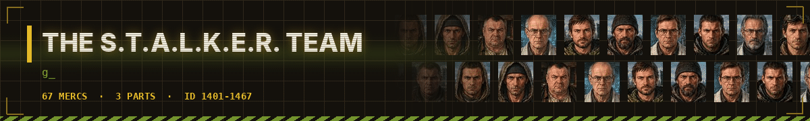
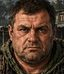
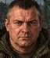

# ☣️ The S.T.A.L.K.E.R. Team - dossiers

<a href="../../README.md">⬅ Back to README</a> · <a href="predator.md">🩸 Predator Team</a> · <a href="alien.md">👾 Alien Team</a> · <a href="troopers.md">🪲 Starship Troopers</a> · <a href="bia.md">🪖 Brothers in Arms</a> · <a href="expendables.md">💥 Expendables Team</a> · <a href="johnwick.md">🪙 John Wick's Team</a> · <a href="clancy.md">🚨 Tom Clancy's Team</a> · <a href="fallout.md">☢️ Fallout Shelter Team</a> · <a href="gta.md">🚗 Grand Theft Auto Team</a>

Stalkers, traders, Duty and Freedom fighters from the Cordon to Pripyat - Shadow of Chernobyl, Clear Sky and Call of Pripyat.

| Mercs | IDs | Games | Avg level | Best all-rounder | Most expensive |
|:---:|:---:|:---:|:---:|:---:|:---:|
| **67** | 1401-1467 | 3 | 6.4 | **Degtyarev** (76.6) | **Degtyarev** ($6,300/day) |

**Games:** [Shadow of Chernobyl](#shadow-of-chernobyl) · [Clear Sky](#clear-sky) · [Call of Pripyat](#call-of-pripyat)

Stats are on the JA2 1.13 scale (0-100), one ━ is 10 points. Day rates are in dollars; the Premium kit costs 50% more.

## Shadow of Chernobyl

15 mercs

<table>
<tr>
<td width="120" align="center" valign="top">
 
<b>ID 1401</b> 
Lvl <b>9</b>
</td>
<td valign="top">

### Strelok · The Marked One

The Marked One. Shadow of Chernobyl - The Cordon, the Zone. 
Place: <b>The Cordon, the Zone</b>

<code>Auto Weapons</code> <code>Ranger</code>

<pre>
HLT ━━━━━━━━━─  90    AGI ━━━━━━━━──  82
DEX ━━━━━━━━──  84    STR ━━━━━━━───  72
WIS ━━━━━━━━──  78    LDR ━━━━━━━───  68
MRK ━━━━━━━━━─  92    MEC ━━━━━━────  60
EXP ━━━━━━────  62    MED ━━━━──────  45
AVG 73.3
</pre>

💵 **$5,900** a day · **$36,600** a week · **$68,450** for two weeks 
🎒 Standard · Alternate · Strelok · Pistol · Premium +50%

</td>
</tr>
</table>

<table>
<tr>
<td width="120" align="center" valign="top">
 
<b>ID 1402</b> 
Lvl <b>8</b>
</td>
<td valign="top">

### Ghost

Ghost. Shadow of Chernobyl - Lake Yantar, the Zone. 
Place: <b>Lake Yantar, the Zone</b>

<code>Sniper</code> <code>Stealthy</code>

<pre>
HLT ━━━━━━━━──  84    AGI ━━━━━━━━──  80
DEX ━━━━━━━━──  80    STR ━━━━━━━───  68
WIS ━━━━━━━━──  76    LDR ━━━━━━━───  66
MRK ━━━━━━━━━─  88    MEC ━━━━━━────  55
EXP ━━━━━━────  58    MED ━━━━──────  40
AVG 69.5
</pre>

💵 **$5,000** a day · **$31,000** a week · **$58,000** for two weeks 
🎒 Standard · Alternate · Ghost · Pistol · Premium +50%

</td>
</tr>
</table>

<table>
<tr>
<td width="120" align="center" valign="top">
 
<b>ID 1403</b> 
Lvl <b>7</b>
</td>
<td valign="top">

### Fang

Fang. Shadow of Chernobyl - Pripyat, the Zone. 
Place: <b>Pripyat, the Zone</b>

<code>Auto Weapons</code> <code>Scouting</code>

<pre>
HLT ━━━━━━━━──  82    AGI ━━━━━━━━──  82
DEX ━━━━━━━━──  78    STR ━━━━━━━───  66
WIS ━━━━━━━───  72    LDR ━━━━━━────  58
MRK ━━━━━━━━──  84    MEC ━━━━━━━───  70
EXP ━━━━━━────  62    MED ━━━━──────  35
AVG 68.9
</pre>

💵 **$4,450** a day · **$27,600** a week · **$51,600** for two weeks 
🎒 Standard · Alternate · Fang · Pistol · Premium +50%

</td>
</tr>
</table>

<table>
<tr>
<td width="120" align="center" valign="top">
 
<b>ID 1404</b> 
Lvl <b>8</b>
</td>
<td valign="top">

### Doctor

Doctor. Shadow of Chernobyl - The marshes, the Zone. 
Place: <b>The marshes, the Zone</b>

<code>Doctor</code> <code>Ranger</code>

<pre>
HLT ━━━━━━━───  72    AGI ━━━━━━────  64
DEX ━━━━━━━━──  76    STR ━━━━━━────  56
WIS ━━━━━━━━━─  92    LDR ━━━━━━━───  70
MRK ━━━━━━━───  72    MEC ━━━━━━────  55
EXP ━━━━──────  40    MED ━━━━━━━━━─  92
AVG 68.9
</pre>

💵 **$4,900** a day · **$30,400** a week · **$56,850** for two weeks 
🎒 Standard · Alternate · Healer · Pistol · Premium +50%

</td>
</tr>
</table>

<table>
<tr>
<td width="120" align="center" valign="top">
 
<b>ID 1405</b> 
Lvl <b>4</b>
</td>
<td valign="top">

### Sidor · Sidorovich

Sidorovich. Shadow of Chernobyl - The Cordon, the Zone. 
Place: <b>The Cordon, the Zone</b>

<code>Snitch</code>

<pre>
HLT ━━━━━━────  64    AGI ━━━━──────  40
DEX ━━━━━━────  60    STR ━━━━━━────  58
WIS ━━━━━━━━──  82    LDR ━━━━━━━───  70
MRK ━━━━━━────  58    MEC ━━━━━━────  62
EXP ━━━━──────  40    MED ━━━━──────  40
AVG 57.4
</pre>

💵 **$1,600** a day · **$9,900** a week · **$18,550** for two weeks 
🎒 Standard · Alternate · Trader · Pistol · Premium +50%

</td>
</tr>
</table>

<table>
<tr>
<td width="120" align="center" valign="top">
 
<b>ID 1406</b> 
Lvl <b>6</b>
</td>
<td valign="top">

### Barman

Barman. Shadow of Chernobyl - Rostok, the Zone. 
Place: <b>Rostok, the Zone</b>

<code>Gunslinger</code> <code>Snitch</code>

<pre>
HLT ━━━━━━━━──  80    AGI ━━━━━━────  62
DEX ━━━━━━━───  74    STR ━━━━━━━───  72
WIS ━━━━━━━━──  80    LDR ━━━━━━━───  72
MRK ━━━━━━━━──  78    MEC ━━━━━─────  50
EXP ━━━━━━────  55    MED ━━━━──────  40
AVG 66.3
</pre>

💵 **$3,650** a day · **$22,650** a week · **$42,350** for two weeks 
🎒 Standard · Alternate · 100 Rads · Pistol · Premium +50%

</td>
</tr>
</table>

<table>
<tr>
<td width="120" align="center" valign="top">
 
<b>ID 1407</b> 
Lvl <b>5</b>
</td>
<td valign="top">

### Sakharov · Professor Sakharov

Professor Sakharov. Shadow of Chernobyl - Lake Yantar, the Zone. 
Place: <b>Lake Yantar, the Zone</b>

<code>Technician</code> <code>Doctor</code>

<pre>
HLT ━━━━━─────  50    AGI ━━━━──────  40
DEX ━━━━━━━───  72    STR ━━━━──────  40
WIS ━━━━━━━━━━  95    LDR ━━━━━━━───  70
MRK ━━━━━─────  48    MEC ━━━━━━━━━─  90
EXP ━━━━━━────  60    MED ━━━━━━━━──  75
AVG 64.0
</pre>

💵 **$2,900** a day · **$18,000** a week · **$33,650** for two weeks 
🎒 Standard · Alternate · Scientist · Pistol · Premium +50%

</td>
</tr>
</table>

<table>
<tr>
<td width="120" align="center" valign="top">
 
<b>ID 1408</b> 
Lvl <b>9</b>
</td>
<td valign="top">

### Voronin · General Voronin

General Voronin. Shadow of Chernobyl - Rostok, the Zone. 
Place: <b>Rostok, the Zone</b>

<code>Squadleader</code>

<pre>
HLT ━━━━━━━━──  78    AGI ━━━━━━────  58
DEX ━━━━━━━───  72    STR ━━━━━━━───  70
WIS ━━━━━━━━──  82    LDR ━━━━━━━━━─  92
MRK ━━━━━━━━──  82    MEC ━━━━──────  45
EXP ━━━━━━────  55    MED ━━━━──────  40
AVG 67.4
</pre>

💵 **$5,200** a day · **$32,250** a week · **$60,300** for two weeks 
🎒 Standard · Alternate · Duty · Pistol · Premium +50%

</td>
</tr>
</table>

<table>
<tr>
<td width="120" align="center" valign="top">
 
<b>ID 1409</b> 
Lvl <b>8</b>
</td>
<td valign="top">

### Lukash

Lukash. Shadow of Chernobyl - The Army Warehouses, the Zone. 
Place: <b>The Army Warehouses, the Zone</b>

<code>Auto Weapons</code> <code>Squadleader</code>

<pre>
HLT ━━━━━━━━──  84    AGI ━━━━━━━───  74
DEX ━━━━━━━━──  78    STR ━━━━━━━───  70
WIS ━━━━━━━───  74    LDR ━━━━━━━━━─  86
MRK ━━━━━━━━──  84    MEC ━━━━━─────  50
EXP ━━━━━━────  60    MED ━━━━──────  35
AVG 69.5
</pre>

💵 **$5,000** a day · **$31,000** a week · **$58,000** for two weeks 
🎒 Standard · Alternate · Freedom · Pistol · Premium +50%

</td>
</tr>
</table>

<table>
<tr>
<td width="120" align="center" valign="top">
 
<b>ID 1410</b> 
Lvl <b>7</b>
</td>
<td valign="top">

### Volk · Wolf

Wolf. Shadow of Chernobyl - The Cordon, the Zone. 
Place: <b>The Cordon, the Zone</b>

<code>Gunslinger</code> <code>Teaching</code>

<pre>
HLT ━━━━━━━━──  84    AGI ━━━━━━━───  72
DEX ━━━━━━━━──  78    STR ━━━━━━━───  72
WIS ━━━━━━━───  74    LDR ━━━━━━━───  74
MRK ━━━━━━━━──  84    MEC ━━━━━─────  50
EXP ━━━━━━────  55    MED ━━━━──────  45
AVG 68.8
</pre>

💵 **$4,400** a day · **$27,300** a week · **$51,050** for two weeks 
🎒 Standard · Alternate · Rookies · Pistol · Premium +50%

</td>
</tr>
</table>

<table>
<tr>
<td width="120" align="center" valign="top">
 
<b>ID 1411</b> 
Lvl <b>5</b>
</td>
<td valign="top">

### Lis · Fox

Fox. Shadow of Chernobyl - The Cordon, the Zone. 
Place: <b>The Cordon, the Zone</b>

<code>Athletics</code> <code>Scouting</code>

<pre>
HLT ━━━━━━━━──  76    AGI ━━━━━━━━──  80
DEX ━━━━━━━━──  76    STR ━━━━━━────  62
WIS ━━━━━━────  64    LDR ━━━━━─────  50
MRK ━━━━━━━━──  76    MEC ━━━━──────  45
EXP ━━━━──────  40    MED ━━━━──────  35
AVG 60.4
</pre>

💵 **$2,450** a day · **$15,200** a week · **$28,400** for two weeks 
🎒 Standard · Alternate · Loner · Pistol · Premium +50%

</td>
</tr>
</table>

<table>
<tr>
<td width="120" align="center" valign="top">
 
<b>ID 1412</b> 
Lvl <b>6</b>
</td>
<td valign="top">

### Seriy

Seriy. Shadow of Chernobyl - The Garbage, the Zone. 
Place: <b>The Garbage, the Zone</b>

<code>Auto Weapons</code> <code>Survival</code>

<pre>
HLT ━━━━━━━━──  82    AGI ━━━━━━━───  70
DEX ━━━━━━━━──  76    STR ━━━━━━━───  72
WIS ━━━━━━━───  70    LDR ━━━━━━────  58
MRK ━━━━━━━━──  80    MEC ━━━━━─────  50
EXP ━━━━━━────  60    MED ━━━━──────  35
AVG 65.3
</pre>

💵 **$3,500** a day · **$21,700** a week · **$40,600** for two weeks 
🎒 Standard · Alternate · Loner · Pistol · Premium +50%

</td>
</tr>
</table>

<table>
<tr>
<td width="120" align="center" valign="top">
 
<b>ID 1413</b> 
Lvl <b>6</b>
</td>
<td valign="top">

### Mole

Mole. Shadow of Chernobyl - Agroprom, the Zone. 
Place: <b>Agroprom, the Zone</b>

<code>Stealthy</code> <code>Scouting</code>

<pre>
HLT ━━━━━━━━──  78    AGI ━━━━━━━━──  76
DEX ━━━━━━━───  72    STR ━━━━━━━───  66
WIS ━━━━━━━───  72    LDR ━━━━━─────  52
MRK ━━━━━━━━──  76    MEC ━━━━━━────  62
EXP ━━━━━━────  55    MED ━━━───────  30
AVG 63.9
</pre>

💵 **$3,350** a day · **$20,750** a week · **$38,850** for two weeks 
🎒 Standard · Alternate · Digger · Pistol · Premium +50%

</td>
</tr>
</table>

<table>
<tr>
<td width="120" align="center" valign="top">
 
<b>ID 1414</b> 
Lvl <b>3</b>
</td>
<td valign="top">

### Kruglov

Kruglov. Shadow of Chernobyl - Lake Yantar, the Zone. 
Place: <b>Lake Yantar, the Zone</b>

<code>Technician</code> <code>Radio Operator</code>

<pre>
HLT ━━━━━━────  58    AGI ━━━━━─────  52
DEX ━━━━━━━───  70    STR ━━━━━─────  46
WIS ━━━━━━━━━─  90    LDR ━━━━━━────  56
MRK ━━━━━─────  48    MEC ━━━━━━━━──  82
EXP ━━━━──────  40    MED ━━━━━━────  60
AVG 60.2
</pre>

💵 **$1,450** a day · **$9,000** a week · **$16,800** for two weeks 
🎒 Standard · Alternate · Ecologist · Pistol · Premium +50%

</td>
</tr>
</table>

<table>
<tr>
<td width="120" align="center" valign="top">
 
<b>ID 1415</b> 
Lvl <b>9</b>
</td>
<td valign="top">

### Guide · The Guide

The Guide. Shadow of Chernobyl - The Cordon, the Zone. 
Place: <b>The Cordon, the Zone</b>

<code>Ranger</code> <code>Scouting</code>

<pre>
HLT ━━━━━━━━━─  86    AGI ━━━━━━━━──  78
DEX ━━━━━━━━──  76    STR ━━━━━━━───  70
WIS ━━━━━━━━━─  88    LDR ━━━━━━────  62
MRK ━━━━━━━━━─  86    MEC ━━━━━━────  60
EXP ━━━━━─────  50    MED ━━━━━━────  55
AVG 71.1
</pre>

💵 **$5,650** a day · **$35,050** a week · **$65,550** for two weeks 
🎒 Standard · Alternate · Guide · Pistol · Premium +50%

</td>
</tr>
</table>

## Clear Sky

26 mercs

<table>
<tr>
<td width="120" align="center" valign="top">
 
<b>ID 1416</b> 
Lvl <b>9</b>
</td>
<td valign="top">

### Scar

Scar. Clear Sky - The swamps, the Zone. 
Place: <b>The swamps, the Zone</b>

<code>Auto Weapons</code> <code>Scouting</code>

<pre>
HLT ━━━━━━━━━─  88    AGI ━━━━━━━━──  82
DEX ━━━━━━━━──  84    STR ━━━━━━━───  74
WIS ━━━━━━━━──  80    LDR ━━━━━━━───  66
MRK ━━━━━━━━━─  90    MEC ━━━━━━────  58
EXP ━━━━━━────  60    MED ━━━━━─────  48
AVG 73.0
</pre>

💵 **$5,900** a day · **$36,600** a week · **$68,450** for two weeks 
🎒 Standard · Alternate · Scar · Pistol · Premium +50%

</td>
</tr>
</table>

<table>
<tr>
<td width="120" align="center" valign="top">
 
<b>ID 1417</b> 
Lvl <b>7</b>
</td>
<td valign="top">

### Lebedev

Lebedev. Clear Sky - The swamps, the Zone. 
Place: <b>The swamps, the Zone</b>

<code>Squadleader</code> <code>Radio Operator</code>

<pre>
HLT ━━━━━━━───  66    AGI ━━━━━━────  58
DEX ━━━━━━━───  72    STR ━━━━━━────  56
WIS ━━━━━━━━━─  90    LDR ━━━━━━━━━─  88
MRK ━━━━━━━───  70    MEC ━━━━━━━───  70
EXP ━━━━━━────  55    MED ━━━━━━────  60
AVG 68.5
</pre>

💵 **$4,400** a day · **$27,300** a week · **$51,050** for two weeks 
🎒 Standard · Alternate · Clear Sky · Pistol · Premium +50%

</td>
</tr>
</table>

<table>
<tr>
<td width="120" align="center" valign="top">
 
<b>ID 1418</b> 
Lvl <b>4</b>
</td>
<td valign="top">

### Kalancha · Professor Kalancha

Professor Kalancha. Clear Sky - The swamps, the Zone. 
Place: <b>The swamps, the Zone</b>

<code>Technician</code> <code>Doctor</code>

<pre>
HLT ━━━━━─────  52    AGI ━━━━──────  44
DEX ━━━━━━━───  70    STR ━━━━──────  44
WIS ━━━━━━━━━─  94    LDR ━━━━━━────  58
MRK ━━━━━─────  46    MEC ━━━━━━━━──  84
EXP ━━━━━━────  58    MED ━━━━━━━───  72
AVG 62.2
</pre>

💵 **$2,200** a day · **$13,650** a week · **$25,500** for two weeks 
🎒 Standard · Alternate · Scientist · Pistol · Premium +50%

</td>
</tr>
</table>

<table>
<tr>
<td width="120" align="center" valign="top">
 
<b>ID 1419</b> 
Lvl <b>4</b>
</td>
<td valign="top">

### Suslov

Suslov. Clear Sky - The swamps, the Zone. 
Place: <b>The swamps, the Zone</b>

<code>Snitch</code>

<pre>
HLT ━━━━━━━───  68    AGI ━━━━━─────  50
DEX ━━━━━━────  62    STR ━━━━━━────  62
WIS ━━━━━━━━──  78    LDR ━━━━━━────  60
MRK ━━━━━━────  60    MEC ━━━━━━────  60
EXP ━━━━──────  45    MED ━━━━──────  40
AVG 58.5
</pre>

💵 **$1,750** a day · **$10,850** a week · **$20,300** for two weeks 
🎒 Standard · Alternate · Trader · Pistol · Premium +50%

</td>
</tr>
</table>

<table>
<tr>
<td width="120" align="center" valign="top">
 
<b>ID 1420</b> 
Lvl <b>5</b>
</td>
<td valign="top">

### Cold

Cold. Clear Sky - The swamps, the Zone. 
Place: <b>The swamps, the Zone</b>

<code>Teaching</code> <code>Snitch</code>

<pre>
HLT ━━━━━━━───  74    AGI ━━━━━━────  56
DEX ━━━━━━━───  66    STR ━━━━━━━───  70
WIS ━━━━━━━───  72    LDR ━━━━━━────  62
MRK ━━━━━━━───  66    MEC ━━━━━─────  50
EXP ━━━━──────  45    MED ━━━━──────  45
AVG 60.6
</pre>

💵 **$2,450** a day · **$15,200** a week · **$28,400** for two weeks 
🎒 Standard · Alternate · Swamp Bar · Pistol · Premium +50%

</td>
</tr>
</table>

<table>
<tr>
<td width="120" align="center" valign="top">
 
<b>ID 1421</b> 
Lvl <b>5</b>
</td>
<td valign="top">

### Novikov

Novikov. Clear Sky - The swamps, the Zone. 
Place: <b>The swamps, the Zone</b>

<code>Technician</code> <code>Demolitions</code>

<pre>
HLT ━━━━━━━───  66    AGI ━━━━━━────  64
DEX ━━━━━━━━──  80    STR ━━━━━━────  58
WIS ━━━━━━━━──  84    LDR ━━━━━─────  52
MRK ━━━━━━────  64    MEC ━━━━━━━━━━  95
EXP ━━━━━━━───  70    MED ━━━━──────  40
AVG 67.3
</pre>

💵 **$3,300** a day · **$20,450** a week · **$38,300** for two weeks 
🎒 Standard · Alternate · Mechanic · Pistol · Premium +50%

</td>
</tr>
</table>

<table>
<tr>
<td width="120" align="center" valign="top">
 
<b>ID 1422</b> 
Lvl <b>9</b>
</td>
<td valign="top">

### Strelok

Strelok. Clear Sky - The Cordon, the Zone. 
Place: <b>The Cordon, the Zone</b>

<code>Auto Weapons</code> <code>Ranger</code>

<pre>
HLT ━━━━━━━━━─  88    AGI ━━━━━━━━━─  86
DEX ━━━━━━━━━─  86    STR ━━━━━━━───  72
WIS ━━━━━━━━──  80    LDR ━━━━━━━───  72
MRK ━━━━━━━━━─  94    MEC ━━━━━━────  62
EXP ━━━━━━────  64    MED ━━━━──────  45
AVG 74.9
</pre>

💵 **$6,100** a day · **$37,800** a week · **$70,750** for two weeks 
🎒 Standard · Alternate · Strelok · Pistol · Premium +50%

</td>
</tr>
</table>

<table>
<tr>
<td width="120" align="center" valign="top">
 
<b>ID 1423</b> 
Lvl <b>7</b>
</td>
<td valign="top">

### Fang

Fang. Clear Sky - The Garbage, the Zone. 
Place: <b>The Garbage, the Zone</b>

<code>Auto Weapons</code> <code>Scouting</code>

<pre>
HLT ━━━━━━━━──  80    AGI ━━━━━━━━──  82
DEX ━━━━━━━━──  80    STR ━━━━━━━───  66
WIS ━━━━━━━───  74    LDR ━━━━━━────  58
MRK ━━━━━━━━──  82    MEC ━━━━━━━───  74
EXP ━━━━━━━───  66    MED ━━━━──────  35
AVG 69.7
</pre>

💵 **$4,500** a day · **$27,900** a week · **$52,200** for two weeks 
🎒 Standard · Alternate · Fang · Pistol · Premium +50%

</td>
</tr>
</table>

<table>
<tr>
<td width="120" align="center" valign="top">
 
<b>ID 1424</b> 
Lvl <b>4</b>
</td>
<td valign="top">

### Sidor · Sidorovich

Sidorovich. Clear Sky - The Cordon, the Zone. 
Place: <b>The Cordon, the Zone</b>

<code>Snitch</code>

<pre>
HLT ━━━━━━────  64    AGI ━━━━──────  40
DEX ━━━━━━────  60    STR ━━━━━━────  58
WIS ━━━━━━━━──  82    LDR ━━━━━━━───  70
MRK ━━━━━━────  58    MEC ━━━━━━────  62
EXP ━━━━──────  40    MED ━━━━──────  40
AVG 57.4
</pre>

💵 **$1,600** a day · **$9,900** a week · **$18,550** for two weeks 
🎒 Standard · Alternate · Trader · Pistol · Premium +50%

</td>
</tr>
</table>

<table>
<tr>
<td width="120" align="center" valign="top">
 
<b>ID 1425</b> 
Lvl <b>8</b>
</td>
<td valign="top">

### Valerian · Father Valerian

Father Valerian. Clear Sky - The Cordon, the Zone. 
Place: <b>The Cordon, the Zone</b>

<code>Auto Weapons</code> <code>Squadleader</code>

<pre>
HLT ━━━━━━━━──  82    AGI ━━━━━━━───  72
DEX ━━━━━━━━──  76    STR ━━━━━━━───  74
WIS ━━━━━━━━──  76    LDR ━━━━━━━━──  84
MRK ━━━━━━━━──  84    MEC ━━━━━─────  52
EXP ━━━━━━────  56    MED ━━━━──────  40
AVG 69.6
</pre>

💵 **$5,000** a day · **$31,000** a week · **$58,000** for two weeks 
🎒 Standard · Alternate · Loners · Pistol · Premium +50%

</td>
</tr>
</table>

<table>
<tr>
<td width="120" align="center" valign="top">
 
<b>ID 1426</b> 
Lvl <b>7</b>
</td>
<td valign="top">

### Khaletsky · Major Khaletsky

Major Khaletsky. Clear Sky - The Cordon, the Zone. 
Place: <b>The Cordon, the Zone</b>

<code>Squadleader</code> <code>Gunslinger</code>

<pre>
HLT ━━━━━━━───  74    AGI ━━━━━━────  60
DEX ━━━━━━━───  72    STR ━━━━━━━───  68
WIS ━━━━━━━───  72    LDR ━━━━━━━━──  80
MRK ━━━━━━━━──  80    MEC ━━━━──────  45
EXP ━━━━━━────  62    MED ━━━━──────  40
AVG 65.3
</pre>

💵 **$4,000** a day · **$24,800** a week · **$46,400** for two weeks 
🎒 Standard · Alternate · Military · Pistol · Premium +50%

</td>
</tr>
</table>

<table>
<tr>
<td width="120" align="center" valign="top">
 
<b>ID 1427</b> 
Lvl <b>7</b>
</td>
<td valign="top">

### Volk · Wolf

Wolf. Clear Sky - The Cordon, the Zone. 
Place: <b>The Cordon, the Zone</b>

<code>Gunslinger</code> <code>Teaching</code>

<pre>
HLT ━━━━━━━━──  84    AGI ━━━━━━━───  72
DEX ━━━━━━━━──  78    STR ━━━━━━━───  72
WIS ━━━━━━━───  74    LDR ━━━━━━━───  72
MRK ━━━━━━━━──  84    MEC ━━━━━─────  50
EXP ━━━━━━────  55    MED ━━━━──────  45
AVG 68.6
</pre>

💵 **$4,400** a day · **$27,300** a week · **$51,050** for two weeks 
🎒 Standard · Alternate · Rookies · Pistol · Premium +50%

</td>
</tr>
</table>

<table>
<tr>
<td width="120" align="center" valign="top">
 
<b>ID 1428</b> 
Lvl <b>9</b>
</td>
<td valign="top">

### Krylov · General Krylov

General Krylov. Clear Sky - Agroprom, the Zone. 
Place: <b>Agroprom, the Zone</b>

<code>Squadleader</code> <code>Auto Weapons</code>

<pre>
HLT ━━━━━━━━──  80    AGI ━━━━━━────  60
DEX ━━━━━━━───  74    STR ━━━━━━━───  72
WIS ━━━━━━━━──  80    LDR ━━━━━━━━━─  92
MRK ━━━━━━━━──  84    MEC ━━━━──────  45
EXP ━━━━━━────  60    MED ━━━━──────  40
AVG 68.7
</pre>

💵 **$5,350** a day · **$33,150** a week · **$62,050** for two weeks 
🎒 Standard · Alternate · Duty · Pistol · Premium +50%

</td>
</tr>
</table>

<table>
<tr>
<td width="120" align="center" valign="top">
 
<b>ID 1429</b> 
Lvl <b>5</b>
</td>
<td valign="top">

### Sakharov · Professor Sakharov

Professor Sakharov. Clear Sky - Lake Yantar, the Zone. 
Place: <b>Lake Yantar, the Zone</b>

<code>Technician</code> <code>Doctor</code>

<pre>
HLT ━━━━━─────  50    AGI ━━━━──────  40
DEX ━━━━━━━───  72    STR ━━━━──────  40
WIS ━━━━━━━━━━  95    LDR ━━━━━━━───  70
MRK ━━━━━─────  48    MEC ━━━━━━━━━─  90
EXP ━━━━━━────  60    MED ━━━━━━━━──  75
AVG 64.0
</pre>

💵 **$2,900** a day · **$18,000** a week · **$33,650** for two weeks 
🎒 Standard · Alternate · Scientist · Pistol · Premium +50%

</td>
</tr>
</table>

<table>
<tr>
<td width="120" align="center" valign="top">
 
<b>ID 1430</b> 
Lvl <b>8</b>
</td>
<td valign="top">

### Lefty

Lefty. Clear Sky - Lake Yantar, the Zone. 
Place: <b>Lake Yantar, the Zone</b>

<code>Auto Weapons</code> <code>Squadleader</code>

<pre>
HLT ━━━━━━━━━─  86    AGI ━━━━━━━━──  78
DEX ━━━━━━━━──  78    STR ━━━━━━━───  74
WIS ━━━━━━━───  72    LDR ━━━━━━━━──  78
MRK ━━━━━━━━━─  86    MEC ━━━━━━────  55
EXP ━━━━━━────  60    MED ━━━━──────  40
AVG 70.7
</pre>

💵 **$5,100** a day · **$31,600** a week · **$59,150** for two weeks 
🎒 Standard · Alternate · Loner · Pistol · Premium +50%

</td>
</tr>
</table>

<table>
<tr>
<td width="120" align="center" valign="top">
 
<b>ID 1431</b> 
Lvl <b>9</b>
</td>
<td valign="top">

### Forester

Forester. Clear Sky - The Red Forest, the Zone. 
Place: <b>The Red Forest, the Zone</b>

<code>Sniper</code> <code>Scouting</code>

<pre>
HLT ━━━━━━━━──  80    AGI ━━━━━━━───  70
DEX ━━━━━━━━──  78    STR ━━━━━━────  62
WIS ━━━━━━━━━─  92    LDR ━━━━━━────  58
MRK ━━━━━━━━━─  90    MEC ━━━━━━━───  72
EXP ━━━━━─────  50    MED ━━━━━━────  60
AVG 71.2
</pre>

💵 **$5,650** a day · **$35,050** a week · **$65,550** for two weeks 
🎒 Standard · Alternate · Forester · Pistol · Premium +50%

</td>
</tr>
</table>

<table>
<tr>
<td width="120" align="center" valign="top">
 
<b>ID 1432</b> 
Lvl <b>8</b>
</td>
<td valign="top">

### Hog

Hog. Clear Sky - The Army Warehouses, the Zone. 
Place: <b>The Army Warehouses, the Zone</b>

<code>Auto Weapons</code> <code>Squadleader</code>

<pre>
HLT ━━━━━━━━──  84    AGI ━━━━━━━───  74
DEX ━━━━━━━━──  80    STR ━━━━━━━───  72
WIS ━━━━━━━───  72    LDR ━━━━━━━━──  80
MRK ━━━━━━━━━─  86    MEC ━━━━━━────  55
EXP ━━━━━━────  64    MED ━━━━──────  40
AVG 70.7
</pre>

💵 **$5,100** a day · **$31,600** a week · **$59,150** for two weeks 
🎒 Standard · Alternate · Mercenary · Pistol · Premium +50%

</td>
</tr>
</table>

<table>
<tr>
<td width="120" align="center" valign="top">
 
<b>ID 1433</b> 
Lvl <b>7</b>
</td>
<td valign="top">

### Yoga

Yoga. Clear Sky - The Garbage, the Zone. 
Place: <b>The Garbage, the Zone</b>

<code>Squadleader</code> <code>Melee</code>

<pre>
HLT ━━━━━━━━──  82    AGI ━━━━━━━───  70
DEX ━━━━━━━───  72    STR ━━━━━━━━──  78
WIS ━━━━━━────  64    LDR ━━━━━━━━──  78
MRK ━━━━━━━━──  78    MEC ━━━━──────  45
EXP ━━━━━━────  60    MED ━━━───────  30
AVG 65.7
</pre>

💵 **$4,050** a day · **$25,100** a week · **$47,000** for two weeks 
🎒 Standard · Alternate · Bandits · Pistol · Premium +50%

</td>
</tr>
</table>

<table>
<tr>
<td width="120" align="center" valign="top">
 
<b>ID 1434</b> 
Lvl <b>6</b>
</td>
<td valign="top">

### Borov

Borov. Clear Sky - The Garbage, the Zone. 
Place: <b>The Garbage, the Zone</b>

<code>Heavy Weapons</code> <code>Bodybuilding</code>

<pre>
HLT ━━━━━━━━──  84    AGI ━━━━━─────  50
DEX ━━━━━━━───  66    STR ━━━━━━━━──  84
WIS ━━━━━━━───  66    LDR ━━━━━━━───  70
MRK ━━━━━━━───  72    MEC ━━━━──────  45
EXP ━━━━━━────  55    MED ━━━───────  30
AVG 62.2
</pre>

💵 **$3,150** a day · **$19,550** a week · **$36,550** for two weeks 
🎒 Standard · Alternate · Bandit Bar · Pistol · Premium +50%

</td>
</tr>
</table>

<table>
<tr>
<td width="120" align="center" valign="top">
 
<b>ID 1435</b> 
Lvl <b>4</b>
</td>
<td valign="top">

### Tooth

Tooth. Clear Sky - The Garbage, the Zone. 
Place: <b>The Garbage, the Zone</b>

<code>Snitch</code> <code>Stealthy</code>

<pre>
HLT ━━━━━━────  62    AGI ━━━━━━━───  66
DEX ━━━━━━━───  70    STR ━━━━━─────  52
WIS ━━━━━━━━──  78    LDR ━━━━━─────  50
MRK ━━━━━━────  62    MEC ━━━━━━────  58
EXP ━━━━──────  45    MED ━━━━──────  35
AVG 57.8
</pre>

💵 **$1,650** a day · **$10,250** a week · **$19,150** for two weeks 
🎒 Standard · Alternate · Fence · Pistol · Premium +50%

</td>
</tr>
</table>

<table>
<tr>
<td width="120" align="center" valign="top">
 
<b>ID 1436</b> 
Lvl <b>3</b>
</td>
<td valign="top">

### Vasyan

Vasyan. Clear Sky - The Garbage, the Zone. 
Place: <b>The Garbage, the Zone</b>

<code>Athletics</code>

<pre>
HLT ━━━━━━━───  72    AGI ━━━━━━━───  72
DEX ━━━━━━━───  70    STR ━━━━━━────  64
WIS ━━━━━━────  58    LDR ━━━━──────  40
MRK ━━━━━━━───  68    MEC ━━━━──────  45
EXP ━━━━──────  40    MED ━━━━──────  35
AVG 56.4
</pre>

💵 **$1,000** a day · **$6,200** a week · **$11,600** for two weeks 
🎒 Standard · Alternate · Loner · Pistol · Premium +50%

</td>
</tr>
</table>

<table>
<tr>
<td width="120" align="center" valign="top">
 
<b>ID 1437</b> 
Lvl <b>8</b>
</td>
<td valign="top">

### Chekhov

Chekhov. Clear Sky - The Dark Valley, the Zone. 
Place: <b>The Dark Valley, the Zone</b>

<code>Auto Weapons</code> <code>Squadleader</code>

<pre>
HLT ━━━━━━━━──  82    AGI ━━━━━━━───  74
DEX ━━━━━━━━──  78    STR ━━━━━━━───  70
WIS ━━━━━━━━──  78    LDR ━━━━━━━━━─  88
MRK ━━━━━━━━──  84    MEC ━━━━━─────  50
EXP ━━━━━━────  60    MED ━━━━──────  40
AVG 70.4
</pre>

💵 **$5,100** a day · **$31,600** a week · **$59,150** for two weeks 
🎒 Standard · Alternate · Freedom · Pistol · Premium +50%

</td>
</tr>
</table>

<table>
<tr>
<td width="120" align="center" valign="top">
 
<b>ID 1438</b> 
Lvl <b>7</b>
</td>
<td valign="top">

### Lingov · Commandant Lingov

Commandant Lingov. Clear Sky - The Dark Valley, the Zone. 
Place: <b>The Dark Valley, the Zone</b>

<code>Gunslinger</code> <code>Stealthy</code>

<pre>
HLT ━━━━━━━━──  76    AGI ━━━━━━━───  70
DEX ━━━━━━━━──  76    STR ━━━━━━━───  66
WIS ━━━━━━━───  74    LDR ━━━━━━━───  74
MRK ━━━━━━━━──  80    MEC ━━━━━─────  48
EXP ━━━━━━────  58    MED ━━━━──────  40
AVG 66.2
</pre>

💵 **$4,100** a day · **$25,400** a week · **$47,550** for two weeks 
🎒 Standard · Alternate · Freedom · Pistol · Premium +50%

</td>
</tr>
</table>

<table>
<tr>
<td width="120" align="center" valign="top">
 
<b>ID 1439</b> 
Lvl <b>7</b>
</td>
<td valign="top">

### Yar · Uncle Yar

Uncle Yar. Clear Sky - The Dark Valley, the Zone. 
Place: <b>The Dark Valley, the Zone</b>

<code>Sniper</code> <code>Technician</code>

<pre>
HLT ━━━━━━━━──  76    AGI ━━━━━━────  62
DEX ━━━━━━━━──  84    STR ━━━━━━────  64
WIS ━━━━━━━━──  80    LDR ━━━━━━────  56
MRK ━━━━━━━━━─  90    MEC ━━━━━━━━━─  88
EXP ━━━━━━────  58    MED ━━━━──────  40
AVG 69.8
</pre>

💵 **$4,550** a day · **$28,200** a week · **$52,800** for two weeks 
🎒 Standard · Alternate · Gunsmith · Pistol · Premium +50%

</td>
</tr>
</table>

<table>
<tr>
<td width="120" align="center" valign="top">
 
<b>ID 1440</b> 
Lvl <b>4</b>
</td>
<td valign="top">

### Ashot

Ashot. Clear Sky - The Dark Valley, the Zone. 
Place: <b>The Dark Valley, the Zone</b>

<code>Snitch</code>

<pre>
HLT ━━━━━━━───  68    AGI ━━━━━─────  54
DEX ━━━━━━────  62    STR ━━━━━━────  64
WIS ━━━━━━━━──  76    LDR ━━━━━━────  58
MRK ━━━━━━────  58    MEC ━━━━━─────  52
EXP ━━━━──────  42    MED ━━━━──────  38
AVG 57.2
</pre>

💵 **$1,600** a day · **$9,900** a week · **$18,550** for two weeks 
🎒 Standard · Alternate · Trader · Pistol · Premium +50%

</td>
</tr>
</table>

<table>
<tr>
<td width="120" align="center" valign="top">
 
<b>ID 1441</b> 
Lvl <b>4</b>
</td>
<td valign="top">

### Ganja

Ganja. Clear Sky - The Dark Valley, the Zone. 
Place: <b>The Dark Valley, the Zone</b>

<code>Teaching</code> <code>Snitch</code>

<pre>
HLT ━━━━━━━───  70    AGI ━━━━━━────  58
DEX ━━━━━━────  64    STR ━━━━━━────  62
WIS ━━━━━━────  64    LDR ━━━━━─────  50
MRK ━━━━━━────  62    MEC ━━━━━─────  46
EXP ━━━━──────  40    MED ━━━━──────  40
AVG 55.6
</pre>

💵 **$1,400** a day · **$8,700** a week · **$16,250** for two weeks 
🎒 Standard · Alternate · Freedom Bar · Pistol · Premium +50%

</td>
</tr>
</table>

## Call of Pripyat

26 mercs

<table>
<tr>
<td width="120" align="center" valign="top">
 
<b>ID 1442</b> 
Lvl <b>9</b>
</td>
<td valign="top">

### Degtyarev · Major Degtyarev

Major Degtyarev. Call of Pripyat - Zaton, the Zone. 
Place: <b>Zaton, the Zone</b>

<code>Covert Ops</code> <code>Ranger</code>

<pre>
HLT ━━━━━━━━━─  90    AGI ━━━━━━━━──  84
DEX ━━━━━━━━━─  86    STR ━━━━━━━───  74
WIS ━━━━━━━━──  84    LDR ━━━━━━━───  74
MRK ━━━━━━━━━─  92    MEC ━━━━━━━───  66
EXP ━━━━━━────  64    MED ━━━━━─────  52
AVG 76.6
</pre>

💵 **$6,300** a day · **$39,050** a week · **$73,100** for two weeks 
🎒 Standard · Alternate · SBU Agent · Pistol · Premium +50%

</td>
</tr>
</table>

<table>
<tr>
<td width="120" align="center" valign="top">
 
<b>ID 1443</b> 
Lvl <b>6</b>
</td>
<td valign="top">

### Beard

Beard. Call of Pripyat - Zaton, the Zone. 
Place: <b>Zaton, the Zone</b>

<code>Squadleader</code> <code>Snitch</code>

<pre>
HLT ━━━━━━━━──  80    AGI ━━━━━━────  60
DEX ━━━━━━━───  70    STR ━━━━━━━━──  76
WIS ━━━━━━━━──  78    LDR ━━━━━━━━──  82
MRK ━━━━━━━───  74    MEC ━━━━━─────  50
EXP ━━━━━─────  50    MED ━━━━──────  45
AVG 66.5
</pre>

💵 **$3,650** a day · **$22,650** a week · **$42,350** for two weeks 
🎒 Standard · Alternate · Skadovsk · Pistol · Premium +50%

</td>
</tr>
</table>

<table>
<tr>
<td width="120" align="center" valign="top">
 
<b>ID 1444</b> 
Lvl <b>7</b>
</td>
<td valign="top">

### Sultan

Sultan. Call of Pripyat - Zaton, the Zone. 
Place: <b>Zaton, the Zone</b>

<code>Squadleader</code> <code>Gunslinger</code>

<pre>
HLT ━━━━━━━━──  80    AGI ━━━━━━━───  70
DEX ━━━━━━━───  74    STR ━━━━━━━━──  76
WIS ━━━━━━━───  68    LDR ━━━━━━━━──  80
MRK ━━━━━━━━──  80    MEC ━━━━──────  45
EXP ━━━━━━────  60    MED ━━━───────  30
AVG 66.3
</pre>

💵 **$4,100** a day · **$25,400** a week · **$47,550** for two weeks 
🎒 Standard · Alternate · Bandits · Pistol · Premium +50%

</td>
</tr>
</table>

<table>
<tr>
<td width="120" align="center" valign="top">
 
<b>ID 1445</b> 
Lvl <b>6</b>
</td>
<td valign="top">

### Owl

Owl. Call of Pripyat - Zaton, the Zone. 
Place: <b>Zaton, the Zone</b>

<code>Snitch</code> <code>Gunslinger</code>

<pre>
HLT ━━━━━━━───  74    AGI ━━━━━━━───  70
DEX ━━━━━━━━──  76    STR ━━━━━━━───  68
WIS ━━━━━━━━──  82    LDR ━━━━━━────  58
MRK ━━━━━━━━──  80    MEC ━━━━━━────  58
EXP ━━━━━━────  55    MED ━━━━──────  40
AVG 66.1
</pre>

💵 **$3,600** a day · **$22,300** a week · **$41,750** for two weeks 
🎒 Standard · Alternate · Owl · Pistol · Premium +50%

</td>
</tr>
</table>

<table>
<tr>
<td width="120" align="center" valign="top">
 
<b>ID 1446</b> 
Lvl <b>4</b>
</td>
<td valign="top">

### Cardan

Cardan. Call of Pripyat - Zaton, the Zone. 
Place: <b>Zaton, the Zone</b>

<code>Technician</code> <code>Demolitions</code>

<pre>
HLT ━━━━━━────  64    AGI ━━━━━─────  52
DEX ━━━━━━━━──  82    STR ━━━━━━────  60
WIS ━━━━━━━━──  82    LDR ━━━━━─────  46
MRK ━━━━━━────  56    MEC ━━━━━━━━━━  96
EXP ━━━━━━━───  72    MED ━━━━──────  35
AVG 64.5
</pre>

💵 **$2,450** a day · **$15,200** a week · **$28,400** for two weeks 
🎒 Standard · Alternate · Mechanic · Pistol · Premium +50%

</td>
</tr>
</table>

<table>
<tr>
<td width="120" align="center" valign="top">
 
<b>ID 1447</b> 
Lvl <b>7</b>
</td>
<td valign="top">

### Grouse

Grouse. Call of Pripyat - Zaton, the Zone. 
Place: <b>Zaton, the Zone</b>

<code>Auto Weapons</code> <code>Scouting</code>

<pre>
HLT ━━━━━━━━──  82    AGI ━━━━━━━━──  76
DEX ━━━━━━━━──  80    STR ━━━━━━━───  70
WIS ━━━━━━━━──  80    LDR ━━━━━━────  64
MRK ━━━━━━━━──  84    MEC ━━━━━─────  52
EXP ━━━━━━────  58    MED ━━━━──────  45
AVG 69.1
</pre>

💵 **$4,450** a day · **$27,600** a week · **$51,600** for two weeks 
🎒 Standard · Alternate · Grouse · Pistol · Premium +50%

</td>
</tr>
</table>

<table>
<tr>
<td width="120" align="center" valign="top">
 
<b>ID 1448</b> 
Lvl <b>5</b>
</td>
<td valign="top">

### Tremor

Tremor. Call of Pripyat - Zaton, the Zone. 
Place: <b>Zaton, the Zone</b>

<code>Doctor</code> <code>Stealthy</code>

<pre>
HLT ━━━━━━────  64    AGI ━━━━━━━───  66
DEX ━━━━━━━━──  78    STR ━━━━━━────  56
WIS ━━━━━━━━──  78    LDR ━━━━━─────  50
MRK ━━━━━━────  62    MEC ━━━━━─────  52
EXP ━━━━──────  40    MED ━━━━━━━━──  82
AVG 62.8
</pre>

💵 **$2,750** a day · **$17,050** a week · **$31,900** for two weeks 
🎒 Standard · Alternate · Medic · Pistol · Premium +50%

</td>
</tr>
</table>

<table>
<tr>
<td width="120" align="center" valign="top">
 
<b>ID 1449</b> 
Lvl <b>8</b>
</td>
<td valign="top">

### Gonta

Gonta. Call of Pripyat - Zaton, the Zone. 
Place: <b>Zaton, the Zone</b>

<code>Ranger</code> <code>Survival</code>

<pre>
HLT ━━━━━━━━━─  86    AGI ━━━━━━━━──  76
DEX ━━━━━━━━──  80    STR ━━━━━━━━──  78
WIS ━━━━━━━━──  76    LDR ━━━━━━━───  70
MRK ━━━━━━━━━─  88    MEC ━━━━━─────  50
EXP ━━━━━━────  62    MED ━━━━──────  40
AVG 70.6
</pre>

💵 **$5,100** a day · **$31,600** a week · **$59,150** for two weeks 
🎒 Standard · Alternate · Hunter · Pistol · Premium +50%

</td>
</tr>
</table>

<table>
<tr>
<td width="120" align="center" valign="top">
 
<b>ID 1450</b> 
Lvl <b>5</b>
</td>
<td valign="top">

### Noah

Noah. Call of Pripyat - Zaton, the Zone. 
Place: <b>Zaton, the Zone</b>

<code>Survival</code> <code>Athletics</code>

<pre>
HLT ━━━━━━━━──  78    AGI ━━━━━━━───  70
DEX ━━━━━━━───  70    STR ━━━━━━━───  74
WIS ━━━━━━━───  70    LDR ━━━━──────  40
MRK ━━━━━━━───  66    MEC ━━━━━━────  55
EXP ━━━━━─────  48    MED ━━━━──────  40
AVG 61.1
</pre>

💵 **$2,550** a day · **$15,800** a week · **$29,600** for two weeks 
🎒 Standard · Alternate · Noah · Pistol · Premium +50%

</td>
</tr>
</table>

<table>
<tr>
<td width="120" align="center" valign="top">
 
<b>ID 1451</b> 
Lvl <b>8</b>
</td>
<td valign="top">

### Loki

Loki. Call of Pripyat - Yanov station, the Zone. 
Place: <b>Yanov station, the Zone</b>

<code>Auto Weapons</code> <code>Squadleader</code>

<pre>
HLT ━━━━━━━━──  82    AGI ━━━━━━━───  74
DEX ━━━━━━━━──  78    STR ━━━━━━━───  70
WIS ━━━━━━━━──  76    LDR ━━━━━━━━──  84
MRK ━━━━━━━━──  84    MEC ━━━━━─────  50
EXP ━━━━━━────  60    MED ━━━━──────  40
AVG 69.8
</pre>

💵 **$5,000** a day · **$31,000** a week · **$58,000** for two weeks 
🎒 Standard · Alternate · Freedom · Pistol · Premium +50%

</td>
</tr>
</table>

<table>
<tr>
<td width="120" align="center" valign="top">
 
<b>ID 1452</b> 
Lvl <b>8</b>
</td>
<td valign="top">

### Shulga · Lieutenant Colonel Shulga

Lieutenant Colonel Shulga. Call of Pripyat - Yanov station, the Zone. 
Place: <b>Yanov station, the Zone</b>

<code>Squadleader</code> <code>Auto Weapons</code>

<pre>
HLT ━━━━━━━━──  80    AGI ━━━━━━────  64
DEX ━━━━━━━───  74    STR ━━━━━━━───  72
WIS ━━━━━━━━──  78    LDR ━━━━━━━━━─  88
MRK ━━━━━━━━──  84    MEC ━━━━━─────  48
EXP ━━━━━━────  62    MED ━━━━──────  40
AVG 69.0
</pre>

💵 **$4,900** a day · **$30,400** a week · **$56,850** for two weeks 
🎒 Standard · Alternate · Duty · Pistol · Premium +50%

</td>
</tr>
</table>

<table>
<tr>
<td width="120" align="center" valign="top">
 
<b>ID 1453</b> 
Lvl <b>4</b>
</td>
<td valign="top">

### Hawaiian

Hawaiian. Call of Pripyat - Yanov station, the Zone. 
Place: <b>Yanov station, the Zone</b>

<code>Snitch</code>

<pre>
HLT ━━━━━━━───  70    AGI ━━━━━━────  60
DEX ━━━━━━────  64    STR ━━━━━━────  64
WIS ━━━━━━━───  74    LDR ━━━━━━────  56
MRK ━━━━━━────  60    MEC ━━━━━─────  50
EXP ━━━━──────  42    MED ━━━━──────  40
AVG 58.0
</pre>

💵 **$1,700** a day · **$10,550** a week · **$19,700** for two weeks 
🎒 Standard · Alternate · Trader · Pistol · Premium +50%

</td>
</tr>
</table>

<table>
<tr>
<td width="120" align="center" valign="top">
 
<b>ID 1454</b> 
Lvl <b>5</b>
</td>
<td valign="top">

### Nitro

Nitro. Call of Pripyat - Yanov station, the Zone. 
Place: <b>Yanov station, the Zone</b>

<code>Technician</code> <code>Radio Operator</code>

<pre>
HLT ━━━━━━━───  66    AGI ━━━━━━────  62
DEX ━━━━━━━━──  80    STR ━━━━━━────  60
WIS ━━━━━━━━──  82    LDR ━━━━━─────  50
MRK ━━━━━━────  62    MEC ━━━━━━━━━─  90
EXP ━━━━━━━───  66    MED ━━━━──────  38
AVG 65.6
</pre>

💵 **$3,050** a day · **$18,900** a week · **$35,400** for two weeks 
🎒 Standard · Alternate · Technician · Pistol · Premium +50%

</td>
</tr>
</table>

<table>
<tr>
<td width="120" align="center" valign="top">
 
<b>ID 1455</b> 
Lvl <b>5</b>
</td>
<td valign="top">

### Flint

Flint. Call of Pripyat - Yanov station, the Zone. 
Place: <b>Yanov station, the Zone</b>

<code>Athletics</code> <code>Stealthy</code>

<pre>
HLT ━━━━━━━───  72    AGI ━━━━━━━───  74
DEX ━━━━━━━───  72    STR ━━━━━━────  64
WIS ━━━━━━────  62    LDR ━━━━━─────  52
MRK ━━━━━━━───  72    MEC ━━━━──────  45
EXP ━━━━━─────  48    MED ━━━━──────  35
AVG 59.6
</pre>

💵 **$2,350** a day · **$14,550** a week · **$27,250** for two weeks 
🎒 Standard · Alternate · Freedom · Pistol · Premium +50%

</td>
</tr>
</table>

<table>
<tr>
<td width="120" align="center" valign="top">
 
<b>ID 1456</b> 
Lvl <b>7</b>
</td>
<td valign="top">

### Yar · Uncle Yar

Uncle Yar. Call of Pripyat - Yanov station, the Zone. 
Place: <b>Yanov station, the Zone</b>

<code>Sniper</code> <code>Doctor</code>

<pre>
HLT ━━━━━━━───  74    AGI ━━━━━━────  60
DEX ━━━━━━━━──  84    STR ━━━━━━────  62
WIS ━━━━━━━━──  82    LDR ━━━━━━────  56
MRK ━━━━━━━━━─  90    MEC ━━━━━━━━──  80
EXP ━━━━━━────  56    MED ━━━━━━━───  70
AVG 71.4
</pre>

💵 **$4,750** a day · **$29,450** a week · **$55,100** for two weeks 
🎒 Standard · Alternate · Sniper · Pistol · Premium +50%

</td>
</tr>
</table>

<table>
<tr>
<td width="120" align="center" valign="top">
 
<b>ID 1457</b> 
Lvl <b>4</b>
</td>
<td valign="top">

### Hermann · Professor Hermann

Professor Hermann. Call of Pripyat - The scientists' bunker, the Zone. 
Place: <b>The scientists' bunker, the Zone</b>

<code>Technician</code> <code>Doctor</code>

<pre>
HLT ━━━━━─────  54    AGI ━━━━──────  44
DEX ━━━━━━━───  70    STR ━━━━━─────  46
WIS ━━━━━━━━━─  94    LDR ━━━━━━━───  74
MRK ━━━━━─────  48    MEC ━━━━━━━━──  82
EXP ━━━━━━────  56    MED ━━━━━━━───  74
AVG 64.2
</pre>

💵 **$2,400** a day · **$14,900** a week · **$27,850** for two weeks 
🎒 Standard · Alternate · Scientist · Pistol · Premium +50%

</td>
</tr>
</table>

<table>
<tr>
<td width="120" align="center" valign="top">
 
<b>ID 1458</b> 
Lvl <b>4</b>
</td>
<td valign="top">

### Ozersky · Professor Ozersky

Professor Ozersky. Call of Pripyat - The scientists' bunker, the Zone. 
Place: <b>The scientists' bunker, the Zone</b>

<code>Doctor</code> <code>Technician</code>

<pre>
HLT ━━━━━━────  58    AGI ━━━━━─────  50
DEX ━━━━━━━───  72    STR ━━━━━─────  50
WIS ━━━━━━━━━─  92    LDR ━━━━━━────  56
MRK ━━━━━─────  50    MEC ━━━━━━━━──  80
EXP ━━━━━━────  58    MED ━━━━━━━━──  76
AVG 64.2
</pre>

💵 **$2,400** a day · **$14,900** a week · **$27,850** for two weeks 
🎒 Standard · Alternate · Scientist · Pistol · Premium +50%

</td>
</tr>
</table>

<table>
<tr>
<td width="120" align="center" valign="top">
 
<b>ID 1459</b> 
Lvl <b>5</b>
</td>
<td valign="top">

### Novikov

Novikov. Call of Pripyat - The scientists' bunker, the Zone. 
Place: <b>The scientists' bunker, the Zone</b>

<code>Technician</code> <code>Demolitions</code>

<pre>
HLT ━━━━━━━───  66    AGI ━━━━━━────  64
DEX ━━━━━━━━──  80    STR ━━━━━━────  58
WIS ━━━━━━━━━─  86    LDR ━━━━━─────  52
MRK ━━━━━━────  64    MEC ━━━━━━━━━━  96
EXP ━━━━━━━───  70    MED ━━━━──────  40
AVG 67.6
</pre>

💵 **$3,300** a day · **$20,450** a week · **$38,300** for two weeks 
🎒 Standard · Alternate · Mechanic · Pistol · Premium +50%

</td>
</tr>
</table>

<table>
<tr>
<td width="120" align="center" valign="top">
 
<b>ID 1460</b> 
Lvl <b>8</b>
</td>
<td valign="top">

### Topol

Topol. Call of Pripyat - The scientists' bunker, the Zone. 
Place: <b>The scientists' bunker, the Zone</b>

<code>Auto Weapons</code> <code>Squadleader</code>

<pre>
HLT ━━━━━━━━──  84    AGI ━━━━━━━━──  76
DEX ━━━━━━━━──  80    STR ━━━━━━━───  74
WIS ━━━━━━━━──  76    LDR ━━━━━━━━──  80
MRK ━━━━━━━━━─  86    MEC ━━━━━─────  52
EXP ━━━━━━────  60    MED ━━━━──────  45
AVG 71.3
</pre>

💵 **$5,200** a day · **$32,250** a week · **$60,300** for two weeks 
🎒 Standard · Alternate · Spark · Pistol · Premium +50%

</td>
</tr>
</table>

<table>
<tr>
<td width="120" align="center" valign="top">
 
<b>ID 1461</b> 
Lvl <b>8</b>
</td>
<td valign="top">

### Zulu

Zulu. Call of Pripyat - Yanov station, the Zone. 
Place: <b>Yanov station, the Zone</b>

<code>Heavy Weapons</code> <code>Bodybuilding</code>

<pre>
HLT ━━━━━━━━━─  90    AGI ━━━━━━────  62
DEX ━━━━━━━───  74    STR ━━━━━━━━━─  86
WIS ━━━━━━━───  72    LDR ━━━━━━────  60
MRK ━━━━━━━━━─  86    MEC ━━━━━─────  50
EXP ━━━━━━━───  66    MED ━━━━──────  40
AVG 68.6
</pre>

💵 **$4,850** a day · **$30,050** a week · **$56,250** for two weeks 
🎒 Standard · Alternate · Zulu · Pistol · Premium +50%

</td>
</tr>
</table>

<table>
<tr>
<td width="120" align="center" valign="top">
 
<b>ID 1462</b> 
Lvl <b>4</b>
</td>
<td valign="top">

### Vano

Vano. Call of Pripyat - Yanov station, the Zone. 
Place: <b>Yanov station, the Zone</b>

<code>Athletics</code>

<pre>
HLT ━━━━━━━───  74    AGI ━━━━━━━───  70
DEX ━━━━━━━───  72    STR ━━━━━━━───  68
WIS ━━━━━━────  64    LDR ━━━━━─────  50
MRK ━━━━━━━───  66    MEC ━━━━━─────  50
EXP ━━━━──────  44    MED ━━━━──────  40
AVG 59.8
</pre>

💵 **$1,900** a day · **$11,800** a week · **$22,050** for two weeks 
🎒 Standard · Alternate · Vano · Pistol · Premium +50%

</td>
</tr>
</table>

<table>
<tr>
<td width="120" align="center" valign="top">
 
<b>ID 1463</b> 
Lvl <b>4</b>
</td>
<td valign="top">

### Sokolov · Lieutenant Sokolov

Lieutenant Sokolov. Call of Pripyat - The scientists' bunker, the Zone. 
Place: <b>The scientists' bunker, the Zone</b>

<code>Technician</code> <code>Radio Operator</code>

<pre>
HLT ━━━━━━━───  66    AGI ━━━━━━━───  66
DEX ━━━━━━━───  74    STR ━━━━━━────  62
WIS ━━━━━━━━──  80    LDR ━━━━━━────  60
MRK ━━━━━━────  62    MEC ━━━━━━━───  74
EXP ━━━━━─────  48    MED ━━━━━─────  48
AVG 64.0
</pre>

💵 **$2,400** a day · **$14,900** a week · **$27,850** for two weeks 
🎒 Standard · Alternate · Pilot · Pistol · Premium +50%

</td>
</tr>
</table>

<table>
<tr>
<td width="120" align="center" valign="top">
 
<b>ID 1464</b> 
Lvl <b>8</b>
</td>
<td valign="top">

### Strider

Strider. Call of Pripyat - Jupiter, the Zone. 
Place: <b>Jupiter, the Zone</b>

<code>Auto Weapons</code> <code>Stealthy</code>

<pre>
HLT ━━━━━━━━──  84    AGI ━━━━━━━━──  80
DEX ━━━━━━━━──  82    STR ━━━━━━━───  72
WIS ━━━━━━━───  70    LDR ━━━━━━━━──  76
MRK ━━━━━━━━━─  88    MEC ━━━━━─────  52
EXP ━━━━━━────  60    MED ━━━━──────  40
AVG 70.4
</pre>

💵 **$5,100** a day · **$31,600** a week · **$59,150** for two weeks 
🎒 Standard · Alternate · Monolith · Pistol · Premium +50%

</td>
</tr>
</table>

<table>
<tr>
<td width="120" align="center" valign="top">
 
<b>ID 1465</b> 
Lvl <b>9</b>
</td>
<td valign="top">

### Kovalsky · Colonel Kovalsky

Colonel Kovalsky. Call of Pripyat - Pripyat, the Zone. 
Place: <b>Pripyat, the Zone</b>

<code>Squadleader</code> <code>Auto Weapons</code>

<pre>
HLT ━━━━━━━━──  82    AGI ━━━━━━────  64
DEX ━━━━━━━━──  76    STR ━━━━━━━───  72
WIS ━━━━━━━━──  80    LDR ━━━━━━━━━─  90
MRK ━━━━━━━━━─  86    MEC ━━━━━─────  48
EXP ━━━━━━────  64    MED ━━━━──────  45
AVG 70.7
</pre>

💵 **$5,600** a day · **$34,700** a week · **$64,950** for two weeks 
🎒 Standard · Alternate · Fairway · Pistol · Premium +50%

</td>
</tr>
</table>

<table>
<tr>
<td width="120" align="center" valign="top">
 
<b>ID 1466</b> 
Lvl <b>8</b>
</td>
<td valign="top">

### Tarasov · Captain Tarasov

Captain Tarasov. Call of Pripyat - Pripyat, the Zone. 
Place: <b>Pripyat, the Zone</b>

<code>Auto Weapons</code> <code>Night Ops</code>

<pre>
HLT ━━━━━━━━━─  86    AGI ━━━━━━━━──  78
DEX ━━━━━━━━──  82    STR ━━━━━━━━──  76
WIS ━━━━━━━───  74    LDR ━━━━━━━━──  78
MRK ━━━━━━━━━─  90    MEC ━━━━━─────  50
EXP ━━━━━━━───  70    MED ━━━━──────  45
AVG 72.9
</pre>

💵 **$5,400** a day · **$33,500** a week · **$62,650** for two weeks 
🎒 Standard · Alternate · Spetsnaz · Pistol · Premium +50%

</td>
</tr>
</table>

<table>
<tr>
<td width="120" align="center" valign="top">
 
<b>ID 1467</b> 
Lvl <b>9</b>
</td>
<td valign="top">

### Strelok

Strelok. Call of Pripyat - Pripyat, the Zone. 
Place: <b>Pripyat, the Zone</b>

<code>Auto Weapons</code> <code>Ranger</code>

<pre>
HLT ━━━━━━━━━─  90    AGI ━━━━━━━━──  84
DEX ━━━━━━━━━─  86    STR ━━━━━━━───  72
WIS ━━━━━━━━──  80    LDR ━━━━━━━───  70
MRK ━━━━━━━━━─  94    MEC ━━━━━━────  62
EXP ━━━━━━────  64    MED ━━━━━─────  46
AVG 74.8
</pre>

💵 **$6,100** a day · **$37,800** a week · **$70,750** for two weeks 
🎒 Standard · Alternate · Strelok · Pistol · Premium +50%

</td>
</tr>
</table>

<a href="#">⬆ Back to top</a> · <a href="../../README.md">README</a>

